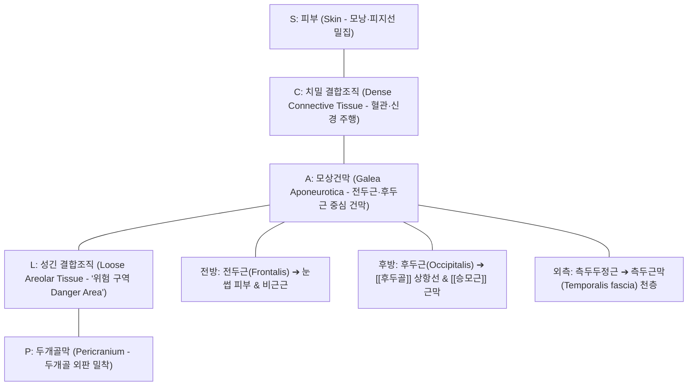

# [[모상건막]] (Galea Aponeurotica / 帽狀腱膜)

> **핵심 요약 (Key Summary)**:
> 두개골의 정수리 부위를 모자처럼 감싸며 덮고 있는 치밀하고 단단한 섬유성 결합조직 널힘줄(Aponeurosis) 시트.
> 전방의 전두근(Frontalis)과 후방의 후두근(Occipitalis)을 기능적으로 연결하는 후두전두근(Occipitofrontalis)의 중심 건막이며, 두피 5대 층판(SCALP)의 세 번째 층(A).
> 토마스 마이어의 표재후방선(Superficial Back Line, SBL)의 최종 종착점이자 만성 [[긴장성 두통]], 상안검하수에 따른 보상성 이마 주름, [[경추성 두통]]의 핵심 근막 병소로 두피 [[침도]] 박리술과 침구·추나 치료의 주 표적.

---

## 📌 목차
1. [해부학적 정밀 구조 및 두피 층판 (SCALP Anatomy)](#1-해부학적-정밀-구조-및-두피-층판-scalp-anatomy)
2. [생체역학·관절학적 운동성 (Biomechanics & Kinematics)](#2-생체역학관절학적-운동성-biomechanics--kinematics)
3. [임상 평가 및 이학적 검사 (Examination & Palpation)](#3-임상-평가-및-이학적-검사-examination--palpation)
4. [영상의학 및 초음파 해부학 (Radiology & Sonoanatomy)](#4-영상의학-및-초음파-해부학-radiology--sonoanatomy)
5. [⭐ 원장님 심층 임상 고찰 및 원본 필기 (Clinical Pearls)](#5--원장님-심층-임상-고찰-및-원본-필기-clinical-pearls)
6. [관련 임상 질환 및 손상 (Pathology & Fractures)](#6-관련-임상-질환-및-손상-pathology--fractures)
7. [추나·도수치료 & 침구·약침·재활 프로토콜](#7-추나도수치료--침구약침재활-프로토콜)
8. [출처 및 학술 참고 문헌 (References)](#8-출처-및-학술-참고-문헌-references)

---

## 1. 해부학적 정밀 구조 및 두피 층판 (SCALP Anatomy)

* **두피 5대 층판(SCALP) 구조에서의 위상**:
  * **S (Skin)**: 모낭, 땀샘, 피지선이 가장 조밀하게 발달한 두꺼운 외피층.
  * **C (Connective tissue)**: 피하 지방 및 단단한 콜라겐 지주대로 형성되어 있으며, 천측두동맥 및 [[후두동맥]] 등의 주요 혈관과 신경이 주행하여 열상 시 혈관 수축이 제한되어 출혈량이 큼.
  * **A (Aponeurosis - 모상건막)**: 두피의 기계적 인장력을 담당하는 두텁고 질긴 건막판. 전두근과 후두근 사이를 견고하게 가교(Bridge).
  * **L (Loose connective tissue)**: 성긴 소포성 결합조직 층으로, 모상건막이 두개골 위에서 미끄러지듯 움직일 수 있는 가동성을 제공. 혈종이나 감염이 두개골 봉합선을 넘어 안와 및 후두부로 쉽게 확산되는 '위험 구역(Danger area)'.
  * **P (Pericranium)**: 두개골 외판 표면을 덮는 치밀 골막.
* **근육 부착 및 주행 연계**:
  * **전방**: 전두근(Frontalis)과 직접 연결되어 안와 상연(Supraorbital margin)과 눈썹 피부로 이어짐.
  * **후방**: 후두근(Occipitalis)과 융합하여 [[후두골]]의 상항선(Superior nuchal line) 및 외후두융기(EOP)에 정지하며, [[항인대]] 및 [[승모근]] 기시부 건막과 연결.
  * **외측**: 얇아지면서 측두근(Temporalis)을 덮는 측두근막 천층으로 이어져 관골궁(Zygomatic arch)에 부착.

---

## 2. 생체역학·관절학적 운동성 (Biomechanics & Kinematics)

* **두경부 근막 긴장 전달축 (Epicranial Tension Sling)**:
  * 모상건막은 전방의 표정근(전두근, 추미근)과 후방의 척추 신근군([[승모근]], [[두판상근]], [[후두하근]]) 사이에서 장력을 양방향으로 전달하는 도르래(Pulley) 역할을 수행.
  * 후두부 근육이 긴장하면 후두근이 모상건막을 뒤로 당기고, 이에 대항하여 전두근이 수축하면서 두개골 전체를 조이는 원주형 압박 장력(Circumferential compressive hoop stress) 형성.
* **표재후방선 (Superficial Back Line, SBL) 종착지**:
  * 족저근막에서 시작하여 비복근, [[슬괵근]], 천결절인대, [[척추기립근]], 후두하근을 거쳐 올라온 전신 후방 장력 사슬이 모상건막을 통과하여 안와상능(Supraorbital ridge)에서 최종 고정.
  * 허리나 종아리의 만성 단축이 모상건막을 거쳐 눈의 피로와 이마의 뻐근한 두통으로 나타나는 생체역학적 기저.

---

## 3. 임상 평가 및 이학적 검사 (Examination & Palpation)

* **모상건막 가동성 검사 (Galea Mobility Test)**:
  * 검사자의 양 손가락 바닥으로 환자의 두피를 두개골에 밀착시킨 상태에서 전후, 좌우, 회전 방향으로 두피를 미끄러뜨려 활주도(Glide) 평가.
  * **양성 소견**: 두피가 두개골에 딱 달라붙어 전혀 움직이지 않는 유착 상태(Adhesion), 정수리 정중선 부위의 심한 팽팽함.
* **압통점 촉진 (Trigger Point Palpation)**:
  * 관상봉합(Coronal suture) 인접 전두근 연접부, 시상봉합(Sagittal suture) 정중앙(백회혈 부위), 람다봉합(Lambdoid suture) 후두근 연접부를 엄지손가락으로 압박 시 날카로운 방사통 유발 확인.
* **안검하수 보상 징후 (Frontalis Compensation Sign)**:
  * 눈을 뜰 때 눈꺼풀 올림근 대신 눈썹을 치켜올리며 모상건막을 과도하게 수축시켜 깊은 수평 이마 주름이 형성되는지 관찰.

---

## 4. 영상의학 및 초음파 해부학 (Radiology & Sonoanatomy)

* **초음파 스캔 (High-Frequency Ultrasound)**:
  * 15~18 MHz 고주파 선형 탐촉자를 두정부에 거치 시, 고에코의 피부선 아래 얇은 저에코 피하지방층, 그 밑으로 균일하고 얇은 선상 고에코 띠로 관찰되는 모상건막 식별.
  * 모상건막 아래의 무에코/저에코 성긴 결합조직 층과 하부의 밝은 고에코 두개골 외판 랜드마크 확인.
* **모상건막하 혈종 (Subgaleal Hematoma) 영상 소견**:
  * 두부 외상 시 성긴 결합조직 층 내부로 출혈이 발생하면, 골막하 혈종(Cephalohematoma)과 달리 두개골 봉합선(Suture line)의 제한을 받지 않고 두개골 전체로 광범위하게 퍼지는 파동성 액체 저류 소견 관찰.

---

## 5. ⭐ 원장님 심층 임상 고찰 및 원본 필기 (Clinical Pearls)

* **"머리에 철모를 쓴 것처럼 조여요"는 100% 모상건막 유착이다**:
  * 환자가 비박동성으로 머리 전체가 묵직하게 조이고 맑지 않다고 호소하는 [[긴장성 두통]]의 실체는 뇌혈관 문제가 아니라 모상건막이 성긴 결합조직 층에서 미끄러지지 못하고 두개골에 들러붙은 '근막 유착(Fascial tethering)'입니다. 후두근과 전두근 부착부를 풀어주고 백회혈 주위의 모상건막을 뜯어내듯 도수 분리해주면 환자가 즉시 머리가 환해진다고 표현합니다.
* **이마 주름을 없애려면 목 뒤 후두골을 풀어라**:
  * 이마에 굵은 주름이 깊게 파인 환자들에게 보톡스만 놓으면 눈꺼풀이 무거워지는 부작용이 생깁니다. 근본 원인은 뒷목의 [[두판상근]]과 후두하근이 단축되어 모상건막을 뒤로 당기므로, 눈을 뜨기 위해 전두근이 과보상 수축을 하기 때문입니다. 후두부 상항선 부착부를 자침하고 이완시켜 주면 이마의 주름과 긴장감이 자연스럽게 펴집니다.
* **두피 침도(Acupotomy) 박리술의 안전한 층(Plane)**:
  * 정수리 부위(백회, 사신총)에 소침도를 시술할 때는 바늘을 두개골 표면에 수직으로 찌르면 안 됩니다. 15~30도 사각으로 비스듬히 눕혀 자입한 후 두개골 외판에 끝이 닿는 것을 느끼며, 모상건막과 골막 사이의 성긴 결합조직 층(위험 구역이지만 골막 바로 위)을 따라 수평으로 긁어내듯(Horizontal scraping) 유착을 박리해야 신경혈관 손상 없이 안전하게 감압됩니다.

---

## 6. 관련 임상 질환 및 손상 (Pathology & Fractures)

| 질환 및 손상 유형 | 주요 병태생리 기전 | 임상 소견 및 특징 |
| :--- | :--- | :--- |
| 만성 [[긴장성 두통]] (TTH) | 모상건막 및 후두전두근의 지속적 등척성 수축 및 허혈 | 머리 전체를 띠로 두른 듯한 압박통, 오후 악화 |
| 모상건막하 혈종 (Subgaleal Hematoma) | 두피 견인 외상 시 유도 정맥(Emissary vein) 파열 | 두개골 봉합선을 넘어 안와 및 후두부로 퍼지는 거대 부종 |
| [[경추성 두통]] 연관통 | 상부 경추 신경근 병변이 후두근을 거쳐 모상건막으로 전이 | 후두부에서 정수리, 안구 뒤쪽으로 뻗치는 편측성 두통 |
| 두피 근막통증증후군 | 장시간 모니터 주시로 인한 전두근-모상건막 트리거 포인트 | 눈썹 위 찌릿한 통증, 눈의 피로, 눈꺼풀 무거움 |
| 상안검하수 보상성 이마 주름 | 눈꺼풀올림근 약화로 모상건막-전두근 과도 견인 | 이마 깊은 수평 주름, 잦은 이마 피로감 및 두통 |

---

## 7. 추나·도수치료 & 침구·약침·재활 프로토콜

### 1) 한의 추나 및 두개근막 이완 도수기법
* **두피 모상건막 롤링 및 활주 기법 (Galea Skin Rolling)**:
  * 검사자의 양 엄지와 시지로 환자의 정수리 두피를 집어 올리듯(Skin rolling) 쥐고 전후좌우로 밀어주며 골막과의 유착 박리.
* **전두-후두 근막 균형 추나 (Occipito-Frontal Balancing)**:
  * 한 손은 전두골, 다른 손은 후두골을 접촉하고 두 손을 반대 방향으로 교차 신장(Cross-hand stretch)하여 모상건막 장력 이완.

### 2) 침구, 침도 및 약침 치료
* **핵심 혈위 자침**:
  * 백회(GV20), 사신총(EX-HN1): 모상건막 정중앙 정점의 긴장 완화 및 뇌혈류 촉진.
  * 두유(ST8), 태양(EX-HN5): 모상건막 외측 측두근막 이행부 이완.
  * 뇌호(GV17), 옥침(BL9): 후두근-모상건막 후방 연접부 감압.
* **침도 치료 (Acupotomy)**:
  * 백회 및 사신총 부위에서 두개골막 위 성긴 결합조직 층으로 소침도를 평자(Flat insertion)하여 섬유성 결합 띠 절개 박리.
* **약침 처방**:
  * **[[신바로약침]] / [[황련해독탕약침]]**: 모상건막 하층에 각 0.1~0.2cc씩 미량 분주하여 근막 염증 및 혈관 운동성 허혈 개선.

### 3) 일상생활 재활 및 자가 근막 이완
* **두피 브러싱 및 셀프 마사지**:
  * 끝이 둥근 우드 브러시로 전두부에서 후두부 방향으로 가볍게 빗어주며 모상건막 미세순환 자극.
* **후두하근 스트레칭**:
  * 턱을 당기는 친턱(Chin-tuck) 운동으로 표재후방선의 기저 긴장 완화.

---

## 8. 출처 및 학술 참고 문헌 (References)

1. **Cao Z, et al. (2026)**. Grid Galeal Scoring Technique in Multifocal Calvarial Scalp Reconstruction: Anatomic Basis and Preliminary Clinical Case Applications. *J Craniofac Surg*. PMID: 41705715.
   - `[연구 요약]` 모상건막(Galea) 절개 격자술의 해부학적 인장력 완화 기전과 다발성 두개관 두피 결손 재건 시의 임상적 유용성 분석.
2. **Vural Y, et al. (2026)**. Two-Staged Cranial Reconstruction: Tissue Expansion, Galeocapsular Flaps, and CAD/CAM Three-Dimensional Titanium Implants. *J Craniofac Surg*. PMID: 42257381.
   - `[연구 요약]` 두개골 재건술에서 모상건막(Galea) 판막의 혈류 공급 특성 및 두피 결합조직 층판의 기계적 인장 강도 보존 연구.
