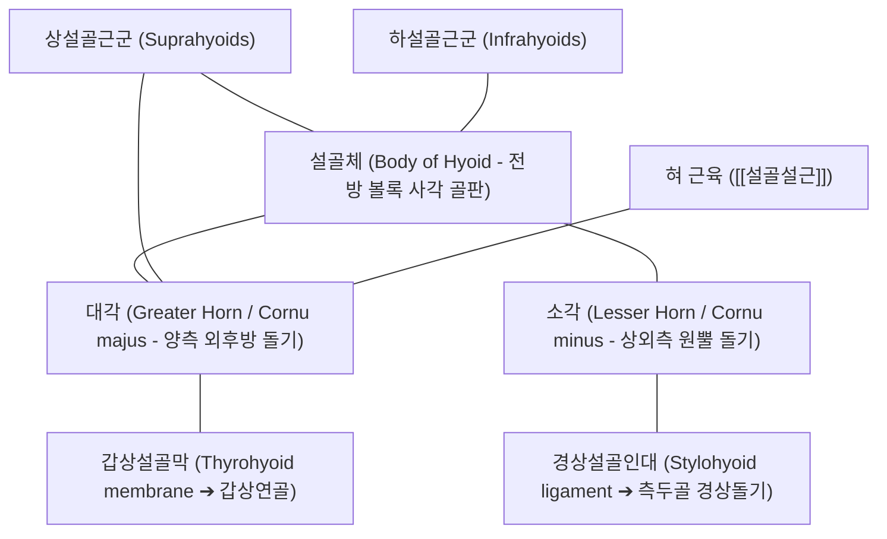

# [[설골]] (Hyoid Bone / 舌骨 / 목뿔뼈)

> **핵심 요약 (Key Summary)**:
> 경추 제3번(C3) 높이의 전경부에 위치하며 다른 어떤 골격과도 직접 관절하지 않고 인대와 근육으로만 매달려 부유하는 말발굽(U자) 형태의 독립된 '부유골(Floating bone)'.
> 상설골근군([[이복근]], [[경상설골근]], [[하악설골근]], [[이설골근]])과 하설골근군([[흉골설골근]], [[견갑설골근]], [[갑상설골근]])이 부착되어 [[하악골]], 후두, 흉골, 견갑골을 기능적으로 연결하고 연하(삼킴)·발성·기도 확보의 중심 지레 역할 수행.
> [[거북목 증후군]](FHP) 및 하악 후퇴 시 설골의 후하방 변위로 기도 협착 및 폐쇄성 수면무호흡증(OSA), 한의학적 매핵기(梅核氣)를 유발하며 전경부 근막이완 및 추나 교정의 핵심 기준점.

---

## 📌 목차
1. [해부학적 정밀 구조 및 골성 랜드마크 (Anatomy & Landmarks)](#1-해부학적-정밀-구조-및-골성-랜드마크-anatomy--landmarks)
2. [생체역학·관절학적 운동성 (Biomechanics & Kinematics)](#2-생체역학관절학적-운동성-biomechanics--kinematics)
3. [임상 평가 및 이학적 검사 (Examination & Palpation)](#3-임상-평가-및-이학적-검사-examination--palpation)
4. [영상의학 및 초음파 해부학 (Radiology & Sonoanatomy)](#4-영상의학-및-초음파-해부학-radiology--sonoanatomy)
5. [⭐ 원장님 심층 임상 고찰 및 원본 필기 (Clinical Pearls)](#5--원장님-심층-임상-고찰-및-원본-필기-clinical-pearls)
6. [관련 임상 질환 및 손상 (Pathology & Fractures)](#6-관련-임상-질환-및-손상-pathology--fractures)
7. [추나·도수치료 & 침구·약침·재활 프로토콜](#7-추나도수치료--침구약침재활-프로토콜)
8. [출처 및 학술 참고 문헌 (References)](#8-출처-및-학술-참고-문헌-references)

---

## 1. 해부학적 정밀 구조 및 골성 랜드마크 (Anatomy & Landmarks)

* **골격적 고유 특성**:
  * 인체에서 유일하게 다른 뼈와의 관절면(Articular facet)이 전혀 없는 독립된 '부유골(Floating bone)'.
  * [[하악골]] 아래, 갑상연골(후두) 위쪽의 제3경추(C3) 수평 높이에 위치하며, 인대와 10쌍 이상의 근육군에 의해 현수(Suspension)되어 있음.
* **3대 구성 골성 구조**:
  * **설골체 (Body of hyoid)**: 전방을 향하는 사각형 판 모양의 중앙부로, 전면은 볼록하고 설하근육들이 조밀하게 부착.
  * **대각 (Greater horn / Cornu majus)**: 설골체 양측에서 외후방으로 길게 뻗은 돌기로, 후두의 갑상연골과 갑상설골막(Thyrohyoid membrane)으로 연결됨.
  * **소각 (Lesser horn / Cornu minus)**: 설골체와 대각 연결부 상외측으로 솟아 있는 작은 원뿔형 돌기로, 경상설골인대(Stylohyoid ligament)가 부착하여 측두골 경상돌기(Styloid process)와 연결됨.

---

## 2. 생체역학·관절학적 운동성 (Biomechanics & Kinematics)

* **상하설골근의 3차원 힘 균형 (Tension Equilibrium)**:
  * **상설골근군 (Suprahyoids)**: [[이복근]](Digastric), [[경상설골근]](Stylohyoid), [[하악설골근]](Mylohyoid), [[이설골근]](Geniohyoid)이 상방 및 전방으로 견인.
  * **하설골근군 (Infrahyoids)**: [[흉골설골근]](Sternohyoid), [[견갑설골근]](Omohyoid), [[갑상설골근]](Thyrohyoid)이 하방 및 후방으로 견인.
* **연하(Swallowing) 작용 시 동적 궤적**:
  * 음식물을 삼킬 때 설골은 전상방(Anterosuperior)으로 약 15~20mm 급격히 거상됨.
  * 설골의 거상은 후두를 위로 끌어올리고 후두개(Epiglottis)가 기도를 덮도록 유도하여 음식물의 기도 흡인(Aspiration)을 방지하고 상부식도괄약근(UES)을 개방.
* **두경부 정렬과 기도 직경의 상관성**:
  * 경추가 앞으로 꺾이는 [[거북목 증후군]](FHP) 발생 시 하설골근군이 과신장 긴장되어 설골을 후하방(Posteroinferior)으로 강하게 끌어당김.
  * 설골이 뒤로 당겨지면 혀뿌리(설근)가 인두 후벽으로 밀착되어 기도(Pharyngeal airway)를 직접 압박·폐쇄.

---

## 3. 임상 평가 및 이학적 검사 (Examination & Palpation)

* **설골 위치 및 좌우 대칭성 촉진**:
  * 환자를 좌위로 두고 목의 힘을 뺀 상태에서 검사자의 엄지와 시지로 갑상연골 바로 상방(C3 레벨)의 설골 대각 양끝을 가볍게 파지.
  * 정중선에서의 편위(Lateral deviation), 상하 위치 이상, 전후방 고정 여부 평가.
* **설골 측방 글라이딩 검사 (Hyoid Side-Glide Test)**:
  * 설골 대각을 쥐고 좌우로 부드럽게 밀어보았을 때 한쪽으로의 이동 제한(Restriction) 및 특유의 날카로운 걸림통 확인.
* **연하 장애 및 설골 거상 평가**:
  * 환자에게 침을 삼키도록 지시하고 설골이 부드럽게 전상방으로 올라갔다 내려오는지 동적 촉진. 거상 폭이 작거나 지연될 경우 연하 곤란 평가.

---

## 4. 영상의학 및 초음파 해부학 (Radiology & Sonoanatomy)

* **경추 단순 방사선 (Cervical Spine X-ray Lateral View)**:
  * 측면상에서 C3 척추체 전방에 위치하는 U자형 골성 음영 확인.
  * **Hyoid-to-C3/C4 거리 및 하악 평면간 거리(MP-H distance)** 계측: 수면무호흡증 환자에서 MP-H 거리가 15~20mm 이상으로 현저히 증가.
* **전경부 초음파 스캔 (High-Frequency Ultrasound)**:
  * 탐촉자를 전경부 횡단으로 거치 시, 설골체는 둥근 아치형의 밝은 고에코 외판 음영과 후방 음향 음영(Acoustic shadow)으로 뚜렷하게 관찰됨.
  * 상부의 하악설골근, 이설골근 및 설골하근의 두께와 동적 연하 운동을 실시간 평가.

---

## 5. ⭐ 원장님 심층 임상 고찰 및 원본 필기 (Clinical Pearls)

* **목에 걸린 매실 씨앗, '매핵기(梅核氣)'의 실체는 설골 결손 긴장이다**:
  * 이비인후과에서 내시경을 봐도 아무 이상이 없는데 "목구멍에 가래나 솜뭉치가 걸려 뱉어지지도 않고 삼켜지지도 않는다"고 호소하는 만성 매핵기 환자들은 십중팔구 설골이 후하방으로 단단히 굳어 있습니다. 스트레스로 교감신경이 흥분하고 전경부 근막([[흉골설골근]], [[갑상설골근]])이 경직되어 설골을 옥죄는 것입니다. 설골을 좌우로 흔들어주고 염천혈을 자침하면 즉시 목구멍이 뻥 뚫리는 해방감을 느낍니다.
* **코골이와 수면무호흡증을 치료하려면 설골을 올려야 한다**:
  * 거북목이 심한 환자들의 수면무호흡증은 비강 문제보다 설골의 후하방 처짐 때문입니다. 앙와위로 누우면 중력에 의해 혀뿌리가 기도를 막아 숨이 멎습니다. 상부 경추 전만을 회복시키고 설골상근 강화 및 설골 가동술을 통해 설골의 기저 위치를 전상방으로 복원시켜야 기도가 물리적으로 확보됩니다.
* **설골 골절(Hyoid Fracture)의 법의학적 및 응급 의학적 의의**:
  * 설골은 질긴 근육에 싸여 있어 일상적 낙상으로는 거의 부러지지 않습니다. 경부 압박 외상(교살, 안전벨트 경부 충돌) 시 대각 부위의 골절이 호발하며, 골절편이 인두벽을 찔러 기도 폐색 및 대출혈을 유발할 수 있으므로 연하통과 객혈이 동반된 외상 환자는 즉시 응급 전원해야 합니다.

---

## 6. 관련 임상 질환 및 손상 (Pathology & Fractures)

| 질환 및 병태 | 발생 기전 및 병리 | 임상 소견 및 감별점 |
| :--- | :--- | :--- |
| 폐쇄성 수면무호흡증 (OSA) | 거북목 및 하악 후퇴로 인한 설골 후하방 변위, 기도 협착 | 심한 코골이, 주간 졸림증, 수면 중 무호흡 |
| 매핵기 (梅核氣 / Globus Pharyngeus) | 스트레스 및 칠정 울결에 따른 설골 주위 근막 경직 | 목 안 이물감, 연하 곤란감, 건초감 |
| 설골 증후군 (Hyoid Syndrome) | 경상설골인대 석회화(Eagle 증후군) 또는 설골 대각 부착부염 | 고개 돌릴 때 인두통, 하악골 및 이개 방사통 |
| 설골 골절 (Hyoid Bone Fracture) | 경부의 직접적인 교살 외상 또는 고에너지 둔상 | 심한 인두통, 연하 곤란, 연발음, 기도 폐색 위험 |
| 턱관절 장애 연계성 경부통 | 하악-설골 기능 사슬 불균형으로 인한 이복근 연쇄 단축 | 개구 장애, 턱관절 소리, 전경부 뻐근함 |

---

## 7. 추나·도수치료 & 침구·약침·재활 프로토콜

### 1) 한의 추나 및 설골 가동술 (Hyoid Mobilization)
* **설골 측방 활주 기법 (Side-to-Side Glide)**:
  * 환자를 앙와위로 눕히고 양손 엄지와 검지로 설골 대각을 부드럽게 쥐고 좌우로 10~20회 부드럽게 글라이딩시켜 인대 유착 이완.
* **전경부 근막 이완술 (Anterior Cervical MFR)**:
  * 쇄골과 흉골병 상연을 하방으로 고정하고 하악골을 거상시키며 설골상하근군을 신장.

### 2) 침구 및 약침 복합 치료
* **핵심 혈위 자침**:
  * 염천(CV23): 설골체 상연 중앙 함요처 자침으로 설하근 긴장 완화 및 연하 기능 촉진.
  * 천돌(CV22): 흉골병 상연 함요처로 하설골근의 하방 견인력 해소.
  * 인영(ST9), 수돌(ST10): 갑상설골막 및 경동맥초 인접 근막 이완.
* **약침 처방**:
  * **[[신바로약침]] / [[자하거약침]]**: 설골 대각 부착부 및 염천혈 심부에 0.3~0.5cc 분주하여 만성 부착부염 완화 및 신경 연하 반사 정상화.

### 3) 혀 근육 및 연하 기능 재활 운동
* **설골 거상 훈련 (Mendelsohn Maneuver)**:
  * 침을 삼킬 때 설골이 가장 높이 올라간 상태에서 목 근육에 힘을 주어 2~3초간 정지 후 천천히 이완.
* **설근 밀기 운동 (Tongue-to-Palate Press)**:
  * 혀끝을 입천장에 강하게 밀착시키는 저항 운동으로 설골상근([[이설골근]], [[하악설골근]]) 강화.

---

## 8. 출처 및 학술 참고 문헌 (References)

1. **Cox CMM, et al. (2026)**. Anatomical reorganisation channels the emergence of the infant vocal repertoire. *Infant Behav Dev*. 85():102253. PMID: 42815114.
   - `[연구 요약]` 설골의 발생학적 하강과 후두의 분리 및 두경부 골격근 재조직화가 인간 발성 기능과 기도 개방성에 미치는 해부학적 기전 분석.
2. **Feng X, et al. (2014)**. The hyoid bone position in patients with obstructive sleep apnea: a systematic review and meta-analysis. *Sleep Breath*. 18(3):477-485. PMID: 24705574.
   - `[연구 요약]` 폐쇄성 수면무호흡증(OSA) 환자군에서 정상 대조군에 비해 설골이 하방 및 후방으로 유의하게 변위되어 있음을 입증한 메타분석.
