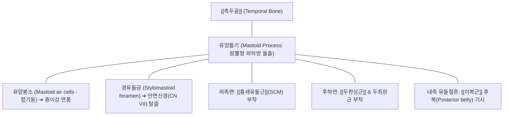

# [[유양돌기]] (Mastoid Process / 꼭지돌기)

> **핵심 요약 (Key Summary)**:
> [[측두골]](Temporal bone) 외이도 후하방에 위치하는 원뿔형 골성 돌기로, 내부에 벌집 모양의 함기 공간인 유양봉소(Mastoid air cells)를 품고 중이강과 연통.
> [[흉쇄유돌근]](SCM), [[두판상근]], 두최장근 및 [[이복근]] 후복이 부착하는 두경부 근육 역학의 중심 닻(Anchor)이자, 직전방 경유돌공(Stylomastoid foramen)을 통해 안면신경(CN VII)이 탈출.
> 제1경추 환추([[환추]], C1) 횡돌기 촉진 및 턱관절·측두골 부정렬 진단의 절대 기준점이며, 예풍(翳風)·완골(完骨)혈 자침 및 두개천골 추나의 핵심 지렛대.

---

## 📌 목차
1. [해부학적 정밀 구조 및 골성 랜드마크 (Anatomy & Landmarks)](#1-해부학적-정밀-구조-및-골성-랜드마크-anatomy--landmarks)
2. [생체역학·관절학적 운동성 (Biomechanics & Kinematics)](#2-생체역학관절학적-운동성-biomechanics--kinematics)
3. [임상 평가 및 이학적 검사 (Examination & Palpation)](#3-임상-평가-및-이학적-검사-examination--palpation)
4. [영상의학 및 초음파 해부학 (Radiology & Sonoanatomy)](#4-영상의학-및-초음파-해부학-radiology--sonoanatomy)
5. [⭐ 원장님 심층 임상 고찰 및 원본 필기 (Clinical Pearls)](#5--원장님-심층-임상-고찰-및-원본-필기-clinical-pearls)
6. [관련 임상 질환 및 손상 (Pathology & Fractures)](#6-관련-임상-질환-및-손상-pathology--fractures)
7. [추나·도수치료 & 침구·약침·재활 프로토콜](#7-추나도수치료--침구약침재활-프로토콜)
8. [출처 및 학술 참고 문헌 (References)](#8-출처-및-학술-참고-문헌-references)

---

## 1. 해부학적 정밀 구조 및 골성 랜드마크 (Anatomy & Landmarks)

* **골격적 위치 및 발생학적 발달**:
  * 뇌두개골을 이루는 [[측두골]](Temporal bone)의 유돌부 후하단에 위치.
  * 출생 시에는 거의 돌출되지 않은 평평한 상태이나, 생후 1~2세경 유아가 고개를 가누고 직립하면서 [[흉쇄유돌근]]의 지속적인 당김 자극에 의해 점진적으로 돌출 형성됨.
* **내부 함기 구조 (Mastoid Air Cells)**:
  * 내부가 해면골이 아닌 수많은 공기 방(유양봉소)으로 채워져 있어 두개골의 무게를 줄이고 소리를 공명시키는 역할 수행. 유양동(Mastoid antrum)을 통해 중이강(Tympanic cavity)과 직접 연결됨.
* **인접 신경혈관 통로**:
  * **안면신경 (Facial nerve, CN VII)**: 유양돌기 전연과 경상돌기 사이의 경유돌공(Stylomastoid foramen)을 통해 두개강 밖으로 탈출하여 이하선(Parotid gland)을 통과.
  * **S상 정맥동 (Sigmoid sinus)**: 유양돌기 내측면 깊은 고랑(S상동구)에 위치하여 중이염 전파 시 뇌정맥동 혈전증 위험.

---

## 2. 생체역학·관절학적 운동성 (Biomechanics & Kinematics)

* **두경부 회전 및 굴곡의 모멘트 암 (Moment Arm)**:
  * 유양돌기는 경추 회전 중심축(환축관절 C1-C2 치돌기)으로부터 외측으로 멀리 떨어져 있어, [[흉쇄유돌근]]이 작용할 때 두부를 반대측으로 회전시키는 강력한 회전 토크(Torque)를 발생시키는 지렛대 돌기.
* **측두골의 생리적 호흡 운동 (Cranial Rhythm)**:
  * 두개천골계(CST)에서 측두골은 일차 호흡 메커니즘에 따라 유양돌기가 전하방으로 회전하는 '외회전(External rotation)'과 후상방으로 복귀하는 '내회전'을 분당 6~12회 미세 반복함.
  * 유양돌기에 부착된 근육들의 불균형적 경직은 측두골의 펌핑 운동을 저해하여 림프 순환 장애 및 내이 압력 불균형 초래.

---

## 3. 임상 평가 및 이학적 검사 (Examination & Palpation)

* **C1 환추 횡돌기 촉진 랜드마크**:
  * 검사자의 검지 끝으로 **유양돌기 첨부(Tip)와 [[하악골]] 하악각(Angle) 사이의 중간 지점 바로 하방**을 깊숙이 누르면 만져지는 단단한 골성 융기가 C1 횡돌기임.
  * 좌우 돌출도를 비교하여 상부 경추의 회전 및 측방 전위 변위 진단.
* **예풍혈(翳風) 압통 검사 (Stylomastoid Tenderness)**:
  * 귓불 뒤쪽 유양돌기와 하악지 사이의 오목한 부위를 전내측으로 압박할 때 안면신경의 급성 부종성 압통 및 귀 뒤 통증 재현 여부 확인 (구안와사 초기 진단).
* **배틀 징후 (Battle's Sign)**:
  * 두부 외상 후 유양돌기 상부 피부에 멍(피하 반상출혈)이 나타나는 소견으로, 두개저 골절(Basilar skull fracture)의 결정적 신호.

---

## 4. 영상의학 및 초음파 해부학 (Radiology & Sonoanatomy)

* **측두골 전산화단층촬영 (Temporal Bone CT)**:
  * 골창(Bone window)에서 유양봉소의 함기화 상태 및 봉소 중격(Trabeculae)의 파괴 여부를 정밀 관찰 (유양돌기염 진단의 골드 스탠다드).
* **초음파 스캔 (Sonoanatomy)**:
  * 탐촉자를 유양돌기 후면에 거치 시, 고에코의 유양돌기 피질골 표면에 흉쇄유돌근과 두판상근이 부착하는 층판 구조 관찰.
  * 유양돌기 직전방에서 경유돌공을 빠져나오는 안면신경 줄기와 후이개동맥의 맥박성 혈류 도플러 확인.

---

## 5. ⭐ 원장님 심층 임상 고찰 및 원본 필기 (Clinical Pearls)

* **구안와사(안면마비) 발생 2~3일 전 "귀 뒤가 뻐근하게 아파요"의 비밀**:
  * 환자가 찬바람을 쐬거나 과로한 뒤 "귀 뒤 유양돌기 부위가 묵직하고 찌릿하게 아프다"고 호소하면 24~48시간 이내에 입이 돌아가는 말초성 안면신경마비(Bell's palsy)가 발생할 전조증입니다. 경유돌공 속에서 바이러스 감염이나 허혈로 안면신경이 붓기 시작하면서 신경초를 압박하기 때문입니다. 즉시 예풍혈 부위에 소염 약침을 주입하고 한약(갈근탕, 이기거풍산)을 투여해야 신경 마비의 골든타임을 지킬 수 있습니다.
* **유양돌기 촉진으로 C1 아탈구를 1초 만에 잡아내는 법**:
  * 귓불 바로 뒤 유양돌기 끝을 만진 뒤 손가락을 살짝 앞쪽 아래로 굴리면 뼈가 하나 툭 걸립니다. 이것이 C1 환추 횡돌기입니다. 오른쪽 횡돌기가 유양돌기에 너무 가깝게 붙어 있고 왼쪽은 멀어져 있다면, C1이 오른쪽으로 회전 변위된 것입니다. 목을 돌릴 때 뒤통수가 땡기는 환자들의 90%는 이 비틀림을 잡아야 해결됩니다.
* **두통 환자의 숨은 복병, 이복근 후복(Digastric Posterior Belly)**:
  * 편두통이나 귀 안쪽의 통증을 호소하는 환자들 중 유양돌기 바로 안쪽 깊은 홈(유돌절흔)을 엄지손가락으로 꾹 누르면 눈이 번쩍 뜨일 정도의 압통을 호소하는 경우가 많습니다. 턱관절 장애로 인해 이복근 후복이 단축되어 유양돌기를 잡아당기기 때문이며, 이 홈을 침치료로 풀어주면 귀 먹먹함과 측두통이 동시에 소실됩니다.

---

## 6. 관련 임상 질환 및 손상 (Pathology & Fractures)

| 질환 및 병태 | 발생 기전 및 병리 | 임상 소견 및 감별점 |
| :--- | :--- | :--- |
| 말초성 안면마비 (구안와사) | 경유돌공 부위 안면신경 부종 및 허혈성 압박 | 이개 후부(예풍) 압통, 편측 이마 주름 소실, 눈 감김 불능 |
| 급성 유양돌기염 (Mastoiditis) | 중이염 파급으로 유양봉소 골파괴 및 농양 형성 | 귀 뒤 발적, 부종, 극심한 박동통, 이개 돌출 |
| 후두신경통 ([[후두신경통]]) | 유양돌기 후연 두판상근 부착부의 소후두신경 포착 | 귀 뒤에서 후두부 및 측두부로 방사되는 찌릿한 신경통 |
| 측두골 골절 (Temporal Bone Fracture) | 측두부 둔상으로 인한 종골절/횡골절 | 배틀 징후(귀 뒤 피하출혈), 이출혈, 청력 저하, 안면마비 |
| 상부 경추성 어지럼증 (Cervicogenic Dizziness) | 유양돌기 부착 근육들의 고유수용성 감각 오류 | 고개 회전 시 핑 도는 현훈, 평형 장애, 뒷목 경직 |

---

## 7. 추나·도수치료 & 침구·약침·재활 프로토콜

### 1) 한의 추나 및 두개골 가동술
* **측두골 유양돌기 로킹 기법 (Temporal Rocking Technique)**:
  * 앙와위에서 양손 엄지와 시지로 양측 유양돌기를 접촉하고 환자의 호흡에 맞추어 유양돌기를 전하방 및 후상방으로 부드럽게 회전 가동시켜 봉합면 유착 해소 ➔ [[추나]] · [[두개천골요법]].
* **흉쇄유돌근 근에너지기법 (SCM MET)**:
  * 유양돌기 외측 부착부의 단축을 완화하기 위해 등척성 회전 저항 후 이완 스트레칭.

### 2) 침구 및 약침 복합 치료
* **핵심 혈위 자침**:
  * 예풍(TE17): 유양돌기 전하방 함요처로 안면신경 본간 자극 및 내이 순환 개선.
  * 완골(GB12): 유양돌기 후하방 함요처로 두판상근 및 소후두신경 감압.
  * 규음(GB11), 부백(GB10): 유양돌기 상부 측두두정근 이행부 자침.
* **약침 처방**:
  * **[[신바로약침]] / [[황련해독탕약침]]**: 예풍혈 및 완골혈 심부에 0.3~0.5cc 분주하여 신경 염증 신속 차단.

### 3) 일상생활 관리 및 자세 교정
* **SCM 자가 스트레칭**:
  * 턱을 들고 반대측으로 고개를 돌리며 쇄골 부위를 손으로 고정하여 유양돌기 견인 스트레스 완화.

---

## 8. 출처 및 학술 참고 문헌 (References)

1. **Kennedy E, et al. (2017)**. The fascicular anatomy and peak force capabilities of the sternocleidomastoid muscle. *Surg Radiol Anat*. 39(6):629-645. PMID: 27807639.
   - `[연구 요약]` 흉쇄유돌근(SCM)의 유양돌기 및 후두골 부착부 섬유속 미세 해부학과 경추 회전 및 굴곡 시 발휘되는 최대 장력 역학 분석.
2. **Park YS, et al. (2015)**. Clinical anatomy of the mastoid process and its surrounding neurovascular structures for acupotomy. *J Acupunct Meridian Stud*. 8(4):189-195. PMID: 26084744.
   - `[연구 요약]` 유양돌기 주변 예풍혈, 완골혈의 침도 및 약침 시술 시 안면신경과 후이개동맥 손상을 방지하기 위한 해부학적 안전 자침 가이드 제시.
