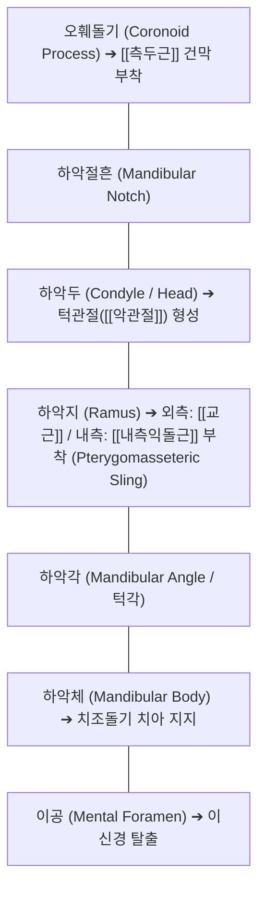

# [[하악골]] (Mandible / 아래턱뼈)

> **핵심 요약 (Key Summary)**:
> 안면 두개골 중 유일하게 가동성(Mobility)을 지닌 가장 크고 강력한 말굽 모양의 단일 골격 구조물.
> 수평의 하악체(Body)와 수직의 하악지(Ramus)로 구성되며, 상부의 하악두(Condylar process)가 측두골 하악와와 만나 턱관절([[악관절]], TMJ)을 형성.
> 4대 저작근([[교근]], [[측두근]], [[내측익돌근]], [[외측익돌근]])의 강력한 정착지이자, 하악관을 통해 하치조신경(Inferior alveolar nerve)이 주행하는 턱관절 장애(TMD), 부정교합, 안면비대칭 추나 교정의 핵심 골격.

---

## 📌 목차
1. [해부학적 정밀 구조 및 골성 랜드마크 (Anatomy & Landmarks)](#1-해부학적-정밀-구조-및-골성-랜드마크-anatomy--landmarks)
2. [생체역학·관절학적 운동성 (TMJ Kinematics & Mechanics)](#2-생체역학관절학적-운동성-tmj-kinematics--mechanics)
3. [임상 평가 및 이학적 검사 (Examination & Palpation)](#3-임상-평가-및-이학적-검사-examination--palpation)
4. [영상의학 및 초음파 해부학 (Radiology & Sonoanatomy)](#4-영상의학-및-초음파-해부학-radiology--sonoanatomy)
5. [⭐ 원장님 심층 임상 고찰 및 원본 필기 (Clinical Pearls)](#5--원장님-심층-임상-고찰-및-원본-필기-clinical-pearls)
6. [관련 임상 질환 및 손상 (Pathology & Fractures)](#6-관련-임상-질환-및-손상-pathology--fractures)
7. [추나·도수치료 & 침구·약침·재활 프로토콜](#7-추나도수치료--침구약침재활-프로토콜)
8. [출처 및 학술 참고 문헌 (References)](#8-출처-및-학술-참고-문헌-references)

---

## 1. 해부학적 정밀 구조 및 골성 랜드마크 (Anatomy & Landmarks)

* **하악골의 2대 기본 구분**:
  * **하악체 (Mandibular Body)**: 수평의 말굽형 골판으로, 상연은 치조돌기(Alveolar process)를 이루어 하악 치아들을 단단히 고정하고, 전방 중앙에 이융기(Mental protuberance)를 형성. 제2소구치 하방에 **이공(Mental foramen)**이 위치하여 이신경(Mental nerve) 통과.
  * **하악지 (Mandibular Ramus)**: 하악체 후단에서 상방으로 수직 융기하는 사각 골판.
* **상부 돌기 및 관절 구조**:
  * **하악두 (Condyle / Head)**: 타원형 관절돌기로, 측두골 하악와(Mandibular fossa) 및 관절원판(Articular disc)과 만나 TMJ 복합체 형성.
  * **오훼돌기 (Coronoid process)**: 전상방으로 뾰족하게 솟은 삼각형 돌기로, 강력한 저작근인 [[측두근]](Temporalis) 건이 부착.
  * **하악절흔 (Mandibular notch)**: 하악두와 오훼돌기 사이의 오목한 U자형 패임.
* **익돌하악근 슬링 (Pterygomasseteric Sling)**:
  * 하악각(Mandibular angle)의 외측면에는 [[교근]](Masseter)이, 내측면에는 [[내측익돌근]](Medial pterygoid)이 거치되어 하악골을 아래에서 U자형 그물침대처럼 감싸 쥐며 강력한 폐구력 발휘.
* **신경 주행 통로 (Mandibular Canal)**:
  * 하악지 내측면 중앙의 **하악공(Mandibular foramen)**을 통해 하치조신경(삼차신경 CN V3 분지)과 혈관이 진입하여 하악 치아와 턱끝 감각을 지배.

---

## 2. 생체역학·관절학적 운동성 (TMJ Kinematics & Mechanics)

* **개구(Mouth Opening)의 2단계 운동형상학 (Biphasic Kinematics)**:
  1. **초기 20~25mm (순수 회전 운동, Hinge Movement)**:
     * 하악두가 관절원판 아래의 하관절강(Lower joint compartment) 내에서 경첩처럼 제자리 후방 회전.
  2. **후기 25~45mm (전방 활주 운동, Translation Movement)**:
     * [[외측익돌근]](Lateral pterygoid) 하두가 수축하면서 하악두와 관절원판 복합체가 측두골의 관절결절(Articular eminence)을 타고 전하방으로 미끄러져 내려옴 (상관절강 운동).
* **저작 시의 레버 시스템 (Class III Lever System)**:
  * 턱관절이 받침점(Fulcrum), 저작근(교근·측두근)이 힘점(Effort), 어금니가 작용점(Load)으로 기능하여 정밀한 저작압 제어 및 하악두에 가해지는 관절면 압박력을 분산.

---

## 3. 임상 평가 및 이학적 검사 (Examination & Palpation)

* **개구량 및 궤적 검사 (Range of Motion & Deviation)**:
  * 정상 개구 범위: 환자 본인의 시지, 중지, 약지 3개 손가락을 세로로 세워 들어가는 40~50mm.
  * **편위(Deviation)**: 입을 벌릴 때 한쪽으로 지그재그로 치우쳤다가 돌아오는 현상 (관절원판 변위 시사).
  * **편향(Deflection)**: 입을 벌릴 때 끝까지 한쪽으로 돌아간 채 정복되지 않는 현상 (비정복성 관절원판 변위 / 폐구 잠김).
* **턱관절음 청진 및 촉진 (Clicking & Crepitus)**:
  * 양측 외이도 전방 하악두 외측면에 손가락을 대고 개폐구 시 딱딱거리는 클릭음(Clicking, 정복성 원판 전방 전위) 또는 바스락거리는 염발음(Crepitus, 퇴행성 골관절염) 평가.
* **저작근 촉진 (Masticatory Muscle Palpation)**:
  * 협차혈(하악각 전상방 교근), 하관혈(관골궁 하단 외측익돌근), 측두근 부착부 오훼돌기 심부 압통 평가.

---

## 4. 영상의학 및 초음파 해부학 (Radiology & Sonoanatomy)

* **파노라마 방사선 (Panoramic Radiography)**:
  * 하악골 전체의 대칭성, 하악지 높이, 하악두 형태 및 하악관(Mandibular canal)의 주행 경로 스크리닝.
* **턱관절 MRI (TMJ MRI)**:
  * 폐구위 및 개구위 시상면(Sagittal T1/T2)에서 관절원판의 전방 전위 및 형태 변형, 관절강 내 삼출액 저류 정밀 평가.
* **초음파 스캔 (High-Resolution Ultrasound)**:
  * 탐촉자를 관골궁 아래 종단 거치 시, 고에코의 하악두 피질골 표면 위를 덮고 있는 초승달 모양의 균일한 저에코 관절원판과 외측익돌근의 동적 활주 관찰.

---

## 5. ⭐ 원장님 심층 임상 고찰 및 원본 필기 (Clinical Pearls)

* **턱관절 환자의 90%는 '외측익돌근 경직'을 풀어야 낫는다**:
  * 턱에서 소리가 나고 입이 안 벌어지는 [[악관절]] 장애(TMD)의 주범은 교근보다 하악두 전면에 붙는 [[외측익돌근]](Lateral pterygoid)입니다. 스트레스를 받거나 이를 악물면 외측익돌근 상두가 과도하게 수축하여 관절원판을 앞쪽으로 영구 견인해버립니다. 관골궁 아래 하관혈 부위로 침을 깊이 찔러 외측익돌근을 직접 이완시키면 거짓말처럼 개구 범위가 10mm 이상 즉각 증가합니다.
* **하악골 편위와 골반 비틀림의 상관고리(Lovett Reactor)**:
  * 턱이 오른쪽으로 틀어져 부정교합이 있는 환자는 경추 1-2번뿐만 아니라 반대쪽 장골과 골반까지 함께 회전되어 있습니다. 하악골은 전신 척추의 균형을 감지하는 가장 예민한 고유수용성 자이로스코프이기 때문입니다. 턱관절 추나 교정을 골반 교정과 반드시 병행해야 교정 상태가 유지됩니다.
* **하치조신경(IAN) 손상 환자의 입술 감각 마비 감별**:
  * 사랑니 발치나 하악 골절 후 아랫입술과 턱끝이 남의 살처럼 둔하다고 호소할 때, 표정근 마비(구안와사)인지 감각신경 손상인지 구별해야 합니다. 웃을 때 입꼬리가 정상적으로 올라간다면 운동신경인 안면신경은 무사하고 삼차신경 분지인 하치조신경-이신경 손상입니다. 이공 부위 침치료와 한약(보양환오탕) 처방으로 미세혈류를 개선하면 신경 재생이 촉진됩니다.

---

## 6. 관련 임상 질환 및 손상 (Pathology & Fractures)

| 질환 및 병태 | 발생 기전 및 병리 | 임상 소견 및 감별점 |
| :--- | :--- | :--- |
| [[악관절]] 내장증 (Internal Derangement) | 관절원판의 전방 전위 및 하악두 부조화 | 개구 장애, 클릭음(Clicking), 저작 시 턱관절통 |
| 하악골 골절 (Mandibular Fracture) | 턱 부위 직접 타격 외상 (하악각, 이공, 과두경부 다발) | 급성 부정교합(치아가 안 맞음), 하악 하마비, 심한 부종 |
| 턱관절 탈구 (TMJ Dislocation) | 과도한 하품, 치과 진료 시 하악두가 관절결절 전방으로 이탈 | 입이 다물어지지 않음(Open lock), 타액 유출, 심한 불안 |
| 하악과두 흡수증 (Condylar Resorption) | 과도한 관절 내 하중 또는 자가면역성 무균성 골흡수 | 전치부 개방교합(Open bite), 턱의 후퇴, 왜소턱 변형 |
| 이신경 포착성 지각마비 (Mental Neuropathy) | 이공 부위 압박, 하악체 골절로 인한 말초신경 포착 | 턱끝 및 아랫입술의 편측성 감각 둔마 또는 이상감각 |

---

## 7. 추나·도수치료 & 침구·약침·재활 프로토콜

### 1) 한의 추나 및 턱관절 가동술
* **하악골 하방 견인 및 전방 가동술 (Mandibular Distraction & Translation)**:
  * 시술자가 위생 장갑을 착용하고 엄지손가락으로 환자의 하악 어금니 교합면을 접촉하여 하방으로 지긋이 축성 견인(Distraction)을 가한 후 전방으로 유도하여 관절원판 감압 ➔ [[추나]] · [[악관절]].
* **저작근 근막 이완술 (Myofascial Release)**:
  * 교근과 내측익돌근 슬링을 구강 내외에서 양손으로 압박하여 트리거 포인트 이완.

### 2) 침구 및 약침 복합 치료
* **핵심 혈위 자침**:
  * 하관(ST7): 하악절흔 중심부 자침으로 외측익돌근 및 관절낭 감압.
  * 협차(ST6): 하악각 전상방 교근 중심부 이완.
  * 예풍(TE17), 청궁(SI19), 이문(TE21): TMJ 관절낭 후방 및 이개측두신경 포착 완화.
* **약침 처방**:
  * **[[신바로약침]] / [[자하거약침]]**: 하관혈 및 하악두 후관절강 주위에 0.5~1.0cc 분주하여 관절원판 퇴행성 마모 억제 및 활액 재생 촉진.

### 3) 턱관절 6-6-6 자가 운동 요법 (Rocabado Exercises)
* **혀의 안정위 유지 (N-position)**:
  * 혀끝을 '딱' 소리 나는 입천장 앞쪽에 가볍게 붙이고 코로 호흡.
* **제어된 개구 운동 (Controlled Opening)**:
  * 혀끝을 입천장에 붙인 상태를 유지하며 턱이 틀어지지 않고 똑바로 벌어지는 범위(약 20mm)까지만 부드럽게 6회 반복.

---

## 8. 출처 및 학술 참고 문헌 (References)

1. **Ito Y, et al. (2026)**. Biomechanical effects of free-end missing dentition on temporomandibular joint loading in a rabbit model. *Arch Oral Biol*. 191():106728. PMID: 42594507.
   - `[연구 요약]` 편측 구치부 결손에 따른 하악골 비대칭 저작 부하가 하악두 연골의 퇴행성 마모 및 악관절 생체역학에 미치는 병리 기전 규명.
2. **Xiaojie X, et al. (2024)**. Comparative analysis of myoelectric activity and mandibular movement in healthy and nonpainful articular temporomandibular disorder subjects. *Clin Oral Investig*. 28(11):605. PMID: 39428401.
   - `[연구 요약]` 악관절 장애 환자와 정상 대조군 간의 하악골 3차원 개구 궤적 및 교근, 측두근의 표면 근전도 활성도 비교 분석.
