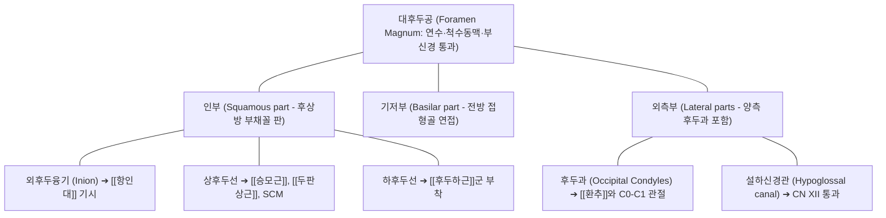

# [[후두골]] (Occipital Bone / 뒤통수뼈)

> **핵심 요약 (Key Summary)**:
> 뇌두개골(Neurocranium)의 후하부를 형성하는 마름모꼴의 단일 골격 구조물.
> 중앙에 연수가 척수로 이어지는 대후두공(Foramen magnum)을 품고 있으며, 양측 후두과(Occipital condyles)를 통해 제1경추 환추([[환추]])와 환추후두관절(C0-C1)을 형성하여 고개 끄덕임(Nodding) 운동 축을 담당.
> 외후두융기(EOP)와 상·하후두선에 [[승모근]], [[두판상근]], [[후두하근]]군이 부착하여 [[경추성 두통]], [[후두신경통]], 턱관절 장애 및 두개천골요법(CST)의 핵심 치료 랜드마크.

---

## 📌 목차
1. [해부학적 정밀 구조 및 골성 랜드마크 (Anatomy & Landmarks)](#1-해부학적-정밀-구조-및-골성-랜드마크-anatomy--landmarks)
2. [생체역학·관절학적 운동성 (C0-C1 환추후두관절 & SBS)](#2-생체역학관절학적-운동성-c0-c1-환추후두관절--sbs)
3. [임상 평가 및 이학적 검사 (Examination & Palpation)](#3-임상-평가-및-이학적-검사-examination--palpation)
4. [영상의학 및 초음파 해부학 (Radiology & Sonoanatomy)](#4-영상의학-및-초음파-해부학-radiology--sonoanatomy)
5. [⭐ 원장님 심층 임상 고찰 및 원본 필기 (Clinical Pearls)](#5--원장님-심층-임상-고찰-및-원본-필기-clinical-pearls)
6. [관련 임상 질환 및 손상 (Pathology & Fractures)](#6-관련-임상-질환-및-손상-pathology--fractures)
7. [추나·도수치료 & 침구·약침·재활 프로토콜](#7-추나도수치료--침구약침재활-프로토콜)
8. [출처 및 학술 참고 문헌 (References)](#8-출처-및-학술-참고-문헌-references)

---

## 1. 해부학적 정밀 구조 및 골성 랜드마크 (Anatomy & Landmarks)

* **후두골의 4대 해부학적 구성 부위**:
  * **대후두공 (Foramen magnum)**: 후두골 중심에 위치하는 큰 타원형 개구부로, 뇌간(연수)이 척수로 이행하며, 좌우 척추동맥(Vertebral artery), 전·후 척수동맥 및 부신경(CN XI)의 척수근이 통과.
  * **인부 (Squamous part)**: 대후두공 후상방의 넓은 조개껍데기 모양 골판.
    * 외후두융기(EOP / Inion): 후두골 정중앙의 가장 돌출된 골성 결절로, [[항인대]] 및 승모근의 상단 기시점.
    * 상후두선(Superior nuchal line): [[승모근]], [[두판상근]], [[흉쇄유돌근]]의 부착 경계선.
    * 하후두선(Inferior nuchal line): [[대후두직근]], [[소후두직근]], [[상두사근]]이 부착하는 심부 경계선.
  * **기저부 (Basilar part)**: 대후두공 전방으로 뻗어 접형골(Sphenoid)과 만나 **접형후두연골결합(Sphenobasilar synchondrosis, SBS)** 형성.
  * **외측부 (Lateral parts)**: 대후두공 양 외측에 볼록한 타원형의 **후두과(Occipital condyle)**가 위치하여 제1경추 환추([[환추]])의 상관절와와 만나 환추후두관절(C0-C1) 형성.

---

## 2. 생체역학·관절학적 운동성 (C0-C1 환추후두관절 & SBS)

* **환추후두관절(C0-C1)의 끄덕임 운동학 (Yes-Joint)**:
  * 타원형의 볼록한 후두과가 환추의 오목한 소켓형 상관절와 위에서 구르고 미끄러지며(Roll & Slide), 시상면 상에서 **굴곡 약 5도, 신전 약 10도(총 15도 내외)**의 고개 끄덕임(Nodding)을 담당.
  * 외측 굴곡은 약 5도 이내로 제한되며, 회전 운동은 알라 인대(Alar ligament)의 장력 구속으로 인해 C0-C1에서는 거의 일어나지 않음 (회전은 C1-C2에서 50% 담당).
* **접형후두연골결합(SBS)과 뇌척수액 순환**:
  * 두개천골요법(CST)의 중심 관절로, 일차 호흡 메커니즘(PRM)에 의해 굴곡기에는 후두골 기저부가 상방으로 들리고 인부가 후하방으로 팽창하며, 제4뇌실과 경막관을 자극하여 뇌척수액(CSF) 순환 펌핑.

---

## 3. 임상 평가 및 이학적 검사 (Examination & Palpation)

* **외후두융기(Inion) 및 하후두선 압통 평가**:
  * 환자의 두부를 가볍게 받치고 상·하후두선을 따라 외측(유양돌기 방향)으로 촉진 시 후두하근과 승모근 건막의 결절성 띠 및 압통 확인.
* **대후두신경 통과점 압박 검사 (Tinel-like Sign on GON)**:
  * 외후두융기에서 외측으로 약 2.5cm(상후두선 부근, 천주혈 인접) 부위를 손가락으로 튕기듯 누를 때 두정부로 번지는 찌릿한 방사통 확인 (후두신경통 진단).
* **C0-C1 환추후두관절 굴곡-신전 수동 가동성 검사**:
  * 환자를 앙와위로 두고 턱을 가볍게 당기며 후두골을 전하방 및 후상방으로 미세하게 움직여 관절 종말감(End-feel)과 가동 제한 평가.

---

## 4. 영상의학 및 초음파 해부학 (Radiology & Sonoanatomy)

* **두경부 단순 방사선 (Skull & Open-Mouth View)**:
  * 측면상에서 대후두공 전연(Basion)과 치돌기 첨부의 거리(Basion-Dens Interval, BDI < 12mm) 계측하여 환추후두관절 아탈구 배제.
  * 전후 개구위(Open-mouth view)에서 양측 후두과와 환추 외측괴의 대칭성 평가.
* **후두하부 초음파 스캔 (Suboccipital Sonoanatomy)**:
  * 후두골 하연에 탐촉자를 거치 시, 피하지방 아래 승모근, 두반극근, 그 심부의 삼각형 공간인 후두하삼각(Suboccipital triangle) 내부의 [[대후두신경]] 및 척추동맥 V3 분절의 박동성 혈류 실시간 확인.

---

## 5. ⭐ 원장님 심층 임상 고찰 및 원본 필기 (Clinical Pearls)

* **눈 뒤가 빠질 듯한 두통은 후두하근 삼각의 혈관·신경 압박이다**:
  * "뒤통수가 뻐근하면서 눈알이 쑥 빠질 것처럼 아프고 시야가 흐려진다"는 환자는 눈이나 뇌의 병이 아니라 후두골 바로 밑의 [[후두하근]](대·소후두직근, 상두사근)이 단축된 것입니다. 이곳을 지나는 척추동맥 혈류가 저하되고 대후두신경이 포착되어 삼차신경 척수핵(Trigeminocervical nucleus)을 자극하기 때문입니다. 풍지혈과 천주혈 심부를 침구와 신바로약침으로 뚫어주면 환자가 "눈이 번쩍 뜨이고 시야가 맑아졌다"고 감탄합니다.
* **후두골 감압술(Suboccipital Release)의 강력한 부교감신경 활성 효과**:
  * 불면증, 만성 불안, 만성 두통 환자에게 후두골 하연을 손가락 끝으로 받쳐 머리 무게만으로 부드럽게 3~5분간 견인(Traction)해주면, 긴장되어 있던 경막(Dura) 장력이 풀리고 미주신경(CN X)과 뇌신경들의 주행 통로인 경정맥공(Jugular foramen)이 감압되면서 즉각적인 깊은 이완과 수면 상태로 유도됩니다.
* **경추 회전 시 뚝 소리 내는 교정의 위험성(VBI 증후군)**:
  * 후두골과 환추 사이로 척추동맥이 S자로 급격히 꺾이며 대후두공으로 들어갑니다. 후두골이 비틀렸다고 목을 과도하게 돌려 꺾는 강한 스러스트 추나를 치면 척추동맥 박리(Vertebral artery dissection)나 뇌간 허혈(VBI)을 초래할 수 있습니다. 상부 경추는 절대로 과도하게 비틀지 말고 완만한 가동술(Mobilization without thrust)만을 원칙으로 해야 합니다.

---

## 6. 관련 임상 질환 및 손상 (Pathology & Fractures)

| 질환 및 병태 | 발생 기전 및 병리 | 임상 소견 및 감별점 |
| :--- | :--- | :--- |
| [[경추성 두통]] (Cervicogenic Headache) | C0-C1 관절 기능장애 및 후두하근 연축에 따른 삼차신경 복합체 자극 | 후두부 둔통, 정수리 및 안와 후방으로의 일측성 방사통 |
| [[후두신경통]] (Occipital Neuralgia) | 상후두선 관통 부위에서 [[대후두신경]] 또는 소후두신경 기계적 포착 | 발작성 찌릿한 전격통, 두피 감각 과민(Allodynia) |
| 후두골 과두 골절 (Occipital Condyle Fracture) | 고에너지 축성 압박 외상 (교통사고, 다이빙 사고) | 경추 심부 통증, 뇌신경 마비(CN IX, X, XI, XII 손상 위험) |
| 아놀드-키아리 기형 (Arnold-Chiari Malformation) | 후두골 기저부 협소로 소뇌 편도가 대후두공 하방으로 탈출 | 기침 시 악화되는 후두통, 연하 장애, 사지 감각 이상 |
| 기저동맥 순환부전 (VBI) | 후두하부 경직 및 관절 변위에 의한 척추동맥 혈류 저하 | 고개 신전-회전 시 현훈, 시야 장애, 실신(Drop attack) |

---

## 7. 추나·도수치료 & 침구·약침·재활 프로토콜

### 1) 한의 추나 및 두개천골요법 (Craniosacral Therapy)
* **후두하근 이완 및 후두골 견인 기법 (Suboccipital Release)**:
  * 앙와위에서 검사자의 손가락 끝 패드를 후두골 하후두선 아래 홈에 걸고 환자의 두부 무게를 이용하여 상방으로 부드러운 장축 견인(3~5분 유지) ➔ [[추나]] · [[두개천골요법]].
* **제4뇌실 압박 기법 (CV-4 Technique)**:
  * 양손을 깍지 껴서 후두골 인부를 감싸 쥐고 뇌척수액의 굴곡-신전 리듬을 정지점(Still point)으로 유도하여 자율신경계 교감신경 톤 다운.

### 2) 침구 및 약침 복합 치료
* **핵심 혈위 자침**:
  * 풍지(GB20): 후두골 하연 승모근과 흉쇄유돌근 사이 함요처로 후두하삼각 감압.
  * 천주(BL10): 승모근 외연 상후두선 바로 아래로 대후두신경 자극.
  * 뇌호(GV17): 외후두융기 상연 함요처.
  * 아문(GV15), 풍부(GV16): 항인대 기시부 및 경막 연계 혈위.
* **약침 처방**:
  * **[[신바로약침]] / [[자하거약침]]**: 풍지혈 및 천주혈 심부에 0.5~1.0cc 분주하여 신경 혈관 주위 염증 완화 및 뇌혈류 촉진.

### 3) 자세 재활 운동
* **친 턱(Chin-tuck) 운동**:
  * 후두골을 상후방으로 늘리고 턱을 당겨 환추후두관절의 과신전 보상 교정.

---

## 8. 출처 및 학술 참고 문헌 (References)

1. **Wu B, et al. (2021)**. An Unrecognized Ligament and its Ossification in the Craniocervical Junction: Prevalence, Patient Characteristics, and Anatomic Evidence. *Clin Orthop Relat Res*. 479(8):1816-1826. PMID: 33739308.
   - `[연구 요약]` 두경부 접합부(Craniocervical Junction)에서 후두골과 상부 경추를 잇는 미세 인대 구조 및 마이오듀랄 브릿지의 해부학적 특성과 골화 유병률 분석.
2. **Chiang CW, et al. (2026)**. Ossification of the Nuchal Ligament With Text Neck Syndrome. *Cureus*. 18(9):e115774. PMID: 42831019.
   - `[연구 요약]` 후두골 외후두융기에서 기시하는 항인대 복합체의 만성 굴곡 스트레스에 따른 견인 골화 및 경추성 두통과의 상관성 규명.
