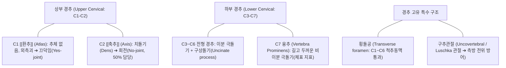

# [[경추]] (Cervical Spine / 頸椎 / 목뼈 C1~C7)

> **핵심 요약 (Key Summary)**:
> 두개골 아래부터 흉추 상단까지를 연결하는 7개의 척추골(C1~C7)로 구성되어 인체 척주 중 가장 크고 정밀한 3차원 가동성(Mobility)을 발휘하는 골격 분절.
> C1([[환추]])·C2([[축추]])의 비전형 관절을 통해 두부 회전의 50%를 담당하고, C3~C7 전형 경추의 구추관절(Luschka 관절) 및 횡돌공(Transverse foramen)을 통해 추골동맥(Vertebral artery)을 보호.
> 정상 전만(Lordosis 30~40°) 소실에 따른 일자목·[[거북목 증후군]], [[경추 추간판 탈출증]], [[경추 척수증]](DCM) 및 신경근병증의 핵심 구조물로 추나 견인 및 신경 침구 치료의 주 표적.

---

## 📌 목차
1. [해부학적 정밀 구조 및 골성 랜드마크 (Anatomy & Landmarks)](#1-해부학적-정밀-구조-및-골성-랜드마크-anatomy--landmarks)
2. [생체역학·관절학적 운동성 (Cervical Biomechanics & Kinematics)](#2-생체역학관절학적-운동성-cervical-biomechanics--kinematics)
3. [임상 평가 및 이학적 검사 (Examination & Palpation)](#3-임상-평가-및-이학적-검사-examination--palpation)
4. [영상의학 및 초음파 해부학 (Radiology & Sonoanatomy)](#4-영상의학-및-초음파-해부학-radiology--sonoanatomy)
5. [⭐ 원장님 심층 임상 고찰 및 원본 필기 (Clinical Pearls)](#5--원장님-심층-임상-고찰-및-원본-필기-clinical-pearls)
6. [관련 임상 질환 및 손상 (Pathology & Fractures)](#6-관련-임상-질환-및-손상-pathology--fractures)
7. [추나·도수치료 & 침구·약침·재활 프로토콜](#7-추나도수치료--침구약침재활-프로토콜)
8. [출처 및 학술 참고 문헌 (References)](#8-출처-및-학술-참고-문헌-references)

---

## 1. 해부학적 정밀 구조 및 골성 랜드마크 (Anatomy & Landmarks)

* **경추의 3대 기능적 구분**:
  * **비전형 상부 경추 (C1~C2)**:
    * **C1 [[환추]](Atlas)**: 척추체와 극돌기가 결손되어 전궁, 후궁, 양측 외측괴(Lateral mass)로 구성. [[후두골]]과 만나 고개 끄덕임 운동 수행.
    * **C2 [[축추]](Axis)**: 추체 상방으로 수직 돌출된 치돌기(Dens / Odontoid process)를 축으로 환추가 회전하여 경부 회전 운동의 절반을 독점.
  * **전형 하부 경추 (C3~C6)**:
    * 작은 가로 직경의 신장형 추체, 끝이 두 갈래로 갈라진 이분(Bifid) 극돌기.
    * **구상돌기 (Uncinate process)**: 추체 상면 외측 모서리가 융기하여 상위 추체와 **구추관절(Luschka 관절)** 형성 (추간판 탈출의 측방 차단벽).
  * **이행형 융추 (C7)**:
    * 갈라지지 않고 매우 길고 두터운 단일 극돌기를 지녀 고개를 숙였을 때 목 뒤에서 가장 뚜렷하게 만져지는 체표 랜드마크.
* **횡돌공 (Transverse Foramen)**:
  * C1~C6 횡돌기에 형성된 개구부로, 뇌저부와 소뇌로 향하는 **척추동맥(Vertebral artery)** 및 정맥이 상행 주행 (C7 횡돌공에는 동맥이 관통하지 않음).

---

## 2. 생체역학·관절학적 운동성 (Cervical Biomechanics & Kinematics)

* **정상 생리적 전만 (Cervical Lordosis)**:
  * 정상 각도: 약 30~40도 (C2~C7 Cobb's angle 기준).
  * 4~5kg의 두부 무게를 분산하고 수직 충격을 흡수하는 스프링 구조.
* **관절면 경사도 (45° Facet Joint Angle)**:
  * 후관절면이 수평면 기준으로 약 45도 상방 경사를 이루어 굴곡·신전이 매우 원활.
  * **커플링 모션 (Coupling Motion)**: C2~C7 분절에서 측굴(Lateral bending) 시 동측 회전(Ipsilateral rotation)이 필연적으로 동반되는 3차원 결합 운동 역학.
* **경추의 하중 분담비**:
  * 정상 전만 상태에서는 추체-추간판 복합체가 전방에서 하중의 약 64%를, 양측 후관절이 후방에서 약 36%를 지지.
  * 일자목/거북목으로 전만이 소실되면 후관절 하중이 감소하고 전방 추간판에 하중이 100% 집중되어 추간판 퇴행 가속.

---

## 3. 임상 평가 및 이학적 검사 (Examination & Palpation)

* **스펄링 검사 ([[Spurling test]])**:
  * 경추를 신전시키고 환측으로 회전-측굴 후 검사자가 두부를 하방으로 축성 압박 시 피부분절(Dermatome) 상지 방사통 재현 여부 확인 (신경근 포착 특이도 93% 이상).
* **견관절 외전 검사 (Bakody's Test)**:
  * 환자가 아픈 팔을 머리 위에 얹었을 때 상지 방사통이 완화되는 징후 (경추 신경근병증 진단).
* **경추 척수증([[경추 척수증]]) 스크리닝 검사**:
  * [[Hoffmann 반사]](중지 원위지절 튕김 시 엄지 굴곡), 바빈스키 반사, 10초 주먹 쥐고 펴기 검사(Grip and release test < 20회).
* **극돌기 및 후관절 촉진 (Facet Joint Tenderness)**:
  * 정중선 극돌기에서 외측 1.5~2cm 부위의 관절기둥(Articular pillar)을 후방에서 전방으로 압박하여 후관절 활액막염 및 퇴행성 관절염 감별.

---

## 4. 영상의학 및 초음파 해부학 (Radiology & Sonoanatomy)

* **경추 X-ray 4대 뷰 (AP, Lateral, Both Oblique, Open-Mouth)**:
  * 측면상: 전만 소실 여부, 추간공 높이, 후종인대골화증([[후종인대골화증]]) 유무.
  * 사위상(Oblique): C3~C7 [[추간공]]의 협착 여부 확인.
  * 개구상(Open-mouth): 치돌기 골절 및 C1-C2 외측괴 대칭성 계측.
* **초음파 가이던스 (High-Resolution Ultrasound)**:
  * 외측 경추 스캔 시, C5, C6, C7 횡돌기의 전결절(Anterior tubercle)과 후결절(Posterior tubercle) 형태 감별(C6의 Chassaignac 결절, C7의 결절 결손)을 통해 척수신경근 C5~C8을 정확히 구별하고 안전한 약침 주입.

---

## 5. ⭐ 원장님 심층 임상 고찰 및 원본 필기 (Clinical Pearls)

* **구추관절(Luschka) 골극이 신경근을 찌르는 메커니즘**:
  * 40대 이후 디스크 높이가 낮아지면 상하 추체 외측 모서리가 맞부딪쳐 구추관절에 뼈가시(골극, Osteophyte)가 자라납니다. 이 골극이 바로 뒤로 지나가는 경추 신경근을 칼날처럼 찌르며 만성적인 팔 저림과 견갑골 안쪽 통증을 유발합니다. 억지로 목을 신전시키면 골극이 신경을 더 짓누르므로 가벼운 축성 견인 추나로 간격을 벌려주어야 합니다.
* **일자목 환자에게 무턱대고 C자 베개를 쓰게 하면 안 된다**:
  * 경추 전만이 소실되었다고 단단한 목침이나 높은 폼롤러를 목 뒤에 대고 자게 하면, 후관절 충돌과 후종인대 긴장이 급격히 증가하여 다음 날 아침 목을 전혀 못 움직이는 급성 연축이 발생합니다. 초기에는 수건을 주먹 굵기로 말아 목 뒤에 받치는 점진적 이완부터 시작해야 합니다.
* **경추 5-6-7번 디스크 탈출 시의 핵심 임상 피부분절**:
  * C5 신경근 압박: 어깨 외측(삼각근) 감각 저하, 팔 들어 올리기 약화.
  * C6 신경근 압박: 엄지와 검지 손가락 저림, 이두근 반사 소실.
  * C7 신경근 압박: 중지 손가락 저림, 삼두근 반사 소실, 팔꿈치 펴기 약화. 손가락 저림 위치만 정확히 파악해도 MRI 없이 병변 레벨을 90% 확진할 수 있습니다.

---

## 6. 관련 임상 질환 및 손상 (Pathology & Fractures)

| 질환 및 병태 | 발생 기전 및 병리 | 임상 소견 및 감별점 |
| :--- | :--- | :--- |
| [[경추 추간판 탈출증]] (C-HIVD) | 추간판 섬유륜 파열로 수핵이 후외측 탈출, 신경근 압박 | 상지 방사통, 저림, 견갑골 내측 연관통, Spurling 검사 양성 |
| [[경추 척수증]] (DCM) | 추간판 탈출, [[황색인대]] 비후, OPLL에 의한 척수관 협착 | 보행 실조, 손의 미세운동 장애(단추 채우기 불능), UMN 징후 |
| 일자목 및 [[거북목 증후군]] | 장시간 두부 전방 돌출로 인한 생리적 경추 전만 소실 | 뒷목 만성 뻐근함, 승모근 과긴장, 긴장성 두통 동반 |
| 경추 채찍질 손상 ([[경추 채찍질 손상]]) | 교통사고 충돌 시 과신전-과굴곡 외상으로 인대·근육 파열 | 경항부 극심한 운동 제한, 자율신경실조증(현훈, 이명, 오심) |
| 제퍼슨 골절 (Jefferson Fracture) | 두부 정수리에 가해진 축성 하중으로 인한 C1 환추 환 파열 | 심부 후두통, 경추 회전 불능, 척수 손상 응급 점검 |

---

## 7. 추나·도수치료 & 침구·약침·재활 프로토콜

### 1) 한의 추나 및 경추 가동술
* **경추 완만 축성 견인 추나 (Gentle Cervical Traction)**:
  * 앙와위에서 검사자가 후두골과 턱을 받치고 환자의 경추 장축을 따라 10~15kg 미만의 부드러운 도수 견인(Manual traction)을 적용하여 [[추간공]] 감압 ➔ [[추나]] · [[도수치료]].
* **경추 후관절 굴곡-활주 가동술**:
  * 제한된 분절의 후관절을 45도 상방 궤적으로 부드럽게 글라이딩.
* **금기 사항**:
  * 척추동맥 허혈 징후가 있거나 OPLL, 심한 척수증 환자에게 고속 회전 스러스트는 절대 금기.

### 2) 침구 및 약침 복합 치료
* **핵심 혈위 자침**:
  * 경추 협척혈(EX-B2 C3~C7): 척추기둥 인접 심부 다열근 및 후관절 자침.
  * 대추(GV14): C7 극돌기 하단으로 경흉추 이행부 이완.
  * 풍지(GB20), 견정(GB21), 후계(SI3): 경추성 방사통 원위 취혈.
* **약침 처방**:
  * **[[신바로약침]] / [[자하거약침]]**: 경추 협척혈 심부 후관절낭 및 신경근 출구 주위에 분주하여 신경 부종 흡수 및 디스크 섬유륜 재생 촉진.

### 3) 심부 경추 굴곡근 강화 운동
* **친 턱(Chin-tuck) 운동**:
  * 후두골을 뒤로 밀고 턱을 가볍게 당겨 경추 심부 굴곡근([[경장근]], [[두장근]])을 등척성 강화하고 흉쇄유돌근의 과보상 차단.

---

## 8. 출처 및 학술 참고 문헌 (References)

1. **Farahbakhsh F, et al. (2026)**. Comparative Therapeutic Effectiveness and Complications of Anterior Versus Posterior Surgical Approach in Non-Ossification of the Posterior Longitudinal Ligament (Non-OPLL) Degenerative Cervical Myelopathy: A Systematic Review and Meta-Analysis. *World Neurosurg*. 216():125372. PMID: 42815851.
   - `[연구 요약]` 퇴행성 경추 척수증 환자에서 척추관 전후경 확보와 전만 정렬 복원이 신경학적 예후에 미치는 해부학적 기전 메타분석.
2. **Lombardo G, et al. (2026)**. Retropharyngeal hematoma following anterior cervical spine surgery: a narrative review. *J Spine Surg*. 12(8):137. PMID: 42719310.
   - `[연구 요약]` 전방 경추 유합 및 감압술 시 전경부 인대, 경장근 및 척추동맥 주행의 외과적 해부학과 인두후 혈종 합병증 예방 가이드.
