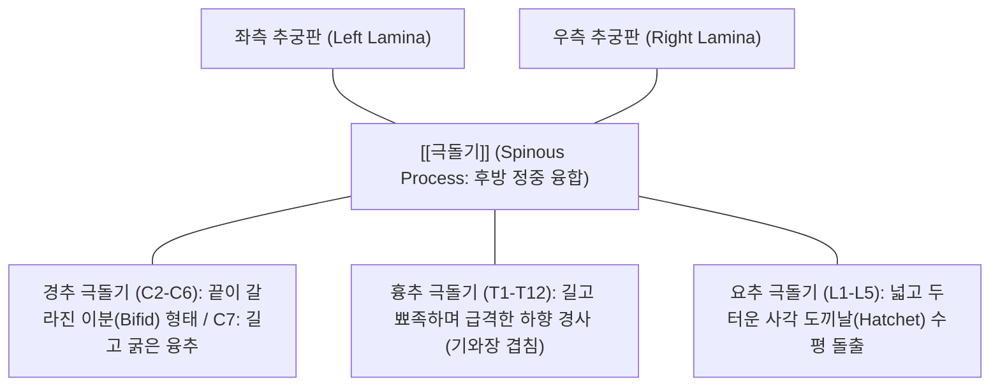

# [[극돌기]] (Spinous Process / 가시돌기 / 棘突起)

> **핵심 요약 (Key Summary)**:
> 척추궁(Vertebral arch)의 양측 추궁판(Lamina)이 후방 정중앙선에서 합쳐져 뒤쪽 아래로 돌출하는 단일 골성 돌기.
> 경추(이분형), 흉추(하향 기와형), 요추(사각 도끼날 수평형)로 분절별 형태학적 특성이 뚜렷하며, 시상면 상에서 척추 신전 운동의 모멘트 암(Moment arm)을 극대화하는 핵심 골성 지렛대.
> [[극상인대]], [[극간인대]], 척추기립근([[극근]]), [[다열근]]이 부착하는 닻이며, 바스트룹병(Baastrup's disease / Kissing spine), 점토채굴자 골절(Clay-shoveler's fracture) 호발 및 추나요법 척추 분절 변위 진단의 절대적 기준점.

---

## 📌 목차
1. [해부학적 정밀 구조 및 분절별 형태학 (Anatomy & Morphology)](#1-해부학적-정밀-구조-및-분절별-형태학-anatomy--morphology)
2. [생체역학·관절학적 운동성 (Biomechanics & Moment Arm)](#2-생체역학관절학적-운동성-biomechanics--moment-arm)
3. [임상 평가 및 이학적 검사 (Examination & Palpation)](#3-임상-평가-및-이학적-검사-examination--palpation)
4. [영상의학 및 초음파 해부학 (Radiology & Sonoanatomy)](#4-영상의학-및-초음파-해부학-radiology--sonoanatomy)
5. [⭐ 원장님 심층 임상 고찰 및 원본 필기 (Clinical Pearls)](#5--원장님-심층-임상-고찰-및-원본-필기-clinical-pearls)
6. [관련 임상 질환 및 손상 (Pathology & Fractures)](#6-관련-임상-질환-및-손상-pathology--fractures)
7. [추나·도수치료 & 침구·약침·재활 프로토콜](#7-추나도수치료--침구약침재활-프로토콜)
8. [출처 및 학술 참고 문헌 (References)](#8-출처-및-학술-참고-문헌-references)

---

## 1. 해부학적 정밀 구조 및 분절별 형태학 (Anatomy & Morphology)

* **분절 수준별 고유 형태학적 특징**:
  * **경추 극돌기 (Cervical, C2~C6)**:
    * 끝단이 좌우 두 갈래로 갈라진 이분(Bifid) 구조로, 심부 후두하근과 경추 회선근들이 좌우로 균형 있게 부착.
    * **제7경추(C7, 융추)**: 갈라지지 않고 매우 길고 두껍게 수평 후방으로 돌출하여 목 뒤 촉진의 1차 기준점.
  * **흉추 극돌기 (Thoracic, T1~T12)**:
    * 가늘고 길며, 뚜렷하게 하방으로 급경사를 이룸.
    * 특히 중부 흉추(T5~T8)는 직하방으로 지붕의 기와처럼 겹쳐져, 극돌기 끝단의 피부 위치가 한 분절 아래 척추체의 높이에 해당 (3분절 규칙, Rule of Threes).
  * **요추 극돌기 (Lumbar, L1~L5)**:
    * 두텁고 넓은 사각형 도끼날 모양(Hatchet-shaped)으로 거의 완벽한 수평 후방 돌출.
    * 극돌기 사이의 극간 간격(Interspinous gap)이 넓어 요추 천자 및 척추 마취의 안전 통로 형성.
* **주요 부착 인대 및 근육군**:
  * **인대**: 끝단을 잇는 [[극상인대]](경추에서는 [[항인대]]로 비후), 상하 극돌기 사이를 메우는 [[극간인대]].
  * **근육**: 척추기립근([[극근]]), 횡돌극근([[반극근]], [[다열근]], [[회선근]]), 천층의 [[승모근]], [[광배근]], [[능형근]].

---

## 2. 생체역학·관절학적 운동성 (Biomechanics & Moment Arm)

* **시상면 신전 지렛대 (Extension Lever Arm)**:
  * 극돌기는 척추체 회전 중심축(Instantaneous axis of rotation)으로부터 후방으로 가장 멀리 돌출되어 있음.
  * 척추 신근들([[다열근]], [[극근]])이 수축할 때 모멘트 암(Moment arm)을 극대화하여 최소한의 근수축력으로도 상체 무게를 일으켜 세우는 1종 지렛대(Class I Lever) 역학 달성.
* **과신전 제동 및 굴곡 구속력**:
  * 신전 시 상하 극돌기가 서로 맞닿으며 기계적 골성 정지(Bony stop)를 형성하여 척추관 내부의 척수 및 신경근의 과도한 협착을 방지.
  * 굴곡 시에는 극돌기 간 간격이 벌어지며 부착된 극상인대와 극간인대가 팽팽하게 긴장하여 굴곡 한계를 구속.

---

## 3. 임상 평가 및 이학적 검사 (Examination & Palpation)

* **극돌기 정중선 정렬 촉진 (Alignment & Step-off Palpation)**:
  * 환자를 복와위로 눕히고 척추 정중선을 따라 손가락 끝으로 극돌기를 위에서 아래로 쓸어내리며 촉진.
  * **회전 변위 (Rotational Malalignment)**: 특정 극돌기가 정중선에서 좌측 또는 우측으로 회전 편위된 소견 확인.
  * **계단상 변형 (Step-off Sign)**: 상위 극돌기가 전방으로 푹 꺼져 만져지는 현상 (척추 전방전위증 Spondylolisthesis 진단).
* **극돌기 타진 검사 (Spinous Process Percussion Test)**:
  * 검사자의 타진기나 주먹으로 극돌기를 가볍게 두드릴 때 날카로운 국소 골통(Bony pain) 발생 시 척추 압박골절, 척추염, 골전이 의심.
* **극간 압통 검사 (Interspinous Tenderness)**:
  * 극돌기 사이의 홈(극간인대 부위)을 엄지손가락으로 깊이 압박하여 인대 염좌 및 추간판 디스크 연관통 확인.

---

## 4. 영상의학 및 초음파 해부학 (Radiology & Sonoanatomy)

* **단순 방사선 측면상 (Lateral Spine X-ray)**:
  * 극돌기의 연속성, 점토채굴자 골절(Clay-shoveler)의 골절선, 인접 극돌기 간 가관절 형성(바스트룹병) 평가.
* **초음파 스캔 (Posterior Midline Sonoanatomy)**:
  * 탐촉자를 척추 정중선에 종단 거치 시, 극돌기 첨부는 밝은 초승달 모양의 고에코 피질골과 그 아래 깊은 음향 음영(Acoustic shadow)으로 관찰됨.
  * 극돌기 사이를 가로지르는 고에코의 극상인대와 저에코의 극간인대 연속성 확인.

---

## 5. ⭐ 원장님 심층 임상 고찰 및 원본 필기 (Clinical Pearls)

* **노인성 요통의 숨은 복병, 바스트룹병(Baastrup's disease)**:
  * 60~70대 노인 환자가 "허리를 뒤로 젖힐 때 척추 정중앙 뼈마디가 부딪치듯이 콕콕 쑤신다"고 호소하면 디스크가 아니라 바스트룹병(Kissing spine)입니다. 디스크가 납작해지면서 요추 극돌기 사이 간격이 좁아져 상하 극돌기가 맞부딪쳐 활액낭염과 골경화가 생기는 질환입니다. 극간 부위에 신바로약침을 주입하고 굴곡 스트레칭을 지도하면 통증이 신속히 호전됩니다.
* **점토채굴자 골절(Clay-shoveler's Fracture)을 단순 담(痰)으로 오진하지 말라**:
  * 무거운 눈을 삽으로 치우거나 골프 연습을 과도하게 한 후 C7-T1 극돌기 부위에 극심한 압통을 호소하면 단순 능형근 염좌가 아니라 하부 경추 극돌기의 견열 골절(Avulsion fracture)일 가능성이 높습니다. 승모근과 능형근의 순간적인 강한 수축력이 극돌기 끝을 물고 떨어져 나간 것이므로 반드시 측면 X-ray를 확인해야 합니다.
* **추나 스러스트 시 극돌기 접촉(Contact)의 절대 원칙**:
  * 척추 교정 추나를 시행할 때 극돌기 첨부(Tip)를 손바닥 중심(두상골)으로 직접 수직 압박하면 뼈막의 극심한 통증이나 극돌기 골절을 유발할 수 있습니다. 반드시 극돌기의 외측 외측연(Lateral aspect) 또는 횡돌기/관절기둥에 안전하게 걸쳐 접촉한 후 방향성을 가진 벡터로 스러스트를 가해야 안전합니다.

---

## 6. 관련 임상 질환 및 손상 (Pathology & Fractures)

| 질환 및 손상 유형 | 발생 기전 및 병리 | 임상 소견 및 감별점 |
| :--- | :--- | :--- |
| 점토채굴자 골절 (Clay-shoveler's) | 급격한 상체 굴곡 또는 중량 작업 시 근육 견인에 의한 C6~T1 극돌기 파열 | 하부 경추 국소적 극심한 칼로 찌르는 듯한 골성 압통 |
| 바스트룹병 (Baastrup's Disease) | 척추 퇴행 및 과전만으로 인접 요추 극돌기끼리 마찰 충돌 | 요추 신전 시 정중선 통증 악화, 극간 활액낭염 동반 |
| 극상·극간인대 염좌 | 허리를 구부리고 물건을 들 때 후방 인대 복합체 인장 파열 | 극돌기 사이의 깊은 압통, 척추 굴곡 시 팽팽한 당김통 |
| 척추 압박골절 후 극돌기 돌출 | 추체 전방 붕괴로 후방 극돌기가 상대적으로 후방 융기 | 척추 후만 변형, 타진통 양성, 체중 부하 불능 |
| 척추 회전 변위증 | 척추 다열근 및 회선근의 편측 단축으로 극돌기가 편위 | 정중선 이탈 촉진, 동측 후관절 압통 동반 |

---

## 7. 추나·도수치료 & 침구·약침·재활 프로토콜

### 1) 한의 추나 및 척추 가동술
* **극돌기 지렛대 회전 교정 추나 (Spinous Process Lever Thrust)**:
  * 회전 변위된 분절의 극돌기 측면을 시술자의 두상골(Pisiform)로 접촉하고 반대 방향으로 회전 교정 스러스트를 적용하여 척추 정렬 회복 ➔ [[추나]] · [[도수치료]].
* **극간 신연 관절가동술**:
  * 요추 굴곡 테이블을 이용하여 좁아진 극돌기 간 간격을 벌려주어 바스트룹병의 마찰 충돌 감압.

### 2) 침구 및 약침 복합 치료
* **핵심 혈위 자침**:
  * 명문(GV4), 요양관(GV3), 신주(GV12), 대추(GV14): 극돌기 직하부 극간인대 중심 자침으로 후방 지주 인장력 정상화.
  * 화타협척혈(EX-B2): 극돌기 양측 0.5촌 외측의 심부 다열근 및 인대 부착부 자침.
* **약침 처방**:
  * **[[신바로약침]] / [[황련해독탕약침]]**: 극간 활액낭 및 극돌기 골막 부착부에 0.5~1.0cc 분주하여 골마찰성 무균 염증 신속 진정.

### 3) 척추 후방 근막 안정화 재활
* **골반 후방 경사 훈련**:
  * 과도한 요추 전만을 줄여 요추 극돌기 간 충돌 방지 ➔ [[Williams 굴곡운동]].

---

## 8. 출처 및 학술 참고 문헌 (References)

1. **Yu W, et al. (2026)**. Accurate automated 3D lumbar spine reconstruction from biplanar X-rays using multi-task deep learning and anatomy-aware optimization. *Med Phys*. 53(8):e70570. PMID: 42482570.
   - `[연구 요약]` 요추 극돌기, 추궁판 및 추체의 3차원 형태학적 랜드마크를 활용한 척추 정렬 계측 및 척추 질환 영상 분할 최적화 연구.
2. **Jokeit M, et al. (2025)**. The importance of the posterior osteoligamentous complex of the lumbar spine. *Acta Neurochir*. 167(1):45. PMID: 39912946.
   - `[연구 요약]` 요추 극돌기 및 극간·극상인대로 구성된 후방 골인대 복합체의 생체역학적 안정화 기여도 및 척추 수술 후 불안정성 예방 분석.
