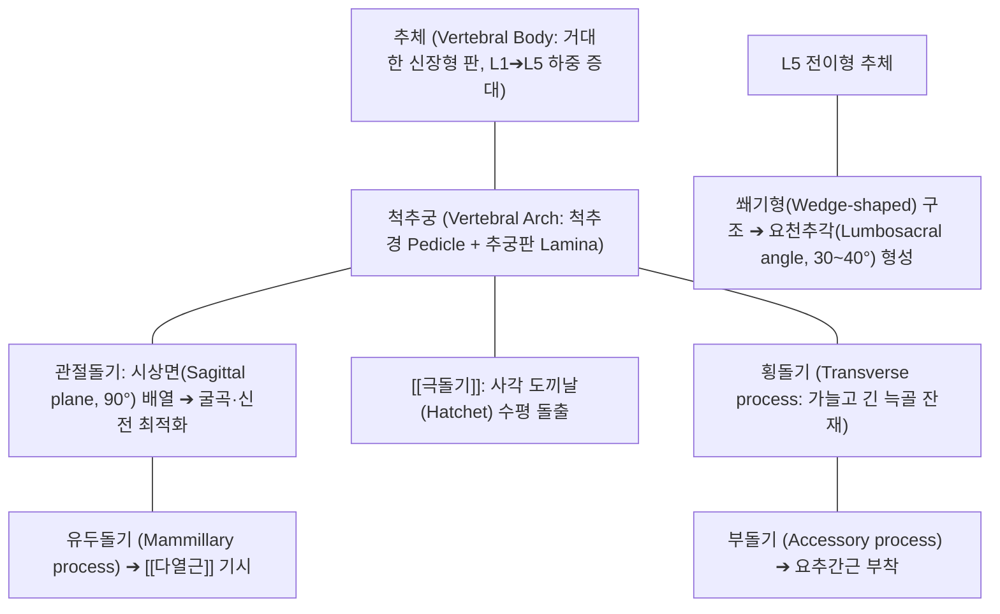

# [[요추]] (Lumbar Vertebrae / 腰椎 / 허리뼈 L1~L5)

> **핵심 요약 (Key Summary)**:
> 흉추 하단부터 천골 상단까지를 연결하는 5개의 대형 척추골(L1~L5)로 구성되어 상체 전체의 체중을 지탱하고 골반으로 전달하는 인체 척추의 중심 하중 지주.
> 거대한 신장형(콩팥 모양) 척추체, 쐐기형 L5 추체, 사각 도끼날 모양 극돌기 및 시상면(약 90°) 배열의 후관절(Facet joint)을 지녀 시상면 굴곡·신전 운동에 최적화되고 축성 회전은 엄격히 차단됨.
> [[요추 추간판 탈출증]](L-HIVD), [[요추 척추관협착증]], 척추분리증 및 전방전위증의 주 병소로 굴곡-신연 추나요법과 코어 안정화 재활의 핵심 표적.

---

## 📌 목차
1. [해부학적 정밀 구조 및 골성 랜드마크 (Anatomy & Landmarks)](#1-해부학적-정밀-구조-및-골성-랜드마크-anatomy--landmarks)
2. [생체역학·관절학적 운동성 (Lumbar Biomechanics & Kinematics)](#2-생체역학관절학적-운동성-lumbar-biomechanics--kinematics)
3. [임상 평가 및 이학적 검사 (Examination & Palpation)](#3-임상-평가-및-이학적-검사-examination--palpation)
4. [영상의학 및 초음파 해부학 (Radiology & Sonoanatomy)](#4-영상의학-및-초음파-해부학-radiology--sonoanatomy)
5. [⭐ 원장님 심층 임상 고찰 및 원본 필기 (Clinical Pearls)](#5--원장님-심층-임상-고찰-및-원본-필기-clinical-pearls)
6. [관련 임상 질환 및 손상 (Pathology & Fractures)](#6-관련-임상-질환-및-손상-pathology--fractures)
7. [추나·도수치료 & 침구·약침·재활 프로토콜](#7-추나도수치료--침구약침재활-프로토콜)
8. [출처 및 학술 참고 문헌 (References)](#8-출처-및-학술-참고-문헌-references)

---

## 1. 해부학적 정밀 구조 및 골성 랜드마크 (Anatomy & Landmarks)

* **추체 (Vertebral Body)의 구조적 특성**:
  * 횡경이 전후경보다 넓은 **신장형(Kidney-shaped)** 형태.
  * 상체 하중을 흡수하기 위해 L1에서 L5로 내려갈수록 체적과 단면적이 비약적으로 증가.
  * **L5 추체**: 앞쪽 높이가 뒤쪽 높이보다 높은 **쐐기형(Wedge-shaped)**으로, [[천골]]과 결합하여 약 30~40도의 생리적 요천추각(Lumbosacral angle) 형성.
* **관절돌기 및 후관절 (Facet Joint)**:
  * **시상면에 거의 수직(약 90도)**으로 배열: 상관절면은 오목하게 뒤·안쪽(후내측)을 향하고, 하관절면은 볼록하게 앞·가쪽(전외측)을 향하여 상하 분절이 견고하게 맞물림.
  * **유두돌기 (Mammillary process)**: 상관절돌기 후외측에 융기된 작은 결절로, 척추 심부 안정화 근육인 [[다열근]](Multifidus)의 기시점.
  * **부돌기 (Accessory process)**: 횡돌기 기저부 후면에 위치하여 요추간근 부착.
* **추공 (Vertebral Foramen)**:
  * 삼각형(Triangular) 형태로 흉추의 원형 추공보다 넓으며, 요수 신경근 및 마미총(Cauda equina) 다발 수용.

---

## 2. 생체역학·관절학적 운동성 (Lumbar Biomechanics & Kinematics)

* **시상면 운동의 절대 우위 (Flexion & Extension)**:
  * 후관절면이 시상면에 가깝게 서 있어 **굴곡(약 40~50°)과 신전(약 15~20°)**이 가장 자유롭게 일어남 (전체 척추 굴곡의 75%를 요추가 담당).
* **축성 회전(Axial Rotation)의 기계적 잠김**:
  * 시상면 관절돌기의 골성 맞물림 구조로 인해 분절당 축성 회전은 **단 1~2도(요추 전체를 합쳐도 5도 내외)**로 극히 제한됨.
  * 골프 스윙 등에서 허리를 무리하게 비틀 경우 회전력이 요추 후관절과 [[추간판]] 섬유륜에 전단 응력(Shear stress)으로 집중되어 파열 유발.
* **추간판 압력의 자세별 변화 (Nachemson Diagram)**:
  * 앙와위(25 kg) < 기립위(100 kg) < 좌위(140 kg) < 상체를 앞으로 숙이고 무거운 물건을 들 때(220~275 kg).

---

## 3. 임상 평가 및 이학적 검사 (Examination & Palpation)

* **하지직거상 검사 ([[SLR test]])**:
  * 앙와위에서 환자의 다리를 신전시킨 채 서서히 거상할 때 30~70도 범위에서 요추 및 좌골신경 주행 경로(대퇴 후면, 하퇴부)의 날카로운 방사통 유발 확인 (L4-L5, L5-S1 디스크 탈출증 진단).
* **대퇴신경 신장 검사 (Femoral Nerve Stretch Test / FST)**:
  * 복와위에서 무릎을 90도 굴곡시키고 고관절을 신전시킬 때 대퇴 전면으로의 방사통 유발 (상위 요추 L2-L3, L3-L4 디스크 탈출증 진단).
* **켐프 검사 ([[Kemp 검사]])**:
  * 환자의 요추를 신전시키고 환측으로 회전-측굴시키며 축성 압박 시 후관절 증후군 및 외측 추간공 협착증 유발.
* **근력 및 심부건반사 평가**:
  * L4: 슬개건 반사, 전경골근(족배굴곡).
  * L5: 족무지 신근(Great toe extension), 발뒤꿈치 보행(Heel walk).
  * S1: 아킬레스건 반사, 비복근(까치발 보행 Toe walk).

---

## 4. 영상의학 및 초음파 해부학 (Radiology & Sonoanatomy)

* **단순 방사선 사위상 (Oblique X-ray - 스코티 도그 Scottie Dog)**:
  * 요추 45도 사위상에서 추궁협부(Pars interarticularis)는 스코티 도그의 '목(Neck)' 부위에 해당.
  * 협부 결손(Spondylolysis) 시 '목에 목줄을 찬(Collar sign)' 형태의 투과성 골절선 확인.
* **요추 MRI (Sagittal & Axial T1/T2)**:
  * 추간판 변성 및 탈출(팽륜, 돌출, 압출, 격리), [[황색인대]] 비후, 척수관 전후경 및 마미총 압박 계측.
* **초음파 유도하 요추 후관절 스캔 (Facet Sonoanatomy)**:
  * 파라미디안 종단 스캔으로 상관절돌기와 하관절돌기가 만드는 물결 모양(Wave sign) 골성 랜드마크 확인 후 후관절낭 주위 정밀 자입.

---

## 5. ⭐ 원장님 심층 임상 고찰 및 원본 필기 (Clinical Pearls)

* **"허리를 비틀어서 뚝 소리 내는 스트레칭"이 디스크를 찢는다**:
  * 많은 환자들이 뻐근하다고 허리를 억지로 비틀어 '우두둑' 소리를 내며 시원하다고 착각합니다. 요추는 구조상 회전이 1도밖에 안 되는 뼈입니다. 회전 소리는 후관절이 억지로 비틀리며 관절낭이 늘어나는 소리이며, 이 동작을 반복하면 추간판 섬유륜의 사선 섬유가 전단력에 의해 찢어져 결국 디스크 파열로 진행됩니다. 요추는 회전 운동이 아니라 복압을 이용한 코어 안정화(Bracing)로 단단히 묶어야 합니다.
* **L4-L5와 L5-S1 디스크 탈출의 방사통 감별 요령**:
  * L4-L5 디스크(L5 신경근 압박): 통증이 엉덩이에서 대퇴 외측을 타고 정강이 앞쪽, 엄지발가락 쪽으로 내려가며, 발뒤꿈치로 걷기 힘들어집니다.
  * L5-S1 디스크(S1 신경근 압박): 통증이 대퇴 후면(오금)을 타고 종아리 뒤쪽, 새끼발가락 및 발바닥으로 내려가며, 까치발로 서기 힘들어집니다. 환자가 "발바닥이 찌릿하고 종아리가 땡겨요" 하면 S1, "발등과 엄지발가락이 저려요" 하면 L5를 즉시 의심해야 합니다.
* **척추전방전위증 환자에게 맥켄지 신전 운동을 시키면 파국이다**:
  * 척추분리증으로 뼈가 앞으로 미끄러진 전방전위증 환자에게 디스크 환자처럼 허리를 뒤로 젖히는 신전 운동을 시키면 척추뼈가 앞으로 더 미끄러져 척수관이 급격히 좁아집니다. 전방전위증 환자는 복근을 강화하고 골반을 후방 경사시키는 윌리엄스 굴곡 운동(Williams flexion)과 콕스 굴곡 추나를 적용해야 증상이 완화됩니다.

---

## 6. 관련 임상 질환 및 손상 (Pathology & Fractures)

| 질환 및 병태 | 발생 기전 및 병리 | 임상 소견 및 감별점 |
| :--- | :--- | :--- |
| [[요추 추간판 탈출증]] (L-HIVD) | 섬유륜 파열로 수핵이 후외측 탈출, 요추 신경근 압박 | 하지 방사통, 저림, 기침 시 요통 악화, SLR 양성 |
| [[요추 척추관협착증]] | [[황색인대]] 비후 및 추간판 팽륜, 골극으로 인한 척추관 협소 | 신경인성 간헐적 파행, 보행 시 하지 중압감, 쇼핑카트 징후 |
| 척추분리증 (Spondylolysis) | 추궁협부의 피로 골절 (청소년 운동선수 호발, L5 다발) | 요추 신전 시 요통 악화, 사위상 X-ray 스코티 도그 칼라 징후 |
| 척추전방전위증 (Spondylolisthesis) | 분리증 또는 퇴행으로 상위 요추체가 전방으로 활주 미끄러짐 | 요통, 계단상 변형(Step-off) 촉진, 신경근 압박성 파행 |
| 요추 압박골절 (Compression Fracture) | 골다공증 노인에서 낙상이나 기침 등 경미한 외상으로 추체 붕괴 | 국소적 극심한 타진통, 체위 변경 시 통증, 신장 감소 |

---

## 7. 추나·도수치료 & 침구·약침·재활 프로토콜

### 1) 한의 굴곡-신연 추나요법 (Cox Flexion-Distraction)
* **콕스 요추 굴곡-신연 기법**:
  * 콕스 테이블을 이용하여 해당 분절을 지지한 상태에서 골반 섹션을 하방으로 부드럽게 굴곡-신연시킴으로써 추간판 내 음압을 형성하고 탈출 수핵의 자연 정복 유도 ➔ [[추나]] · [[도수치료]].
* **골반 중립위 회복 교정**:
  * 단축된 [[장요근]]을 이완하고 약화된 [[대둔근]]을 강화하여 요추 과전만 완화.

### 2) 침구 및 약침 복합 치료
* **핵심 혈위 자침**:
  * 신유(BL23), 기해유(BL24), 대장유(BL25), 관원유(BL26): 요추 횡돌기 및 후관절 주위 심부 혈위.
  * 요추 화타협척혈(EX-B2 L1~L5): 심부 [[다열근]] 및 신경근 출구 자극.
  * 위중(BL40), 환도(GB30), 양릉천(GB34): 하지 방사통 원위 취혈.
* **약침 처방**:
  * **[[신바로약침]] / [[자하거약침]]**: 협척혈 심부 후관절 및 황색인대 배측에 1.0~2.0cc 분주하여 신경 염증 신속 진정 및 신경 재생 촉진.
  * **[[봉독약침]]**: 만성 요통 및 퇴행성 후관절염의 국소 혈류 증진.

### 3) 코어 브레이싱 및 멕길 3대 운동 (McGill Big 3)
* **복부 브레이싱 (Abdominal Bracing)**:
  * 배를 집어넣지 않고 전후좌우로 단단하게 복압을 주어 요추의 자연 복대를 형성 ➔ [[복횡근]].
* **멕길 3대 운동**:
  * 칼업(Curl-up, 상부 복직근), 사이드 플랭크(Side bridge, 요방형근), 버드독(Bird-dog, 둔근·다열근)을 척추 중립 상태에서 수행.

---

## 8. 출처 및 학술 참고 문헌 (References)

1. **Hurley CB, et al. (2026)**. Alignment Factors Associated With the Need for Revision Extension Surgery to the Sacrum After Previous Lumbar Spinal Fusion. *Spine (Phila Pa 1976)*. 51(22):1612-1619. PMID: 41549695.
   - `[연구 요약]` 요추 유합술 후 천골로의 유합 연장 재수술에 영향을 미치는 시상면 척추골반 정렬(PI-LL 불일치) 및 요추 전만 각도의 생체역학적 분석.
2. **Sun Z, et al. (2026)**. Comparative Study of Sagittal Spinopelvic Parameters and Clinical Outcomes After Minimally Invasive Versus Open Fusion in Mild Isthmic Lumbar Spondylolisthesis. *Clin Spine Surg*. PMID: 42691246.
   - `[연구 요약]` 협부 요추 척추전방전위증 환자에서 최소침습 유합술 후 요추 전만각 및 척추골반 파라미터의 회복이 임상 예후에 미치는 영향 고찰.
