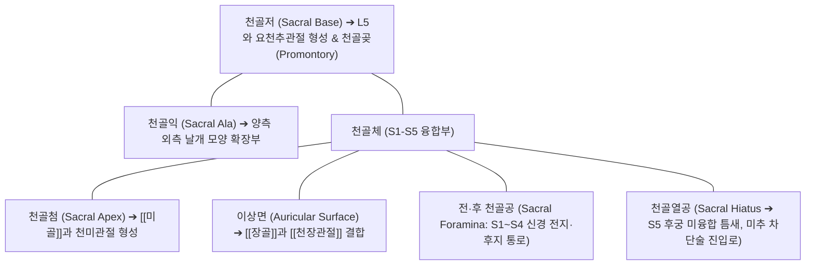

# [[천골]] (Sacrum / 薦骨 / 엉치뼈 S1~S5)

> **핵심 요약 (Key Summary)**:
> 5개의 천추골(S1~S5)이 성인이 되면서 하나로 융합되어 형성된 거대한 역삼각형 골격 구조물.
> 척주(요추 L5)와 양측 장골 사이에 쐐기(Wedge)처럼 박혀 골반환(Pelvic ring)의 후방 중심 쐐기돌(Keystone)을 형성하며, 이상면을 통해 [[천장관절]](SIJ)을 이룸.
> 체중을 양하지로 분산하는 뉴테이션(Nutation) 및 카운터뉴테이션의 생체역학적 중심축이자, [[이상근]], [[대둔근]], [[다열근]], 골반저근이 부착하고 [[천장관절 증후군]], 천골 피로골절 및 골반 비틀림 추나의 핵심 표적.

---

## 📌 목차
1. [해부학적 정밀 구조 및 골성 랜드마크 (Anatomy & Landmarks)](#1-해부학적-정밀-구조-및-골성-랜드마크-anatomy--landmarks)
2. [생체역학·관절학적 운동성 (Nutation & Pelvic Keystone)](#2-생체역학관절학적-운동성-nutation--pelvic-keystone)
3. [임상 평가 및 이학적 검사 (Examination & Palpation)](#3-임상-평가-및-이학적-검사-examination--palpation)
4. [영상의학 및 초음파 해부학 (Radiology & Sonoanatomy)](#4-영상의학-및-초음파-해부학-radiology--sonoanatomy)
5. [⭐ 원장님 심층 임상 고찰 및 원본 필기 (Clinical Pearls)](#5--원장님-심층-임상-고찰-및-원본-필기-clinical-pearls)
6. [관련 임상 질환 및 손상 (Pathology & Fractures)](#6-관련-임상-질환-및-손상-pathology--fractures)
7. [추나·도수치료 & 침구·약침·재활 프로토콜](#7-추나도수치료--침구약침재활-프로토콜)
8. [출처 및 학술 참고 문헌 (References)](#8-출처-및-학술-참고-문헌-references)

---

## 1. 해부학적 정밀 구조 및 골성 랜드마크 (Anatomy & Landmarks)

* **천골의 주요 골성 랜드마크**:
  * **천골저 (Sacral Base)**: 상부의 넓은 평면으로, 제5요추(L5) 추체 하면과 만나 요천추 추간판 복합체를 형성. 전방 돌출 모서리를 **천골곶(Sacral promontory)**이라 부르며 골반 입구 계측의 기준점.
  * **천골첨 (Sacral Apex)**: 하단의 좁은 부위로, 미골(Coccyx)의 기저부와 만나 천미관절 형성.
  * **이상면 (Auricular Surface)**: 천골 외측에 귀 모양으로 굴곡진 연골면으로, [[장골]]의 이개면과 맞물려 강력한 [[천장관절]]을 구성.
  * **전·후 천골공 (Sacral Foramina)**: 좌우 4쌍씩 총 8개의 구멍으로, 전천골공으로는 S1~S4 척수신경 전지가 빠져나가 천골신경총을 형성하고, 후천골공으로는 후지(팔료혈)가 탈출.
  * **천골열공 (Sacral Hiatus)**: S5(간혹 S4) 추궁판이 정중선에서 융합되지 않아 형성된 역V자형 틈새로, 양측에 천골각(Sacral cornua)이 융기되어 있어 미추 마취(Caudal epidural) 및 약침 자입로로 활용.
* **주요 부착 근육 및 인대군**:
  * **근육**: 전면 외측의 [[이상근]](Piriformis), 후면의 [[대둔근]](Gluteus maximus) 및 요추 [[다열근]](Multifidus), 하단의 골반저근(미골근).
  * **인대**: [[천장인대]](전방, 골간, 후방 다발), [[천결절인대]], [[천극인대]].

---

## 2. 생체역학·관절학적 운동성 (Nutation & Pelvic Keystone)

* **골반환의 쐐기돌 (Keystone Mechanism)**:
  * 천골은 상체에서 내려오는 수직 체중을 양측 장골과 고관절로 분산하는 골반의 '키스톤(Keystone)' 역할을 수행.
* **뉴테이션 (Nutation, 천골 전굴)의 안정화 역학**:
  * 천골저가 전하방으로 기울어지고 천골첨이 후상방으로 들리는 회전 운동.
  * 체중 부하 및 보행 입각기(Stance phase) 시 천골은 자연스럽게 뉴테이션 상태로 진입하며, 이때 골간 천장인대, 천결절인대, 천극인대가 팽팽하게 당겨져 관절을 잠그는 형태 폐쇄(Form closure)를 완성.
* **카운터뉴테이션 (Counter-nutation, 천골 후굴)**:
  * 천골저가 후상방으로 들리는 운동으로, 장후방 천장인대(LPSL)가 인장 부하를 독점적으로 감당하여 골반 이완 및 산도 확보에 기여.

---

## 3. 임상 평가 및 이학적 검사 (Examination & Palpation)

* **천골 경사도 및 변위 촉진**:
  * 환자를 복와위로 눕히고 양측 PSIS를 엄지손가락으로 확인한 후, 내측 천골저(Sacral base)의 깊이를 양측 비교하여 전방/후방 비틀림(Torsion) 진단.
  * 천골하각(Inferior Lateral Angle, ILA)의 상하/전후 위치를 촉진하여 비틀림 축(Oblique axis) 판정.
* **스프링 검사 (Springing Test of Sacrum)**:
  * 천골 하부 및 천골저에 손바닥을 대고 전방으로 탄력성 있게 압박(Springing)을 가할 때 스프링 반동이 소실되고 단단하게 저항하는지 확인.
* **천장관절 복합 유발 검사 (Laslett's Battery)**:
  * 패트릭 검사([[패트릭 검사]], FABER), 대퇴 전단 검사(Thigh thrust), 장골 압박 및 이개 검사 중 3개 이상 양성 시 천장관절 유래 통증 진단.

---

## 4. 영상의학 및 초음파 해부학 (Radiology & Sonoanatomy)

* **골반 단순 방사선 (Pelvis AP & Ferguson View)**:
  * 천골을 정면에서 똑바로 투영하는 퍼거슨 뷰(Ferguson view, 30~35도 두부 방향 틸트)를 통해 천장관절면의 골경화, 골침식, 관절강 협착 평가.
* **천골열공 초음파 스캔 (Caudal Sonoanatomy)**:
  * 탐촉자를 천골열공 부위에 횡단 거치 시, 양측의 밝은 고에코 천골각(Cornua)과 그 사이를 덮고 있는 고에코의 천미인대(Sacrococcygeal ligament), 그 심부의 저에코 경막외강을 관찰하여 안전한 미추 약침 자입 가이드.

---

## 5. ⭐ 원장님 심층 임상 고찰 및 원본 필기 (Clinical Pearls)

* **엉치가 빠질 듯이 아픈 '천골 비틀림(Sacral Torsion)'의 치료 요체**:
  * 골반 통증 환자의 70%는 장골보다 천골이 비스듬한 축(Left-on-left 또는 Right-on-left oblique axis)을 중심으로 비틀려 있습니다. 한쪽 천골저는 앞으로 쑥 들어가 있고 반대쪽 천골첨(ILA)은 뒤로 툭 튀어나와 엉덩방아를 찧은 것처럼 통증이 옵니다. 이때 튀어나온 ILA를 호흡과 함께 전방으로 밀어주는 천골 추나 교정(Sacral wobble)을 적용하면 즉각적으로 다리 길이가 맞춰지고 엉치 통증이 사라집니다.
* **골다공증 노인의 의문의 엉치 통증, '천골 피로골절(Insufficiency Fracture)'**:
  * 70대 이상 골다공증 환자가 넘어지지도 않았는데 "갑자기 엉치와 골반이 부서질 듯이 아파서 한 걸음도 못 딛겠다"고 하면 단순 염좌가 아니라 천골익(Sacral ala) 부위의 부전 골절입니다. X-ray에서는 잘 보이지 않고 MRI나 골스캔(Bone scan)에서 전형적인 나비 모양(H-sign / Honda sign)으로 확인됩니다. 이때 무리한 추나나 도수치료는 절대 금기이며 안정과 골밀도 치료가 최우선입니다.
* **팔료혈(八髎穴) 심부 자침의 비뇨생식기 및 마미신경 조절력**:
  * 천골 후면의 상료, 차료, 중료, 하료혈은 S1~S4 천골신경이 나오는 문입니다. 이곳으로 3치 호침을 깊이 자침하여 전침을 걸어주면 천골부 통증뿐만 아니라 만성 방광염, 전립선 비대, 요실금, 발기부전 등 골반강 장기의 자율신경 기능이 획기적으로 개선됩니다.

---

## 6. 관련 임상 질환 및 손상 (Pathology & Fractures)

| 질환 및 병태 | 발생 기전 및 병리 | 임상 소견 및 감별점 |
| :--- | :--- | :--- |
| [[천장관절 증후군]] (SIJ Dysfunction) | 천골-장골 관절면의 아탈구, 후방 인대 복합체 인장 손상 | 둔부 및 서혜부 방사통, 앉았다 일어설 때 통증, 패트릭 양성 |
| 천골 부전 골절 (Insufficiency Fracture) | 골다공증 노인에서 일상적 체중 부하에 의한 천골익 피로 파열 | 보행 완전 불능, 서혜부 및 둔부 극심한 골통, MRI상 H-징후 |
| 강직성 척추염 ([[강직성 척추염]]) | 천장관절 연골 및 인대 부착부의 자가면역성 만성 염증 | 젊은 남성 조조강직 >30분, 양측성 둔부통, 관절 유합 |
| [[이상근 증후군]] (Piriformis Syndrome) | 천골 전면 기시부에서 이상근 과긴장으로 좌골신경 압박 | 엉덩이 깊은 통증, 하지 후면 저림, FAIR 검사 양성 |
| 천골 낭종 (Tarlov Cyst) | 천골 신경근초의 뇌척수액 비정상 팽창으로 신경근 압박 | 좌골신경통과 유사한 하지 통증, 회음부 감각 이상 |

---

## 7. 추나·도수치료 & 침구·약침·재활 프로토콜

### 1) 한의 천골 추나 및 골반 교정 기법
* **천골 호흡 가동술 (Sacral Wobble Technique)**:
  * 복와위에서 시술자의 손바닥을 천골저와 ILA에 얹고 환자의 호흡 주기에 맞추어 흡기 시 천골저를 복측으로, 호기 시 ILA를 전방으로 교대 압박하여 천골 굴곡-신전 리듬 회복 ➔ [[추나]] · [[도수치료]].
* **천골 비틀림 직접 교정 추나**:
  * 천골 후방 변위된 ILA를 지지점으로 하여 순간적인 전방 스러스트를 가해 관절 정렬 복원.

### 2) 침구 및 약침 복합 치료
* **팔료혈(八髎穴) 심부 자침**:
  * 상료(BL31), 차료(BL32), 중료(BL33), 하료(BL34): 천골공 내부로 2.5~3치 호침을 정확히 진입시켜 천골 신경총 자극.
  * 백환유(BL30), 질변(BL54): 천골 외측 이상근 및 둔근 연쇄 긴장 완화.
* **약침 처방**:
  * **[[신바로약침]] / [[자하거약침]]**: 차료혈 및 천골열공, 후방 천장인대 부착부에 1.0~2.0cc 분주하여 골반 인대 강화 및 신경 염증 완화.

### 3) 골반저근 및 둔근 재활 운동
* **케겔 운동 (Kegel Exercise)**:
  * 천골첨과 치골 사이에 매달린 골반저근을 능동 수축하여 천골의 동적 지지력 회복.
* **골반 브릿지 (Glute Bridge)**:
  * [[대둔근]]과 [[복횡근]]을 동시 수축하여 천골의 힘 폐쇄(Force closure) 완성.

---

## 8. 출처 및 학술 참고 문헌 (References)

1. **Jordan MC, et al. (2024)**. Do we need another screw? Sacroiliac screw fixation in open-book pelvic ring injuries (APC type II). *EFORT Open Rev*. 9(8):827-836. PMID: 39087500.
   - `[연구 요약]` 골반환 개폐성 손상에서 천골 골성 지주와 천장관절 나사 고정 시 전단 응력 분산 및 생체역학적 안정화 분석.
2. **Casaroli G, et al. (2020)**. What do we know about the biomechanics of the sacroiliac joint and of sacropelvic fixation? A literature review. *Med Eng Phys*. 76():1-12. PMID: 31866118.
   - `[연구 요약]` 천골과 장골 사이의 3차원 형태/힘 폐쇄력 및 뉴테이션 운동학, 척추골반 고정술 후 하중 전달 메커니즘 고찰.
