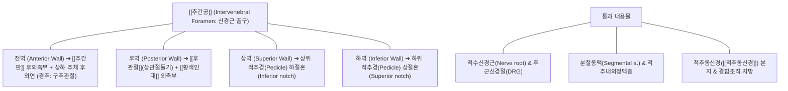

# [[추간공]] (Intervertebral Foramen / 椎間孔 / 신경공)

> **핵심 요약 (Key Summary)**:
> 상하로 인접한 두 척추골의 척추경(Pedicle), 추체 후외측, 추간판 및 후관절이 둘러싸서 형성하는 척수신경근(Spinal nerve root)과 혈관의 핵심 출구 통로.
> 경추 추간공은 요추에 비해 전후경이 좁고 신경근이 차지하는 단면적 비율(약 30~50%)이 높아, 디스크 팽륜이나 구추관절(Luschka) 골극, 후관절 비대에 의한 협착에 매우 취약.
> 척추 신전·회전 시 직경이 감소하고 굴곡·축성 견인 시 직경이 확대되는 가변적 생체역학 통로로, [[Spurling 검사]]의 유발 표적이자 추나 견인 및 신경근 약침 치료의 핵심 해부학적 관문.

---

## 📌 목차
1. [해부학적 정밀 구조 및 4대 경계 (Anatomical Boundaries)](#1-해부학적-정밀-구조-및-4대-경계-anatomical-boundaries)
2. [생체역학·동적 면적 변화 (Dynamic Biomechanics)](#2-생체역학동적-면적-변화-dynamic-biomechanics)
3. [임상 평가 및 이학적 검사 (Examination & Provocation)](#3-임상-평가-및-이학적-검사-examination--provocation)
4. [영상의학 및 초음파 해부학 (Radiology & Sonoanatomy)](#4-영상의학-및-초음파-해부학-radiology--sonoanatomy)
5. [⭐ 원장님 심층 임상 고찰 및 원본 필기 (Clinical Pearls)](#5--원장님-심층-임상-고찰-및-원본-필기-clinical-pearls)
6. [관련 임상 질환 및 손상 (Pathology & Stenosis)](#6-관련-임상-질환-및-손상-pathology--stenosis)
7. [추나·도수치료 & 침구·약침·재활 프로토콜](#7-추나도수치료--침구약침재활-프로토콜)
8. [출처 및 학술 참고 문헌 (References)](#8-출처-및-학술-참고-문헌-references)

---

## 1. 해부학적 정밀 구조 및 4대 경계 (Anatomical Boundaries)

* **추간공의 4대 해부학적 경계벽**:
  * **전벽 (Anterior)**: 상하 척추체 후외측면, [[추간판]](Intervertebral disc) 후외측 섬유륜. 경추에서는 구추관절(Luschka 관절의 구상돌기)이 전벽의 내측 경계를 형성.
  * **후벽 (Posterior)**: 후관절(Facet joint)의 상관절돌기 전연 및 이를 감싸는 [[황색인대]](Ligamentum flavum)의 외측 연장부.
  * **상벽 (Superior)**: 상위 척추경의 하추간절흔(Inferior vertebral notch).
  * **하벽 (Inferior)**: 하위 척추경의 상추간절흔(Superior vertebral notch).
* **통과 구조물 (Contents)**:
  * **척수신경근 및 후근신경절(Dorsal Root Ganglion, DRG)**: 통각에 극도로 민감한 DRG가 추간공 내벽 상부에 위치.
  * **척추동신경 ([[척추동신경]])**: 추간공을 빠져나온 직후 다시 추간공 안으로 되돌아가 추간판 후면과 경막 외벽의 통각을 지배.
  * **혈관망**: 척수와 척추뼈에 영양을 공급하는 분절동맥(Radicular artery) 및 척추간 정맥총, 충격 흡수용 경막외 지방 조직.

---

## 2. 생체역학·동적 면적 변화 (Dynamic Biomechanics)

* **자세에 따른 추간공 면적의 동적 개폐 (Dynamic Opening & Closing)**:
  * **신전 (Extension)**: 상하 척추경이 가까워지고 후관절이 미끄러져 내려오며 황색인대가 접혀 들어가 **추간공 단면적이 최대 20~30% 감소**.
  * **신전 + 동측 회전/측굴**: 추간공이 가장 좁아지는 최악의 압박 위치 (Spurling 검사의 역학적 원리).
  * **굴곡 (Flexion)**: 후방 척추경 간격이 벌어지며 **추간공 단면적이 20~25% 확대**.
  * **축성 견인 (Axial Traction)**: 추간판 높이를 일시적으로 회복시키고 척추경 사이 간격을 수직으로 넓혀 신경근 허혈을 즉각 해소.

---

## 3. 임상 평가 및 이학적 검사 (Examination & Provocation)

* **스펄링 검사 ([[Spurling test]] / 추간공 압박 검사)**:
  * 경추를 신전시키고 환측으로 회전-측굴 후 검사자가 두부를 하방으로 축성 압박 시 추간공이 급격히 좁아지며 피부분절 상지 방사통 재현.
* **경추 신연 검사 (Cervical Distraction Test)**:
  * 검사자가 앙와위에서 환자의 후두골과 턱을 잡고 상방으로 축성 견인할 때 추간공이 넓어지며 기존의 상지 방사통이 즉각 완화되는 현상 확인 (특이도 90% 이상).
* **견관절 외전 검사 (Bakody's Test)**:
  * 손을 머리 위에 얹었을 때 상완신경총과 추간공 내 신경근의 주행 경로가 느슨해져 통증이 줄어드는 소견.

---

## 4. 영상의학 및 초음파 해부학 (Radiology & Sonoanatomy)

* **경추 사위 방사선 (Cervical Oblique X-ray)**:
  * 전후 45도 사위상에서 추간공의 난원형(Oval) 구멍 형태가 가장 뚜렷하게 투영됨.
  * 구추관절 골극이나 후관절 비대에 의한 '모래시계형 협착(Hourglass narrowing)' 여부 확인.
* **척추 CT 및 MRI (Axial & Sagittal View)**:
  * CT 골창: 신경공을 둘러싼 골극의 크기와 골화 상태 정밀 입체 분석.
  * MRI T2 시상면: 추간공 내부를 채우고 있는 고신호의 지방 조직이 소실되고 저신호의 디스크나 뼈에 의해 신경근이 압박(Obliteration of perineural fat)된 양상 확인.
* **초음파 유도하 추간공 외측 스캔 (Cervical Nerve Root Sonoanatomy)**:
  * 횡돌기 전결절과 후결절 사이의 홈(Intertubercular groove)을 빠져나오는 신경근(동글동글한 저에코 신경 다발)을 실시간 확인하여 혈관 천자 없는 안전한 약침 주입.

---

## 5. ⭐ 원장님 심층 임상 고찰 및 원본 필기 (Clinical Pearls)

* **중앙관 협착(Central Stenosis)보다 추간공 협착(Foraminal Stenosis)이 통증이 10배 더 날카롭다**:
  * 척추관 중심 협착증 환자는 다리가 무겁고 저린 파행이 주 증상이지만, 추간공 협착증 환자는 "칼로 베는 듯하고 전기가 통하듯 찌릿찌릿해서 밤에 잠을 한숨도 못 잔다"고 울부짖습니다. 통각에 가장 예민한 후근신경절(DRG)이 바로 이 추간공 속에 갇혀 있기 때문입니다. 소염 약침을 신경근 출구 주위에 분주하여 DRG의 부종을 신속히 빼주는 것이 통증 차단의 핵심입니다.
* **견인 치료(Traction)의 성패는 '각도(Angle)'가 결정한다**:
  * 경추 추간공 협착 환자에게 목을 똑바로 일자로 당기면 추간공이 잘 벌어지지 않습니다. 경추를 약 15~24도 굴곡(Flexion)시킨 상태에서 축성 견인을 걸어야 후관절이 열리면서 추간공 단면적이 최대치로 개방됩니다. 요추 역시 무릎을 구부린 앙와위(Fowler's position)에서 굴곡 견인을 걸어야 효과가 극대화됩니다.
* **구추관절 골극과 디스크 탈출의 동반 압박(Double-Crush in Foramen)**:
  * 50대 이상 만성 목 디스크 환자들은 단순 디스크 연조직 탈출뿐만 아니라 앞에서는 구추관절 골극이, 뒤에서는 후관절 골극이 자라나 신경근을 앞뒤에서 가위처럼 집어삼키는 복합 협착 상태입니다. 뼈를 깎아내지 않고도 추나 요법으로 척추관절의 가동성을 회복시켜주면 신경근 주위의 미세 순환이 회복되어 수술 없이 완치가 가능합니다.

---

## 6. 관련 임상 질환 및 손상 (Pathology & Stenosis)

| 질환 및 병태 | 발생 기전 및 병리 | 임상 소견 및 감별점 |
| :--- | :--- | :--- |
| [[경추 추간판 탈출증]] (C-HIVD) | 후외측 디스크 탈출로 추간공 내 신경근 전방 압박 | 목 신전-회전 시 상지 방사통 폭증, Spurling 양성 |
| 추간공 협착증 (Foraminal Stenosis) | 후관절 퇴행성 비대, 골극, 디스크 침하로 추간공 협소 | 안정 시에도 지속되는 발작성 신경통, 야간통 심화 |
| 후근신경절염 (DRG Neuritis) | 추간공 내 DRG의 기계적 압박 및 신경 염증 물질 침윤 | 극심한 작열통(Burning pain), 이질통(Allodynia) |
| 경추 신경근병증 ([[경추 신경근병증]]) | 추간공 내 신경근 허혈 및 전도 장애 | 분절성 감각 저하, 심부건반사 소실, 근위축 |
| 요추 외측 함요부 협착증 | 요추 추간공 내측 입구에서 상위 상관절돌기에 의한 신경 압박 | 하지 방사통, 걸을 때 신경인성 파행, Kemp 양성 |

---

## 7. 추나·도수치료 & 침구·약침·재활 프로토콜

### 1) 한의 추나 및 추간공 감압 도수기법
* **경추 굴곡-측굴-신연 가동술 (Flexion-Lateral Distraction)**:
  * 환측 추간공을 최대 개방하기 위해 경추를 약 20도 굴곡시키고 건측으로 측굴한 상태에서 부드러운 도수 견인을 간헐적으로 적용 ➔ [[추나]] · [[도수치료]].
* **요추 콕스 굴곡-외측 굴곡 추나 (Cox Side-Lying Distraction)**:
  * 요추 추간공 협착 분절의 신경근 감압을 위해 굴곡과 반대측 측굴을 병행하여 신경공 통로 확장.

### 2) 침구 및 약침 복합 치료
* **핵심 혈위 자침**:
  * 경추 협척혈(EX-B2 C4~C7): 횡돌기 후결절 바로 내측으로 자침하여 추간공 외측 입구 감압.
  * 천주(BL10), 풍지(GB20), 견정(GB21): 상완신경총으로 이어지는 근막 긴장 완화.
  * 요추 협척혈(EX-B2 L3~L5): 요추 신경근관 후벽 주위 자침.
* **약침 처방**:
  * **[[신바로약침]] / [[자하거약침]]**: 추간공 외측 출구 및 DRG 인접부에 1.0~2.0cc 분주하여 신경 주위 염증성 사이토카인 억제 및 허혈성 신경 손상 복원.
  * **[[봉독약침]]**: 만성 신경근 유착 및 섬유화 박리.

### 3) 신경 가동화 운동 (Nerve Flossing)
* **상완신경총 신경 슬라이딩 훈련 (Cervical Nerve Flossing)**:
  * 고개를 건측으로 젖힐 때 손목을 굴곡시키고, 고개를 원위치할 때 손목을 신전시키는 동적 활주 운동을 통해 추간공 내 신경근의 유착 방지.

---

## 8. 출처 및 학술 참고 문헌 (References)

1. **Al-Habib A, et al. (2025)**. Targeted anterior expansion of the cervical facet joints achieves indirect foraminal decompression and reduces spondylolisthesis via a posterior approach: a cadaveric study. *J Orthop Surg Res*. 20(1):437. PMID: 40307884.
   - `[연구 요약]` 경추 후관절의 타겟 확장술을 통한 추간공 높이 및 단면적의 간접 감압 효과와 척추 전방전위증 완화 생체역학 분석.
2. **Kageyama H, et al. (2026)**. Transforaminal full-endoscopic thoracic foraminoplasty performed under local anesthesia for foraminal stenosis associated with degenerative scoliosis: illustrative case. *J Neurosurg Case Lessons*. 11(17):. PMID: 42044530.
   - `[연구 요약]` 척추 변형 및 퇴행성 협착증 환자에서 경추간공 내시경 신경공성형술(Foraminoplasty) 시 추간공의 4대 해부학적 경계와 신경근 감압 기전 고찰.
