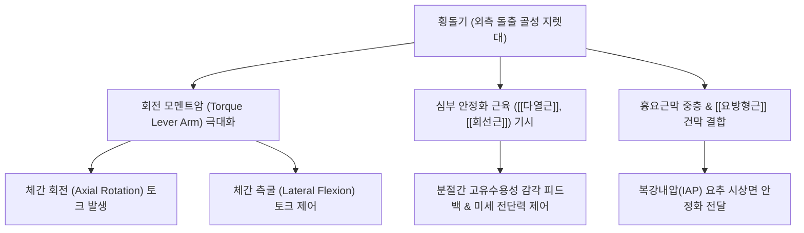

# 횡돌기 (Transverse Process, 가로돌기, 橫突起)

> **핵심 요약 (Key Summary)**:
> 척추경(Pedicle)과 척추판(Lamina)의 접합부에서 좌우 외측으로 수평 또는 후외측으로 돌출된 척추의 외측 지렛대 골격 돌기.
> 경추에서는 횡돌기공(Foramen transversarium)을 통해 추골동맥이 주행하고 [[사각근]]·[[견갑거근]]이 부착하며, 흉추에서는 늑골과 늑횡돌관절(Costotransverse joint)을 이루고, 요추에서는 [[요방형근]]과 [[대요근]]의 심부 부착점이자 흉요근막 중층의 지지대 역할을 수행.
> 요추 횡돌기 견열 골절(Avulsion fracture), 횡돌기간 인대(Intertransverse ligament) 염좌, 흉곽출구 증후군 경부 신경근 포착의 핵심 병소이며 추나 척추 회전 변위 교정(횡돌기 추진법)의 절대적 접촉점.

---

## 1. 개요 및 기능해부학

횡돌기(Transverse Process, 가로돌기)는 척추궁(Vertebral arch)의 외측벽에서 뻗어 나와 척추의 회전 및 측굴 운동 시 강력한 지레팔(Moment arm)을 제공하는 뼈 구조물이다. 경추, 흉추, 요추의 고유 생체역학적 기능과 부하 요구도에 따라 형태학적 분화가 뚜렷하다.

| 척추 분절 | 형태학적 고유 특징 | 통과 혈관 / 신경 / 관절 구조 | 주요 부착 근육 및 연부조직 |
| :--- | :--- | :--- | :--- |
| **경추 (C1~C7)** | 전결절(Anterior tubercle)과 후결절(Posterior tubercle) 형성, 중앙에 횡돌기공 존재 | • C1~C6: [[추골동맥]](Vertebral artery) 및 추골정맥 통과 • 결절 사이 척수신경구(Sulcus): 경추신경 전지 주행 | [[사각근]](전·중·후), [[견갑거근]], 경판상근, 경최장근 |
| **흉추 (T1~T12)** | 두껍고 곤봉 모양으로 후외측 돌출, 전외측면에 늑골 관절면 형성 | • T1~T10: 횡돌늑골와(Transverse costal facet)가 늑골 결절과 결합하여 **늑횡돌관절** 구성 | [[회선근]](Rotatores), [[다열근]], [[흉최장근]], 늑골거근 |
| **요추 (L1~L5)** | 얇고 긴 주걱 모양(발생학적으로 늑골 퇴화물인 갈비돌기/Costal process) | • 유두돌기(Mammillary process): 상관절돌기 후면 부착 • 부돌기(Accessory process): 횡돌기 기저부 후하방 위치 | [[요방형근]], [[대요근]], [[횡돌기간근]], 흉요근막(TLF) 중층 |

### 주요 체표 해부학 랜드마크
- **C1(환추) 횡돌기**: 유양돌기(Mastoid process) 첨부와 하악각(Angle of mandible) 사이의 함요부에서 가장 넓게 촉진되는 돌기로, 후두하근군 촉진 및 상부경추 추나의 핵심 기준점이다.
- **C6 전결절 (Chassaignac 결절, 경동맥결절)**: 총경동맥(Common carotid artery)이 바로 앞을 주행하여 압박 지혈 및 성상신경절 차단술(Stellate ganglion block)의 해부학적 표지점 역할을 한다.
- **C7 횡돌기**: 횡돌기공이 매우 작거나 퇴화되어 추골동맥이 통과하지 않으며(추골정맥만 통과), 제7경추 신경근이 전방을 주행한다.

---

## 2. 생체역학 및 3차원 운동학

- **회전 및 외측 굴곡의 모멘트암 극대화**:
  - 횡돌기는 척추 회전 운동축(Instantaneous axis of rotation)에서 관상면 상 가장 외측으로 멀리 떨어져 위치한다.
  - 근육이 수축할 때 적은 힘으로도 높은 비틀림 토크(Torsional torque)를 형성하여 척추의 효율적인 회전과 측굴을 유도한다.
- **분절 안정화와 고유수용성 센서**:
  - 횡돌기 기저부와 후면에서 기시하는 [[다열근]](Multifidus)과 [[회선근]](Rotatores)은 척추 극돌기로 사선 주행하며, 관절 위치 감각 수용기가 밀집되어 척추 분절의 미세 흔들림과 전단력을 실시간 제어한다.

---

## 3. 인접 연부조직 및 신경·혈관 관계

- **추골동맥(Vertebral Artery)의 보호 도관**:
  - C6에서 C1 횡돌기공을 수직 관통하며 뇌간 및 소뇌로 혈류를 공급한다. C1-C2 분절 및 C6 입구부에서 경추 회전이나 외상 시 동맥 신장 및 박리 위험에 노출될 수 있다.
- **경추신경근 통과 홈(Intertubercular groove)**:
  - 경추 횡돌기 전결절과 후결절 사이의 홈을 통해 척수신경 전지가 빠져나와 [[상완신경총]]을 형성한다. 전사각근과 중사각근의 긴장은 이 신경 통로를 협착시켜 신경 포착을 유발한다.
- **요추 흉요근막(TLF) 중층의 부착**:
  - L1~L4 횡돌기 첨부에는 흉요근막 중층(Middle layer)과 [[요방형근]]의 내측 건막이 견고하게 부착되어, 복벽 근육군 수축 시 발생하는 측방 장력을 요추체로 직결시킨다.

---

## 4. 임상 병태생리 및 주요 질환

### 1) 요추 횡돌기 골절 (Lumbar Transverse Process Fracture)
- **손상 메커니즘**:
  - 교통사고, 추락 등 고에너지 직접 타격 또는 무거운 물건을 들 때 [[요방형근]] 및 [[대요근]]의 급격한 편심성 수축에 의해 횡돌기 첨부가 뜯겨 나가는 견열 골절(Avulsion fracture).
- **임상 징후 및 합병증**:
  - 체간 기립 및 환측 회전 시 극심한 편측 요통과 국소 압통이 발생한다.
  - L1~L3 횡돌기 골절 시 신장 손상 및 후복막강 혈종(Retroperitoneal hematoma) 위험이 동반되며, L5 횡돌기 골절은 골반환(Pelvic ring) 불안정성 및 천장관절 분리와 높은 상관관계를 갖는다.

### 2) 횡돌기간 인대(Intertransverse Ligament) 염좌
- 척추 굴곡과 비틀림이 결합된 부하에서 횡돌기 사이를 잇는 인대 섬유가 미세 파열되어 분절성 국소 압통과 회전 가동범위 제한을 초래한다.

### 3) 흉곽출구 증후군 및 경추 횡돌기 비대
- C7 횡돌기가 비정상적으로 길어지거나 경늑골(Cervical rib)이 형성된 경우, 쇄골하동맥 및 상완신경총 하신경간(C8-T1)을 압박하여 척측 수부 저림과 순환 장애를 유발한다.

---

## 5. 이학적 검사 및 영상의학적 진단

- **분절 횡돌기 촉진 및 척추 리스팅 (Palpation & Listing)**:
  - 복와위(Prone) 상태에서 양측 횡돌기 후면을 수근부나 모지로 압진하여 전후방 회전 변위(Rotational malposition, P/A glide restriction) 및 방어적 근연축(Muscle guarding)을 평가한다.
- **C1 횡돌기 외측 편위 검사**:
  - 유양돌기와 하악각 사이에서 좌우 C1 횡돌기의 돌출도 및 좌우 대칭성을 비교하여 상부경추 회전 아탈구를 판정한다.
- **영상의학적 평가**:
  - **단순 방사선(X-ray)**: AP 뷰에서 횡돌기 골절선의 전위 유무를 관찰한다. 장내 가스 음영에 가려질 수 있어 주의를 요한다.
  - **CT 검사**: 횡돌기 골절편의 분쇄 정도, 후복막강 혈종, 인접 척추경 및 후관절 골절 동반 여부를 확진하는 표준 검사이다.

---

## 6. 한의 임상 치료 및 추나 프로토콜

- **추나 횡돌기 추진법 (Transverse Push Technique)**:
  - **흉추 및 요추 회전 변위 교정**: 척추가 후방으로 회전 돌출된(Posterior) 측의 횡돌기에 시술자의 두상골(Pisiform) 또는 모지구를 밀착 접촉한다. 환자의 호흡 날숨 말기에 전방(Anterior) 및 분절 관절면 방향(Superior)으로 순간 임펄스(HVLA thrust)를 가해 회전 변위를 정렬한다.
- **침구 및 협척혈(夾脊穴) 자침**:
  - **화타협척혈(華佗夾脊穴)**: 각 척추 극돌기 하연 외측 0.5촌 지점으로, 침첨이 횡돌기 기저부 및 후관절 주위 다열근 심부로 진입한다. 척수신경 후지 내측지와 심부 기립근을 동시에 자극하여 근성 연축을 즉각 이완한다.
- **약침 및 도침 치료**:
  - 횡돌기 첨부 요방형근 부착부 및 횡돌기간 인대 손상 부위에 중성어혈약침 또는 신바로약침을 주입하여 무균성 신경염증을 가라앉힌다.
  - 만성 유착성 섬유화 병변에는 도침(Acupotomy)으로 횡돌기 골막 상단을 가볍게 소통 박리한다.

---

## 7. 재활 운동 및 예방 관리

- **코어 근육 및 다열근 재교육**:
  - 급성 횡돌기 골절 초기(2~4주)에는 무리한 회전과 굴곡 스트레칭을 엄격히 제한하고 흉요추 보조기(TLSO)를 착용한다.
  - 통증 완화기에는 버드독(Bird-dog) 및 플랭크 등 척추 중립을 유지한 채 횡돌기에 부착하는 심부 다열근과 복횡근을 활성화하는 등척성 코어 운동을 점진적으로 시행한다.
- **사각근 및 경추 횡돌기 스트레칭**:
  - 경추 횡돌기에 부착하는 전·중사각근의 과긴장을 풀기 위해 턱을 당긴 상태(Chin-tuck)에서 경추를 반대측으로 측굴 및 회전시키는 부드러운 신장 운동을 지도한다.

---

## 8. 현대 학술 연구 및 근거 고찰

- Alijanipour P, et al. (2020). Isolated multiple lumbar transverse process fractures with spinal instability: an uncommon yet serious association. *Eur Spine J*. PMID: 31407163
  - [연구 요약] 다발성 요추 횡돌기 골절이 단순한 안정성 골절로 오인되기 쉬우나, 부착 인대와 근막 손상으로 인해 척추 불안정성 및 후복막강 혈종을 동반할 수 있음을 입증하고 정밀 추적의 필요성을 강조함.
- Barker PJ, et al. (2007). The middle layer of lumbar fascia and attachments to lumbar transverse processes. *Spine*. PMID: 17978663
  - [연구 요약] 요추 횡돌기와 흉요근막 중층 간의 해부학적 결합 방식을 규명하고, 복벽 근육군의 수축력이 횡돌기를 매개로 요추 시상면 안정성을 강화하는 생체역학적 장력 전달 기전을 증명함.
- Winkelmann M, et al. (2018). Fractures of the transverse processes of the fourth and fifth lumbar vertebrae in patients with pelvic ring injuries: indicator of biomechanical instability but not shock. *Bone Joint J*. PMID: 30168760
  - [연구 요약] L4 및 L5 횡돌기 골절이 장요인대 손상 및 후방 골반환 불안정성의 신뢰할 수 있는 생체역학적 간접 지표임을 규명함.
