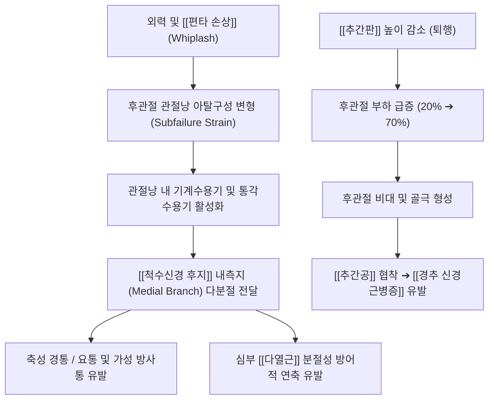

# 후관절 (Facet Joint / Zygapophysial Joint, 後關節, 추간관절)

> **핵심 요약 (Key Summary)**:
> 상위 추골의 하관절돌기(Inferior articular process)와 하위 추골의 상관절돌기(Superior articular process)가 맞물려 형성되는 척추 후방의 활액성 평면관절(Synovial planar joint).
> 척추의 분절별 운동 방향([[경추]] 45° 사선, [[흉추]] 60° 관상면, [[요추]] 90° 시상면)을 결정하고 축성 하중의 약 20%를 담당하며, [[추간판]] 퇴행 시 최대 70%까지 하중이 전이되어 퇴행 악순환을 유발.
> [[척수신경 후지]] 내측지(Medial branch)의 다분절 지배를 받아 [[후관절 증후군]], 만성 [[요통]], [[경추성 두통]]의 핵심 원인점이 되며, 관절 비대 시 [[추간공]]을 협착시켜 [[경추 신경근병증]]을 유발.
> [[추나]] 관절신연 및 가동술, [[협척혈]] 심부 자침, 초음파 유도하 관절낭 [[포도당 프로로테라피]](DPT)의 핵심 표적 관절.

---

## 1. 개요 및 기능해부학

후관절(Zygapophysial joint, Facet joint)은 전방의 추간판(Intervertebral disc)과 함께 척추 삼관절 복합체(Three-joint complex)의 후방 두 기둥을 형성하는 활액 관절이다. 관절면은 유리연골로 덮여 있으며 섬유성 관절낭, 활막, 관절강 내 지방 및 활막 주름 패드(Meniscoid)로 구성된다.

| 척추 분절 | 관절면 배열 방향 (Spatial Orientation) | 허용 운동 및 주동 역학 | 임상적 취약점 |
| :--- | :--- | :--- | :--- |
| **경추 (C2~C7)** | 관상면과 수평면 사이 **약 45° 경사** | 굴곡-신전 및 회전·측굴의 3차원 커플링(Coupling) 모션 | 관절낭이 두껍고 활막 주름이 풍부하여 편타 손상 및 [[경추성 두통]] 호발 |
| **흉추 (T1~T12)** | 관상면에 가까운 **약 60° 경사** (전두면 배열) | 체간 회전(Axial Rotation) 운동에 가장 유리, 굴신 제한 | 늑추관절과 결합되어 견고하나 과후만 시 후관절 충돌 발생 |
| **요추 (L1~L5)** | 시상면에 가까운 **약 90° 배열** (J자형 관절면) | 굴곡-신전 허용, 회전 운동을 강력히 차단(각 분절당 1~2°) | 회전 비틀림 외력 시 관절돌기 협부 및 관절낭 손상, [[후관절 증후군]] |

---

## 2. 생체역학 및 3차원 운동학

- **하중 분담 및 퇴행의 가속 악순환 (Load Sharing & Vicious Cycle)**:
  - 정상 직립 자세에서 척추 전방의 추간판이 축성 하중의 약 80%를 감당하고, 후방의 양측 후관절이 나머지 20%를 분담한다.
  - 신전 및 동측 회전 시 후관절 접촉 압력이 급격히 상승하며, 굴곡 시에는 관절면이 분리되고 관절낭이 신장된다.
  - 추간판 높이가 퇴행성으로 감소하면 후관절로 쏟아지는 하중이 최대 70%까지 치솟아 후관절 연골 마모, 연골하 골경화, 골극 비대를 가속화한다.
- **편타 손상과 관절낭 아탈구성 변형 (Subfailure Strain)**:
  - 교통사고 등 급격한 가속-감속 충격 시 후관절낭이 생리적 탄성 한계를 초과하여 늘어나는 미세 손상이 발생하며, 이는 구조적 파열 없이도 지속적인 신경인성 염증과 만성 통증을 유발하는 주 기전으로 규명되었다.

---

## 3. 인접 연부조직 및 신경·혈관 관계

- **다분절 신경 지배 (Dual Innervation by Medial Branch)**:
  - 각 후관절은 해당 분절의 척수신경 후지 내측지와 상위 분절의 내측지, 최소 **2개 분절의 신경 지배**를 동시에 받는다.
  - 예컨대 L4-L5 후관절은 L3 및 L4 신경근의 후지 내측지 지배를 받는다. 이 다분절 수렴 현상으로 인해 후관절 통증은 명확한 피부분절을 따르지 않고 둔부, 서혜부, 대퇴 후면으로 모호하게 퍼지는 가성 방사통(Pseudoradicular pain)을 보인다.
- **추간공(Intervertebral Foramen) 후벽 형성**:
  - 후관절의 상관절돌기와 관절낭은 추간공의 후벽을 구성한다. 후관절의 비후성 골관절염이나 관절낭 낭종(Synovial cyst)은 추간공 내부를 주행하는 신경근과 후근신경절(DRG)을 직접 압박한다.
- **심부 다열근과의 기계적 연결**:
  - [[다열근]]의 최심부 섬유는 후관절낭에 직접 부착되어 관절 운동 시 관절낭과 활막 패드가 관절면 사이에 끼이지 않도록 능동적으로 당겨주는 보호 역할을 수행한다.

---

## 4. 임상 병태생리 및 주요 질환

### 1) 후관절 증후군 (Facet Joint Syndrome)
- 척추 신전(뒤로 젖힘), 동측 측굴 및 회전 시 환측 척추 기립근 심부에서 국소적 압통과 둔통이 악화된다.
- 굴곡(앞으로 숙임)이나 보행 시에는 관절면 압박이 풀려 통증이 일시적으로 완화되는 특징을 갖는다(디스크 질환인 [[추간판 탈출증]]과의 핵심 감별점).

### 2) 경추성 두통 및 삼차신경-경추 복합체 연계
- 상부 경추(C1-C3) 후관절낭의 통각 신호는 삼차신경 척수핵([[삼차신경-경추 복합체]])으로 수렴되어 후두부, 두정부 및 안와 후면의 박동성 통증으로 투사된다.

### 3) 후관절 비대와 경추/요추 척추관·추간공 협착증
- 퇴행성 마모에 따른 반응성 골극 형성이 척추관 외측 함요(Lateral recess) 및 추간공을 침범하여 보행 시 신경인성 파행(Claudication)이나 상지 방사통을 유발한다.

---

## 5. 이학적 검사 및 영상의학적 진단

- **켐프 검사 (Kemp Test / Quadrant Test)**:
  - 환자의 척추를 신전시킨 상태에서 환측으로 측굴 및 회전력을 동시에 가하여 후관절면을 강하게 압박한다. 국소 통증 또는 둔부 연관통이 재현되면 양성이다.
- **척추 분절 스프링 검사 (Springing Test / P-A Glide)**:
  - 복와위에서 후관절 돌기 부위에 후전방(P-A) 압박력을 가하여 관절낭 염증 유무, 엔드필(End-feel), 통증 유발 여부를 평가한다.
- **영상의학적 검사**:
  - **경추/요추 사위 촬영(Oblique X-ray)**: 요추 사위상에서 스코티시 테리어(Scotty dog)의 목 부위(협부)와 귀/앞다리(상·하관절돌기)의 정렬 및 골관절염성 골극을 관찰한다.
  - **MRI & CT**: 관절면 연골 마모, 관절강 삼출액, 연골하 골낭종 및 활막 낭종의 척수강 압박 여부를 확인한다.

---

## 6. 한의 임상 치료 및 추나 프로토콜

- **추나 후관절 신연 및 가동 기법 (Distraction & Mobilization)**:
  - **경추 후관절 가동술**: 경추 굴곡 및 반대측 측굴을 유도하여 좁아진 후관절면을 열어주고, [[Maitland 관절가동술]] 등급 I~II ([[도수치료]] 병행)의 미세 진동으로 활액 순환을 촉진한다.
  - **요추 앙와위/측와위 골반 회전 교정 (Lumbar Roll)**: 후관절 면의 잠김(Facet lock)을 해소하기 위해 관절면 방향에 맞추어 최소 회전 각도에서 순간 임펄스를 가한다.
- **[[협척혈]] 심부 자침 및 약침술**:
  - 후관절 부착부와 후지 내측지가 지나는 협척혈([[극돌기]] 하연 외측 0.5~1.0촌)에 장침을 45° 사자하여 후관절낭 외측벽에 침첨이 가볍게 접촉(Bone contact)하도록 심부 자침한다.
  - 신바로약침, 중성어혈약침 또는 황련해독탕 [[약침]]을 후관절낭 주변에 주입하여 무균성 활막염을 강력히 제어한다.
- **초음파 유도하 관절낭 증식치료 (Prolotherapy / DPT 연계)**:
  - 도수치료 및 추나로 정렬을 회복한 후에도 인대 이완으로 재발하는 만성 불안정성 환자에게 20% 고농도 포도당 프로로테라피(DPT)를 적용한다.
  - **골면 접촉(Bone Contact) 안전 수칙**: 초음파 시각화 하에 22G(9cm) 이상의 척추침을 사용하여 관절돌기 외측 골면에 확실히 닿은 것을 확인한 후 주입함으로써 척추강 및 신경 손상을 원천 방지한다.

---

## 7. 재활 운동 및 예방 관리

- **후관절 감압 굴곡 운동 (Williams Flexion Exercise)**:
  - 후관절 내압을 낮추기 위해 무릎을 가슴으로 당기는 골반 후방경사 운동(Knee-to-chest stretch)을 지도한다.
  - 과도한 요추 신전(Cobra 자세 등)은 후관절 충돌을 악화시키므로 급성기에는 금기한다.
- **경부 심부굴곡근(DCF) 훈련**:
  - 경추 후관절의 전단력을 줄이기 위해 턱 당기기(Chin-tuck)를 통한 두장근·경장근 활성화 운동을 매일 3회 이상 시행한다.

---

## 8. 현대 학술 연구 및 근거 고찰

- Bogduk N, et al. (2026). Subfailure capsule strain as the cause of cervical zygapophysial joint pain after whiplash: a scoping review. *Pain Med*. PMID: 41706694
  - [연구 요약] 편타성 손상 후 경추 후관절 통증이 관절낭의 아탈구성 변형(Subfailure strain)에 의해 통각 수용기가 감작되어 발생함을 문헌적으로 입증하고, 후관절이 저에너지 손상에서도 핵심 통증 유발원임을 규명함.
- Kagawa E, et al. (2021). Fibrous Connection Between Cervical Nerve and Zygapophysial Joint and Implication of the Cervical Spondylotic Radiculopathy. *Spine*. PMID: 33337682
  - [연구 요약] 경추 신경근과 후관절낭 복합체 사이의 직접적인 해부학적 섬유성 결합을 규명하여, 후관절 퇴행 및 관절낭 유착이 신경근병증성 통증으로 전이되는 생체역학적 기전을 밝힘.
- Mao H, et al. (2026). Effects of Parameter Combinations in Cervical Rotation-Traction Manipulation on Intervertebral Foramen Opening and Biomechanical Responses. *J Pain Res*. PMID: 42741733
  - [연구 요약] 척추 회전-견인 추나요법의 매개변수 조합이 후관절면의 분리와 추간공 단면적 확장에 미치는 생체역학적 영향을 3차원 유한요소 해석으로 규명함.
