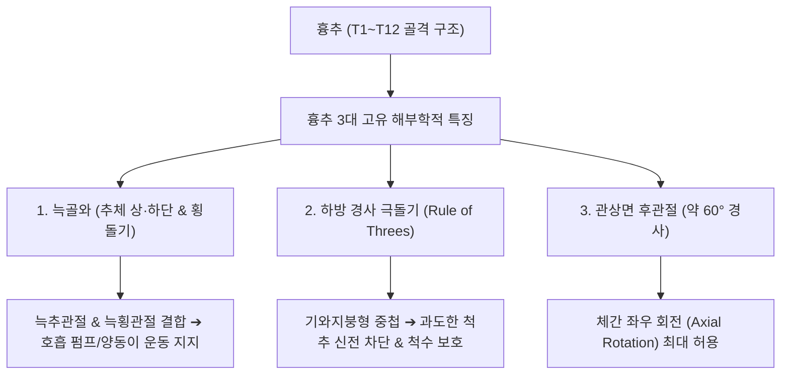

# 흉추 (胸椎, Thoracic Vertebrae, 등뼈, 흉추골)

> **핵심 요약 (Key Summary)**:
> [[경추]](C7)와 [[요추]](L1) 사이에 위치하는 12개의 척추골(T1~T12)로 좌우 12쌍의 [[늑골]](갈비뼈) 및 전방의 [[흉골]]과 함께 흉곽(Thoracic cage)을 구성하는 골격 기둥.
> 심장형(Heart-shaped) [[추체]], 늑골과 결합하는 늑골와(Costal facets), 하방으로 가파르게 경사져 기와지붕 형태로 중첩되는 극돌기, 관상면(Coronal plane)에 가까운 후관절면(약 60°) 배열을 통해 체간의 좌우 축성 회전(Axial Rotation) 운동을 주도.
> 정상 흉추 생리적 후만(20~40°)을 형성하며, 흉추 과후만증(굽은등), [[쇼이어만병]](Scheuermann's disease), 골다공증성 압박골절, 늑간신경통([[늑간신경]])의 핵심 병소.
> 족태양방광경 배수혈(背兪穴)과 화타협척혈이 배치되어 내장 자율신경 조절의 중심 축이며, 앙와위 피스톨(Pistol) 및 복와위 교차 추나 교정술의 핵심 표적.

---

## 1. 개요 및 기능해부학

흉추(Thoracic Vertebrae)는 인체 척추 중 가장 긴 분절로, 흉강 내 심장·폐 등 주요 생명 장기를 보호하고 호흡 운동을 지지하는 견고한 새장 형태의 흉곽을 형성한다.

### 흉추의 4대 골학적 구조
1. **추체 (Vertebral Body)**:
   - 상관절면에서 보았을 때 전형적인 **심장형(Heart-shaped)** 윤곽을 보이며, 하위 분절로 내려갈수록 체중 부하를 감당하기 위해 추체의 단면적이 점진적으로 커진다.
   - [[추체]] 후외측의 상·하단 모서리에 늑골두와 관절하는 상늑골와(Superior costal facet)와 하늑골와(Inferior costal facet)가 존재한다.
2. **횡돌기 (Transverse Process)**:
   - 굵고 단단하며 후외측 방향으로 돌출한다. T1~T10 [[횡돌기]] 전외측면에는 [[늑골]] 결절(Tubercle of rib)과 만나는 **횡돌늑골와(Transverse costal facet)**가 있어 늑횡관절을 구성한다.
3. **극돌기 (Spinous Process)**:
   - 길고 얇으며 아래쪽으로 가파르게 경사져 있어 마치 기와지붕(Shingles)처럼 바로 아래 추골의 추궁판을 덮는다(T5~T8 부위에서 경사도가 가장 극대화됨).
   - **[[극돌기]] 3분 법칙 (Rule of Threes)**:
     - T1~T3: 극돌기 첨부 높이가 해당 추체 높이와 일치.
     - T4~T6: 극돌기 첨부가 해당 추체와 하위 추체 사이의 디스크 높이에 위치(반 분절 아래).
     - T7~T9: 극돌기 첨부가 하위 추체의 본체 높이까지 내려감(한 분절 아래).
     - T10~T12: 역순으로 극돌기가 점차 수평화됨.
4. **후관절면 (Facet Joint)**:
   - 상관절돌기는 후외측을 향하고, 하관절돌기는 전내측을 향하여 **관상면(Coronal plane)에 가깝게 약 60° 경사**로 맞물린다.

---

## 2. 생체역학 및 3차원 운동학

- **운동 자유도와 회전 운동의 우위**:
  - 관상면에 가까운 후관절 배열 덕분에 **체간의 축성 회전(Axial rotation)이 흉추 전체에서 약 35° 내외로 가장 자유롭게 일어난다**.
  - 반면, 굴곡과 신전은 흉곽(늑골-흉골 복합체)의 구속력과 중첩된 극돌기의 물리적 간섭으로 인해 상대적으로 제한된다.
- **흉추 생리적 후만 (Thoracic Kyphosis)**:
  - 흉추는 전방 쐐기형 추체 형상에 의해 정상적으로 20~40°의 생리적 후만을 형성한다.
  - 상부 흉추는 경추 전만을 받쳐주는 받침대 역할을 하며, 하부 흉추(T11~T12)는 늑골 부착이 유리된 부유늑골 구간으로 요추와의 가동성 이행부(Thoracolumbar junction)를 이룬다.

---

## 3. 인접 연부조직 및 신경·혈관 관계

- **다층 근육 부착 네트워크**:
  - **천층(Superficial)**: [[승모근]](T1~T12 극돌기), [[광배근]](T7~T12 극돌기 및 흉요근막).
  - **중간층(Intermediate)**: [[능형근]](대능형근 T2~T5, 소능형근 C7~T1 극돌기), 상후거근, 하후거근.
  - **심층(Deep)**: [[척추기립근]](흉장늑근, 흉최장근, 흉극근), 반극근, [[다열근]], [[회선근]].
- **늑간신경(Intercostal Nerve) 및 교감신경간(Sympathetic Trunk)**:
  - 흉추 추간공을 통과한 흉신경 전지는 늑골하구를 따라 주행하는 [[늑간신경]]이 되어 흉벽 근육과 피부 감각을 지배한다.
  - 흉추 추체 및 늑골두 바로 전외측에는 자율신경계의 핵심인 교감신경간(Sympathetic trunk)과 신경절이 수직 주행하여 심장, 폐, 위장관 등 흉복부 내장의 혈관 운동과 분비를 조절한다.

---

## 4. 임상 병태생리 및 주요 질환

### 1) 흉추 과후만증 (Thoracic Hyperkyphosis) 및 굽은등
- 장시간 좌식 생활, 스마트폰 사용, [[상부교차증후군]](Upper crossed syndrome)으로 인해 흉추 후만이 40° 이상으로 증가하는 변형.
- [[대흉근]] 연축과 하부 승모근·전거근 약화가 동반되며, 흉곽 확장이 저하되어 폐활량 감소 및 만성 등 통증을 초래한다.

### 2) [[골다공증]]성 흉추 [[압박골절]] (Osteoporotic Compression Fracture)
- 고령자 및 폐경 후 여성에서 가벼운 엉덩방아, 기침, 무거운 물건 들기 등의 저에너지 손상으로 흉요추 이행부(T11~L1) 추체 전벽이 주저앉는 골절.
- 체간 굴곡 시 심한 통증이 발생하며, 다발성 압박골절 시 척추 과후만 변형이 영구화된다.

### 3) 척추골단염 (쇼이어만병, Scheuermann's Disease)
- 청소년 성장기 흉추 추체 전방 연골판의 무균성 골괴사로 인해 3개 이상의 연속된 흉추 추체가 전방으로 5° 이상 쐐기형(Wedge vertebra) 변형을 일으켜 구조적 고정성 후만을 초래하는 질환.

### 4) 흉추 관절 기능이상 및 늑간신경통
- 흉추 후관절 및 늑횡관절의 미세 변위나 관절낭염으로 인해 등 중앙부의 뻐근한 통증 및 갈비뼈 주행로를 따라 앞가슴으로 방사되는 발작성 신경통이 발생한다.

---

## 5. 이학적 검사 및 영상의학적 진단

- **흉추 분절 촉진 및 극돌기 두드림 검사 (Percussion Test)**:
  - 환자를 약간 숙이게 한 후 극돌기 라인을 따라 타진하여 국소 압박골절의 예리한 골성 통증 유무를 선별한다.
- **애덤스 전방 굴곡 검사 (Adams Forward Bend Test)**:
  - 환자가 체간을 90° 숙였을 때 한쪽 흉곽(늑골)이 반대쪽에 비해 위로 솟아오르는 늑골 혹(Rib hump) 유무를 관찰하여 흉추 [[측만증]](Scoliosis)의 구조적 회전 변형을 판정한다.
- **영상의학적 검사**:
  - **전척추 측면 X-ray**: 콥 각도(Cobb's angle)를 측정하여 흉추 후만도(정상 20~40°)를 정량화한다.
  - **흉추 MRI**: 압박골절의 급성(골수 부종 신호) vs 진구성 감별, 척추관 내 척수 압박(Thoracic myelopathy) 유무를 확인한다.

---

## 6. 한의 임상 치료 및 추나 프로토콜

- **배수혈(背兪穴)과 화타협척혈(華佗夾脊穴) 자침**:
  - 흉추 극돌기 하연 양측 1.5촌에 위치한 족태양방광경 1선 배수혈:
    - **폐유(肺兪, T3)**, **궐음유(厥陰兪, T4)**, **심유(心兪, T5)**, **격유(膈兪, T7 - 혈회)**, **간유(肝兪, T9)**, **담유(膽兪, T10)**, **비유(脾兪, T11)**, **위유(胃兪, T12)**.
  - 각 극돌기 하연 외측 0.5촌의 [[화타협척혈]]에 30~45° 사자하여 늑간신경 후지와 교감신경 반사궁을 활성화한다.
- **[[추나]] 흉추 교정 기법 (Thoracic HVLA Thrust)**:
  - **앙와위 흉추 교정술 (피스톨 주먹 / 토미 드롭 기법)**:
    - 환자가 등을 대고 누운 상태에서 양팔을 가슴 앞에서 교차하여 안게 한다.
    - 시술자는 하부 손으로 피스톨 형태(두상골 및 모지구)로 변위된 흉추의 횡돌기를 후방에서 견고히 받치고, 상부 흉곽을 환자의 호흡 날숨 말기에 후하방으로 순간 충격(Thrust)을 가해 관절면 제한을 해소한다.
  - **복와위 교차수근 횡돌기 교정술**:
    - 환자를 엎드리게 한 후 양 손바닥 수근부를 교차하여 변위된 흉추 횡돌기에 접촉하고 체중을 실어 전방 및 상방으로 스러스트를 가한다.
- **약침 및 부항 치료**:
  - 만성 흉배부 근막통증 및 늑횡관절염 부위에 [[신바로약침]] 또는 [[중성어혈약침]]을 주입하고, 건식·습식 부항을 [[배수혈]]에 시술하여 미세혈류 순환을 촉진한다.

---

## 7. 재활 운동 및 예방 관리

- **폼롤러 흉추 신전 운동 (Thoracic Extension on Foam Roller)**:
  - 폼롤러를 견갑골 하각(T7) 부위에 가로로 대고 누워 깍지 낀 손으로 목을 받친 후 호흡과 함께 흉추를 뒤로 젖혀 흉추 후만을 펴주는 신전 가동성 운동을 지도한다.
- **오픈 북(Open Book) 흉추 회전 스트레칭**:
  - 측와위에서 양 무릎을 90° 굽힌 채 상측 팔을 반대편으로 크게 넘기며 시선을 따라가 흉추 회전 가동성을 극대화한다.
- **견갑골 안정화 및 등 근육 강화**:
  - 밴드를 이용한 로잉(Rowing) 및 Y-raise 운동으로 하부 승모근과 능형근을 강화하여 흉추 기립력을 유지한다.

---

## 8. 현대 학술 연구 및 근거 고찰

- Langenfeld A, et al. (2025). Systematic review on biomechanical effects of high-velocity, low amplitude spinal manipulation. *PLoS One*. PMID: 40680063
  - [연구 요약] 흉추 및 척추 전반에 대한 고속-저진폭(HVLA) 도수교정 기법이 관절면의 순간적 분리, 후관절낭 내압 감소, 척추 주위 근육 활성도 재설정에 미치는 생체역학적 효과를 체계적으로 입증함.
- Tanishima S, et al. (2026). Osteoporosis, sarcopenia, locomotive syndrome, and frailty in age-related spinal kyphosis. *J Bone Miner Metab*. PMID: 42967254
  - [연구 요약] 연령 증가에 따른 흉추 과후만증이 단순한 척추 변형을 넘어 골다공증성 미세골절, 척추기립근 근감소증, 전신 노쇠 및 운동기 증후군 악화의 핵심 매개체임을 규명함.
