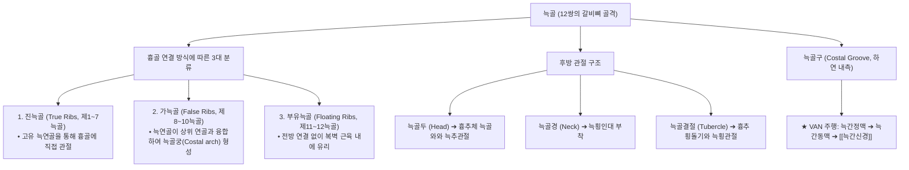
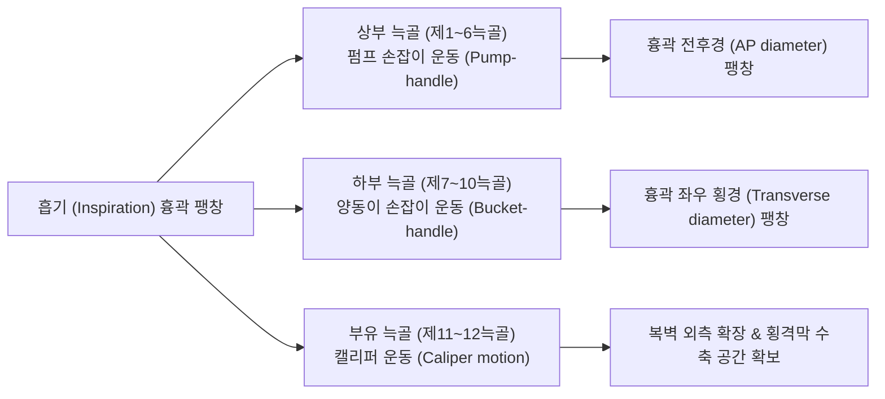

# 늑골 (肋骨, Ribs, 갈비뼈, 늑골골)

> **핵심 요약 (Key Summary)**:
> 흉곽(Thoracic cage)의 외측벽을 형성하는 좌우 12쌍(총 24개)의 길고 탄력 있는 활 모양 곡선 편평골(Curved flat bone).
> 후방은 [[흉추]]체 및 [[횡돌기]]와 늑추관절·늑횡관절을 이루고, 전방은 [[늑연골]]을 매개로 [[흉골]]에 연결되어 심폐 장기를 보호하고 호흡 흉강 체적을 조절.
> 진늑골(1~7), 가늑골(8~10), 부유늑골(11~12)로 분류되며, 호흡 시 상부 펌프 손잡이 운동(전후경 확장)과 하부 양동이 손잡이 운동(횡경 확장)을 수행.
> 늑골 체부 하연 내측 늑골구(Costal groove)를 따라 **정맥-동맥-신경(VAN)**이 나란히 주행하여 흉벽 천자 및 자침 시 해부학적 주의점 제공.
> 늑골각(Costal angle) 골절, 늑간신경통([[늑간신경]]), [[늑연골염]]의 핵심 구조물이며 늑골 거상/하강 추나 기법의 치료 표적.

---

## 1. 개요 및 기능해부학

늑골(Ribs, 갈비뼈)은 흉강을 둘러싸는 유연하고 견고한 골격 케이지로, 전방 흉골과의 연결 방식에 따라 3대 군으로 명확히 구분된다.

### 늑골의 주요 구조적 특징
- **늑골각 (Costal Angle)**:
  - 늑골결절 외측 수 센티미터 지점에서 늑골 체부가 전하방으로 급격하게 휘어지는 부위로, 외력 집중 시 **[[늑골 골절]]이 가장 빈번하게 발생하는 호발 부위**이다.
- **늑골하구 (Costal Groove)와 신경혈관 다발**:
  - 늑골 하연 안쪽 파인 홈을 따라 상부에서 하부 순서로 **정맥(Vein) $\rightarrow$ 동맥(Artery) $\rightarrow$ 신경(Nerve)**의 순서(VAN)로 보호받으며 주행한다.
  - **임상 안전 수칙**: 흉벽 천자나 침 시술 시 신경혈관 다발 손상을 방지하기 위해 침첨을 **반드시 아래쪽 늑골의 상연(Upper border)을 스치듯이 진입**시켜야 한다.

---

## 2. 생체역학 및 3차원 운동학

1. **펌프 손잡이 운동 (Pump-Handle Motion, 상부 제1~6 늑골)**:
   - 늑골두와 결절을 잇는 회전축이 관상면에 가까워, 흡기 시 늑골 전단과 흉골이 앞쪽 위로 들려 올려지면서 **흉곽의 전후 직경(Anteroposterior diameter)**이 증가한다.
2. **양동이 손잡이 운동 (Bucket-Handle Motion, 하부 제7~10 늑골)**:
   - 회전축이 시상면에 가까워, 늑골 체부 중앙이 바깥쪽 위로 회전 거상되면서 **흉곽의 좌우 횡직경(Transverse diameter)**이 크게 확장된다.
3. **캘리퍼 운동 (Caliper Motion, 제11~12 부유늑골)**:
   - 전방 연결이 없어 수평면 상에서 캘리퍼처럼 외측으로 벌어지며 [[횡격막]]의 수축 공간을 확보한다.

---

## 3. 인접 연부조직 및 신경·혈관 관계

- **호흡 및 체간 부착 근육군**:
  - **늑간근**: 외늑간근([[외늑간근]], 흡기 시 늑골 거상), 내늑간근([[내늑간근]], 호기 시 늑골 하강), 최내늑간근.
  - **호흡 보조근**: [[전거근]](제1~8/9 늑골 외측 기시), [[[[소흉근]]]](제3~5 늑골 전면 기시), [[광배근]](하부 3~4개 늑골 부착), 상후거근, 하후거근, 늑골거근.
  - **복벽 근육군**: [[외복사근]]([[[[외복사근]]]]), [[내복사근]]([[[[내복사근]]]]), [[복횡근]], [[복직근]].
- **늑막(Pleura) 및 폐 실질과의 인접성**:
  - 늑골 내면은 흉내근막과 벽측 늑막(Parietal pleura)에 밀착되어 있다. 늑골 골절편의 전위나 과도하게 깊은 수직 침 자극 시 [[기흉]](Pneumothorax)이나 [[혈흉]](Hemothorax)이 발생할 수 있다.

---

## 4. 임상 병태생리 및 주요 질환

### 1) 늑골 골절 (Rib Fracture)
- **손상 부위별 임상적 위험도**:
  - **제1~3 늑골 골절**: 쇄골과 견갑골에 의해 보호되는 부위로, 강한 고에너지 외상에서만 발생하며 쇄골하혈관, 대동맥궁, 기관지 파열 등 치명적 혈관 손상을 동반할 위험이 높다.
  - **제4~9 늑골 골절**: 외력에 가장 취약하며 늑골각 부위 단순 골절 호발. 심호흡, 기침, 재채기 시 극심한 흉통 발생.
  - **제10~12 늑골 골절**: 우측은 간 파열(Liver laceration), 좌측은 비장 파열(Splenic rupture), 후방은 신장 손상 위험이 동반된다.
  - **동요 흉곽 (Flail Chest)**: 연속된 3개 이상의 늑골이 각각 2군데 이상 골절되어 흉벽 일부가 호흡 시 흉강 내압과 반대로 움직이는 모순 호흡(Paradoxical breathing)을 유발하는 응급 질환.

### 2) 늑간신경통 (Intercostal Neuralgia)
- 늑골하구의 늑간신경이 흉추 변위, 늑간근 연축 또는 [[대상포진]](Herpes zoster) 바이러스 감염에 의해 자극되어 갈비뼈 주행로를 따라 찌릿하게 뻗치는 발작성 방사통.

### 3) 늑골 기능이상 (Rib Dysfunction / Subluxation)
- 추나학적으로 늑골이 흡기 상태에서 굳어진 흡기성 변위(Inhalation somatic dysfunction) 또는 호기 상태에서 굳어진 호기성 변위(Exhalation somatic dysfunction)로 인해 국소 흉벽 압통과 흉곽 팽창 제한을 초래.

---

## 5. 이학적 검사 및 영상의학적 진단

- **흉곽 압박 검사 (Rib Compression Test)**:
  - 흉골과 흉추를 전후(A-P) 방향으로 압박하거나 양측 늑골 외측을 좌우(Lateral)로 압박할 때, 압박 부위가 아닌 원격의 특정 늑골 부위에서 국소 통증이 유발되면 해당 늑골의 골절을 강력히 시사한다.
- **늑골 분절 호흡 촉진 검사**:
  - 환자의 흉곽 상부와 하부에 양손을 얹고 심호흡을 유도하여 좌우 비대칭적 팽창 및 늑골 운동 장애 분절을 평가한다.
- **영상의학적 검사**:
  - **흉부 늑골 X-ray (Rib Series)**: 골절선 및 기흉 유무를 확인하나, 미세 불전위 골절이나 늑연골 손상은 초기 엑스레이에서 50% 이상 놓칠 수 있다.
  - **근골격계 초음파 (Musculoskeletal Ultrasound)**: 늑골 피질골의 미세 단열(Cortical step-off) 및 골막하 혈종을 엑스레이보다 신속하고 정밀하게 진단한다.

---

## 6. 한의 임상 치료 및 추나 프로토콜

- **늑간 경혈 자침 및 안전 자침 수칙**:
  - **주요 혈자리**:
    - **기문(期門, LR14)**: 제6늑간 쇄골중간선(간의 모혈).
    - **일월(日月, GB24)**: 제7늑간 쇄골중간선(담의 모혈).
    - **대포(大包, SP21)**: 제6늑간 액와중심선(비의 대락).
    - **장문(章門, LR13)**: 제11늑골 첨단 하연(비의 모혈이자 장회臟會).
    - **경문(京門, GB25)**: 제12늑골 첨단 하연(신의 모혈).
  - **자침 안전 수칙**: 늑간 부위는 기흉의 위험이 높으므로 **절대 직자하지 않고, 늑골 뼈 표면을 향해 15~30° 사자(Oblique) 또는 횡자(Horizontal)**로 안전하게 골면에 닿게 자침한다.
- **[[추나]] 늑골 교정 기법 (Rib Mobilization & Muscle Energy Technique)**:
  - **호기성 늑골 변위 교정**: 흡기 장애가 있는 주요 늑골에 시술자의 모지구를 접촉하고, 환자의 흡기 시 늑골 하연을 상외측으로 견인 보조하며 호기 시 유지를 반복하여 늑골 거상 가동성을 회복한다.
  - **앙와위 늑추관절 HVLA**: 흉추 횡돌기와 늑골두 결합면에 주먹을 접촉하고 호흡 말기 스러스트로 늑횡관절 아탈구를 정렬한다.
- **약침 및 한약 요법**:
  - 늑간 신경통 부위에 [[중성어혈약침]] 또는 [[황련해독탕]] [[약침]]을 주입하고, 늑골 골절 치유 촉진 및 어혈 제거를 위해 [[당귀수산]](當歸鬚散)이나 산골(자연동)을 배오한 처방을 투약한다.

---

## 7. 재활 운동 및 예방 관리

- **흉곽 확장 심호흡 훈련 (Diaphragmatic Breathing & Rib Cage Expansion)**:
  - 양측 하부 늑골에 탄력 밴드를 두르고 흡기 시 밴드를 좌우로 밀어내며 늑골 양동이 손잡이 운동을 활성화하는 호흡 재활을 시행한다.
- **전거근 및 늑간근 신장 운동**:
  - 팔을 머리 위로 올리고 체간을 측굴시켜 늑간극을 열어주는 측벽 신장 스트레칭을 지도한다.

---

## 8. 현대 학술 연구 및 근거 고찰

- Zhou B, et al. (2026). Comparative efficacy of ultrasound-guided intercostal nerve block versus transversus abdominis plane block in laparoscopic cholecystectomy: A propensity score-matched retrospective cohort study. *Am J Surg*. PMID: 42971034
  - [연구 요약] 늑골하구를 주행하는 늑간신경에 대한 초음파 유도하 표적 차단술이 흉벽 통증 제어 및 수술 후 마약성 진통제 사용 감소에 탁월한 효과를 보임을 규명함.
- Kim H, et al. (2026). Erector spinae plane block added to intercostal nerve block versus intercostal nerve block alone for postoperative analgesia in video-assisted thoracoscopic surgery: A randomized controlled trial. *PLoS One*. PMID: 42945162
  - [연구 요약] 늑골 및 늑간신경 손상 환자에서 척추기립근면 차단과 늑간신경 차단의 병용이 흉곽 호흡 운동성 회복 및 통증 점수 개선에 미치는 임상적 유의성을 무작위 대조 시험으로 증명함.
