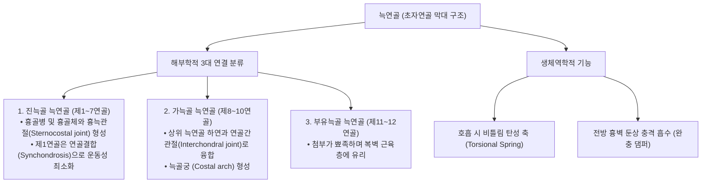

# 늑연골 (Costal Cartilage, 갈비연골, 肋軟骨)

> **핵심 요약 (Key Summary)**:
> [[늑골]](Rib)의 전단 골성 부위와 [[흉골]](Sternum) 사이에 위치하여 흉곽 전벽을 형성하는 봉 형태의 [[초자연골]](Hyaline cartilage) 구조물.
> 진늑골(제1~7연골: 흉골과 직접 흉늑관절 형성), 가늑골(제8~10연골: 상위 연골과 융합하여 늑골궁 Costal arch 구성), 부유늑골(제11~12연골: 전단이 복벽 근육 내에 유리)로 분류.
> 호흡 주기 동안 비틀림 탄성(Torsional elasticity)을 발휘하여 흉곽의 팽창과 수축을 매개하고, 전방 흉벽에 가해지는 외력을 완충하여 심장과 폐 실질을 보호.
> 전흉통의 주원인인 [[늑연골염]](Costochondritis)과 [[티체 증후군]](Tietze syndrome)의 감별 병소이며, [[흉협통]](胸脇痛) 한의 변증 및 전중·기문 중심 침구·추나 치료의 핵심 표적.

---

## 1. 개요 및 기능해부학

늑연골(Costal Cartilage)은 늑골 체부의 골-연골 접합부(Costochondral junction)에서 기원하여 흉골을 향해 내측으로 주행하는 초자연골 막대이다.

### 늑연골의 분절별 해부학적 특징
1. **제1 늑연골**:
   - 흉골병(Manubrium)의 외측 상관절면에 부착하며, 활막 관절이 아닌 섬유성 연골결합(Synchondrosis)을 이루어 흉쇄관절 직하방에서 견고한 골격 지지 기반을 제공한다.
2. **제2~7 늑연골**:
   - 흉골체(Sternal body) 외측의 늑골절흔과 전형적인 활막성 흉늑관절을 형성하며, 흉늑인대(Radiate sternocostal ligaments)에 의해 전후면이 보강된다. 제2 늑연골은 흉골각(Angle of Louis) 높이에 관절한다.
3. **늑골궁 (Costal Arch / Margin)**:
   - 제7~10 늑연골이 하나로 결합하여 형성하는 궁형 구조로, 복부와 흉부의 경계를 이루며 검상돌기 하방에서 늑골하각(Infrasternal angle, 약 70~90°)을 결정한다.

---

## 2. 생체역학 및 3차원 운동학

- **비틀림 탄성 스프링 (Torsional Spring Action)**:
  - 늑골이 호흡 시 펌프 손잡이 및 양동이 손잡이 회전 운동을 수행할 때, 늑연골은 뼈와 달리 유연하게 비틀리는 장력 변형(Torsional strain)을 감당한다.
  - 흡기 시 변형된 늑연골은 탄성에너지를 축적하고, 호기 시 본래 형태로 복원되는 반동력(Elastic recoil)을 제공하여 에너지 소비 없이 수동적 호기를 돕는다.
- **연령에 따른 연골 골화(Calcification)**:
  - 20대 후반부터 늑연골 중심부에 칼슘 침착 및 골화가 진행되며, 고령자로 갈수록 늑연골의 탄성이 저하되어 흉곽의 탄성 팽창 범위가 감소하고 외상 시 늑연골 골절 위험이 증가한다.

---

## 3. 인접 연부조직 및 신경·혈관 관계

- **근육 부착 및 근막 연결**:
  - **전면**: [[대흉근]](Pectoralis major)의 흉골늑골두가 제1~6 늑연골 전면에서 광범위하게 기시한다.
  - **하부**: [[복직근]](Rectus abdominis)의 상부 건막이 제5~7 늑연골 전면에 정지하며, [[복횡근]](Transversus abdominis)의 심부 섬유가 제7~12 늑연골 내면에서 기시한다.
  - **내면**: 흉횡근(Transversus thoracis)이 흉골체 하부에서 기시하여 제2~6 늑연골 내측면에 부착하여 강제 호기를 보조한다.
- **내흉동맥(Internal Thoracic Artery) 주행**:
  - [[쇄골하동맥]]에서 분지한 내흉동맥과 정맥이 흉골 외측연에서 약 1~1.5cm 떨어진 지점에서 제1~6 늑연골 바로 뒷면(후면)을 수직 주행한다. 늑연골 주변 깊은 자침이나 외상 시 내흉동맥 파열에 의한 종격동 혈종에 주의해야 한다.

---

## 4. 임상 병태생리 및 주요 질환

### 1) 늑연골염 (Costochondritis) vs 티체 증후군 (Tietze Syndrome)
전흉부 통증의 가장 흔한 원인으로, 심인성 흉통([[협심증]], [[심근경색]])과의 정밀 감별이 필수적이다.

| 감별 항목 | [[늑연골염]] (Costochondritis) | [[티체 증후군]] (Tietze Syndrome) |
| :--- | :--- | :--- |
| **호발 부위** | 제2~5 늑연골 접합부 (다발성 호발) | 제2 또는 제3 늑연골 접합부 (단발성 호발) |
| **국소 융기/부종** | **육안적 부종 없음** (압통만 존재) | **뚜렷한 늑연골 방추상 비후 및 염증성 융기 부종 동반** |
| **호발 연령** | 40세 이상 성인 여성 다발 | 40세 미만 젊은 성인 및 청소년 |
| **병리 기전** | 미세 외상, 반복적 기침, 과사용에 의한 연골 마찰 | 급성 연골막염(Perichondritis) 및 국소 염증성 삼출 |

### 2) 늑연골 골절 및 탈구 (Chondral Fracture & Slipping Rib Syndrome)
- 단순 엑스레이에서는 연골이 투과되어 진단되지 않으며, 제8~10 늑골궁 연골 간 결합이 뜯겨져 신경을 자극하는 미끄러짐 늑골 증후군(Slipping rib syndrome)은 초음파 검사로 확진한다.

---

## 5. 이학적 검사 및 영상의학적 진단

- **늑연골 분절 압진 검사 (Costochondral Palpation)**:
  - 검사자의 엄지로 제1~7 늑연골 및 골-연골 접합부를 흉골 외측을 따라 하나씩 점진적으로 압박한다. 환자가 호소하던 가슴 통증과 정확히 일치하는 예리한 국소 압통(Reproduction of pain)이 재현되면 양성이다.
- **후핑 기동 (Hooking Maneuver, 미끄러짐 늑골 검사)**:
  - 환자를 앙와위로 눕히고 검사자의 손가락을 하부 늑골궁 아래에 걸어 전방으로 들어 올릴 때, 늑연골 탈구 클릭음(Click)과 함께 예리한 통증이 재현되는지 확인한다.
- **영상의학적 검사**:
  - **근골격계 초음파 (MSK Ultrasound)**: 늑연골의 두께, 연골하 부종, 연골 피질 단열, 티체 증후군의 혈류 증가(Power Doppler)를 확진하는 1차 표준 영상 기법이다.

---

## 6. 한의 임상 치료 및 추나 프로토콜

- **[[흉협통]](胸脇痛) 한의 변증 분류**:
  - **간울기체(肝鬱氣滯)**: 정서적 스트레스, 울화(鬱火)로 인해 전흉부 및 늑골 하연이 뻐근하게 결리고 한숨을 쉬면 편안해지는 통증.
  - **어혈조락(瘀血阻絡)**: 타박 외상이나 만성 기침 후 발생한 고정된 부위의 바늘로 찌르는 듯한(刺痛) 늑연골통.
  - **담음정음(痰飮停飮)**: 흉강 내 수액 대사 장애로 기침 및 체위 변경 시 결리는 결흉(結胸) 및 현음(懸飮).
- **침구 및 경혈 배오**:
  - **[[전중]](膻中, CV17)**: 기회(氣會)이자 심포의 모혈로 전흉부 기체를 소통시키는 핵심 혈위.
  - **[[기문]](期門, LR14)**, **일월(日月, GB24)**, **[[양릉천]](GB34)**, **지구(TE6)**, **내관(PC6)**: 흉협부 소간이기(疏肝理氣) 및 활혈지통.
  - 늑연골 압통점(아시혈)에 30G 미세 침으로 연골막 상단에 가볍게 평자(Horizontal insertion)하여 국소 혈류 개선.
- **추나 흉곽 이완 기법 (Thoracic Cage Mobilization)**:
  - [[대흉근]] 및 [[복직근]]의 단축성 견인력을 완화하기 위해 [[근막 이완술]](Myofascial Release)을 시행하고, [[흉추]] 신전-회전 [[추나]]를 통해 늑연골에 가해지는 비틀림 응력을 정상화한다.
- **약침 요법**:
  - 늑연골막 염증 부위에 [[소염약침]]([[황련해독탕]]) 또는 [[중성어혈약침]]을 0.1~0.2cc씩 피하 미세 주입하여 국소 염증 물질을 중화한다.

---

## 7. 재활 운동 및 예방 관리

- **대흉근 및 전흉벽 스트레칭**:
  - 문틀(Doorway)에 양팔을 걸치고 체간을 앞으로 전진시켜 단축된 대흉근을 신장함으로써 늑연골에 가해지는 전방 견인 부하를 완화한다.
- **호흡근 안정화 훈련**:
  - 과도한 흉식 호흡(Accessory muscle breathing)을 교정하고 [[횡격막]] 호흡(Diaphragmatic breathing)을 유도하여 늑연골의 과도한 상하 비틀림을 억제한다.

---

## 8. 현대 학술 연구 및 근거 고찰

- Shokanov T, et al. (2026). O-Arm CT-Guided Intercostal Nerve Radiofrequency Ablation for Refractory Tietze's Syndrome: A Case Report. *Orthop Res Rev*. PMID: 41769042
  - [연구 요약] 난치성 티체 증후군(Tietze's syndrome) 환자에서 늑연골 부종과 염증성 흉통을 유발하는 병소 신경에 대한 정밀 중재술의 효과를 보고하고, 늑연골 병변의 병태생리학적 신경 감작 기전을 제시함.
- Proulx AM, Zryd TW. (2009). Costochondritis: diagnosis and treatment. *Am Fam Physician*. PMID: 19746779
  - [연구 요약] 늑연골염의 역학, 심인성 흉통과의 체계적 임상 감별 프로토콜, 국소 보존적 치료 및 예후에 관한 근거 기반 가이드라인을 제공함.
