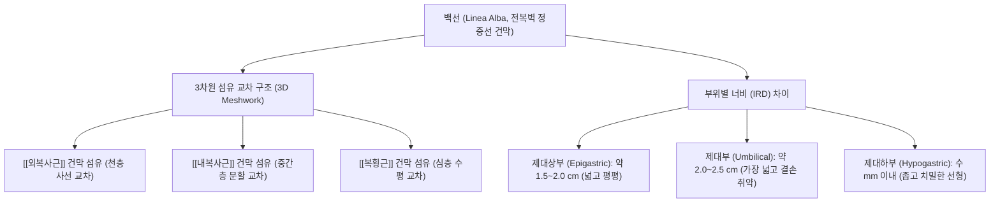
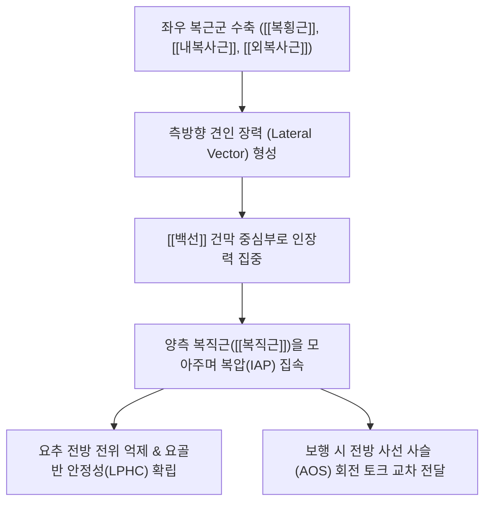

# 백선 (Linea Alba, 하얀선, 白線)

> **핵심 요약 (Key Summary)**:
> [[흉골]] [[검상돌기]](Xiphoid process)에서 [[치골결합]](Pubic symphysis)까지 전복벽의 정중선을 수직으로 관통하는 단단한 백색 섬유성 건막 융합선(Aponeurotic raphe).
> 좌우 [[외복사근]], [[내복사근]], [[복횡근]]의 건막 섬유가 중앙에서 3차원적(천·중·심층)으로 엇갈리며 교차하여 양측 복직근초(Rectus sheath)를 강력히 결속.
> 복강내압(Intra-abdominal pressure, IAP)의 체간 전달, 보행 시 전방 사선 사슬(Anterior Oblique Sling)의 회전 토크 교차점, 요추-골반 복합체(LPHC) 전방 안정성의 핵심 앵커.
> 임신, 출산 및 복압 과부하 시 [[복직근 이개]](Diastasis recti abdominis) 및 상복부 백선 [[탈장]](Epigastric hernia)이 호발.
> 한의학의 **임맥(任脈)** 주행로와 완벽히 일치하여 중완·신궐·관원 등 핵심 모혈의 해부학적 기반이며 산후 복벽 재활(드로우인)과 침구 결합조직 재생의 핵심 표적.

---

## 1. 개요 및 기능해부학

백선(Linea Alba, 하얀선)은 전복벽 중앙에서 좌우 복근군을 결합하는 무혈관성 백색 건막 복합체이다.

| 해부학적 지표 | 상세 특징 및 부착점 |
| :--- | :--- |
| **상부 기시점** | [[흉골]] [[검상돌기]](Xiphoid process) 전면 및 하연 |
| **하부 정지점** | [[치골결합]](Pubic symphysis) 상연 및 치골능(Pubic crest) |
| **구성 섬유** | 좌우 복벽 외측 3개 근육(외복사근, 내복사근, 복횡근) 건막의 정중선 교차망 (Type I & III 콜라겐) |
| **혈관 및 신경 분포** | 대혈관이 없는 무혈관성 결합조직(외과 정중절개 Laparotomy의 주요 진입로), 늑간신경 전피지의 종말 분지 분포 |

- **3차원 섬유 직물 구조 (3D Fiber Meshwork)**:
  - 백선은 단순한 1차원 접착선이 아니라, 얕은층·중간층·깊은층의 섬유가 45°~90° 각도로 엇갈리며 입체적으로 직조된 콜라겐 직물 구조이다.
  - 전단력과 인장력에 모두 저항할 수 있는 생체역학적 텐세그리티(Tensegrity) 중심점 역할을 한다.

---

## 2. 생체역학 및 3차원 운동학

- **복강내압(IAP) 형성의 전방 버팀목**:
  - 복횡근과 복사근이 수축할 때 발생하는 외측 견인력을 백선이 중앙에서 단단히 버텨줌으로써 복강 내부 압력을 상승시킨다. 이는 요추 기립근의 부담을 줄이고 요추의 시상면 안정성을 확보하는 필수 기전이다.
- **전방 사선 사슬 (Anterior Oblique Sling)의 교차 브릿지**:
  - 한쪽 외복사근과 반대쪽 내복사근이 백선을 가로질러 대각선으로 연결되어 체간 회전, 투구, 보행 시 상지와 골반 간의 회전 에너지를 전달하는 교차점 역할을 수행한다.

---

## 3. 인접 연부조직 및 신경·혈관 관계

- **복직근초(Rectus Sheath)와의 결합**:
  - 제대 상부에서는 내복사근 건막이 전·후엽으로 갈라져 복직근을 감싸며 중앙의 백선에 융합한다.
  - 궁상선(Arcuate line, 제대 하방 약 4~5cm) 이하에서는 3개 근육의 모든 건막이 복직근 앞쪽(전엽)으로만 주행하여 백선에 결합하므로, 백선 하부는 좁아지는 대신 전방 결속력이 극대화된다.
- **복막외 지방 및 복막과의 관계**:
  - 백선의 심부에는 횡근근막(Transversalis fascia), 복막외 지방, 그리고 벽측 복막이 순차적으로 밀착되어 있다. 백선 섬유의 결손이 생기면 복막외 지방이나 장간막이 틈새로 탈출한다.

---

## 4. 임상 병태생리 및 주요 질환

### 1) 복직근 이개 (Diastasis Recti Abdominis, DRA)
- **발생 기전**:
  - 임신 말기 릴랙신(Relaxin) 호르몬 분비 및 자궁 팽창으로 인한 복벽 신장, 또는 만성적인 복부 비만으로 인해 백선이 얇아지고 좌우 복직근 사이 간격(Inter-recti distance, IRD)이 2cm(2 finger) 이상 영구적으로 벌어지는 병변.
- **임상적 여파**:
  - 복벽의 전방 지지력이 상실되어 만성 [[요통]](요골반 통증), [[요실금]]([[골반저근]] 기능부전 동반), 제대부 돔 형태의 돌출(Doming/Tenting)을 유발한다.

### 2) 상복부 백선 탈장 (Epigastric Hernia)
- 검상돌기와 제대 사이 백선의 섬유 교차 틈새가 국소적으로 벌어지면서 복막외 지방이나 소장이 돌출되어 식후 복통 및 압통을 일으키는 질환.

### 3) 흑선 (Linea Nigra)
- 임신 중 태반에서 분비되는 멜라닌세포 자극 호르몬 및 에스트로겐 증가로 인해 백선 부위 피부에 짙은 갈색 색소 침착이 나타나는 생리적 변화.

---

## 5. 이학적 검사 및 영상의학적 진단

- **복직근 간격(Inter-recti Distance, IRD) 촉진 검사**:
  - 환자를 앙와위로 눕히고 무릎을 굽힌 상태에서 머리와 견갑골을 살짝 들어 올리는 미니 컬업(Curl-up) 동작을 취하게 한다.
  - 검사자가 제대 상부 3cm, 제대부, 제대 하부 3cm 부위의 정중선을 촉진하여 손가락이 2마디 이상 들어가는 너비와 깊은 함몰감을 측정한다.
- **근골격계 초음파 정밀 계측 (Ultrasound Imaging)**:
  - 고주파 선형 탐촉자를 명치와 제대 사이 정중선에 직각으로 대고 안정 시 및 복근 수축 시의 백선 너비(IRD)와 두께, 탄성도(Elastography)를 정량화한다.

---

## 6. 한의 임상 치료 및 추나 프로토콜

- **임맥(任脈) 경혈 체계와의 완벽한 일치**:
  - 백선의 주행로는 한의학에서 '음맥의 바다(陰脈之海)'라 불리는 **임맥(任脈)**의 복부 주행 경로와 100% 일치한다.
  - **주요 임맥 혈자리**:
    - **[[중완]](中脘, CV12)**: 위(胃)의 모혈, 제대 상방 4촌(백선 상부의 중심).
    - **하완(下脘, CV10)**, **수분(水分, CV9)**: 수액 대사 및 부종 조절.
    - **[[신궐]](神闕, CV8)**: 배꼽 중심(백선 결손 최취약부).
    - **기해(氣海, CV6)**: 제대 하방 1.5촌, 원기(元氣) 결집 혈위.
    - **[[관원]](關元, CV4)**: 소장의 모혈, 제대 하방 3촌, 단전(丹田).
- **침구 및 복벽 결합조직 재생 요법**:
  - 이개된 백선 양측 가장자리(복직근 내측연)를 향해 횡자(Horizontal insertion)하여 건막 섬유에 미세 침 자극을 가하고 저주파 전침을 통전하여 Type I 콜라겐 합성을 촉진한다.
  - 산후 허약성 복벽 이완 환자에게 [[자하거약침]](태반)을 관원 및 기해에 주입하여 결합조직 탄력 회복을 도모한다.
- **[[추나]] 골반 정렬 교정**:
  - [[골반 전방경사]](Anterior pelvic tilt) 및 [[치골결합]](Pubic symphysis)의 전단 변위를 추나 수기요법으로 정렬하여 백선에 걸리는 만성 비틀림 장력을 해소한다.

---

## 7. 재활 운동 및 예방 관리

- **크런치/윗몸일으키기 절대 금기 (Contraindication of Traditional Crunches)**:
  - 복직근 이개 환자가 상체를 강하게 굴곡시키는 크런치 동작을 하면 복압이 전방으로 쏠려 백선이 더욱 벌어지고 찢어지므로 철저히 금지해야 한다.
- **저압 복벽 호흡 및 드로우인 훈련 (Hypopressive / Draw-In Exercise)**:
  - 호기 시 배꼽을 척추 쪽으로 지그시 당기며 골반저근(Pelvic floor)을 동시에 조여주는 복횡근 활성화 운동(Drawing-in maneuver)을 시행한다. 백선을 양옆으로 당기지 않고 안쪽으로 모아주는 장력선(Tensioning)을 회복시킨다.

---

## 8. 현대 학술 연구 및 근거 고찰

- Cañamero de León S, et al. (2026). Reliability of shear wave elastography measurements of the linea alba: an intraclass correlation and Bland-Altman analysis. *BMC Womens Health*. PMID: 42919325
  - [연구 요약] 전단파 탄성초음파(Shear wave elastography)를 이용하여 복직근 이개 여성의 백선 강도와 탄성도를 비침습적으로 정량 계측한 결과, 신뢰도가 매우 높음을 증명하고 산후 복벽 기능 회복의 객관적 지표로 제시함.
- Bruno A, et al. (2026). Restoring Core Strength After Rectus Diastasis Repair: A Prospective Controlled Study of Abdominal Muscle Function Following Abdominoplasty. *Aesthetic Plast Surg*. PMID: 41491320
  - [연구 요약] 백선의 해부학적 봉합 및 복벽 정렬 복원이 단순한 체형 개선을 넘어 복부 근력, 요추 안정성 및 환자의 삶의 질을 현저히 향상시킴을 전향적 대조 연구로 입증함.
