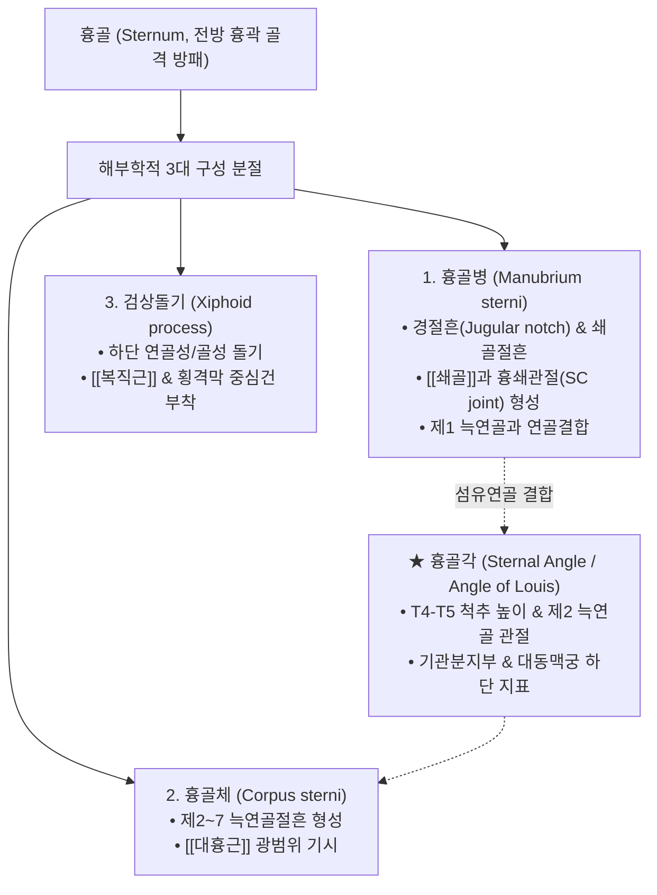

# 흉골 (Sternum, 가슴뼈, 胸骨)

> **핵심 요약 (Key Summary)**:
> 흉곽(Thoracic cage) 전벽의 정중앙에 위치하는 단도(Dagger) 형태의 납작뼈(Flat bone)로, 흉골병(Manubrium)·흉골체(Body)·[[검상돌기]](Xiphoid process)의 3개 부분으로 구성.
> 상단에서 [[쇄골]]과 만나 **흉쇄관절(Sternoclavicular joint, SC joint)**을 형성하여 체간과 상지를 연결하는 유일한 골성 관절을 이루며, 제1~7 [[늑연골]]과 결합하여 전방 흉벽을 완성.
> 흉골각(Angle of Louis)은 제2 늑연골 부착점이자 T4-T5 흉추간판, 기관분지부, 대동맥궁 하단과 일치하는 핵심 임상 랜드마크.
> [[대흉근]], [[흉쇄유돌근]](SCM), [[복직근]]이 부착하며, 운전대 충격 둔상 골절 시 [[심근 좌상]](Myocardial contusion) 합병 주의.
> 한의학 임맥(任脈)의 주행로이자 제4늑간 높이의 심포 모혈인 **전중(膻中, CV17)**이 위치하여 화병(火病), 흉민, 자율신경실조증 치료의 핵심 거점.

---

## 1. 개요 및 기능해부학

흉골(Sternum)은 흉강 앞벽의 중앙 골격을 형성하며, 심장, 흉선 및 대혈관 등 [[종격동]](Mediastinum) 장기를 보호하는 방패 역할을 수행한다.

### 흉골의 3대 구성 부위와 랜드마크
1. **흉골병 (Manubrium sterni)**:
   - 흉골의 가장 상부의 사각-사다리꼴 형태 영역.
   - 상단 중앙에 **경절흔(Jugular/Suprasternal notch)**이 체표에서 뚜렷이 함요되며, 좌우 외측에 쇄골절흔(Clavicular notch)이 위치하여 [[쇄골]] 내측단과 **흉쇄관절(SC joint)**을 형성한다.
   - 흉골병 외측면 상단은 제1 늑연골과 섬유연골 결합을 이룬다.
2. **흉골각 (Sternal Angle / Angle of Louis)**:
   - 흉골병과 흉골체가 만나는 결합부(Manubriosternal joint)로, 전방으로 약간 융기되어 체표에서 쉽게 만져지는 가장 중요한 흉곽 랜드마크이다.
   - **임상적 4대 지표**:
     - 제2 늑연골 부착 위치 (늑골 계측의 절대적 출발점).
     - 후방으로 제4~5 흉추간판(T4-T5) 높이와 수평 일치.
     - [[기관분지부]](Tracheal bifurcation / Carina) 높이.
     - 상행대동맥이 끝나고 [[대동맥궁]](Aortic arch)이 시작되는 경계.
3. **흉골체 (Body of sternum / Gladiolus)**:
   - 길고 좁은 중앙 평판 골격으로, 좌우 외측연에 제2~7 늑연골과 관절하는 늑골절흔(Costal notches)을 갖는다.
4. **검상돌기 (Xiphoid process)**:
   - 흉골 최하단의 작은 돌기로, 청소년기에는 초자연골 상태이나 성인이 되면서 점차 골화된다. 명치 부위에서 촉진되며 [[복직근]]과 횡격막의 중심건 일부가 연결된다.

---

## 2. 생체역학 및 3차원 운동학

- **흉쇄관절(SC Joint)을 통한 상지 운동 에너지 전달**:
  - 흉골은 체간 축성 골격 중 상지 견갑대(Shoulder girdle)와 직접 골성 관절을 이루는 유일한 부위이다.
  - 상완골과 쇄골의 거상, 하강, 전인, 후인 및 회전 운동 시 흉쇄관절의 관절원판(Articular disc)을 통해 하중이 흉골병으로 분산 흡수된다.
- **호흡 펌프 손잡이 운동(Pump-handle)의 전방 지렛대**:
  - 흡기 시 늑골의 거상과 함께 흉골체 및 흉골병이 전상방으로 전진 돌출하여 흉강 전후 직경을 넓힌다.
  - 흉골병-흉골체 결합각(Sternal angle)의 미세한 굴신 가동성이 정상 호흡 역학에 기여한다.

---

## 3. 인접 연부조직 및 신경·혈관 관계

- **근육 부착 네트워크**:
  - **전면**: [[대흉근]](Pectoralis major)의 흉골병 및 흉골체 전면 절반 기시, [[흉쇄유돌근]](SCM)의 흉골두(Sternal head)가 흉골병 전상면 기시.
  - **후면**: [[흉골설골근]](Sternohyoid) 및 흉골갑상근(Sternothyroid)이 흉골병 후면에서 기시하여 경부 장기 보호.
  - **하부**: [[복직근]](Rectus abdominis) 및 복횡근이 검상돌기에 정지.
  - **흉골근 (Sternalis Muscle 변이)**: 인구의 약 5~8%에서 흉골 전면에 수직으로 주행하는 선천성 변이 근육이 존재하며, 유방촬영술(Mammography)이나 흉부 CT에서 종양으로 오인되지 않도록 주의해야 한다.
- **종격동(Mediastinum) 및 심장과의 인접 관계**:
  - 흉골체 후면은 심낭(Pericardium) 및 우심실(Right ventricle)과 불과 수 밀리미터 간격을 두고 위치한다. 심폐소생술(CPR) 시 검상돌기를 강하게 압박하면 간 파열을 유발할 수 있으므로 반드시 흉골체 하부 1/2을 압박해야 한다.

---

## 4. 임상 병태생리 및 주요 질환

### 1) 흉골 골절 (Sternal Fracture)
- **손상 메커니즘**:
  - 자동차 충돌 시 안전벨트 착용 상태에서 핸들에 가슴을 강하게 부딪치는 둔상(Direct blunt trauma) 시 흉골체 중앙부에서 횡골절 호발.
- **치명적 합병증 선별**:
  - 흉골 골절 자체보다 골절 충격이 심장으로 전달되어 발생하는 **[[심근 좌상]](Myocardial contusion)**, 심낭 압전(Cardiac tamponade), 대동맥 박리 위험이 동반되므로 심전도(ECG) 및 심근효소(Troponin) 모니터링이 필수적이다.

### 2) 흉쇄관절 탈구 및 관절염 (SC Joint Dislocation/Arthritis)
- 전방 탈구가 흔하며, 후방 탈구 시에는 흉골병 후방의 기관이나 총경동맥, 쇄골하정맥을 압박하여 호흡 곤란 및 응급 혈관 손상을 초래한다.

### 3) 흉골 골수염 및 늑골연골염
- 흉부 개흉술 후 흉골 절개 부위 감염이나 티체 증후군이 흉골 외측연을 따라 극심한 통증과 압통을 유발한다.

---

## 5. 이학적 검사 및 영상의학적 진단

- **흉골 압박 및 촉진 검사 (Sternum Compression Test)**:
  - 흉골병, 흉골각, 흉골체, 검상돌기를 손가락으로 수직 압박하여 골절의 계단상 변형(Step-off deformity), 골성 염발음(Crepitus) 및 전중혈 부위 압통 유무를 평가한다.
- **영상의학적 검사**:
  - **흉골 측면 X-ray (Sternum Lateral View)**: 흉골 골절선 및 전위 여부를 확인하는 표준 투시법 (전후방 뷰에서는 흉추 음영에 겹쳐 판독 곤란).
  - **흉부 CT**: 흉골 피질골 골절선, 종격동 혈종, 심낭 삼출액 및 늑골 관절 손상을 완전 평가.

---

## 6. 한의 임상 치료 및 추나 프로토콜

- **임맥(任脈) 흉골 부위 경혈 자침**:
  - **전중(膻中, CV17)**: 양 젖꼭지 연결선과 흉골 중심이 교차하는 제4 늑간 높이의 심포 모혈이자 기회(氣會).
    - **[[화병]](火病) 및 신경증의 특효혈**: 울화, 스트레스, 우울증, 가슴 답답함(흉민), 심계항진 시 전중혈에 극심한 압통이 나타남.
    - **자침 기법**: 심낭 손상을 방지하기 위해 절대 직자하지 않고, 흉골 골면을 따라 하방으로 15~30° 사자 또는 평자(0.3~0.5촌)하여 침첨을 골막 상단에 유치.
  - **선기(璿璣, CV21)**, **화개(華蓋, CV20)**, **자궁(紫宮, CV19)**, **옥당(玉堂, CV18)**, **중정(中庭, CV16)**.
- **약침 요법**:
  - 전중혈 및 흉골체 압통점에 [[황련해독탕]] 약침 또는 [[소염약침]]을 0.2~0.3cc 피하 주입하여 심화(心火)를 내리고 전흉부 근막 긴장을 즉각 해소한다.
- **[[추나]] 흉쇄관절 및 흉골 가동술 (SC Joint & Sternal Mobilization)**:
  - 흉쇄관절 기능부전 시 쇄골 내측단을 파지하여 후상방 및 회전 가동술을 적용하고, 흉곽 전면 근막 이완술(MFR)로 대흉근 긴장을 풀어 흉골의 비틀림을 교정한다.

---

## 7. 재활 운동 및 예방 관리

- **가슴 열기 호흡 운동 (Chest Opening Diaphragmatic Stretch)**:
  - 양손을 등 뒤로 깍지 끼고 흉골체를 전상방으로 가볍게 밀어 올리며 심호흡을 하여 흉골-늑골 간 관절의 가동 범위를 확장한다.
- **자세 교정 및 라운드 숄더 관리**:
  - 거북목 및 둥근어깨 자세는 흉골을 함몰시키고 흉곽을 압박하므로, 견갑골 후인 및 흉추 신전 운동을 통해 흉골이 중립 정렬을 유지하도록 지도한다.

---

## 8. 현대 학술 연구 및 근거 고찰

- Aimi T, et al. (2026). Implementing acromioclavicular and coracoclavicular ligaments with a novel sternoclavicular posterior rotation estimation approach improves agreement between simulated muscle activation and surface electromyography in shoulder musculoskeletal simulation. *J Biomech*. PMID: 42854516
  - [연구 요약] 흉쇄관절(SC joint)을 통한 흉골과 쇄골 간의 후방 회전 동역학이 상지 근육군 활성화 및 견갑대 생체역학적 부하 전달에 미치는 결정적 영향을 정밀 시뮬레이션으로 규명함.
- Hallberg O, et al. (2026). A statistical shape model of the human sternum including cortical bone thickness. *Front Bioeng Biotechnol*. PMID: 42630393
  - [연구 요약] 인체 흉골의 3차원 형태학적 변이 및 피질골 두께를 정량화한 통계 모델을 구축하여, 흉부 둔상 충돌 시 흉골 골절 패턴과 흉벽 생체역학적 강도를 체계적으로 분석함.
