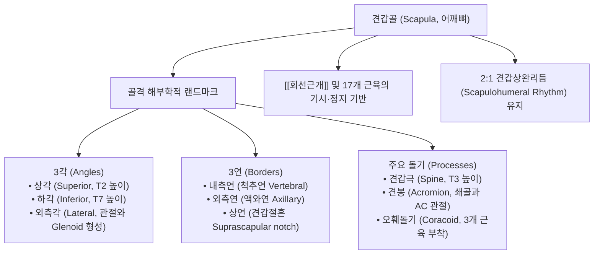
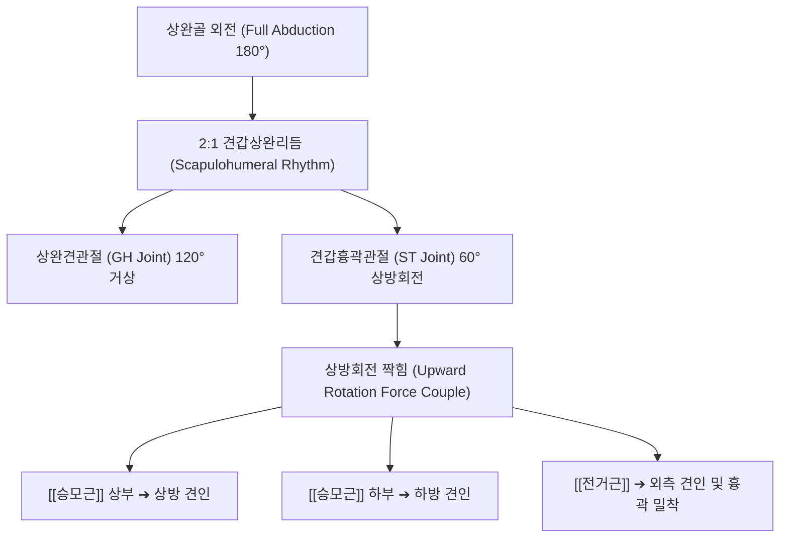

# 견갑골 (Scapula, 어깨뼈, 肩胛骨, Shoulder blade)

> **핵심 요약 (Key Summary)**:
> 흉곽 후외측면(제2~7늑골 높이)에 부유하는 역삼각형의 편평골(Flat bone)로, 상지 운동의 기동성(Mobility)과 동적 안정성(Stability)을 동시에 제어하는 견갑대의 핵심 베이스.
> 3개의 각(상각 T2, 하각 T7, 외측각 관절와), 3개의 연, 2개의 면과 함께 **견갑극(Spine, T3 높이)**, **견봉(Acromion)**, **오훼돌기(Coracoid process)**의 주요 돌기를 보유.
> 상완골 외전 시 2:1 비율의 **견갑상완리듬(Scapulohumeral rhythm)**을 유지하며, [[승모근]](상·하부)과 [[전거근]]의 상방회전 짝힘(Force couple)으로 관절와 중심화(Glenohumeral centering)를 달성.
> 17개의 근육이 부착하며, 견갑골 운동이상증(Scapular dyskinesis), 익상견갑(Scapular winging), 견봉하 충돌 증후군, 능형근 부위 만성 연관통의 핵심 병소.
> 천종(天宗) 중심의 침구·약침 치료 및 견갑흉곽관절(ST) 추나 가동술의 표적.

---

## 1. 개요 및 기능해부학

견갑골(Scapula)은 흉곽 후면에 떠 있는 뼈로, 골성 결합 대신 근육과 근막에 의해 지지되는 가관절(Pseudojoint)인 **견갑흉곽관절(Scapulothoracic joint, ST joint)**을 통해 체간 위를 3차원적으로 활주한다.

### 견갑골의 주요 랜드마크와 골학적 구조
1. **관절와 (Glenoid cavity)**:
   - 외측각에 위치하며 상완골두와 만나 견관절(GH joint)을 형성하는 얕은 배 모양 오목. 섬유연골성 관절와순(Glenoid labrum)이 둘레를 감싸 깊이를 더한다.
2. **견갑극 (Spine of Scapula) & 견봉 (Acromion)**:
   - T3 흉추 극돌기 높이에서 시작하여 외측 상방으로 비스듬히 돌출되며, 외측 첨부에서 편평한 견봉으로 이어져 [[쇄골]] 외측단과 견봉쇄골관절(AC joint)을 형성한다.
   - 견갑극을 경계로 후면은 상부의 극상와(Supraspinous fossa)와 하부의 극하와(Infraspinous fossa)로 양분된다.
3. **오훼돌기 (Coracoid Process)**:
   - 쇄골 하방 전외측으로 까마귀 부리처럼 튀어나온 골성 돌기.
   - **3개 근육 부착**: [[소흉근]](Pectoralis minor), [[오훼완근]](Coracobrachialis), [[상완이두근]] 단두(Short head).
   - **3개 인대 부착**: 오훼견봉인대(CAL), 오훼쇄골인대(CCL: 원추인대+능형인대), 오훼상완인대(CHL).

---

## 2. 생체역학 및 3차원 운동학

- **견갑상완리듬 (Scapulohumeral Rhythm)**:
  - 팔을 180° 완전 외전할 때, 상완골(GH)에서 약 120°, 견갑골의 상방회전(ST)에서 약 60°의 움직임이 **2:1의 정밀한 운동 비율**로 발생한다.
  - 초기 30° 외전(Setting phase) 이후 견갑골이 부드럽게 상방회전되지 못하면 견봉하 공간(Subacromial space)이 협소해져 극상근 건 충돌이 발생한다.
- **견갑골의 3차원 운동 자유도**:
  - 거상/하강(Elevation/Depression), 전인/후인(Protraction/Retraction), 상방회전/하방회전(Upward/Downward rotation), 전경사/후경사(Anterior/Posterior tilt), 내회전/외회전(Internal/External rotation).

---

## 3. 인접 연부조직 및 신경·혈관 관계

- **17개 근육 부착 네트워크**:
  - **회전근개 4종**: [[극상근]](극상와), [[극하근]](극하와), [[소원근]](외측연 후면), [[견갑하근]](견갑하와 전면).
  - **견갑골 위치 제어 근육**: [[승모근]](견갑극·견봉), [[전거근]](내측연 전면), [[능형근]](대·소능형근, 내측연 후면), [[견갑거근]](상각 및 내측연 상부), [[광배근]](하각 일부 섬유).
  - **상완 및 주관절 근육**: [[삼각근]](견갑극·견봉), [[상완삼두근]] 장두(관절하결절), [[상완이두근]] 장두(관절상결절) 및 단두(오훼돌기).
- **견갑상신경(Suprascapular Nerve)의 주행로**:
  - 견갑골 상연의 견갑절흔(Suprascapular notch)과 상견갑횡인대(STSL) 아래를 통과하여 극상와로 진입 후, 극견갑절흔(Spino-glenoid notch)을 돌아 극하근으로 주행한다.
  - 견갑절흔 부위 결절종이나 신경 포착 시 극상근 및 극하근의 무통성 위축과 외전·외회전 근력 저하가 발생한다.

---

## 4. 임상 병태생리 및 주요 질환

### 1) 견갑골 운동이상증 (Scapular Dyskinesis)
- 견갑골 안정화 근육군의 근력 불균형, 피로 또는 관절와순 파열로 인해 팔을 움직일 때 견갑골의 비정상적인 돌출 및 불규칙한 궤적이 발생하는 상태 (Kibler Type I: 하각 돌출, Type II: 내측연 돌출, Type III: 상각 거상).

### 2) 익상견갑 (Scapular Winging)
- [[전거근]]의 심한 약화나 장흉신경(Long thoracic nerve) 마비로 인해 견갑골 내측연 전체가 흉곽에서 새 날개처럼 후방으로 들리는 현상 (벽 밀기 검사 Wall push-up 시 뚜렷).

### 3) 견봉하 충돌 증후군 (Subacromial Impingement Syndrome)
- 견갑골의 후경사(Posterior tilt) 및 상방회전 부전으로 인해 상지 거상 시 견봉 전하면과 대결절 사이에서 극상근 건과 견봉하 점액낭이 압박 마찰되어 발생하는 통증.

### 4) 만성 견갑골 내측통 및 능형근 통증유발점
- 거북목(일자목) 환자에서 흉곽이 굽어지며 견갑골이 전인 및 하방회전 상태로 고착되어 내측연의 능형근과 견갑거근에 지속적인 편심성 신장 스트레스가 가해져 발생.

---

## 5. 이학적 검사 및 영상의학적 진단

- **견갑골 운동이상증 검사 (Scapular Dyskinesis Test, SDT)**:
  - 1~2kg 아령을 쥐고 팔을 굴곡 및 외전하여 내리는(Eccentric phase) 동안 견갑골의 조기 튕김, 과도한 하각/내측연 돌출을 관찰한다.
- **견갑골 지지 검사 (Scapular Assistance Test, SAT)**:
  - 환자가 팔을 들어 올릴 때 검사자가 한 손으로 견갑골 상단을 누르고 다른 손으로 하각을 상방회전 방향으로 밀어줄 때 충돌 통증이 즉각 감소하면 견갑골 운동이상증이 통증의 원인임을 시사한다.
- **영상의학적 검사**:
  - **견갑골 Y-view X-ray**: 견봉의 골극 형태(Bigliani Type I: 편평, Type II: 곡선, Type III: 갈고리형) 및 관절와와 상완골두의 정렬을 평가한다.

---

## 6. 한의 임상 치료 및 추나 프로토콜

- **침구 및 혈자리 배오**:
  - **천종(天宗, SI11)**: 견갑골 극하와 중앙의 함요부로, 극하근 통증유발점이자 견관절 후방 방사통의 명혈.
  - **병풍(秉風, SI12)**: 극상와 중앙, 팔을 들어 올릴 때 쏙 들어가는 부위.
  - **견중수(肩中兪, SI15)** 및 **견외수(肩外兪, SI14)**: 견갑골 상각 및 내측연 능형근 부착부 통증 완화.
  - **견정(肩貞, SI9)**: 견관절 후하방 액와횡문 후단 상방 1촌.
- **추나 견갑흉곽관절 가동술 (Scapulothoracic Mobilization)**:
  - 환자를 측와위(Side-lying)로 눕히고 시술자가 한 손으로 견갑골 내측연을 파지하고 다른 손으로 하각을 감싸 쥔다.
  - 흉곽과 견갑골 사이에 손가락을 넣어 견갑골을 흉곽에서 띄우며(Lift-off), 상하 글라이딩, 전후 회전 가동술을 시행하여 견갑하근과 전거근 사이의 근막 유착을 완전히 박리한다.
- **약침 및 도침 치료**:
  - 견갑골 내측연 부착부의 만성 석회화 건막염에 신바로약침 또는 중성어혈약침을 주입하고, 완고한 유착점에 도침을 적용하여 섬유성 띠를 절개한다.

---

## 7. 재활 운동 및 예방 관리

- **전거근 강화 운동 (Push-up Plus & Wall Slide)**:
  - 네발기기 자세나 벽 짚기 자세에서 팔꿈치를 편 채 견갑골을 전방으로 최대한 밀어내는(Protraction) Push-up plus 동작으로 전거근을 재교육한다.
- **하부 승모근 강화 (Y-Raise on Prone/Incline)**:
  - 복와위에서 엄지를 하늘로 향한 채 대각선 45° 상방(Y자)으로 팔을 들어 올려 견갑골 하강 및 상방회전 짝힘을 회복한다.

---

## 8. 현대 학술 연구 및 근거 고찰

- Fernández-Matías R, et al. (2025). Scapular kinematics variability in individuals with and without rotator cuff-related shoulder pain: A systematic review with multilevel meta-regression. *Braz J Phys Ther*. PMID: 40845626
  - [연구 요약] 회전근개 관련 어깨 통증 환자와 정상인 간의 견갑골 3차원 운동학적 변이성을 메타회귀 분석하여, 견갑골 상방회전 및 후경사 결함이 견관절 질환의 핵심 위험 인자임을 입증함.
- Chavoshi SSM, et al. (2026). Short-Term Clinical Comparison of Scapular Stabilization With and Without Added Kinetic-Chain Exercises on Pain, Scapular Kinematics, and Upper-Extremity Function in Overhead Athletes With Subacromial Pain Syndrome: A Randomized Controlled Trial. *Physiother Res Int*. PMID: 42775581
  - [연구 요약] 견봉하 통증 증후군 환자에서 운동 사슬(Kinetic chain)을 통합한 견갑골 안정화 치료가 견갑골의 3차원 운동학적 정렬과 통증 감소에 미치는 탁월한 임상 효과를 규명함.
