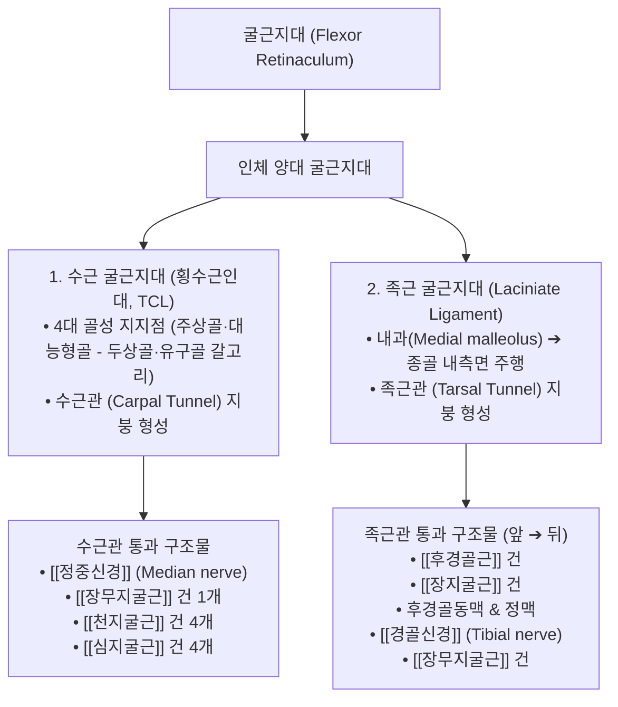

# 굴근지대 (Flexor Retinaculum, 굴근지지대, 屈筋支帶, 횡수근인대)

> **핵심 요약 (Key Summary)**:
> 손목(수부)과 발목(족부)의 굴곡면에 위치하여 긴 굴근 건들과 신경·혈관 다발을 골격 표면에 밀착시키는 강력한 섬유성 결합조직 띠(Fibrous band).
> 관절 굴곡 시 건이 허공으로 붕 뜨는 **활시위 현상(Bowstringing)**을 방지하는 해부학적 도르래(Pulley) 역할을 수행.
> 수부에서는 수근골 사이에 걸쳐져 **수근관(Carpal tunnel)**의 지붕을 형성하며 정중신경과 9개 굴근 건을 보호하고, 족부에서는 내과와 종골 사이에 **족근관(Tarsal tunnel)**을 형성하여 [[경골신경]]과 족저 굴근 건들을 수용.
> [[수근관 증후군]](Carpal tunnel syndrome) 및 족근관 증후군(Tarsal tunnel syndrome)의 핵심 병소이며, 대릉(PC7)·태계(KI3) 중심 침구·전침, 도침(Acupotomy) 미세 절개술 및 추나 수근골궁 확장 기법의 치료 표적.

---

## 1. 개요 및 기능해부학

굴근지대(Flexor Retinaculum)는 인체 말초에서 관절 가동 범위가 가장 넓고 건의 장력이 극대화되는 수근부와 족관절 내측부에 각각 발달하여 골-섬유성 터널(Osteofibrous tunnel)을 완성한다.

### 1) 수근 굴근지대 (횡수근인대, Transverse Carpal Ligament, TCL)
- **4대 골성 부착점**:
  - **요측(외측)**: 주상골 결절(Tubercle of scaphoid) 및 대능형골 결절(Tubercle of trapezium).
  - **척측(내측)**: 두상골(Pisiform) 및 유구골 갈고리(Hook of hamate).
- **수근관(Carpal Tunnel)의 내용물 (총 9개 건 + 1개 신경)**:
  - **정중신경 (Median nerve)**: 지대 바로 아래 가장 천층에 위치하여 압박 손상에 가장 취약.
  - 건 복합체: [[장무지굴근]](FPL) 건 1개, [[천지굴근]](FDS) 건 4개, [[심지굴근]](FDP) 건 4개 (총 9개 건이 활액초에 싸여 통과).

### 2) 족근 굴근지대 (발목 굴근지지대, Laciniate Ligament)
- **골성 부착점**: 경골 내과(Medial malleolus)의 후하연에서 기시하여 종골(Calcaneus) 내측면과 족저근막 근위부에 부착.
- **족근관 통과 구조물 (앞에서 뒤 순서, Tom, Dick And Very Nervous Harry)**:
  1. [[후경골근]](Tibialis posterior) 건.
  2. [[장지굴근]](Flexor digitorum longus) 건.
  3. 후경골동맥 및 동반정맥(Posterior tibial artery & veins).
  4. [[경골신경]](Tibial nerve) 및 내·외측 족저신경 분지.
  5. [[장무지굴근]](Flexor hallucis longus) 건.

---

## 2. 생체역학 및 3차원 운동학

- **도르래 작용과 활시위 방지 (Anti-Bowstringing Mechanism)**:
  - 손목을 굴곡하거나 발목을 족저굴곡할 때, 긴 굴근 건들에 발생하는 강력한 벡터 힘이 건을 관절 회전축에서 전방으로 튕겨져 나가게(Bowstringing) 하려는 물리적 성향을 갖는다.
  - 굴근지대는 건을 뼈 표면에 단단히 묶어두어 일정한 모멘트암을 유지하고, 악력(Grip strength)과 족저 추진력이 관절 각도에 상관없이 균일하게 발휘되도록 지탱한다.
- **고유수용성 감각 센서 기능**:
  - 지대 내부에는 기계수용기인 루피니 소체(Ruffini corpuscles)와 파치니 소체(Pacini corpuscles)가 풍부하게 분포하여 수근관절 및 족관절의 위치 감각과 인대 장력을 척수로 피드백한다.

---

## 3. 인접 연부조직 및 신경·혈관 관계

- **무지구근(Thenar Muscles)의 기시 기반**:
  - 횡수근인대 전면 외측에서는 [[단무지외전근]], [[단무지굴근]] 천두, [[무지대립근]]이 직접 기시하여 엄지손가락의 정밀한 대립(Opposition) 운동을 지탱한다.
- **기용관 (Guyon's Canal, 척골신경관)과의 경계**:
  - 수근 굴근지대의 척측 천층에는 두상골과 유구골 갈고리 사이에 장측 수근인대(Volar carpal ligament)가 덮여 기용관을 형성하며, 척골신경(Ulnar nerve)과 척골동맥이 주행한다.

---

## 4. 임상 병태생리 및 주요 질환

### 1) 수근관 증후군 (Carpal Tunnel Syndrome, CTS)
- **병태생리**:
  - 반복적인 손목 과사용, 컴퓨터 키보드/마우스 작업, 건초염, 임신·폐경기의 호르몬 변화로 인한 조직 부종 시 수근 굴근지대가 비후되고 터널 내압이 정상(2~10mmHg)에서 30mmHg 이상으로 급상승.
  - 정중신경의 상외막 미세혈류가 차단되어 허혈성 부종, 신경전도 지연, 탈수초화(Demyelination)가 발생.
- **증상**:
  - 제1~3수지 및 제4수지 요측의 저림, 감각 저하, 야간통(수면 중 손을 털면 완화), 말기에는 무지구근 위축(Ape hand deformity) 초래.

### 2) 족근관 증후군 (Tarsal Tunnel Syndrome, TTS)
- 발목 내측 굴근지대 하방에서 경골신경이 압박되어 발바닥(족저부) 전체의 타는 듯한 작열통, 이상감각 및 보행 시 악화되는 신경통 유발.

---

## 5. 이학적 검사 및 영상의학적 진단

- **팔렌 검사 (Phalen's Test)**:
  - 양 손등을 서로 맞대고 손목을 90° 최대 굴곡한 상태로 60초간 유지할 때, 수근 굴근지대 하방 압력 상승으로 정중신경 영역의 저림과 통증이 유발되면 양성이다.
- **티넬 징후 (Tinel's Sign)**:
  - 횡수근인대 또는 발목 내과 후하방 굴근지대 위를 신경 타진기로 가볍게 두드릴 때 말초 신경 주행로를 따라 찌릿한 방전통이 발생하면 양성이다.
- **초음파 영상 진단 (Ultrasound Cross-Sectional Area, CSA)**:
  - 수근관 입구(두상골-주상골 높이)에서 정중신경 단면적(CSA)이 10㎟ 이상으로 종창되어 있거나 굴근지대의 비후(Thickening)를 관찰한다.

---

## 6. 한의 임상 치료 및 추나 프로토콜

- **침구 및 전침 치료**:
  - **수근부**:
    - **대릉(大陵, PC7)**: 손목 횡문 중앙, 횡수근인대 근위연에 위치하는 심포경의 원혈. 정중신경 직상방에 위치하므로 15° 사자로 안전 자침.
    - **내관(內關, PC6)**, **노궁(勞宮, PC8)**, **태연(LU9)**, **양계(LI5)**.
    - 저주파(2~4Hz) 전침을 대릉-내관에 통전하여 굴근지대 주변 미세혈류 림프 순환을 촉진하고 신경 부종을 흡수.
  - **족근부**:
    - **태계(太谿, KI3)**: 내과 첨부와 아킬레스건 사이의 함요처(족근관 중심).
    - **수천(KI5)**, **조해(KI6)**, **삼음교(SP6)**.
- **도침 요법 (Acupotomy Retinacular Mini-Release)**:
  - 만성적으로 섬유화되어 정중신경을 조이고 있는 횡수근인대의 원위연 또는 족근 굴근지대를 소침도(Small needle knife)로 미세 절개·박리하여 터널 내압을 감압하는 특화 시술.
- **추나 수근골궁 확장 기법 (Carpal Arch Spreading Technique)**:
  - 시술자의 양 엄지로 환자의 주상골 결절과 두상골을 동시에 접촉하고, 외측으로 부드럽게 벌려주는 신연력을 가하여 횡수근인대의 긴장과 수근관 협착을 해소한다.

---

## 7. 재활 운동 및 예방 관리

- **정중신경 신경가동술 (Median Nerve Flossing / Gliding)**:
  - 팔을 펴고 손목을 신전시키며 고개를 반대편으로 측굴하는 슬라이더(Slider) 및 텐셔너(Tensioner) 기법으로 굴근지대 하방에서 정중신경의 원활한 활주(Excursion)를 회복시킨다.
- **굴근건 신장 및 악력 분산 교육**:
  - 손가락과 손목을 뒤로 젖혀 굴근건과 지대를 부드럽게 스트레칭하고, 장시간 컴퓨터 작업 시 손목 받침대(Ergonomic pad)를 활용하도록 지도한다.

---

## 8. 현대 학술 연구 및 근거 고찰

- Loss J, et al. (2020). Biometry of thenar muscle origins on the flexor retinaculum. *Clin Anat*. PMID: 31894884
  - [연구 요약] 횡수근인대(굴근지대)에 부착하는 무지구근의 정밀 해부학적 계측을 통해, 굴근지대의 수술적 절개 및 보존적 감압 시 무지 기능 보존을 위한 생체역학적 안전 범위를 규명함.
- Lee S, et al. (2019). Quantitative stiffness of the median nerve, flexor tendons, and flexor retinaculum in the carpal tunnel measured with acoustic radiation force impulse elastography in various wrist and finger positions. *Medicine (Baltimore)*. PMID: 31490404
  - [연구 요약] 손목과 손가락의 다양한 위치 변화에 따른 수근 굴근지대와 정중신경의 정량적 경도(Stiffness) 변화를 음향 방사력 탄성초음파로 측정하여, 수근관 내압 상승의 생체역학적 기전을 밝힘.
