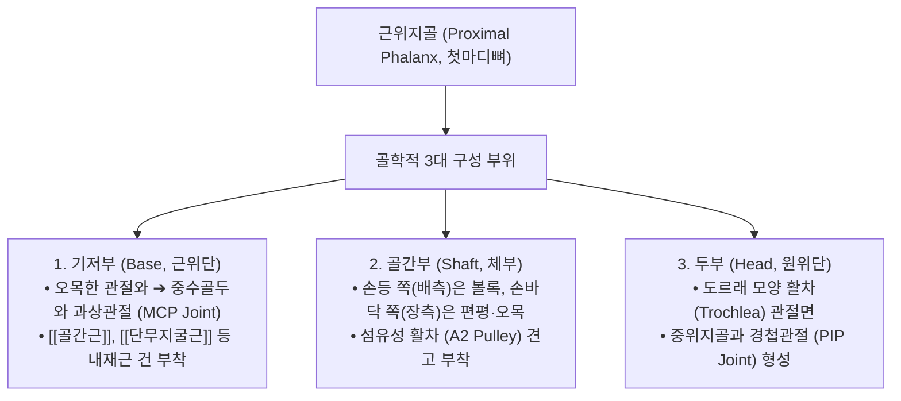
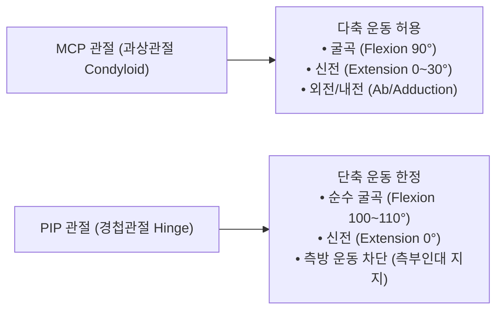

# 근위지골 (Proximal Phalanx, 기저지골, 첫마디뼈)

> **핵심 요약 (Key Summary)**:
> 수부(손) 및 족부(발)의 지골(Phalanges) 중 [[중수골]](Metacarpal) 및 [[중족골]](Metatarsal)과 직접 관절을 이루는 가장 근위부의 관상골(Long bone).
> 근위부의 **중수수지관절(MCP joint)**과 원위부의 **근위지절간관절(PIP joint)**을 형성하며, [[골간근]](Interossei)과 [[충양근]](Lumbricals)이 기저부에 부착하여 손가락 정밀 파지(Grip)와 굴신·내외전 지렛대 역할 수행.
> 수부 골절의 최다 호발 부위 중 하나로, 골간근의 장력에 의해 골절단이 손등 쪽으로 꺾이는 **장측 정점 각형성(Volar apex angulation)** 및 미세 회전 변형 시 가위질 현상(Scissoring) 유발.
> 퇴행성 골관절염의 **[[부샤르 결절]](Bouchard's nodes)** 및 [[류마티스 관절염]] 활막염에 따른 백조목(Swan-neck)·단추구멍(Boutonniere) 변형의 주요 병소.
> [[팔사]](八邪)혈 중심 침구 치료 및 지절간 관절 추나 가동술의 표적.

---

## 1. 개요 및 기능해부학

근위지골(Proximal Phalanx)은 엄지부터 새끼손가락까지 손과 발에 각각 5개씩(좌우 총 20개) 존재하며, 지골 3형제(근위·중위·원위 지골) 중 가장 크고 길다 (단, 제1지인 모지와 엄지발가락은 중위지골이 결손되어 근위지골과 원위지골만 존재).

### 근위지골의 골학적 구조
1. **기저부 (Base)**:
   - 근위단으로 타원형의 둥근 오목면을 형성하여 볼록한 중수골두(Metacarpal head)를 수용한다. 외측 결절에는 측부인대와 골간근 건이 견고히 결합한다.
2. **골간부 (Shaft)**:
   - 전방(장측)으로 약간 오목하게 만곡되어 있다. 손바닥 쪽 면의 양측 모서리에는 굴근건 섬유초(Flexor sheath)와 **A2 활차(A2 Pulley)**가 단단히 부착되어 굴근건의 탈선을 막는 지붕 도관을 이룬다.
3. **두부 (Head)**:
   - 원위단으로 중앙에 가벼운 홈이 파인 도르래(Trochlea) 형태의 양과 관절면을 형성하여 중위지골 기저부의 융기선과 완벽한 경첩(Hinge) 구조를 완성한다.

---

## 2. 생체역학 및 3차원 운동학

- **MCP 관절의 이원적 안정성 (Cam Effect)**:
  - 중수골두는 전후경보다 배측경이 넓은 편심성 캠(Cam) 형태이다.
  - 신전 시에는 측부인대가 느슨해져 손가락의 벌림(외전)과 모음(내전)이 자유롭지만, **90° 굴곡 시에는 측부인대가 팽팽하게 당겨져 외전/내전이 원천 차단**되는 견고한 안정성을 획득한다.
- **PIP 관절의 측방 및 과신전 방어**:
  - 두부 활차면과 측부인대(Collateral ligament), 장측판(Volar plate)이 삼면을 둘러싸고 있어 과신전을 0°에서 강력히 잠그고 측방 흔들림을 방지한다.

---

## 3. 인접 연부조직 및 신경·혈관 관계

- **내재근과 신전 건막(Extensor Mechanism)의 결합**:
  - **골간근 (Interossei)**: 장측 3개(내전)와 배측 4개(외전)가 근위지골 기저부 외측 결절 및 신전지대 측방대로 정지하여 MCP 관절의 굴곡과 지절의 정렬을 제어한다.
  - **충양근 (Lumbricals)**: 근위지골 요측을 가로질러 배측 신전건막에 합류, MCP 굴곡과 동시에 IP 관절 신전을 유도한다.
  - **모지 및 소지 특화근**: 제1근위지골 기저부에는 [[단무지외전근]], [[단무지굴근]], [[무지내전근]]이 정지하고, 제5근위지골 기저부에는 [[소지외전근]] 및 [[단소지굴근]]이 정지한다.
- **A2 활차(A2 Pulley)와 굴근건 통과**:
  - 근위지골 골간부 전면에 부착하는 A2 활차는 수부 활차 중 가장 길고 강하며, [[심지굴근]](FDP)과 [[천지굴근]](FDS) 건이 통과할 때 발생하는 전방 인장력을 전담 완충한다.

---

## 4. 임상 병태생리 및 주요 질환

### 1) 근위지골 골절 (Proximal Phalangeal Fracture)
- **장측 정점 각형성 변형 (Volar Apex Angulation)**:
  - 근위지골 골간부 골절 시, 기저부에 부착된 골간근과 충양근이 근위 골편을 손바닥 쪽(장측)으로 굴곡시키고, 중심 신전건 슬립이 원위 골편을 신전시킨다.
  - 그 결과 골절 부위가 손등 쪽으로 꺾이는 전형적인 배측 함몰 및 장측 정점 각형성이 발생한다.
- **회전 변형과 가위질 현상 (Rotational Scissoring)**:
  - 근위지골에서 불과 5°의 회전 정렬 오차만 발생해도, 주먹을 쥘 때 다친 손가락이 인접 손가락 위로 겹쳐지는 가위질 현상이 발생하여 손의 악력 기능이 마비된다.

### 2) [[골관절염]]의 [[부샤르 결절]] (Bouchard's Nodes)
- 근위지골 두부와 중위지골 기저부가 만나는 PIP 관절의 퇴행성 마모로 연골하 골극이 형성되어 손가락 중간 마디가 딱딱하게 굵어지는 질환 (원위지절 DIP의 [[헤베르덴 결절]]과 대비).

### 3) 류마티스 관절염 지절 변형
- 만성 활막염으로 인해 장측판이 파열되면 **백조목 변형(Swan-neck, PIP 과신전 + DIP 굴곡)**이 초래되고, 중심 신전건 슬립이 파열되면 **단추구멍 변형(Boutonniere, PIP 굴곡 + DIP 신전)**이 고착된다.

---

## 5. 이학적 검사 및 영상의학적 진단

- **수지 회전 정렬 검사 (Finger Cascade & Rotational Alignment)**:
  - 환자에게 손가락을 가볍게 굴곡시키도록 지도한다. 정상 상태에서는 모든 손가락 끝의 방향이 주상골 결절(Scaphoid tubercle)을 향해야 한다. 골절된 지골의 손가락이 인접 수지를 침범하면 회전 골절을 확진한다.
- **PIP 관절 측부인대 스트레스 검사**:
  - PIP 관절을 완전 신전 및 30° 굴곡 상태에서 좌우 내반/외반 스트레스를 가해 관절 간격 벌어짐과 통증을 확인한다.
- **영상의학적 검사**:
  - **수부 전후방(AP), 측면(True Lateral), 사위(Oblique) X-ray**: 골절선의 전위 각도 및 관절면 침범(Intra-articular fracture) 여부를 정밀 판정한다.

---

## 6. 한의 임상 치료 및 추나 프로토콜

- **침구 및 팔사혈(八邪穴) 자침**:
  - **팔사(八邪)**: 손등 쪽 제1~5 중수골간 및 근위지골 기저부 사이의 적백육제 함요부(총 8개 혈위).
    - 수부의 급만성 종창, 손가락 마디의 통증, 굴신불리(屈伸不利)를 해소하는 수부 질환의 특효혈.
  - PIP 관절 측부인대 부착부 아시혈에 0.20mm 미세 호침으로 점자 출혈 또는 평자하여 관절강 내 활액 울체를 배출한다.
- **[[도침]] 요법 (Acupotomy for PIP Adhesion)**:
  - 만성 지절간 관절염 및 외상 후 섬유성 구축으로 손가락이 굳은 경우, 근위지골 두부 외측의 비후된 측부인대와 관절낭을 소침도로 미세 박리하여 가동성을 회복시킨다.
- **[[소염약침]] 및 [[봉약침]]**:
  - PIP 활막염 및 부샤르 결절 통증 부위에 [[황련해독탕]] 약침 또는 [[봉약침]](BV, 1:10000 희석)을 0.05~0.1cc 관절낭 주위에 주입하여 부종을 흡수하고 연골 마모를 억제한다.
- **[[추나]] 수지 관절 가동술 (Finger Traction & Glide)**:
  - 근위지골 골간부를 시술자의 손가락으로 가볍게 고정한 후 원위 방향으로 부드러운 축성 견인(Long-axis traction)을 가하면서 장배측 글라이딩을 유도하여 관절 유착을 푼다.

---

## 7. 재활 운동 및 예방 관리

- **부목 고정 및 조기 관절 운동 (Early Active Motion)**:
  - 안정성 근위지골 골절 정복 후에는 3주 이상 장기 고정 시 건 유착이 심해지므로, 인접 정상 손가락과 함께 묶는 버디 테이핑(Buddy taping)을 적용하고 조기 능동 굴신 운동을 시작한다.
- **테이블탑(Tabletop) 및 고리 쥐기(Hook fist) 훈련**:
  - MCP는 90° 굴곡하고 PIP/DIP는 신전시키는 테이블탑 운동을 통해 충양근과 골간근을 단독 강화하고, 반대로 MCP는 신전하고 PIP/DIP를 굴곡시키는 훈련으로 굴근건의 활주 거리를 유지한다.

---

## 8. 현대 학술 연구 및 근거 고찰

- Peszek A, et al. (2026). Proximal Phalanx Intramedullary Fixation Configurations: A Comparative Biomechanical Cadaveric Study. *Hand (N Y)*. PMID: 42648891
  - [연구 요약] 근위지골 골절의 골수강 내 고정술 시 나사못 구성과 생체역학적 강도를 사체 연구로 비교하여, 손가락 굴신 시 발생하는 각형성 및 회전 전단력에 저항하는 최적의 역학적 안정성을 규명함.
- Mekhail J, et al. (2026). Quantifying Extensor Tendon and Articular Surface Involvement During Phalangeal Intramedullary Fixation. *J Hand Surg Glob Online*. PMID: 42292904
  - [연구 요약] 지골 골절의 정복 및 고정 과정에서 신전건 복합체와 관절면 손상을 최소화하기 위한 해부학적 진입 경로와 생체역학적 안전 범위를 정량 분석함.
