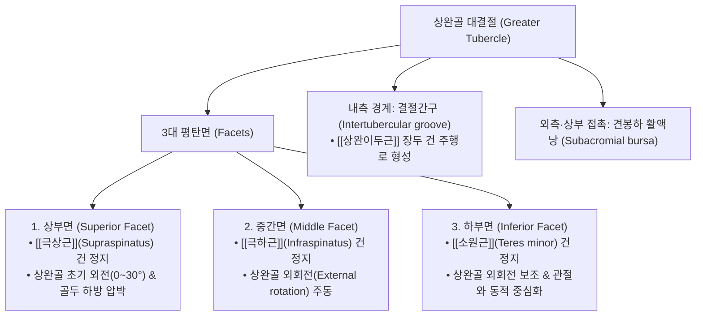
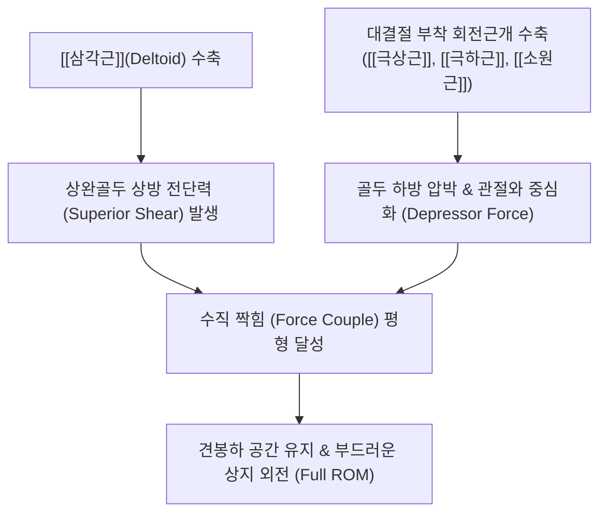

# 대결절 (Greater Tubercle, 상완골 대결절, 大結節)

> **핵심 요약 (Key Summary)**:
> 상완골두(Humeral head) 외측면에 위치하는 커다란 골성 융기로, [[회전근개]]를 구성하는 3대 외인성 건이 정지하는 상지의 핵심 역학 랜드마크.
> 상부면(극상근), 중간면(극하근), 하부면(소원근)의 3개 평탄면(Facets)으로 구획되어 상완골의 외전과 외회전을 견인하고 상완골두를 관절와로 압박 안정화(Depressor role).
> 결절간구(Bicipital groove)의 외측벽을 형성하여 [[상완이두근]] 장두 건을 지지하며, [[견봉하 충돌 증후군]], 극상근 건병증, [[석회성 건염]] 및 상완골 견열 골절(Avulsion fracture)의 최다 호발 부위.
> 견우(LI15)·견료(TE14) 중심 침구·약침 치료 및 견관절 후하방 글라이딩 추나 수기요법의 표적.

---

## 1. 개요 및 기능해부학

대결절(Greater Tubercle)은 상완골 근위 외측에 돌출된 뼈 돌기로, 견봉(Acromion) 아래에서 어깨의 외측 윤곽을 형성한다.

| 해부학적 구조 | 상세 내용 |
| :--- | :--- |
| **골격 분류** | [[상완골]](Humerus) 근위부 외측 골성 융기 |
| **3대 부착면** | • 상부면: [[극상근]](Supraspinatus) 정지 • 중간면: [[극하근]](Infraspinatus) 정지 • 하부면: [[소원근]](Teres minor) 정지 |
| **인접 랜드마크** | • 내측: 소결절(Lesser tubercle) 및 결절간구(이두근구) • 전상방: 견봉 및 오훼견봉인대(CAL) • 심부: 상완골 해부경(Anatomical neck) |
| **체표 촉진** | 상완을 신전 및 내회전(열중쉬어 자세) 시 견봉 전외측 하방에서 결절의 외측 모서리가 가장 뚜렷하게 촉진됨 |

---

## 2. 생체역학 및 3차원 운동학

- **상완골두 하방 압박과 짝힘 (Force Couple) 메커니즘**:
  - 팔을 들어 올릴 때 가장 강력한 삼각근은 상완골두를 견봉 쪽으로 끌어올리는 상방 전단력(Superior shear)을 유발한다.
  - 대결절의 3개 면에 정지하는 회전근개 건들은 상완골두를 관절와 중심으로 당겨 누르는 하방 압박력(Depressor role)을 발휘하여 상완골두가 견봉과 부딪히지 않도록 견봉하 공간(Subacromial space, 정상 9~10mm)을 방어한다.
- **상지 외전 시 대결절의 외회전 클리어런스**:
  - 상완골이 90° 이상 외전될 때, 대결절이 견봉 밑을 안전하게 통과하기 위해서는 **상완골의 외회전(External rotation)**이 필수적이다. 만약 상완골이 내회전된 상태로 외전되면 대결절이 견봉 앞쪽 모서리에 물리적으로 부딪히며 충돌을 일으킨다.

---

## 3. 인접 연부조직 및 신경·혈관 관계

- **견봉하 활액낭(Subacromial Bursa)과의 마찰 관계**:
  - 대결절의 상면과 외측면은 견봉하 활액낭의 바닥을 이룬다. 팔의 반복 거상 시 활액낭이 대결절과 견봉 사이에서 마찰을 완충하지만, 만성 과사용 시 활액낭염이 동반되어 대결절 전체에 극심한 통증을 유발한다.
- **위험 영역 (Codman's Critical Zone)**:
  - 대결절 상부면에서 극상근 건이 정지하기 직전 약 1cm 부위는 미세혈관 분포가 희박한 저혈류 영역(Critical zone)이다. 반복 압박이나 허혈 시 석회 침착과 퇴행성 파열이 가장 빈발한다.
- **액와신경(Axillary Nerve)과의 위치 관계**:
  - 대결절 하단에서 약 5~7cm 원위부로 액와신경 전지가 삼각근 심부를 가로질러 주행한다.

---

## 4. 임상 병태생리 및 주요 질환

### 1) 견봉하 충돌 증후군 (Subacromial Impingement Syndrome)
- 팔을 60~120° 외전할 때(유통호, Painful arc) 대결절과 부착된 극상근 건이 견봉 및 오훼견봉인대와 충돌하여 찌르는 듯한 날카로운 통증 발생.

### 2) 석회성 건염 (Calcific Tendinitis of the Shoulder)
- 대결절 상부면 부착부의 임계 영역에 하이드록시아파타이트(Hydroxyapatite) 칼슘 결정이 침착되는 질환.
- 침착기에는 뻐근한 둔통을 보이다가, 석회가 흡수·용해되는 흡수기(Resorptive phase)에는 화학적 염증으로 인해 밤에 잠을 잘 수 없을 정도의 극심한 발작성 야간통을 초래.

### 3) 대결절 견열 골절 (Greater Tuberosity Avulsion Fracture)
- 견관절의 급성 전방 탈구나 낙상 타격 시, 강하게 수축한 회전근개 건이 대결절 골편을 잡아 뜯어 골절이 발생. 5mm 이상의 골편 전위 시 견봉하 충돌과 외회전 근력 소실이 영구화될 수 있어 정밀 정복이 요구됨.

---

## 5. 이학적 검사 및 영상의학적 진단

- **니어 충돌 검사 (Neer Impingement Test)**:
  - 검사자가 견갑골을 고정한 상태에서 환자의 팔을 내회전시킨 채 강제로 전방 굴곡 거상할 때, 대결절이 견봉 전하연과 충돌하여 통증이 발생하면 양성.
- **호킨스-케네디 검사 (Hawkins-Kennedy Test)**:
  - 어깨와 팔꿈치를 90° 굴곡한 상태에서 수평 내전 및 급격한 내회전을 가하여 대결절을 오훼견봉인대 아래로 밀어 넣어 통증을 유발.
- **영상의학적 검사**:
  - **단순 X-ray (AP, Scapular Y-view, Axillary view)**: 대결절 피질골의 경화, 골극 형성, 골절편 전위 및 석회성 건염의 백색 석회 음영을 확인.
  - **근골격계 초음파 및 MRI**: 대결절 골막 부착부의 극상근 전층/부분 파열(Footprint tear) 및 견봉하 활액낭 종창을 정밀 평가.

---

## 6. 한의 임상 치료 및 추나 프로토콜

- **침구 및 주요 경혈 배오**:
  - **견우(肩髃, LI15)**: 대결절 전상방과 견봉 사이의 함요처(팔을 수평 외전 시 생기는 전방 오목). 수양명대장경의 요혈로 극상근 전부와 견봉하 활액낭을 표적 자침.
  - **견료(肩髎, TE14)**: 대결절 후상방 함요처(외전 시 후방 오목). 극하근 정지부 및 후방 관절낭 치료.
  - **노회(臑會, TE13)**, **비노(臂臑, LI14)**: 대결절 하방 삼각근 부착부 근막 긴장 완화.
- **약침 및 도침 치료**:
  - 석회성 건염 및 퇴행성 건병증 부위에 신바로약침 또는 황련해독탕 약침을 대결절 골막 표면에 주입하여 무균성 신경염증을 억제하고 혈류를 개선.
  - 만성 건 유착 및 골극 부착부에는 소침도(Acupotomy)로 골막 상단을 미세 절개하여 건막의 탄성을 회복.
- **추나 견관절 가동술 (Glenohumeral Mobilization)**:
  - **상완골두 후하방 글라이딩 (Posterior-Inferior Glide)**: 앙와위에서 시술자가 상완골 근위부를 파지하고 축성 견인과 함께 후하방으로 지그시 밀어주어 대결절과 견봉 사이의 공간을 확보.

---

## 7. 재활 운동 및 예방 관리

- **회전근개 외회전근 강화 (Side-lying External Rotation)**:
  - 대결절에 부착하는 극하근과 소원근을 단독 강화하기 위해 측와위에서 가벼운 덤벨이나 밴드를 이용한 외회전 운동을 지도하여 상완골두 하방 압박력을 회복.
- **견갑골 후경사 및 후인 운동 (Scapular Retraction & Posterior Tilt)**:
  - 둥근어깨 자세는 대결절과 견봉의 거리를 좁히므로 흉추 신전 및 능형근 강화 스트레칭을 병행.

---

## 8. 현대 학술 연구 및 근거 고찰

- Arnold E, et al. (2026). Implant-specific rates of post-operative displacement and reoperation in isolated greater tuberosity fracture open reduction and internal fixation. *JSES Rev Rep Tech*. PMID: 42824738
  - [연구 요약] 단독 상완골 대결절 골절 환자에서 내고정 기구에 따른 생체역학적 안정성과 재수술률을 비교 분석하여, 회전근개 인장력에 저항하는 대결절 해부학적 정복의 임상적 중요성을 입증함.
- Wang M, et al. (2026). A quantitative computed tomography-based finite element analysis of iatrogenic fracture during shoulder dislocation reduction: biomechanical mechanism and efficacy of prophylactic K-wire fixation. *Clin Biomech (Bristol)*. PMID: 42784918
  - [연구 요약] 견관절 탈구 정복 시 대결절에 집중되는 응력 분포와 견열 골절 발생의 생체역학적 메커니즘을 3차원 유한요소 해석으로 규명함.
