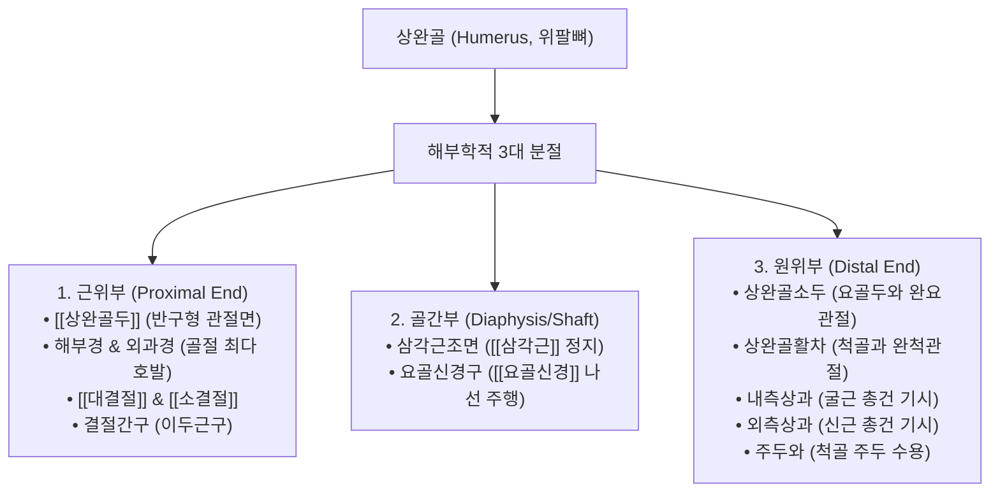

# 상완골 (上腕骨, Humerus, 위팔뼈)

> **핵심 요약 (Key Summary)**:
> 상지 골격 중 가장 크고 긴 관상골(Long bone)로, 근위부는 견갑골 관절와와 [[견관절]](GH joint)을 형성하고 원위부는 요골·척골과 [[주관절]](Elbow joint)을 형성하는 중심 지렛대 축.
> 대결절과 소결절에 [[회전근개]] 4대 건이 정지하며, 골간부 나선형 고랑인 요골신경구(Radial groove) 및 원위부의 내·외측상과가 상지의 핵심 역학 랜드마크.
> 3대 주요 신경이 골막에 밀착 주행: 외과경([[액와신경]]), 골간부([[요골신경]], 손목하수), 내측상과 후면([[척골신경]], 주관증후군 및 갈퀴손).
> 상완골두 탈구 시 Hill-Sachs 병변, 골간부 골절, 테니스엘보([[외측상과염]]) 및 골퍼스엘보([[내측상과염]])의 중심 병소.
> 견우·견료·곡지(LI11)·소해(HT3) 중심 침구 치료 및 견관절·주관절 추나 가동술의 치료 표적.

---

## 1. 개요 및 기능해부학

상완골(Humerus)은 체간과 전완을 매개하는 단일 골격 기둥으로, 근위단(Proximal), 골간부(Shaft), 원위단(Distal)의 3개 분절로 구성된다.

### 상완골의 주요 골격 랜드마크
1. **근위단 (Proximal End)**:
   - **상완골두 (Humeral head)**: 매끄러운 반구형 관절면으로 견갑골의 얕은 관절와와 만나 인체에서 가동성이 가장 넓은 구와관절(Ball-and-socket joint)을 형성한다.
   - **외과경 (Surgical neck)**: 결절 하방의 잘록한 부위로, 골다공증 환자나 낙상 시 골절이 가장 빈번하여 '외과적 목'이라 명명되었다.
   - **대결절 & 소결절**: 대결절에는 [[극상근]], [[극하근]], [[소원근]]이 정지하고, 소결절에는 [[견갑하근]]이 단독 정지한다. 둘 사이의 결절간구로는 [[상완이두근]] 장두 건이 주행한다.
2. **골간부 (Shaft)**:
   - 원통형에서 하부로 갈수록 삼각형 단면을 띤다. 외측 중앙에 V자 모양의 **삼각근조면(Deltoid tuberosity)**이 돌출하며, 후면에는 **요골신경구(Radial groove)**가 나선형으로 비스듬히 패여 있다.
3. **원위단 (Distal End)**:
   - **소두(Capitulum)**: 외측의 둥근 구형 관절면으로 요골두와 관절한다.
   - **활차(Trochlea)**: 내측의 모래시계 도르래 모양 관절면으로 척골의 활차절흔과 강력한 경첩관절을 이룬다.
   - **내·외측상과**: 내측상과는 전완 굴근군, 외측상과는 전완 신근군의 총건 부착부이다. 후면에는 팔을 뻗을 때 척골 주두가 쏙 들어가는 **주두와(Olecranon fossa)**가 깊게 파여 있다.

---

## 2. 생체역학 및 3차원 운동학

- **견관절(GH Joint)의 다축 운동과 동적 안정성**:
  - 관절와의 표면적에 비해 상완골두가 3배 이상 커서 굴곡, 신전, 외전, 내전, 내회전, 외회전, 회선(Circumduction)의 자유로운 3차원 운동이 가능하다.
  - 골성 안정성이 부족하므로 상완골두를 사방에서 감싸 쥐는 [[회전근개]]의 동적 중심화 작용이 상완골 운동의 전제조건이다.
- **주관절(Elbow Joint)의 경첩 굴신 운동**:
  - 상완골 활차와 척골 간의 완척관절은 관상축(Coronal axis)을 중심으로 순수 굴곡(0~145°)과 신전을 수행한다. 상완골의 운반각(Carrying angle, 남성 10~15°, 여성 15~20°)은 팔을 폈을 때 손이 체간에 부딪히지 않도록 외측으로 편위된 각도를 제공한다.

---

## 3. 인접 연부조직 및 신경·혈관 관계

상완골은 골막 바로 위로 3대 주요 신경이 밀착 주행하여 골절 시 신경 마비가 호발한다.

| 상완골 손상 부위 | 밀착 주행 신경 및 혈관 | 손상 시 대표적 임상 증상 |
| :--- | :--- | :--- |
| **외과경 (Surgical neck)** | [[액와신경]](Axillary nerve) 및 후상완회선동맥 | [[삼각근]] 마비(외전 불가), 어깨 외측 군장 부위 감각 소실 |
| **골간부 중앙 (Mid-shaft)** | [[요골신경]](Radial nerve) 및 상완심동맥 | **손목 하수(Wrist drop)**, 수배부(손등) 제1~3수지 감각 저하 |
| **내측상과 후면 (Medial epicondyle)** | [[척골신경]](Ulnar nerve) (주관 관통) | **갈퀴손(Claw hand)** 변형, 제4·5수지 저림, 골간근 위축 |

- **상완동맥(Brachial Artery) 주행**:
  - 상완골 내측을 따라 상완이두근 안쪽 고랑으로 주행하여 주와(Cubital fossa)에서 요골동맥과 척골동맥으로 분지한다. 과상 골절(Supracondylar fracture) 시 상완동맥 압박에 의한 볼크만 허혈성 구축(Volkmann's ischemic contracture)이 발생할 수 있다.

---

## 4. 임상 병태생리 및 주요 질환

### 1) 상완골두 전방 탈구 및 Hill-Sachs 병변
- 외전-외회전 상태에서 후방 충격 시 골두가 관절와 앞쪽으로 튕겨져 탈구. 이때 관절와 전하연과 상완골두 후외측면이 충돌하여 골두에 압박 골절이 패이는 **Hill-Sachs 병변**이 발생.

### 2) 상완골 간부 골절 (Humeral Shaft Fracture)
- 비틀림 외력(나선 골절) 또는 직접 타격(횡골절) 시 발생. 10~15%에서 요골신경 마비가 동반되어 손목과 손가락을 손등 쪽으로 들어 올리지 못하는 Wrist drop 초래.

### 3) 상과염 (Epicondylitis)
- **외측상과염 (테니스엘보)**: 외측상과 단요측수근신근(ECRB) 총건 기시부의 미세 파열과 건병증.
- **내측상과염 (골퍼스엘보)**: 내측상과 굴근-회내근 복합 건 기시부의 염증 및 통증.

---

## 5. 이학적 검사 및 영상의학적 진단

- **밀 검사 (Mill's Test) & 코젠 검사 (Cozen's Test)**:
  - 외측상과염 선별: 검사자가 손목 신전을 저항하거나 환자의 팔꿈치를 편 채 손목을 강제 굴곡시킬 때 외측상과에 통증이 유발되면 양성.
- **골퍼스 엘보 검사 (Golfer's Elbow Test)**:
  - 팔꿈치를 펴고 전완을 회외시킨 상태에서 손목 굴곡에 저항을 가할 때 내측상과에 통증이 유발되면 양성.
- **영상의학적 검사**:
  - **상완골 전장 전후방/측면 X-ray**: 골절선, 각형성, 단축, 탈구 유무를 판독.
  - **견관절/주관절 MRI**: 골두 관절연골 마모, 회전근개 부착부 파열 및 주관절 측부인대 손상을 확진.

---

## 6. 한의 임상 치료 및 추나 프로토콜

- **침구 및 주요 경혈 배오**:
  - **견우(LI15) & 견료(TE14)**: 상완골두 주위 회전근개 건초염 및 유착성 관절낭염 치료.
  - **비노(臂臑, LI14)**: 상완골 삼각근조면 부위로 삼각근 통증, 견비통, 상지 운동마비의 다용혈.
  - **곡지(曲池, LI11)**: 상완골 외측상과 전외측 함요처로 테니스엘보 치료의 제1 요혈.
  - **소해(少海, HT3)**: 상완골 내측상과 전방 주횡문 내측단으로 골퍼스엘보 및 척골신경 포착 해소.
  - **수삼리(LI10)**: 요골신경 주행로 상의 전완 신근군 이완.
- **약침 요법**:
  - 외측상과 및 내측상과 건 부착부에 신바로약침 또는 중성어혈약침을 0.2~0.3cc 주입하여 건막의 무균성 퇴행성 염증을 억제.
- **추나 관절가동술 (Joint Mobilization)**:
  - **견관절 캡슐 신연 추나**: 상완골두를 관절와에서 외측으로 가볍게 분리 견인(Lateral distraction)하여 관절 내압을 낮춤.
  - **주관절 완척관절 신연 및 외반 교정**: 주관절 굴곡 제한 시 활차와 주두 사이의 후방 활주(Posterior glide)를 적용.

---

## 7. 재활 운동 및 예방 관리

- **진자 운동 (Codman Pendulum Exercise)**:
  - 상완골 골절 회복기나 오십견 초기에 상체를 숙이고 팔을 자연스럽게 늘어뜨려 중력을 이용해 원을 그리며 관절낭 유착을 방지하는 안전한 조기 가동 운동.
- **전완 신근/굴근 편심성 근력 강화 (Eccentric Wrist Extension/Flexion)**:
  - 상과염 재발 방지를 위해 덤벨을 쥐고 천천히 버티며 내리는 편심성 수축 훈련을 지도하여 건의 콜라겐 재배열을 유도.

---

## 8. 현대 학술 연구 및 근거 고찰

- Saffi M, et al. (2026). Allograft strut fixation to humeral bone: a biomechanical comparison of suture tape cerclage, wire cerclage, and screws. *J Shoulder Elbow Surg*. PMID: 42697358
  - [연구 요약] 상완골 골간부 골절 및 불유합 모델에서 골성 고정 방식에 따른 비틀림 및 굴곡 생체역학적 강도를 비교 분석하여, 상완골 부하 전달 축의 최적 안정화 기전을 규명함.
- Almalki MM, et al. (2025). Fracture Patterns and Peripheral Brachial Plexus Injury in Humerus Fractures: A Retrospective Study. *J Brachial Plex Peripher Nerve Inj*. PMID: 40837853
  - [연구 요약] 상완골 골절 유형에 따른 요골신경, 액와신경, 정중신경 손상의 유병률과 회복 예후를 임상적으로 추적하여, 상완골 해부학적 위치별 신경 포착의 정밀 진단 기준을 제시함.
