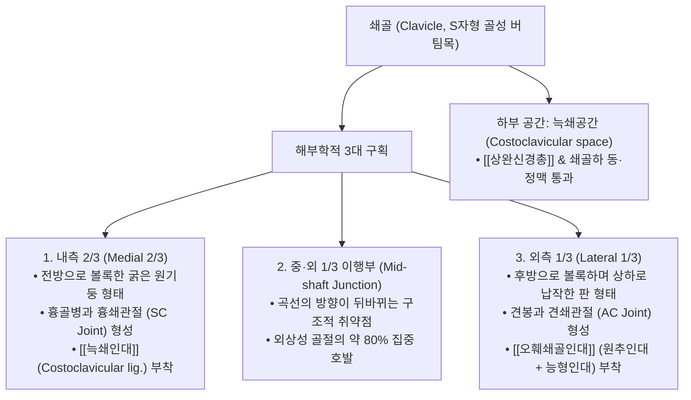
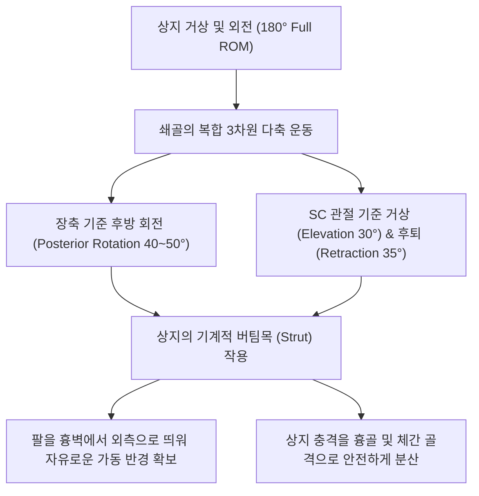

# 쇄골 (Clavicle, 빗장뼈, 鎖骨, Collarbone)

> **핵심 요약 (Key Summary)**:
> [[흉골병]](Manubrium)과 [[견봉]](Acromion) 사이에 수평으로 완만한 S자 곡선을 그리며 위치하여 상지를 체간 축성 골격에 연결하는 유일한 골성 버팀목(Strut).
> 내측단은 **흉쇄관절(Sternoclavicular joint, SC joint)**을, 외측단은 **견쇄관절(Acromioclavicular joint, AC joint)**을 형성하며 견갑대 운동 시 장축을 중심으로 40~50° 후방 회전.
> 상면과 하면에 [[승모근]], [[흉쇄유돌근]](SCM), [[대흉근]], [[삼각근]], [[쇄골하근]]이 부착.
> 곡선 전환부인 **중·외 1/3 경계부(Mid-shaft)**가 역학적으로 가장 취약하여 인체 골절 최다 호발 부위 중 하나이며, 하부 늑쇄공간 협착 시 [[흉곽출구 증후군]](TOS) 호발.
> 결분(ST12)·기호(ST13) 혈위 안전 자침 및 SC·AC 관절 [[추나]] 가동술의 핵심 표적.

---

## 1. 개요 및 기능해부학

쇄골(Clavicle)은 전 길이에 걸쳐 피하에 직접 노출되어 체표 촉진이 용이한 긴뼈(골수강이 없는 장골)이다.

| 해부학적 지표 | 상세 내용 |
| :--- | :--- |
| **골격 분류** | 상지대(Shoulder girdle) 관상골 (골수강 결여, 골막 내 골화로 형성) |
| **관절 결합** | • **흉쇄관절(SC joint)**: 상지와 체간 축성 골격을 잇는 유일한 골성 관절 • **견쇄관절(AC joint)**: 쇄골 외측단과 견갑골 견봉 결합 |
| **핵심 인대** | [[늑쇄인대]](제1늑골 연결), [[오훼쇄골인대]](원추인대+능형인대), [[견쇄인대]], 쇄골간인대 |
| **인접 신경·혈관** | 상완신경총 신경간, 쇄골하동맥, 쇄골하정맥 (쇄골 바로 아래 늑쇄간극 주행) |

---

## 2. 생체역학 및 3차원 운동학

- **상지의 외측 버팀목 (Strut Action)**:
  - 쇄골은 견갑골과 팔을 흉벽에서 바깥쪽으로 적절한 거리를 두고 떨어뜨려 유지함으로써 상지가 체간의 방해 없이 360°에 가까운 넓은 회전 반경을 갖도록 지탱한다.
- **상지 거상 시 쇄골의 후방 회전 (Posterior Rotation)**:
  - 팔을 180° 완전 거상할 때, [[오훼쇄골인대]]가 팽팽해지면서 쇄골은 장축을 중심으로 **약 40~50° 후방 회전**한다. 쇄골의 후방 회전이 제한되면 어깨 외전이 90° 부근에서 멈추게 된다.

---

## 3. 인접 연부조직 및 신경·혈관 관계

- **근육 부착 네트워크**:
  - **상면(Superior)**: 내측 1/3에 [[흉쇄유돌근]](SCM) 쇄골두 기시, 외측 1/3에 [[승모근]] 상부 섬유 정지.
  - **전하면(Anterior & Inferior)**: 내측 1/2에 [[대흉근]] 쇄골두 기시, 외측 1/3에 [[삼각근]] 전면 섬유 기시.
  - **하면(Inferior)**: 쇄골하근구에 [[쇄골하근]](Subclavius)이 정지하여 쇄골하 혈관을 보호.
- **늑쇄공간(Costoclavicular Space)과 흉곽출구 증후군**:
  - 쇄골 중앙 하면과 제1늑골 사이의 좁은 틈새(늑쇄공간)로 [[상완신경총]]과 쇄골하 혈관이 빠져나간다.
  - 쇄골하근 과긴장, 쇄골 골절 후 부정유합(Malunion), [[거북목]]에 따른 쇄골 하강 시 신경혈관이 눌려 손저림과 부종을 유발한다.

---

## 4. 임상 병태생리 및 주요 질환

### 1) 쇄골 골절 (Clavicle Fracture)
- **손상 메커니즘**: 어깨 외측으로 넘어지거나 직접 타격을 받을 때 곡선이 꺾이는 **중간 1/3과 외측 1/3 경계부(Mid-shaft)**에서 전체 골절의 80%가 발생.
- **전위 양상**: 내측 골편은 흉쇄유돌근의 강력한 견인력에 의해 위로 솟구치고, 외측 골편은 팔의 무게와 대흉근에 의해 아래 및 안쪽으로 끌려 내려가 전형적인 층형 변형을 형성.

### 2) 견쇄관절 분리 및 탈구 (AC Joint Separation)
- 어깨 끝을 바닥에 강하게 부딪힐 때 [[견쇄인대]] 및 [[오훼쇄골인대]]가 파열되어 쇄골 외측단이 계단처럼 위로 솟아오름.
- **[[피아노 건반 징후]] (Piano Key Sign)**: 솟아오른 쇄골 외측단을 손가락으로 누르면 내려갔다가 손을 떼면 다시 튀어 올라오는 징후.

### 3) 늑쇄증후군 (Costoclavicular Syndrome)
- 군인이 무거운 군장을 메거나 가슴을 지나치게 펴고 어깨를 뒤로 젖히는 자세(차려 자세)에서 쇄골과 제1늑골이 가위처럼 맞물려 상완신경총을 압박하는 질환.

---

## 5. 이학적 검사 및 영상의학적 진단

- **늑쇄 압박 검사 (Costoclavicular Maneuver / Military Brace Test)**:
  - 환자의 어깨를 뒤로 당기고 아래로 내리게(군인 차려 자세) 한 후 심호흡을 시키며 요골동맥 맥박 소실 및 상지 저림 유발을 평가.
- **수평 내전 검사 (Cross-body Adduction Test)**:
  - 팔을 90° 굴곡한 상태에서 반대편 어깨 쪽으로 수평 내전시켜 견쇄관절면을 압박할 때 국소 통증이 유발되면 견쇄관절염이나 인대 손상을 시사.
- **영상의학적 검사**:
  - **쇄골 전후방(AP) 및 20° 두측 경사 X-ray (Zanca View)**: 쇄골 골절편의 전위, 단축 길이, 견쇄관절 간격 확대를 확인.

---

## 6. 한의 임상 치료 및 추나 프로토콜

- **침구 및 주요 경혈 배오**:
  - **[[결분]](缺盆, ST12)**: 쇄골상와 중앙 함요처로 상완신경총이 지나는 요혈.
  - **[[기호]](氣戶, ST13)**: 쇄골하연, 전정중선 외측 4촌.
  - **[[거골]](巨骨, LI16)**: 쇄골 외측단과 견갑극 사이 함요처로 견쇄관절 통증 치료의 명혈.
  - **안전 자침 수칙**: 쇄골 상하부 혈자리는 바로 밑에 늑막 첨부(Apex of lung)가 위치하므로 **절대 깊게 직자하지 않고, 쇄골이나 늑골 뼈 표면을 향해 15° 사자 또는 횡자**로 0.3~0.5촌 이내로 안전하게 유침한다.
- **추나 흉쇄관절 및 견쇄관절 가동술 (SC & AC Mobilization)**:
  - 시술자의 모지와 식지로 쇄골의 내측단 또는 외측단을 부드럽게 파지하고, 상지 굴신과 연동하여 상하·전후 방향으로 가벼운 저진폭 진동(Oscillation)을 가해 관절면 유착을 해소.
- **쇄골하근 근막 이완술 (MFR)**:
  - 쇄골 하연을 따라 손가락 끝으로 내측에서 외측으로 지그시 압박 슬라이딩하여 늑쇄간극을 넓혀줌으로써 흉곽출구 증후군 증상을 완화.

---

## 7. 재활 운동 및 예방 관리

- **8자 붕대 고정 및 조기 진자 운동**:
  - 비수술적 쇄골 골절 치료 시 8자 붕대(Figure-of-eight bandage)를 3~4주간 적용하여 어깨를 뒤로 젖힌 정렬을 유지하며, 핑거 래더(Finger ladder) 운동으로 관절 강직을 예방.
- **견갑골 상방회전 및 전거근 운동**:
  - 쇄골의 원활한 후방 회전을 보조하기 위해 월 슬라이드(Wall slide) 운동을 시행.

---

## 8. 현대 학술 연구 및 근거 고찰

- Kedadria A, et al. (2026). Investigating Contact Models in Clavicle Fixation Plates: A Finite Element Study of Their Impact on Biomechanical Performance. *J Biomech Eng*. PMID: 42446913
  - [연구 요약] 쇄골 골간부 골절 시 골소실 및 인장력에 대응하는 고정 금속판의 접촉 모델과 생체역학적 응력 분산을 유한요소 분석하여 최적의 쇄골 정렬 안정화 기전을 입증함.
- Zheng L, et al. (2026). Finite element analysis of internal fixation with clavicular hook plate vs. adjustable loop plate for Neer Type IIB distal clavicle fractures. *Front Surg*. PMID: 42052365
  - [연구 요약] 원위부 쇄골 골절 및 견쇄관절 인대 손상에서 내고정 기구의 생체역학적 거동과 견봉하 마찰 위험을 정량 비교하여 쇄골 외측단의 해부학적 복원 지침을 제시함.
