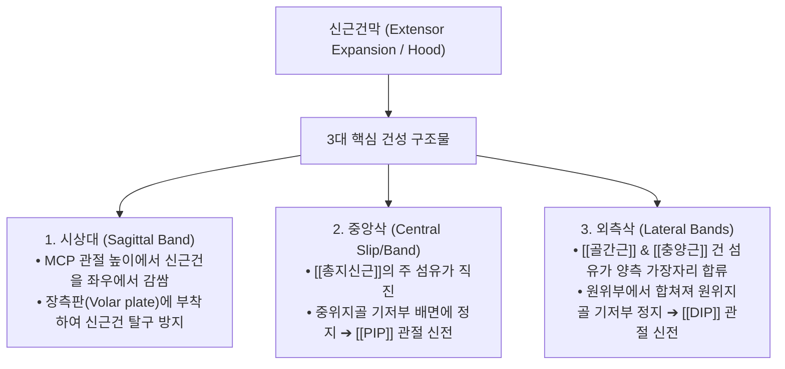
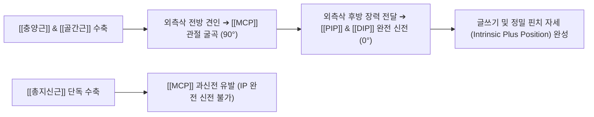

# 신근건막 (Extensor Expansion, 지배건막, 伸筋腱膜, Extensor Hood)

> **핵심 요약 (Key Summary)**:
> 수부 제2~5수지의 근위지골 배면에 위치하여 외인성 신근 건과 내인성 수부 근육의 건들이 입체적으로 융합하는 삼각형 모자(Hood) 형태의 특수 섬유건막 복합체.
> [[총지신근]](EDC), [[골간근]](Interossei), [[충양근]](Lumbricals)의 수축력을 중수수지관절([[MCP]])과 근위·원위 지간관절([[PIP]], [[DIP]])로 정밀하게 분배하는 고도의 다관절 신전 기구.
> 시상대(Sagittal band, 신근건 중앙 정렬), 중앙삭(Central slip, 중절골 정지 및 PIP 신전), 외측삭(Lateral bands, 말절골 정지 및 DIP 신전)으로 구성.
> 손상 시 [[추지]](Mallet finger), [[단추구멍 변형]](Boutonniere), [[백조목 변형]](Swan-neck) 및 시상대 파열에 따른 건 탈구 유발.
> 팔사(EX-UE9)·합곡(LI4) 중심 미세 침구 치료, 소침도 건막 박리 및 수지 관절 추나 가동술의 표적.

---

## 1. 개요 및 기능해부학

신근건막(Extensor Expansion)은 뼈에 직접 닿는 단순한 건 정지부가 아니라, 손가락 배측 전체를 감싸며 여러 근육의 장력을 조절하는 가동성 건막 슬리브(Mobile aponeurotic sleeve)이다.

### 신근건막의 3대 해부학적 구성 요소
1. **시상대 (Sagittal bands, 근위대)**:
   - MCP 관절 높이에서 외인성 [[총지신근]] 건을 마치 고리처럼 둘러싸며 양측의 장측판(Volar plate) 및 심수근횡인대에 단단히 고정된다.
   - 손가락을 굴곡하거나 신전할 때 신근건이 중수골두 옆으로 미끄러져 탈구되지 않도록 중앙 정렬을 유지하는 절대적 가이드 역할을 수행한다.
2. **중앙삭 (Central slip / band)**:
   - 신근건막의 정중앙을 종주하는 주 건 섬유로, 근위지골을 지나 **중위지골(Middle phalanx) 기저부 배측**에 견고히 부착한다. PIP 관절을 신전시키는 주동 구조물이다.
3. **외측삭 (Lateral bands)**:
   - 내인성 근육인 [[골간근]]과 [[충양근]]에서 뻗어 나온 건 섬유가 신근건막의 요측 및 척측 변연에 합류하여 두 갈래의 띠를 형성한다.
   - PIP 관절 양측면을 지나 원위부에서 다시 하나로 합쳐져(종말건, Terminal tendon) **원위지골(Distal phalanx) 기저부 배측**에 정지하며 DIP 관절 신전을 담당한다.

---

## 2. 생체역학 및 3차원 운동학

- **다관절 연동 메커니즘 (Intrinsic-Plus Position)**:
  - 인간의 손이 펜을 쥐거나 글씨를 쓸 때, MCP 관절은 굴곡하면서도 PIP와 DIP 관절은 꼿꼿이 신전되는 독특한 자세가 가능하다.
  - 충양근과 골간근이 수축하면 MCP 관절 회전축 앞쪽을 지나므로 MCP는 굴곡시키지만, 동시에 신근건막의 외측삭을 뒤쪽으로 팽팽하게 당겨주어 PIP와 DIP 관절을 완벽하게 신전시킨다.
- **수동적 연동 기전 (Landsmeer's Retinacular Ligament)**:
  - 사선 지대인대(Oblique retinacular ligament)가 PIP 관절 측면에서 DIP 배면으로 주행하여, PIP 관절이 굴곡되면 DIP 관절도 자동으로 굴곡되고, PIP가 펴지면 DIP도 수동적으로 펴지는 기계적 연동을 완성한다.

---

## 3. 인접 연부조직 및 신경·혈관 관계

- **장측판(Volar Plate) 및 측부인대와의 결합**:
  - 시상대는 MCP 관절의 장측판과 측부인대 복합체에 부착되어 수지 굴곡 시 신근건이 장측으로 끌려가지 않도록 지탱한다.
- **활액막 및 지골 골막과의 관계**:
  - 신근건막의 심부는 근위지골 골막 위를 부드럽게 미끄러지는 무혈관성 건막 층이다. 건막이 지골 골막에 염증성으로 유착되면 손가락 굴신이 심하게 제한된다.

---

## 4. 임상 병태생리 및 주요 질환

신근건막의 특정 삭이 파열되면 특징적인 손가락 기형이 발생한다.

| 수부 기형 명칭 | 손상 병소 및 메커니즘 | 특징적 임상 형태 |
| :--- | :--- | :--- |
| **[[추지]] (Mallet Finger, 망치수지)** | 원위지골 부착 종말건(Terminal extensor tendon) 파열 또는 견열 골절 | **DIP 관절이 굴곡된 채 능동 신전 불능** (수동 신전은 가능) |
| **[[단추구멍 변형]] (Boutonniere Deformity)** | 중위지골 부착 **중앙삭(Central slip) 파열** ➔ 양측 외측삭이 장측으로 아탈구 | **PIP 관절 굴곡 + DIP 관절 과신전** (마치 단추구멍으로 관절이 빠져나온 형태) |
| **[[백조목 변형]] (Swan-Neck Deformity)** | 장측판 이완/파열 ➔ 양측 외측삭이 배측으로 아탈구 | **PIP 관절 과신전 + DIP 관절 굴곡** (백조의 목 형태) |
| **시상대 파열 (Sagittal Band Rupture)** | 시상대(주로 요측) 단열로 주먹을 쥘 때 신근건이 척측 골간으로 이탈 | 주먹 쥘 때 신근건이 뚝 떨어지며 튕기는 스냅(Snapping) 및 신전 지연 |

---

## 5. 이학적 검사 및 영상의학적 진단

- **엘슨 검사 (Elson Test, 중앙삭 파열 선별)**:
  - 환자의 PIP 관절을 탁자 모서리에 90° 굴곡시킨 상태에서 검사자가 중위지골 신전에 저항을 가한다.
  - 중앙삭이 파열된 경우 PIP 신전력이 현저히 약화되고, 대신 외측삭에 힘이 집중되어 DIP 관절이 팽팽하게 펴지는 모순된 신전 현상이 나타나면 양성.
- **초음파 영상 진단**:
  - 고주파 탐촉자로 수지 배면을 스캔하여 중앙삭의 연속성 단열, 외측삭의 아탈구 위치 및 시상대 파열 시 신근건의 탈구 궤적을 실시간 동적 관찰.

---

## 6. 한의 임상 치료 및 추나 프로토콜

- **침구 및 주요 경혈 배오**:
  - **팔사(八邪, EX-UE9)**: 중수골간 및 신근건막 기저부 사이의 함요처로 수부 기혈 울체와 근건염 완화의 특효혈.
  - **합곡(LI4)**, **중저(TE3)**, **양계(LI5)**, **양지(TE4)**: 전완 신근군과 수부 건막의 연계 치료.
  - 지절 배면의 아시혈에 0.16~0.20mm 미세 호침으로 건막 표면을 평자(Horizontal)하여 국소 미세혈류 순환 촉진.
- **도침 요법 (Acupotomy for Extensor Adhesion)**:
  - 외상이나 류마티스 관절염 후 신근건막이 근위지골 골막에 유착되어 손가락이 굳은 경우, 초미세 침도로 건막 변연의 섬유성 유착 밴드를 정밀하게 박리하여 활주성을 복원.
- **추나 수지 관절 가동술 (Finger Traction & Gliding)**:
  - 지절간 관절을 부드럽게 축성 견인하면서 외측삭과 장측판의 유착을 풀어주는 수기 신연 기법 적용.

---

## 7. 재활 운동 및 예방 관리

- **손상별 특화 부목(Splint) 요법**:
  - **망치수지**: DIP 관절을 완전 신전(약간 과신전) 상태로 6~8주간 단 1초도 굽히지 않고 24시간 연속 고정.
  - **단추구멍 변형**: PIP 관절 신전 부목을 적용하되 DIP 관절은 자유롭게 굴곡 운동을 허용하여 외측삭의 장측 유착을 방지.
- **손가락 블록 훈련 (Blocking Exercise)**:
  - 인접 관절을 손으로 고정한 채 특정 지절(PIP 또는 DIP)만 독립적으로 굴신시키는 분리 활주 운동 지도.

---

## 8. 현대 학술 연구 및 근거 고찰

- Bouredoucen H, et al. (2026). Metacarpophalangeal Joints of the Long Fingers: Anatomy, Biomechanics, and Imaging Techniques. *Eur J Radiol*. PMID: 41187640
  - [연구 요약] 수부 중수수지관절과 신근건막 시상대의 미세 3차원 해부학, 건막의 활주 역학 및 초음파/MRI 영상 진단 기법을 체계적으로 총괄 분석함.
- Borgström T, et al. (2024). The retinacular ligaments of the digital extensor expansion revisited: An anatomical and biomechanical study. *Clin Anat*. PMID: 37747299
  - [연구 요약] 신근건막의 지대인대(Retinacular ligaments) 복합체의 해부학적 미세 주행과 지절간 다관절 연동 운동 시 외측삭 장력 분배의 생체역학적 기전을 사체 연구로 재정립함.
