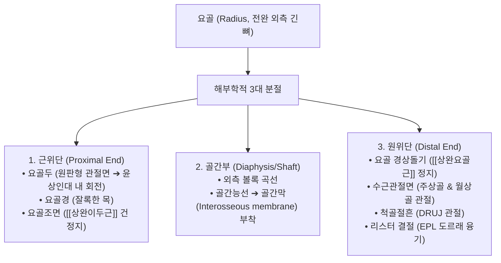
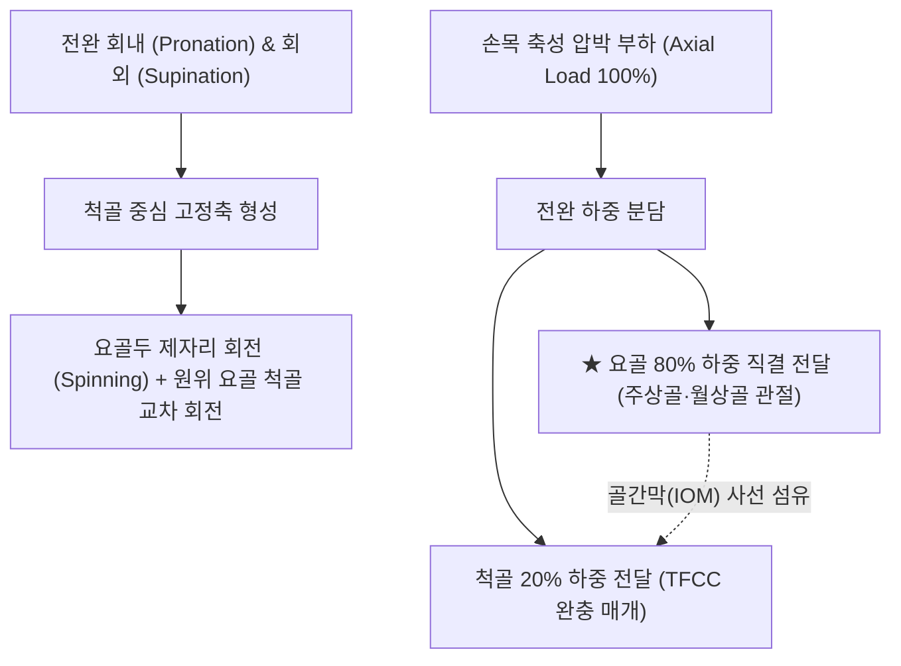

# 요골 (橈骨, Radius, 노뼈)

> **핵심 요약 (Key Summary)**:
> 전완(아래팔) 외측(엄지손가락 쪽)에 위치하는 긴 관상골로, [[척골]]과 나란히 주행하며 전완 회선(Pronation/Supination) 운동의 주동 지렛대 역할을 수행.
> 근위부의 **요골두(Radial head)**는 [[상완골]] 소두 및 [[윤상인대]](Annular ligament)와 완요관절을 이루고, 원위부는 [[주상골]]·[[월상골]]과 **요수근관절(Radiocarpal joint)**을 형성.
> 손목에 가해지는 축성 압박력의 **약 80%를 전담하여 체간으로 전달**하는 상지 하중의 중심 기둥.
> 요골 원위 전면은 한의학 **촌관척(寸關尺) 맥진**의 절대적 랜드마크이며, [[콜레스 골절]](Colles' fracture), 유아 [[요골두 아탈구]](Nursemaid's elbow), [[드퀘르벵 건초염]] 및 [[후골간신경]](PIN) 포착의 핵심 병소.
> 요골두 후방 변위 추나 교정, 원위 요척관절(DRUJ) 가동술 및 태연(LU9)·열결(LU7) 중심 침구 치료 표적.

---

## 1. 개요 및 기능해부학

요골(Radius)은 근위단이 작고 원위단으로 갈수록 넓어지는 역피라미드 형태의 긴뼈로, 척골과 반대되는 형태학적 역학 대칭을 이룬다.

### 요골의 3대 골격 구조와 랜드마크
1. **근위단 (Proximal End)**:
   - **요골두 (Radial head)**: 오목한 원판형 관절면으로 상완골 소두(Capitulum)와 완요관절을 이루고, 둘레관절면은 척골의 요골절흔 및 **윤상인대(Annular ligament)** 안에서 360° 매끄럽게 제자리 회전(Spinning)한다.
   - **요골조면 (Radial tuberosity)**: 내측 후방의 타원형 융기로 강력한 굴곡 및 회외근인 **[[상완이두근]](Biceps brachii) 건**이 견고히 정지한다.
2. **골간부 (Shaft)**:
   - 외측으로 완만한 곡선을 그리며, 내측 모서리는 날카로운 골간능선(Interosseous border)으로 척골과 결합하는 **전완 [[골간막]](Interosseous membrane)**이 부착되어 하중을 분산한다.
3. **원위단 (Distal End)**:
   - **요골 경상돌기 (Radial styloid process)**: 원위 외측으로 뾰족하게 돌출되며 [[상완요골근]]이 정지하고 [[측부인대]](요측)가 부착한다 (척골 경상돌기보다 약 1~1.5cm 더 원위부까지 길게 뻗어 있음).
   - **수근관절면**: 손목의 **주상골(Scaphoid)** 및 **월상골(Lunate)**과 직접 관절하여 요수근관절을 이룬다.
   - **리스터 결절 (Lister's tubercle)**: 손등 쪽 골성 융기로 [[장무지신근]](EPL) 건이 방향을 45° 꺾는 해부학적 도르래 역할을 수행한다.

---

## 2. 생체역학 및 3차원 운동학

- **전완 회선 운동 (Pronation/Supination)의 기계적 축**:
  - 척골이 안정적인 고정축(Pivot) 역할을 하는 동안, 요골은 근위부 요골두가 윤상인대 안에서 팽이처럼 회전하고, 원위 요골이 척골두 둘레를 150~180° 회전하며 척골 전면을 대각선으로 가로지른다.
- **손목 하중 분담의 절대적 우위 (80:20 법칙)**:
  - 손을 짚을 때 손목에 가해지는 축성 압박력의 **약 80%는 요골의 넓은 수근관절면**을 통해 흡수 전달되며, 나머지 20%만이 TFCC를 거쳐 척골로 분산된다. 골간막의 팽팽한 사선 섬유는 요골에 걸린 막대한 하중을 척골로 효과적으로 전이시키는 충격 흡수 댐퍼 역할을 한다.

---

## 3. 인접 연부조직 및 신경·혈관 관계

- **[[후골간신경]](PIN)과의 포착 관계**:
  - [[요골신경]]의 심부 운동 분지인 후골간신경(Posterior interosseous nerve, PIN)은 요골경 외측을 감아 [[회외근]](Supinator)의 두 갈래 사이(프로제 건궁, Arcade of Frohse)로 진입한다. 요골두 골절이나 탈구 시 신경이 압박되어 손가락 신전 마비가 발생할 수 있다.
- **요골동맥(Radial Artery)과 한의 촌관척(寸關尺) 맥진**:
  - 요골 원위 전면과 요측수근굴근건 사이의 얕은 홈에서 요골동맥이 박동한다. 이 부위가 바로 한의학에서 전신 12경락과 오장육부의 상태를 진찰하는 **촌관척(寸關尺, 촌구 맥진)**의 절대적 해부학적 위치이다.

---

## 4. 임상 병태생리 및 주요 질환

### 1) 콜레스 골절 (Colles' Fracture) vs 스미스 골절 (Smith's Fracture)
- **콜레스 골절**: 손바닥을 짚고 넘어질 때(FOOSH) 원위 요골 골간단 골절이 발생하여 원위 골편이 손등 쪽(배측)으로 전위되는 **포크 변형(Dinner fork deformity)** 호발 (폐경 후 여성 [[골다공증]] 골절 다발).
- **스미스 골절**: 손등을 짚고 넘어질 때 발생하여 원위 골편이 손바닥 쪽(장측)으로 전위되는 역-콜레스 골절.

### 2) 유아 요골두 아탈구 (Nursemaid's Elbow / Pulled Elbow)
- 만 2~5세 유아의 손이나 팔을 부모가 갑자기 위로 잡아당길 때, 미성숙한 요골두가 윤상인대 밖으로 미끄러져 부분 탈구되는 질환. 환아는 팔을 축 늘어뜨린 채 움직이지 못함 (간단한 정복 추나로 즉시 교정).

### 3) [[드퀘르벵 건초염]] (De Quervain's Tenosynovitis)
- 요골 경상돌기 상부의 제1 신근건 구획을 통과하는 [[단무지신근]](EPB)과 [[장무지외전근]](APL) 건의 마찰성 활액막염. 산모나 손목 과사용자에게 호발.

---

## 5. 이학적 검사 및 영상의학적 진단

- **핀켈스타인 검사 (Finkelstein Test, 드퀘르벵 선별)**:
  - 엄지손가락을 손바닥 안으로 접어 넣고 주먹을 쥔 상태에서 손목을 척측으로 강하게 편위시킬 때 요골 경상돌기 부위에 찢어지는 듯한 통증이 발생하면 양성.
- **영상의학적 검사**:
  - **손목 및 전완 X-ray (AP, Lateral)**: 요골 경사각(Radial inclination, 정상 22~23°), 수장측 경사각(Volar tilt, 정상 11~12°), 요골 길이 단축 여부를 계측하여 정복 상태를 평가.

---

## 6. 한의 임상 치료 및 추나 프로토콜

- **침구 및 주요 경혈 배오**:
  - **[[태연]](太淵, LU9)**: 요골 경상돌기와 주상골 사이 함요처, 요골동맥 맥동처(수태음폐경 원혈이자 맥회脈會).
  - **[[열결]](列缺, LU7)**: 요골 경상돌기 상방 1.5촌(사관혈, 두항부 질환 요혈).
  - **경거(經渠, LU8)**, **양계(陽谿, LI5)**: 해부학적 코담배갑(Snuffbox) 부위 제1 구획 건초염 표적.
  - **곡지(LI11)** 및 **척택(LU5)**: 요골두 인근 근육 긴장 완화.
- **[[추나]] 요골두 교정 및 DRUJ 가동술**:
  - **요골두 후방 변위 교정**: 팔꿈치를 90° 굴곡한 상태에서 시술자의 모지로 요골두 후면을 전방으로 밀면서 전완을 부드럽게 회외시켜 정상 관절 궤도를 복원.
  - **원위 요척관절(DRUJ) AP 글라이딩**: 손목 염좌 및 회전 제한 환자에게 요골과 척골을 전후로 미세 활주시켜 회선 가동역을 정상화.
- **약침 치료**:
  - [[드퀘르벵 건초염]] 및 요골 경상돌기 건병증에 [[신바로약침]] 또는 [[봉약침]]을 제1 신근건 구획 건초 내에 0.2ml 미세 주입하여 급성 염증을 가라앉힘.

---

## 7. 재활 운동 및 예방 관리

- **전완 회선 가동성 스트레칭**:
  - 팔꿈치를 옆구리에 붙인 채 가벼운 막대기나 망치를 쥐고 천천히 안쪽(회내)과 바깥쪽(회외)으로 끝범위까지 회전하여 요골두의 원활한 회전을 유지.
- **원위 요골 골절 후 수지 능동 굴신 훈련**:
  - 석고 붕대 고정 중에도 손가락 강직을 예방하기 위해 조기 주먹 쥐기-펴기 운동을 매시간 권장.

---

## 8. 현대 학술 연구 및 근거 고찰

- Gupta N, et al. (2026). Evaluation of Functional Outcome of Extended Flexor Carpi Radialis Approach for Fracture Fixation of Distal End Radius Fracture. *J Orthop Case Rep*. PMID: 42851988
  - [연구 요약] 원위 요골 골절 환자에서 요측수근굴근 접근법을 통한 해부학적 금속판 고정이 수근관절 가동 범위 복원과 조기 기능 회복에 미치는 임상적 유의성을 규명함.
- Worhacz K, et al. (2026). Dorsal subchondral arc line: A novel radiographic marker to avoid dorsal screw prominence during distal radius fixation with volar locking plates. *Injury*. PMID: 42628227
  - [연구 요약] 원위 요골 골절의 장측 금속판 고정 시 신전건 파열을 예방하기 위한 배측 연골하 아치 라인의 생체역학적 방사선학적 지표 가치를 입증함.
