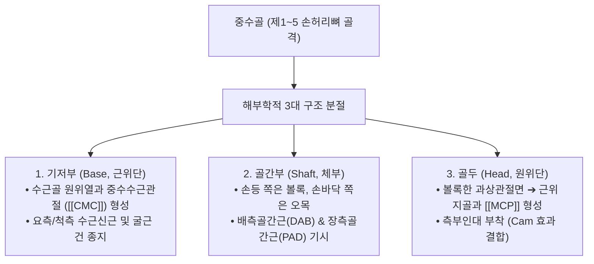
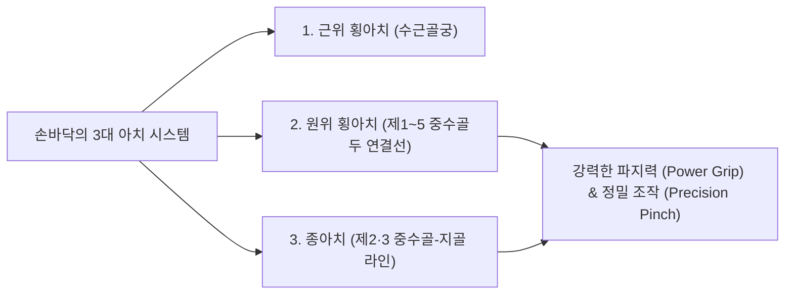

# 중수골 (掌骨, Metacarpal Bones, 손허리뼈)

> **핵심 요약 (Key Summary)**:
> [[수근골]](손목뼈)과 [[근위지골]](손가락뼈) 사이에 위치하는 5개의 미니 관상골(Miniature long bones)로, 손바닥의 횡아치와 종아치를 형성하는 골격 프레임워크.
> 기저부(Base), 골간부(Shaft), 골두(Head)로 구성되며, 수근중수관절([[CMC]])과 중수수지관절([[MCP]])을 형성.
> **제1 중수골(엄지)**은 대능형골과 특수한 **안장관절(Saddle joint)**을 이루어 인간 고유의 정밀 대립 운동(Opposition)을 매개하며, 제2·3 중수골은 고정 중심 기둥, 제4·5 중수골은 가동성 적응 아치를 형성.
> 4개의 [[배측골간근]](외전)과 3개의 [[장측골간근]](내전)의 기시부.
> [[권투선수 골절]](Boxer's fracture, 제4·5중수골 경부), [[베넷 골절]](제1중수골 저부 탈구 골절)의 호발 병소이며 합곡(LI4)·중저(TE3)·후계(SI3) 중심 침구 치료의 거점.

---

## 1. 개요 및 기능해부학

중수골(Metacarpal Bones)은 외측(엄지)에서 내측(새끼손가락) 방향으로 제1 중수골부터 제5 중수골까지 일련번호로 명명된다.

### 중수골의 분절별 기능적 분화
1. **제1 중수골 (Thumb, 엄지손허리뼈)**:
   - 5개 중수골 중 가장 짧고 두껍다. 수근골 중 **대능형골(Trapezium)**과 맞물려 **무지 CMC 안장관절(Saddle joint)**을 형성한다.
   - 2개의 직교하는 오목-볼록 곡면으로 구성되어 굴곡-신전, 외전-내전 및 회전을 결합한 **대립 운동(Opposition)**을 구현한다.
2. **제2·3 중수골 (Index & Middle, 고정 중심 기둥)**:
   - [[소능형골]] 및 [[유두골]]과 매우 치밀한 인대로 결합하여 가동성이 거의 없는 **고정된 중심 기둥(Fixed central pillar)** 역할을 한다. 손의 악력 발휘 시 강력한 역학적 버팀목을 제공한다.
3. **제4·5 중수골 (Ring & Little, 가동성 외측 기둥)**:
   - [[유구골]](Hamate)과 관절하며 굴곡 시 각각 10~15°, 20~30°의 운동성을 가진다. 손바닥을 둥글게 오므려 컵 모양 횡아치를 형성하고 다양한 형태의 물체를 감싸 쥐는 데 기여한다.

---

## 2. 생체역학 및 3차원 운동학

- **손바닥 아치(Hand Arches)의 구조적 축**:
  - 중수골들은 평평한 일직선이 아니라 손바닥 쪽으로 오목한 활 모양의 **원위 횡아치(Distal transverse arch)**와 **종아치(Longitudinal arch)**를 형성한다.
  - 이 아치 구조가 유지되어야만 손가락의 굴근 건들이 분산되지 않고 손바닥 중심부로 집중되어 강력한 악력을 발생시킬 수 있다.
- **MCP 관절의 편심성 캠(Cam) 효과**:
  - 중수골두의 관절면은 신전 상태보다 굴곡 상태에서 좌우 폭이 더 넓어진다. 따라서 MCP 관절을 90° 굴곡하면 측부인대가 최대로 신장되어 좌우 흔들림이 완벽히 차단된다.

---

## 3. 인접 연부조직 및 신경·혈관 관계

- **내재근 및 외재건 부착 네트워크**:
  - **기시(Origin)**:
    - **배측골간근 (Dorsal interossei, 4개)**: 제1~5 중수골 체부의 인접 양측면에서 깃털 모양으로 기시하여 손가락 외전(DAB: Dorsal ABducts)을 담당.
    - **장측골간근 (Palmar interossei, 3개)**: 제2, 제4, 제5 중수골 체부 장측면에서 기시하여 손가락 내전(PAD: Palmar ADducts)을 담당.
    - **모지내전근 횡두(Adductor pollicis transverse head)**: 제3 중수골 체부 전면에서 넓게 기시.
  - **정지(Insertion)**:
    - 제2·3 중수골 기저부 배면에는 [[장요측수근신근]]·[[단요측수근신근]] 건, 제5 중수골 기저부 배면에는 [[척측수근신근]]건이 정지.
- **심수장동맥궁(Deep Palmar Arch)과의 밀접 주행**:
  - 중수골 기저부 바로 앞쪽(장측)으로 요골동맥에서 이어진 심수장동맥궁과 척골신경 심지가 가로질러 주행한다.

---

## 4. 임상 병태생리 및 주요 질환

### 1) 권투선수 골절 (Boxer's Fracture)
- 주먹을 쥔 상태에서 단단한 벽이나 물체를 가격할 때 발생하는 **제4 또는 제5 중수골 경부(Neck) 골절**.
- 장측 골간근의 강력한 견인력에 의해 골두가 손바닥 쪽으로 꺾이는 **장측 각형성(Volar angulation)**이 발생하며, 주먹을 쥘 때 마디(Knuckle)가 함몰되어 사라지는 변형 호발.

### 2) 베넷 골절 (Bennett's Fracture) vs [[롤란도 골절]] (Rolando's Fracture)
- **베넷 골절**: 엄지손가락에 축성 압박이 가해져 제1 중수골 기저부에 발생하는 관절 내 사선 골절. 작은 전내측 골편은 제자리에 남고, 주 골간부는 [[장무지외전근]](APL) 건의 당김에 의해 후외측으로 탈구되는 관절 내 골절-탈구.
- **[[롤란도 골절]]**: 제1 중수골 기저부에 Y자 또는 T자 형태로 발생하는 분쇄성 관절 내 골절.

### 3) 중수수지관절 측부인대 파열 (Gamekeeper's / Skier's Thumb)
- 제1 중수골두 척측 측부인대(UCL)가 스키 폴대나 낙상으로 인해 급격한 외반력을 받아 파열되는 질환.

---

## 5. 이학적 검사 및 영상의학적 진단

- **수지 회전 및 축성 압박 검사**:
  - 골절이 의심되는 중수골의 골두를 원위부에서 기저부 방향으로 축성 압박(Axial compression)할 때 골절선 부위에서 날카로운 국소 통증이 유발되는지 평가.
  - 손가락을 가볍게 쥐었을 때 골절된 수지가 인접 수지를 타고 넘어가는 가위질 현상(Scissoring) 유무를 관찰하여 회전 전위 판정.
- **영상의학적 검사**:
  - **수부 전후방(AP), 측면(Lateral), 사위(Oblique) X-ray**: 중수골 경부 골절의 장측 각형성 정도(제5 중수골은 최대 30~40°까지 허용 가능)를 계측.
  - **Brewerton View**: 중수골두의 관절 내 미세 골절 및 측부인대 견열 골절을 선별하는 특수 방사선 투시법.

---

## 6. 한의 임상 치료 및 추나 프로토콜

- **침구 및 주요 경혈 배오**:
  - **[[합곡]](合谷, LI4)**: 제1·제2 중수골 기저부 결합처 전방 함요처로 수양명대장경 원혈이자 전신 기혈 순환의 사관혈.
  - **[[중저]](中渚, TE3)**: 제4·제5 중수골 소두 후방 함요처로 삼초경 수혈이자 견배통 및 수지 관절염의 요혈.
  - **[[후계]](後谿, SI3)**: 제5 중수골 소두 후내측 적백육제 함요처로 독맥(督脈)과 통하는 팔맥교회혈.
  - **[[낙침]](落枕, EX-UE8)**: 제2·제3 중수골 소두 후방 0.5촌 지점으로 급성 경추 염좌 및 항강증 특효혈.
- **[[추나]] 수부 횡아치 가동술 (Carpal-Metacarpal Mobilization)**:
  - 시술자의 양 엄지로 환자의 제1 및 제5 중수골을 전방에서 지지하고, 손등 쪽에서 제2·3 중수골을 전방으로 살짝 밀어주며 횡아치의 유연성을 복원.
- **약침 요법**:
  - 베넷 골절 후유증이나 만성 무지 CMC 관절염에 [[신바로약침]] 또는 [[중성어혈약침]]을 관절강 주변에 0.1~0.2cc 주입하여 연골 마모와 통증을 제어.

---

## 7. 재활 운동 및 예방 관리

- **내재근 강화 훈련 (Intrinsic-Plus Squeeze)**:
  - 중수골 사이 골간근을 강화하기 위해 손가락 사이에 스펀지나 명함을 끼우고 버티는 내전/외전 등척성 운동을 시행.
- **골절 정복 후 기능적 부목 고정**:
  - 권투선수 골절 치료 시 MCP 관절을 70~90° 굴곡시키고 IP 관절은 펴는 '내재근 양성 자세(Intrinsic-plus splint)'로 고정하여 측부인대 단축 강직을 예방.

---

## 8. 현대 학술 연구 및 근거 고찰

- Lautenbach G, et al. (2026). Radiological outcomes of metacarpal fractures fixed with intramedullary headless compression screws compared to dorsal plates. *Hand Surg Rehabil*. PMID: 42962891
  - [연구 요약] 중수골 골절에서 골수강 내 무두 압박 나사못 고정과 배측 금속판 고정의 방사선학적 정렬 및 골유합률을 비교하여, 신전건 유착을 최소화하는 생체역학적 고정술의 장점을 규명함.
- Himmelberg SM, et al. (2027). A Biomechanical Analysis of Intramedullary Threaded Nail Fixation and Dorsal Plate and Screw Fixation for Metacarpal Base Fractures. *J Hand Surg Glob Online*. PMID: 42733646
  - [연구 요약] 중수골 기저부 골절 모델에서 골수강 내 나사못과 배측 금속판 고정의 비틀림 및 굽힘 저항력을 사체 생체역학 연구로 정량 검증함.
