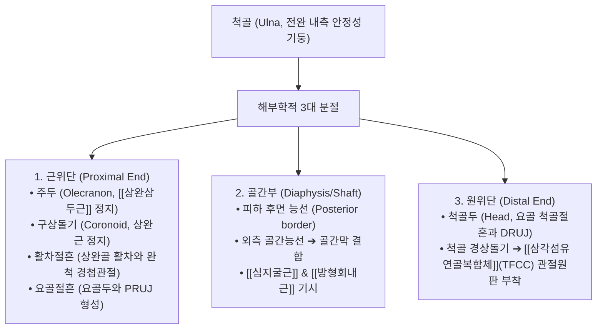
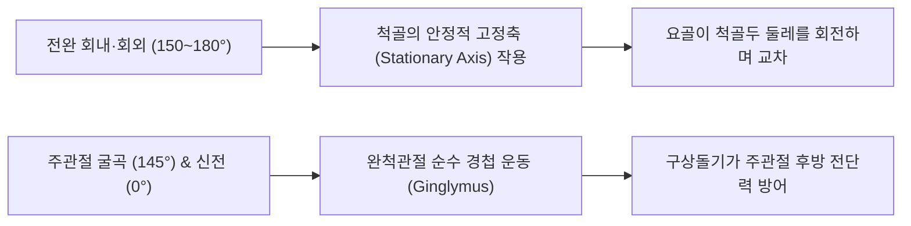

# 척골 (尺骨, Ulna, 자뼈, 팔꿈치뼈)

> **핵심 요약 (Key Summary)**:
> 전완(아래팔) 내측(제5수지 측)에 위치하는 긴 관상골로, 근위단이 거대하고 원위부로 갈수록 가늘어져 [[요골]]과 완벽한 형태학적 역학 대칭을 이루는 주관절의 안정성 기둥.
> 근위부의 **주두(Olecranon)**, **구상돌기(Coronoid process)**, **활차절흔(Trochlear notch)**이 [[상완골]] 활차와 강력한 완척 경첩관절을 형성하여 순수 굴신을 담당하고, 원위부 **척골두(Head)**와 **경상돌기(Styloid process)**는 **삼각섬유연골복합체(TFCC)**의 핵심 닻 역할을 수행.
> 전완 회선 운동(Pronation/Supination)의 중심 고정축(Axis) 역할 수행.
> [[척골신경]] 포착성 신경병증인 [[주관증후군]](Cubital tunnel syndrome), TFCC 파열, [[척골충돌증후군]](Ulnar impaction syndrome), [[몬테지아 골절]](Monteggia fracture)의 핵심 병소.
> 소해(SI8)·양곡(SI5) 중심 침구 치료 및 주관절 완척관절·DRUJ [[추나]] 가동술의 치료 표적.

---

## 1. 개요 및 기능해부학

척골(Ulna)은 전완의 안정성을 전담하는 뼈로, 근위부는 주관절의 뼈대를 이루고 원위부는 섬유연골을 매개로 손목 관절을 간접 지지한다.

### 척골의 3대 골격 랜드마크
1. **근위단 (Proximal End)**:
   - **주두 (Olecranon, 팔꿈치머리)**: 팔꿈치 뒷면에서 가장 뾰족하게 튀어나온 뼈 돌출부로, 주관절 완전 신전 시 상완골 주두와에 안착된다. 강력한 신전근인 [[상완삼두근]] 건이 종지한다.
   - **구상돌기 (Coronoid process)**: 주두 아래 전방으로 뻗은 부리 모양 돌기로 [[상완근]]이 부착하며, 주관절 완전 굴곡 시 상완골 구상와에 맞물리고 주관절의 후방 탈구를 물리적으로 차단한다.
   - **활차절흔 (Trochlear notch)**: 주두와 구상돌기 사이의 깊은 C자형 반월 절흔으로, 상완골 활차와 맞물려 완척관절(Humero-ulnar joint) 경첩을 형성한다.
   - **요골절흔 (Radial notch)**: 구상돌기 외측면에 위치하여 요골두와 근위 요척관절(PRUJ)을 이룬다.
2. **골간부 (Shaft)**:
   - 후면 모서리(Posterior border)는 주두부터 척골 경상돌기까지 전 길이에 걸쳐 피하에 직접 만져진다.
   - 전내측면 상부에서 [[심지굴근]](FDP), 원위 전면 1/4에서 [[방형회내근]](Pronator quadratus)이 기시한다.
3. **원위단 (Distal End)**:
   - **척골두 (Head of ulna)**: 원위 요척관절(DRUJ)을 통해 요골의 척골절흔과 만난다.
   - **척골 경상돌기 (Ulnar styloid process)**: 척골두 후내측에서 아래로 뻗은 골성 침으로, 손목의 척측 측부인대와 **삼각섬유연골복합체([[TFCC]])**의 중심 섬유가 견고히 결합한다.

---

## 2. 생체역학 및 3차원 운동학

- **전완 회선 운동의 부동축 (Stationary Axis)**:
  - 전완의 회내·회외 운동 시 요골이 3차원 궤도를 그리며 교차하는 동안, 척골은 거의 움직이지 않고 중심 축(Stationary pivot)을 굳건히 유지한다.
- **주관절 전후방 골성 안정성**:
  - 활차절흔이 상완골 활차를 180° 이상 깊숙이 감싸고 있어 주관절의 굴신 방향 외의 측방 흔들림이나 전후방 전위를 원천 차단하는 가장 견고한 골성 결합을 완성한다.

---

## 3. 인접 연부조직 및 신경·혈관 관계

- **척골신경(Ulnar Nerve)과 주관(Cubital Tunnel)**:
  - 척골 주두와 상완골 내측상과 사이의 오목한 고랑(주관)을 척골신경이 바로 통과하여 전완 척측으로 진입한다.
  - 팔꿈치를 깊게 굴곡할 때 주관 내압이 평소의 20배 이상 상승하며 척골신경이 팽팽하게 당겨진다.
- **삼각섬유연골복합체(TFCC)와의 매개 관계**:
  - 척골 원위단은 요골과 달리 수근골(월상골, 삼각골)과 직접 골성 관절을 이루지 않고, 그 사이에 끼어 있는 무혈관성 섬유연골 원판(TFCC)을 통해서만 간접적으로 접촉한다.

---

## 4. 임상 병태생리 및 주요 질환

### 1) 주관증후군 (Cubital Tunnel Syndrome, 척골신경 포착)
- 척골 주두 내측 고랑에서 척골신경이 만성 압박, 마찰, 견인 손상을 받아 제4·5수지 저림, 골간근 위축, 엄지손가락 내전 약화 및 **갈퀴손(Claw hand)** 변형을 유발하는 질환.

### 2) 삼각섬유연골복합체(TFCC) 파열
- 손목 척측 통증의 가장 흔한 원인. 손목을 척측으로 꺾거나(Ulnar deviation) 바닥을 짚고 일어날 때, 문고리를 돌릴 때 척골두 후방과 경상돌기 부위에서 극심한 통증과 염발음 발생.

### 3) 척골충돌증후군 (Ulnar Impaction Syndrome)
- 요골에 비해 척골이 상대적으로 긴 **척골 양성 변위(Positive ulnar variance)** 환자에서 척골두가 TFCC를 뚫고 [[월상골]] 및 [[삼각골]]과 만성적으로 충돌하여 발생하는 무균성 연골 마모 및 골괴사증.

### 4) 몬테지아 골절 (Monteggia Fracture)
- 척골 근위부 1/3 골간부 골절과 함께 요골두의 전방 또는 후방 탈구가 복합 동반되는 고에너지 손상.

---

## 5. 이학적 검사 및 영상의학적 진단

- **척골신경 주관 압박 및 굴곡 검사 (Elbow Flexion Test)**:
  - 팔꿈치를 최대로 굴곡하고 손목을 신전시킨 상태를 60초간 유지할 때 제4·5수지 저림이 재현되면 양성.
- **TFCC 압박 부하 검사 (Ulnar Fovea Sign & TFCC Load Test)**:
  - 척골 경상돌기와 척측수근굴근건 사이의 척골와(Fovea)를 직접 압박하거나, 손목을 척측으로 편위시킨 채 축성 압박을 가하며 회전시킬 때 통증이 유발되면 양성.
- **영상의학적 검사**:
  - **전완 및 손목 X-ray (Zero-rotation Neutral View)**: 척골 양성 변위(정상 0mm 기준, +2mm 이상 시 충돌증후군 고위험) 계측.
  - **손목 MRI 및 관절조영술**: TFCC 관절원판의 중심부 파열 및 척골 경상돌기 견열 유무를 확진.

---

## 6. 한의 임상 치료 및 추나 프로토콜

- **침구 및 주요 경혈 배오**:
  - **[[소해]](小海, SI8)**: 척골 주두와 상완골 내측상과 사이 주관 함요처(수태양소장경 합혈). 주관증후군 및 팔꿈치 내측통 치료의 제1 요혈.
  - **[[양곡]](陽谷, SI5)**: 척골 경상돌기와 삼각골 사이 함요처로 TFCC 손상 부위 표적.
  - **[[지정]](支正, SI7)**: 양곡혈 상방 5촌, 척골 후내측 능선상(소장경 낙혈).
  - **음극(HT6) & [[신문]](HT7)**: 척골 원위 전내측 심경 혈위.
- **약침 및 도침 치료**:
  - 주관증후군의 오스본 인대(Osborne's ligament) 비후 부위에 [[황련해독탕]] [[약침]]을 주입하고, 완고한 유착성 신경 포착에는 소침도로 척골신경 상부의 섬유띠를 미세 절개하여 감압.
  - TFCC 파열 부위에 [[신바로약침]] 또는 [[봉약침]]을 척골두 후외측 관절강에 주입하여 연골막 염증을 신속 흡수.
- **추나 주관절 및 DRUJ 가동술**:
  - 완척관절 신연 추나를 통해 주두와 활차 사이의 기계적 마찰을 줄이고, 원위 요척관절 AP 글라이딩으로 척골두 주변 활주성을 복원.

---

## 7. 재활 운동 및 예방 관리

- **척골신경 신경가동술 (Ulnar Nerve Flossing)**:
  - 'OK' 사인을 만들며 손을 거꾸로 뒤집어 눈 주위에 안경처럼 대는 동작으로 주관 내에서 척골신경의 자유로운 활주를 유도.
- **TFCC 손목 보호 밴드(Wrist Widget) 착용**:
  - 원위 요척관절을 압박 고정하는 테이핑이나 밴드를 착용하여 척골두의 배측 전위를 억제하고 하중 전달을 안정화.

---

## 8. 현대 학술 연구 및 근거 고찰

- Weber MM, et al. (2026). Radial head arthroplasty restores axial construct stiffness in a Monteggia-like injury model: a biomechanical study. *Arch Orthop Trauma Surg*. PMID: 42955368
  - [연구 요약] 척골 근위부 골절과 요골두 탈구가 동반된 몬테지아 손상 모델에서 척골의 해부학적 고정 및 관절면 재건이 상지 축성 생체역학 강성 회복에 미치는 역할을 사체 역학 연구로 입증함.
- Varama A, et al. (2026). Three-Dimensional Surgical Planning and Patient-Specific Osteotomy Guide in the Management of Chronic Monteggia Fracture: A Case Report. *J Orthop Case Rep*. PMID: 42712986
  - [연구 요약] 만성 척골 부정유합 및 요골두 아탈구 환자에서 3차원 전완 골격 시뮬레이션을 통한 척골 교정 절골술의 생체역학적 정렬 회복 기전을 규명함.
