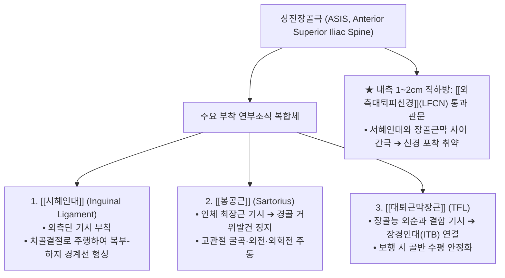
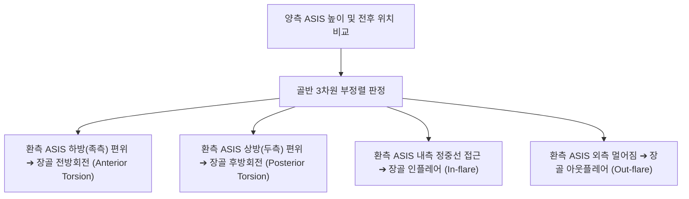

# ASIS (上前腸骨棘, Anterior Superior Iliac Spine, 상전장골극)

> **핵심 요약 (Key Summary)**:
> 골반 [[장골]](Ilium) 장골능(Iliac crest)의 전하방 종말점에 돌출된 뼈 융기로, 인체 골반 경사와 다리 길이를 평가하는 가장 대표적인 체표 골성 랜드마크.
> 인체 최장 근육인 [[봉공근]](Sartorius)과 [[대퇴근막장근]](TFL)의 기시부이자 [[서혜인대]](Inguinal ligament)의 외측 부착점.
> 돌기 내측 약 1~2cm 아래 간극으로 **[[외측대퇴피신경]](LFCN)**이 통과하여 이상감각성 대퇴신경통(Meralgia paresthetica)의 핵심 감압 표적 제공.
> 골반 비틀림(장골 전방·후방 회전 변위), 실제 다리 길이(True leg length), Q-angle(대퇴사두근각) 계측 및 골반 추나 교정의 제1 기준점.
> 거료(GB29)·오추(GB27) 중심 침구·도침 치료 및 드롭 테이블 장골 교정술의 접촉점.

---

## 1. 개요 및 기능해부학

상전장골극(ASIS)은 골반 전외측 상단에서 손가락 끝으로 가장 뚜렷하게 돌출되어 만져지는 뼈 결절이다.

| 해부학적 지표 | 상세 내용 |
| :--- | :--- |
| **골격 분류** | 골반 [[장골]](Ilium) 장골능 전하방 모서리 돌기 |
| **주요 부착근** | • [[봉공근]](Sartorius): ASIS 첨부 기시 • [[대퇴근막장근]](TFL): ASIS 외측 모서리 기시 |
| **주요 부착 인대** | [[서혜인대]](Inguinal ligament / Poupart ligament) 외측 시점 |
| **밀접 주행 신경** | **[[외측대퇴피신경]](LFCN)**: ASIS 내측 1~2cm 지점에서 서혜인대 심부를 통과하여 대퇴 전외측으로 주행 |
| **체표 촉진** | 골반 양측 허리선 아래를 더듬어 전하방으로 미끄러져 내려갈 때 손바닥에 걸리는 가장 뚜렷한 골성 융기 |

---

## 2. 생체역학 및 3차원 운동학

- **골반 경사 및 비틀림(Torsion)의 역학적 지표**:
  - 장요근이나 대퇴직근이 단축되면 장골이 전방으로 기울어지면서 환측 ASIS가 반대측에 비해 아래(족측)로 내려가고 기능적 장족(Long leg)을 형성한다.
  - 반대로 햄스트링이나 대둔근이 긴장되면 장골이 뒤로 회전하여 환측 ASIS가 위(두측)로 올라가고 기능적 단족(Short leg)을 초래한다.
- **하지 운동 사슬의 전방 지렛대**:
  - ASIS에서 기시하는 봉공근과 TFL은 고관절 운동 시 골반 전방을 지탱하는 버팀줄 역할을 하며 보행 시 입각기(Stance phase) 동안 골반이 반대측으로 기우는 트렌델렌버그(Trendelenburg) 징후를 방어한다.

---

## 3. 인접 연부조직 및 신경·혈관 관계

- **외측대퇴피신경(LFCN)의 해부학적 관문**:
  - 요추신경총(L2-L3)에서 분지한 LFCN은 장골근막 아래를 지나 ASIS 바로 내측 1~2cm 부위에서 서혜인대와 장골뼈 사이의 좁은 터널을 뚫고 대퇴부로 진입한다.
  - 골반의 전방경사, 꽉 끼는 바지, 두꺼운 허리띠, 비만, 임신 시 이 간극이 압박되어 신경의 허혈성 포착이 발생한다.
- **복사근 건막과의 장력 결합**:
  - ASIS는 [[외복사근]] 건막의 종말 부착점이자 [[내복사근]] 및 복횡근의 하부 기시부와 맞물려 복벽의 긴장도를 하지로 전달한다.

---

## 4. 임상 병태생리 및 주요 질환

### 1) 이상감각성 대퇴신경통 (Meralgia Paresthetica)
- ASIS 내측에서 외측대퇴피신경이 눌려 대퇴부 전외측 피부에 감각 저하, 저림, 바늘로 찌르는 듯한 감각, 불에 타는 듯한 작열통(Burning pain)이 발생하는 질환 (순수 감각신경이므로 운동마비는 없음).

### 2) 청소년 ASIS 견열 골절 (ASIS Avulsion Fracture)
- 축구의 킥 동작, 전력 질주 등 급격한 고관절 과신전 시 성장기 골단판이 완전히 유합되지 않은 청소년 운동선수에서 봉공근과 TFL의 강력한 견인력에 의해 ASIS 뼈 조각이 뜯겨 나가는 골절.

### 3) 대퇴근막장근(TFL) 건초염 및 골반 통증
- 장시간 보행이나 러닝 시 ASIS 기시부의 만성 마찰로 인한 국소 압통과 장경인대 마찰 증후군(ITBS) 병발.

---

## 5. 이학적 검사 및 영상의학적 진단

- **실제 다리 길이 측정 (True Leg Length Test)**:
  - 앙와위에서 양측 **ASIS 최하단에서부터 동측 족관절 내측 복사뼈(Medial malleolus) 최하단까지의 거리**를 줄자로 측정. 1~1.5cm 이상의 차이는 구조적 단족을 진단.
- **Q-angle (대퇴사두근각) 계측**:
  - ASIS와 슬개골 중심점을 잇는 선과, 슬개골 중심점과 경골조면을 잇는 선이 이루는 각도 (정상: 남성 10~14°, 여성 15~18°). 20° 이상 과다 시 슬개대퇴 통증 증후군(PFPS) 고위험.
- **외측대퇴피신경 티넬 징후 (Tinel's Sign at ASIS)**:
  - ASIS 바로 내측 1~2cm 부위를 검사자의 손가락으로 가볍게 톡톡 두드릴 때 허벅지 앞외측으로 찌릿한 전기 방전통이 유발되면 양성.

---

## 6. 한의 임상 치료 및 추나 프로토콜

- **침구 및 주요 경혈 배오**:
  - **거료(居髎, GB29)**: ASIS와 대퇴골 대전자 최고점을 잇는 선의 중점 함요처. 족소양담경과 양교맥의 교회혈로 고관절 통증 및 이상감각성 대퇴신경통의 특효혈.
  - **오추(五樞, GB27)**: ASIS 전방 함요처, 배꼽 수평선 높이.
  - **유도(維道, GB28)**: 오추혈 전하방 0.5촌(ASIS 내하방).
  - ASIS 기시부 압통점에 침첨을 골막 표면에 닿도록 사자하여 봉공근 건막 유착을 해소.
- **도침 요법 (Acupotomy for LFCN Decompression)**:
  - 이상감각성 대퇴신경통 환자에서 ASIS 내측 1cm 서혜인대 하부 섬유띠를 소침도로 미세 절개하여 포착된 신경관을 감압.
- **추나 골반 교정 기법 (Drop Table & Manual Rotation)**:
  - **장골 전방회전 교정**: ASIS가 낮아진 쪽에 대해 복와위에서 좌골결절을 전상방으로 미는 추나 기법 적용.
  - **장골 후방회전 교정**: ASIS가 높아진 쪽에 대해 앙와위 드롭 테이블에서 ASIS를 후하방으로 스러스트하여 골반 수평 정렬을 회복.

---

## 7. 재활 운동 및 예방 관리

- **봉공근 및 TFL 폼롤러 스트레칭**:
  - ASIS 직하부 외측 근육에 폼롤러를 대고 엎드려 부드럽게 롤링하여 골반 전외측 근막 긴장을 완화.
- **골반 중립 자세 지도**:
  - 꽉 끼는 바지나 보정 속옷의 착용을 피하고, 장시간 앉아 있을 때 골반 전방경사를 막는 코어 드로우인 운동 지도.

---

## 8. 현대 학술 연구 및 근거 고찰

- Molina LL, et al. (2026). Outcomes of Conservative Versus Surgical Treatment of Adolescent Pelvic and Hip Avulsion Fractures: A Systematic Review and Meta-Analysis. *J Pediatr Orthop*. PMID: 42084198
  - [연구 요약] 청소년 운동선수에서 발생하는 ASIS 및 골반 견열 골절의 보존적 치료와 수술적 고정술의 임상 예후를 체계적으로 메타분석하여, 골편 전위 정도에 따른 최적 치료 가이드라인을 제시함.
- Cominos ND, et al. (2025). Iliac Epiphyseal Avulsion Repair Using a Suture Bridge and Lag Screw Construct. *Arthrosc Tech*. PMID: 41220676
  - [연구 요약] ASIS를 포함한 장골 골단 견열 파열 시 봉공근 및 복사근의 강력한 견인력에 대항하는 생체역학적 복원 수술 기법을 보고함.
