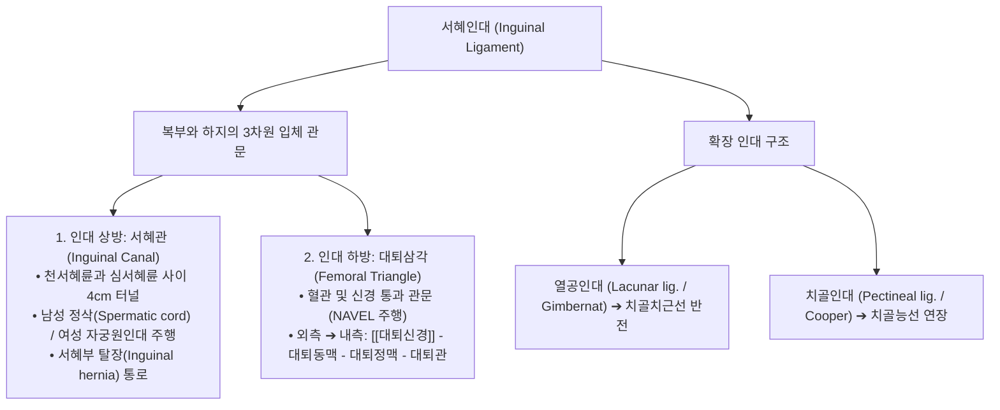

# 서혜인대 (Inguinal Ligament, 사타구니인대, 鼠蹊靭帶, Poupart's Ligament)

> **핵심 요약 (Key Summary)**:
> 상전장골극([[ASIS]])에서 [[치골결절]](Pubic tubercle)까지 팽팽하게 사선으로 이어지는 [[외복사근]] 건막의 하연이 후상방으로 말려 접혀 형성된 두터운 섬유성 인대.
> 복부(체간)와 하지(대퇴부)를 물리적으로 양분하는 절대적인 체표 해부학적 경계 랜드마크.
> 인대 상방으로는 정삭 및 자궁원인대가 지나는 **서혜관(Inguinal canal)**의 바닥을 이루고, 인대 하방으로는 [[대퇴신경]]·대퇴동맥·대퇴정맥이 통과하는 **대퇴삼각(Femoral triangle)**의 상계를 형성.
> [[서혜부 탈장]](간접/직접 탈장), 운동선수 서혜부 통증(스포츠 탈장), [[외측대퇴피신경]](LFCN) 포착성 [[이상감각성 대퇴신경통]](Meralgia paresthetica)의 핵심 병소.
> 충문(SP12)·기충(ST30) 중심 침구 치료, 서혜인대 장력 정상화 골반 [[추나]] 및 장요근 이완술의 표적.

---

## 1. 개요 및 기능해부학

서혜인대(Inguinal Ligament / Poupart's Ligament)는 뼈와 뼈를 잇는 일반적인 골성 인대와 달리, 복벽의 가장 외측 근육인 [[외복사근]](External oblique muscle) 건막의 하부 자유단이 안쪽으로 말려 들어가며 굵어진 건막성 인대(Aponeurotic ligament)이다.

| 해부학적 지표 | 상세 내용 |
| :--- | :--- |
| **기시단 (Lateral)** | 상전장골극 ([[ASIS]], Anterior Superior Iliac Spine) |
| **정지단 (Medial)** | 치골결절(Pubic tubercle) 및 치골능(Pecten pubis) |
| **확장 구조** | • **열공인대(Lacunar ligament / Gimbernat's lig.)**: 인대 내측단이 초승달 모양으로 반전되어 치골치근선에 부착 • **치골인대(Pectineal ligament / Cooper's lig.)**: 열공인대가 치골근선을 따라 외측으로 뼈막에 두껍게 연장된 구조 |
| **하부 통과 구조물** | **N-A-V-E-L**: [[대퇴신경]](Nerve) ➔ 대퇴동맥(Artery) ➔ 대퇴정맥(Vein) ➔ 빈공간(Empty space / 대퇴관) ➔ 림프절(Lymphatics) |

---

## 2. 생체역학 및 3차원 운동학

- **복압 지지와 전단력 차단 브릿지**:
  - 서혜인대는 기침, 배변, 무거운 물건 들기 등 복강내압(IAP)이 급상승할 때 복부 장기가 하지 쪽으로 밀려 탈출하지 않도록 버텨주는 전하방 물리적 장벽이다.
  - 고관절의 신전 및 회전 운동 시 복벽 근육군([[복직근]], [[외복사근]], [[내복사근]], [[복횡근]])의 인장 장력을 골반 치골부와 대퇴 골격으로 매끄럽게 분산한다.
- **골반 비틀림에 따른 인대 장력 비대칭**:
  - 한쪽 장골이 전방으로 기울어지면(Anterior torsion) 해당 서혜인대가 비정상적으로 팽팽하게 당겨지며, 반대로 후방 회전 시 인대가 이완성 느슨해짐을 겪어 서혜관 및 대퇴신경 통로에 압박 스트레스를 유발한다.

---

## 3. 인접 연부조직 및 신경·혈관 관계

- **외측대퇴피신경(LFCN)의 통과 터널**:
  - ASIS 바로 내측 1~2cm 지점에서 서혜인대 바로 아래 틈새(Fibrous tunnel)를 통해 LFCN이 빠져나간다. 이 부위 인대 섬유가 비후되거나 장골근막이 긴장되면 신경이 꽉 끼어 만성 통증을 일으킨다.
- **장요근(Iliopsoas) 및 대퇴신경과의 관계**:
  - 서혜인대 외측 1/2의 심부 바닥으로는 대요근과 [[장골근]]의 거대한 근 복합체가 통과하여 고관절 소전자로 향하며, 그 위에 대퇴신경이 얹혀 주행한다.

---

## 4. 임상 병태생리 및 주요 질환

### 1) 서혜부 탈장 (Inguinal Hernia)
- **간접 탈장 (Indirect Hernia)**: 심서혜륜(Deep inguinal ring)을 통해 정삭을 따라 서혜관 내부를 거쳐 음낭 쪽으로 돌출하는 선천성/후천성 탈장 (서혜인대 외측 상방에서 시작).
- **직접 탈장 (Direct Hernia)**: 서혜인대 바로 상방의 복벽 근막 허약 부위인 **[[헤셀바흐 삼각]](Hesselbach's triangle)**을 통해 전방으로 불룩하게 튀어나오는 노인성 탈장.

### 2) 이상감각성 대퇴신경통 (Meralgia Paresthetica)
- 서혜인대 외측단 하부에서 외측대퇴피신경이 눌려 대퇴부 전외측 피부의 감각 이상, 저림, 타는 듯한 작열통 발생.

### 3) 스포츠 탈장 (Sports Hernia / Athletic Pubalgia)
- 진성 탈장(장기 돌출)은 아니나, 축구나 하키 등 급격한 체간 회전과 킥 동작 시 서혜인대 내측 부착부 건막과 복직근-내전근 복합체의 미세 파열로 발생하는 만성 서혜부 통증.

---

## 5. 이학적 검사 및 영상의학적 진단

- **서혜관 외륜 촉진 검사 (Inguinal Ring Palpation)**:
  - 검사자의 손가락으로 음낭 피부를 밀어 올리며 치골결절 외상방의 외서혜륜(Superficial ring)에 손끝을 대고 환자에게 기침을 시킬 때 손가락 끝을 툭 치는 충격(Impulse)이 감지되면 탈장 판정.
- **LFCN 압박 및 신전 검사**:
  - 환자를 측와위로 눕히고 고관절을 신전시키면서 서혜인대 외측단을 압박할 때 대퇴 외측으로 통증이 재현되면 양성.
- **영상의학적 검사**:
  - **초음파 검사 (High-Resolution US)**: 발살바(Valsalva) 호흡 시 서혜관 내부 장기 탈출 유무, 외측대퇴피신경의 방추상 비후 및 단면적을 실시간 평가.

---

## 6. 한의 임상 치료 및 추나 프로토콜

- **침구 및 주요 경혈 배오**:
  - **[[충문]](衝門, SP12)**: 서혜인대 중앙 부위, 대퇴동맥 맥동처 외측 함요처. 족태음비경 혈위로 서혜부 임파선염 및 고관절 통증 치료.
  - **[[기충]](氣衝, ST30)**: 치골결합 상연 서혜인대 내측단 함요처. 하복부 기체(氣滯) 및 탈장 통증 완화.
  - **[[오리]](五里, LR10)** & **음렴(陰廉, LR11)**: 서혜인대 직하부 대퇴 내측 근육군 긴장 완화.
- **[[도침]] 요법 (Acupotomy Retinacular Release)**:
  - 외측대퇴피신경 포착 환자에서 ASIS 내측 1cm 서혜인대 하연의 섬유성 밴드를 소침도로 미세하게 소통 박리하여 신경 내압을 즉각 감압.
- **추나 골반 정렬 및 장요근 이완술 (PIR)**:
  - 장골의 전방 또는 후방 회전 변위를 교정하여 서혜인대에 가해지는 좌우 비대칭 장력을 해소.
  - 환자의 하지를 신전시킨 채 호흡과 함께 장요근을 신장시키는 후등척성 이완술(Post-Isometric Relaxation) 적용.

---

## 7. 재활 운동 및 예방 관리

- **고관절 굴근 스트레칭 (Lunge Stretch)**:
  - 런지 자세에서 골반을 전하방으로 지그시 밀어 서혜인대와 장요근을 부드럽게 이완.
- **코어 및 복횡근 안정화 (Deadbug Exercise)**:
  - 복압 상승 시 서혜관 후벽을 보강하기 위해 복횡근과 내복사근을 강화하는 코어 운동 지도.

---

## 8. 현대 학술 연구 및 근거 고찰

- Ansari D, et al. (2026). Clinical outcomes following transposition of the lateral femoral cutaneous nerve for meralgia paresthetica: a prospective case series. *J Neurosurg*. PMID: 42468044
  - [연구 요약] 난치성 이상감각성 대퇴신경통 환자에서 서혜인대 하부 신경 포착의 해부학적 해제 및 신경 이전술의 임상적 통증 감소 효과를 전향적 임상 연구로 입증함.
- Chianca V, et al. (2026). Meralgia paresthetica: from qualitative ultrasound assessment to quantitative multimodality imaging. *J Ultrason*. PMID: 42088377
  - [연구 요약] 서혜인대와 외측대퇴피신경 간의 상호작용 및 신경 포착 병변에 대한 다중 모달리티 초음파 정밀 영상 진단 기준을 확립함.
