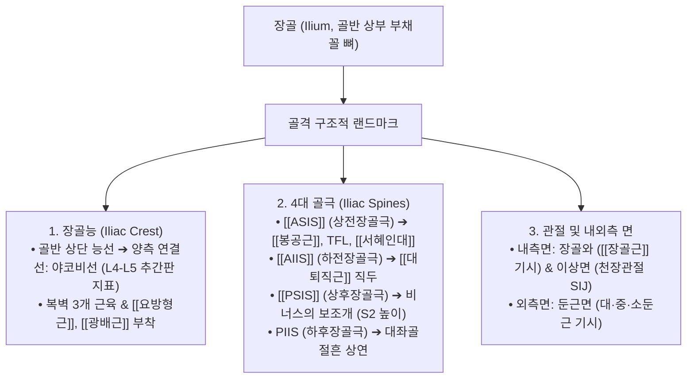
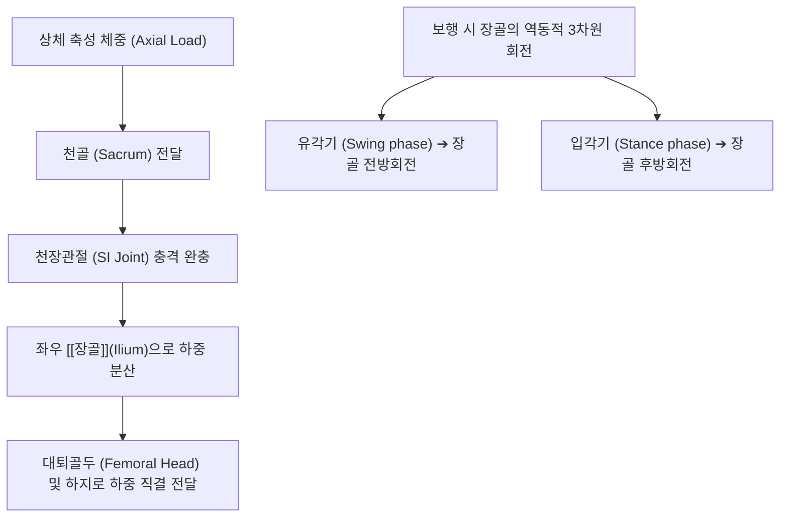

# 장골 (腸骨, Ilium, 엉덩뼈, 골반장골)

> **핵심 요약 (Key Summary)**:
> 관골(무명골, Hip bone / Os coxae)의 상부를 형성하는 가장 크고 넓은 부채꼴 모양의 골반 골격으로, 척추의 축성 체중을 하지로 전달하는 하중 분산의 중심 축.
> 상부의 넓은 **장골익(Ala)**과 하부의 **장골체(Body)**로 나뉘며, **장골능(Iliac crest, L4-L5 야코비선)**, 4대 골극([[ASIS]], [[AIIS]], [[PSIS]], PIIS) 및 천골과 결합하는 **천장관절(Sacroiliac joint, SI joint)** 관절면을 보유.
> 외측 둔근면은 [[대둔근]]·[[중둔근]]·소둔근의 거대 기시부이고, 내측 장골와는 [[장골근]]의 안착지이자 복벽근·요방형근의 견고한 부착 지지대.
> 골반 비틀림(장골 전방·후방 회전 변위), [[천장관절 증후군]], 장골능 골단염의 핵심 병소이며 추나 골반 교정술의 제1 기준 뼈.
> 거료(GB29)·질변(BL54) 중심 침구 치료 및 측와위 장골 회전 추나(ASIS/좌골결절 추진법)의 표적.

---

## 1. 개요 및 기능해부학

장골(Ilium)은 좌골(Ischium), 치골(Pubis)과 함께 Y자 연골(Triradiate cartilage)에서 융합하여 고관절 소켓인 관골구(Acetabulum)의 상부 2/5를 형성한다.

### 장골의 주요 골격 랜드마크
1. **장골능 (Iliac Crest)과 야코비선 (Jacoby's Line / Tuffier's Line)**:
   - 양측 장골능의 최상단을 연결하는 가상의 수평선은 **제4 요추(L4) 극돌기 하단 또는 L4-L5 추간판 높이**와 정확히 일치하여 척추 마취, 요추 천자, 추나 요추 변위 리스팅의 절대적 표준 기준선이 된다.
2. **4대 골극 (Iliac Spines)**:
   - **상전장골극 (ASIS)**: 골반 전면 외측 돌출부로 다리 길이 측정의 출발점.
   - **하전장골극 (AIIS)**: ASIS 직하방 2.5cm 지점으로, 대퇴사두근의 [[대퇴직근]] 직두(Straight head)가 기시.
   - **상후장골극 (PSIS)**: 엉덩이 상방 양측 오목하게 들어간 '비너스의 보조개(Dimple)' 부위로 **제2 천추(S2) 높이**이자 천장관절의 위치 지표.
   - **하후장골극 (PIIS)**: PSIS 하방 돌기로 대좌골절흔(Greater sciatic notch)의 상부 경계를 형성.
3. **천장관절면 (Auricular Surface)**:
   - 장골 내측 후방의 귀바퀴 모양 관절면으로 천골과 만나 강력한 전·후 천장인대 및 골간인대로 결합된다.

---

## 2. 생체역학 및 3차원 운동학

- **골반환(Pelvic Ring)의 키스톤 하중 전달**:
  - 장골은 요추와 천골을 통해 내려오는 상체의 막대한 체중을 좌우로 나누어 대퇴골두(Femoral head)로 전달하는 아치형 교각(Arch bridge) 역할을 수행한다.
- **보행 주기에서의 장골 회전 운동**:
  - 보행 시 한쪽 다리가 앞으로 나아갈 때(유각기) 동측 장골은 미세하게 전방 회전(Anterior rotation)하고, 발이 바닥을 딛고 체중을 지지할 때(입각기)는 후방 회전(Posterior rotation)하며 천장관절의 뉴테이션(Nutation) 및 카운터뉴테이션 운동과 연동된다.

---

## 3. 인접 연부조직 및 신경·혈관 관계

- **거대 근육 부착 네트워크**:
  - **내면(Medial)**: 넓은 장골와 전체에서 [[장골근]](Iliacus)이 기시하여 대요근과 합류.
  - **외면(Lateral)**: 전·후·하둔근선에 의해 구획된 둔근면에서 [[대둔근]], [[중둔근]], [[소둔근]]이 광범위하게 기시하여 보행 시 골반 수평을 제어.
  - **상단 능선(Crest)**: 외순에 [[외복사근]], 중간선에 [[내복사근]], 내순에 복횡근과 [[요방형근]], [[광배근]]이 부착.
- **좌골신경(Sciatic Nerve)과의 위치 관계**:
  - 장골 PIIS 아래의 대좌골절흔을 통해 이상근(Piriformis)과 함께 좌골신경이 골반강을 빠져나와 하지 후면으로 주행한다. 장골의 비틀림 변위는 이상근을 긴장시켜 이상근 증후군성 좌골신경통을 유발한다.

---

## 4. 임상 병태생리 및 주요 질환

### 1) 골반 비틀림 (장골 회전 변위, Innominate Rotation)
- **장골 전방 회전 변위 (Anterior Innominate)**: 장요근 단축 등으로 장골이 앞으로 기울어져 동측 ASIS가 낮아지고 PSIS가 높아지며 기능적 장족(Long leg) 초래.
- **장골 후방 회전 변위 (Posterior Innominate)**: 햄스트링 단축 등으로 장골이 뒤로 넘어가 동측 ASIS가 높아지고 PSIS가 낮아지며 기능적 단족(Short leg) 초래.

### 2) 천장관절 증후군 (Sacroiliac Joint Syndrome)
- 장골과 천골 사이 활막 관절의 염증, 미세 아탈구 또는 인대 이완으로 인해 둔부, 서혜부, 허벅지 후면으로 뻗치는 만성 요골반 통증.

### 3) 장골능 골단염 (Iliac Crest Apophysitis)
- 청소년 육상, 축구 선수에서 복사근과 중둔근의 반복적인 편심성 견인으로 장골능 골단판에 발생하는 염증 및 미세 파열.

---

## 5. 이학적 검사 및 영상의학적 진단

- **패트릭 검사 (Patrick FABER Test, 천장관절 평가)**:
  - 환자를 앙와위로 눕히고 검사측 다리를 굴곡(Flexion), 외전(ABduction), 외회전(External Rotation)하여 반대측 무릎 위에 얹은 후 무릎을 바닥 쪽으로 누를 때 반대측 ASIS를 고정. 둔부 후방 천장관절면에 통증이 재현되면 양성.
- **질레 검사 (Gillette / Stork Test, 천장관절 가동성)**:
  - 검사자가 한 엄지로 PSIS를, 다른 엄지로 천골 중앙을 촉진한 상태에서 환자가 검사측 고관절을 90° 들어 올릴 때, PSIS가 하방으로 정상 하강하지 못하면 관절 잠김(Hypomobility) 판정.
- **영상의학적 검사**:
  - **골반 전후방 X-ray (Pelvis AP, Ferguson View)**: 장골능 높이 대칭성, 폐쇄공(Obturator foramen) 면적 비대칭(전방/후방 회전 판정), 천장관절 간격 협착 및 골경화증을 평가.

---

## 6. 한의 임상 치료 및 추나 프로토콜

- **침구 및 주요 경혈 배오**:
  - **거료(居髎, GB29)**: ASIS와 대퇴골 대전자 연결선 중점 함요처(천장관절 방사통 요혈).
  - **질변(秩邊, BL54)**: 제4 천골공 높이에서 외측 3촌 지점으로 좌골신경 출구부 및 심부 이상근 치료혈.
  - **방광유(膀胱兪, BL28)** & **소장유(小腸兪, BL27)**: PSIS 인근 천골공 외측의 천장관절 배수혈.
  - **요양관(GV3)**: L4 극돌기 하연(야코비선 교차점).
- **추나 골반 회전 교정 기법 (Pelvic Rotation Thrust)**:
  - **측와위 장골 후방변위 교정술 (ASIS 추진법)**: 환자를 측와위로 눕히고 하지를 신전시킨 상태에서 시술자가 PSIS 후상방에 수근부를 접촉하고 호흡 날숨 말기에 전하방으로 순간 충격을 가해 전방 회전을 유도.
  - **측와위 장골 전방변위 교정술 (좌골결절 추진법)**: 하지를 굴곡시킨 상태에서 좌골결절을 전상방으로 당기며 장골을 후방 회전 정렬.
- **약침 요법**:
  - 만성 천장관절염 및 장골능 부착부 건병증에 신바로약침 또는 중성어혈약침을 1.0~2.0cc 천장관절 심부 인대층에 주입.

---

## 7. 재활 운동 및 예방 관리

- **골반 중립 코어 재교육 (Pelvic Clock Exercise)**:
  - 앙와위에서 골반을 시계 방향(전방경사, 후방경사, 좌우 측굴)으로 부드럽게 기울이며 장골의 고유수용성 감각과 대칭적 가동성을 회복.
- **중둔근 강화 훈련 (Clamshell & Side Plank)**:
  - 장골 외측 둔근면에 부착하는 중둔근을 강화하여 보행 시 골반이 무너지는 현상을 방어.

---

## 8. 현대 학술 연구 및 근거 고찰

- Ma J, et al. (2026). Effects of physiological and manipulative loading conditions on the sacroiliac joint: a three-dimensional finite element analysis. *Front Bioeng Biotechnol*. PMID: 42973569
  - [연구 요약] 장골과 천골이 이루는 천장관절에 생리적 체중 부하 및 추나 도수교정 기법이 가해질 때 관절면 연골과 주변 인대의 3차원 응력 분포 및 변위를 유한요소 분석으로 증명함.
- Ma L, et al. (2026). Biomechanical and clinical analysis of pelvic stability and the role of internal fixation after debridement for sacroiliac joint tuberculosis with different degrees of bone destruction. *Front Bioeng Biotechnol*. PMID: 42553311
  - [연구 요약] 장골익과 천장관절의 골 결손 정도에 따른 골반환(Pelvic ring)의 생체역학적 안정성 및 부하 전달 축의 변화를 분석함.
