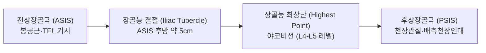
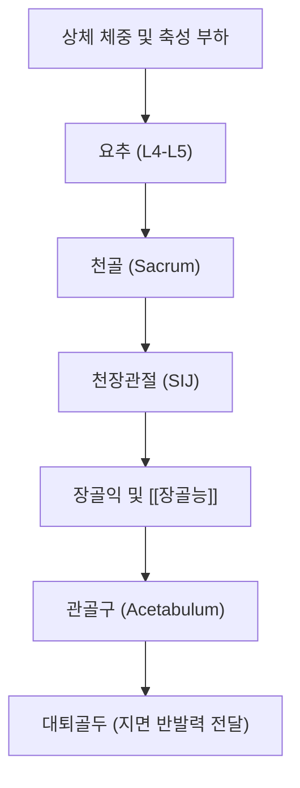

# 🦴 [[장골능]] (Iliac Crest, 엉덩뼈능선)

> **핵심 요약 (Key Summary)**:
> 장골익(Ilium)의 상부 모서리를 이루는 두꺼운 S자형 능선으로, 전방의 [[ASIS]](전상장골극)에서 후방의 [[PSIS]](후상장골극)까지 주행하는 체간-하지 역학의 핵심 골성 랜드마크입니다.
> 외순, 중간선, 내순의 3개 입술선으로 구분되어 복벽 3층근([[외복사근]], [[내복사근]], [[복횡근]])과 [[요방형근]], [[광배근]], [[둔근군]]([[대둔근]], [[중둔근]]) 및 [[대퇴근막장근]]이 부착하는 근막 허브 역할을 수행합니다.
> 양측 장골능 최상단을 연결한 야코비선(Jacoby line)은 L4-L5 추간 공간을 가리키는 척추 진단의 표준 기준점이며, 상둔피신경(SCN) 포착 증후군과 장늑인대 손상의 주요 호발 부위입니다.

---

## 1. 개요 및 해부학적 위치

[[장골능]](Iliac crest)은 [[골반]](Pelvis)을 구성하는 세 뼈 중 가장 큰 [[장골]](Ilium)의 상연을 형성하는 볼록한 능선 구조물입니다. 인체 체표에서 전 구간에 걸쳐 피하 촉진이 용이한 대표적인 표면 해부학적 랜드마크입니다.

위에서 내려다보았을 때 장골능은 완만한 S자 곡선(Sigmoid curve)을 그립니다. 전방 절반은 외측으로 볼록하고, 후방 절반은 내측으로 오목한 형태를 띠어 직립 보행 시 흉복부 내장기를 지지하고 보행 시 발생하는 회전 비틀림 응력을 효과적으로 분산시킵니다.

---

## 2. 골성 지표 및 구조적 특징

장골능은 폭과 두께가 부위에 따라 상이하며, 단면상 3개의 뚜렷한 경계선(Lips)으로 구분됩니다.

| 골성 지표 | 해부학적 특징 | 부착 근육 및 결합 조직 |
| :--- | :--- | :--- |
| **외순 (Outer lip)** | 장골능의 바깥쪽 능선 모서리 | [[외복사근]], [[광배근]], [[대퇴근막장근]](TFL), [[중둔근]] |
| **중간선 (Intermediate line)** | 외순과 내순 사이의 좁은 고랑 | [[내복사근]] 기시부 |
| **내순 (Inner lip)** | 장골능의 안쪽 골반강 방향 모서리 | [[복횡근]], [[요방형근]], [[장골근]], 흉요근막 심포 |
| **장골능 결절 (Iliac Tubercle)** | ASIS 후방 약 5cm 외순의 외측 돌출부 | [[중둔근]]과 [[대퇴근막장근]]의 경계 지표 |
| **장골능 최상단 (Highest point)** | 장골능의 가장 높은 정점 | 야코비선(Jacoby's line) 기준점 (L4 극돌기 하연~L4-L5 추간 공간) |

이러한 3개 능선 구조는 복벽 근육군과 배부·둔부 근육군이 서로 다른 층위에서 엇갈려 부착할 수 있는 입체적 앵커(Anchor) 기반을 제공합니다.

---

## 3. 부착 근육 및 인대 복합체

장골능은 체간의 코어 안정화 근육과 하지 보행 구동 근육이 만나는 핵심 교차로입니다.

1. **복벽 및 코어 근육군**:
   - [[외복사근]](External oblique): 장골능 외순 전방 1/2에 정지하여 체간 굴곡 및 반대측 회전을 담당합니다.
   - [[내복사근]](Internal oblique): 중간선 전방 2/3에서 기시하여 복압 형성 및 동측 회전을 유도합니다.
   - [[복횡근]](Transversus abdominis): 내순 전방 2/3에서 기시하여 복부 내압 상승 및 척추 분절 안정성을 제공합니다.
2. **후복벽 및 척추 기립 근육군**:
   - [[요방형근]](Quadratus lumborum): 장골능 내순 후방 1/3 및 장늑인대(Iliolumbar ligament)에서 기시하여 제12늑골과 요추 횡돌기에 부착하며, 요추 측굴 및 골반 거상을 조절합니다.
   - [[광배근]](Latissimus dorsi): 외순 후방 1/3에서 흉요근막을 통해 강력하게 결합합니다.
3. **둔부 및 하지 근육군**:
   - [[중둔근]](Gluteus medius) 및 [[대둔근]](Gluteus maximus): 외순 외측면 및 후방 능선에 부착하여 보행 입각기 골반 수평 유지(트렌델렌버그 방지)와 고관절 신전을 주도합니다.
   - [[대퇴근막장근]](Tensor fasciae latae): ASIS 직후방 외순에서 기시하여 [[장경인대]]로 이어집니다.
4. **인대 복합체**:
   - **장요인대(Iliolumbar ligament)**: L5 횡돌기에서 장골능 내순 후방부로 주행하여 요천추 접합부의 전방 전위를 방지하는 핵심 인대입니다.

---

## 4. 생체역학 및 운동학적 기능

장골능은 체중 부하 전달과 체간-골반 간 짝힘(Force Couple)의 중심축입니다.

1. **골반환(Pelvic Ring) 하중 분산**:
   - 보행 시 상체에서 내려오는 수직 압축력은 천골과 천장관절을 거쳐 장골능을 타고 관골구로 전달됩니다.
   - 양측 장골능 최상단을 연결한 야코비선은 기립 시 수평면과 평행을 이루어야 하며, 편측 골반 거상이나 하강 시 요추 측만증 및 보상성 골반 회전 변위가 초래됩니다.
2. **회전 및 전단 응력 흡수**:
   - 흉요근막의 천층과 심층이 장골능 후방 능선에 단단히 결속되어, 상체 회전 운동과 하지 보행 운동 사이에서 발생하는 비틀림 토크를 탄성적으로 흡수·저장합니다.

---

## 5. 임상적 의의 및 관련 질환

1. **상둔피신경 포착 증후군 (Superior Cluneal Nerve Entrapment)**:
   - T12~L3 척수신경 후지 외측지에서 기시한 상둔피신경(SCN)은 흉요근막을 관통하여 장골능 상연(PSIS 외측 약 7~8cm 지점)을 타고 넘어 둔부 피하로 주행합니다.
   - 장골능 모서리를 통과하는 골-섬유성 터널에서 신경이 포착되면 요통 및 둔부, 대퇴 후외측으로 방산되는 가성 좌골신경통(Pseudo-sciatica)이 발생합니다.
2. **장늑인대/장요인대 증후군 (Iliolumbar Syndrome)**:
   - 장골능 후내측 부착부의 만성 견인 손상으로 인해 요천추부 및 서혜부, 고관절 부위로 방산되는 심부 둔통이 유발됩니다.
3. **장골능 견열 골절 (Iliac Crest Avulsion Fracture)**:
   - 성장기 청소년 운동선수에서 복사근 및 대퇴근막장근의 급격한 원심성 수축으로 인해 장골능 골단판이 뜯겨 나가는 손상입니다.
4. **골반 비틀림 및 상하 변위 (Pelvic Upslip / Torsion)**:
   - [[요방형근]]의 편측 단축이나 외상으로 인해 편측 장골능이 비정상적으로 거상되는 업슬립(Upslip) 변위가 호발합니다.

---

## 6. 이학적 검사 및 감별 진단

1. **상둔피신경 압박 검사 (SCN Compression Test)**:
   - 환자를 복와위(Prone)로 눕힌 후, PSIS 외측 7~8cm 부위의 장골능 상연을 엄지손가락으로 강하게 압박합니다.
   - 압박 시 둔부 하방으로 전기가 통하듯 퍼지는 방산통이나 심한 국소 압통이 재현되면 양성으로 판정합니다.
2. **야코비선 촉진 및 골반 수평도 평가**:
   - 양측 장골능 정점에 검사자의 양 손가락을 얹어 수평 높이를 비교합니다.
   - 비대칭적 높이는 진성/가성 하지길이부동(LLD) 또는 골반 염전(Pelvic torsion)을 시사합니다.
3. **감별 진단**:
   - **요추 추간판 탈출증(HIVD)**: 하지 직거상 검사(SLR) 양성, 피부 분절(Dermatome) 감각 저하 및 건반사 소실이 동반되나, 상둔피신경 포착은 신경근 징후 없이 장골능 압통이 현저합니다.
   - **천장관절 증후군**: 패트릭 검사(Patrick test) 및 천골 압박 검사에서 통증이 유발되며, 압통점이 장골능보다는 PSIS 및 천장관절 열극에 집중됩니다.

---

## 7. 한의학적 임상 응용 및 치료

장골능 능선과 그 주변 연부조직은 족소양담경(足少陽膽經) 및 족태양방광경(足太陽膀胱經)의 주요 경혈들이 분포하는 핵심 치료 구역입니다.

1. **침구 치료 및 경혈 배오**:
   - **거료(GB29)**: ASIS와 대퇴골 대전자 연결선의 중점으로 장골능 외순과 [[대퇴근막장근]]의 긴장을 해소합니다.
   - **오추(GB28) 및 유도(GB27)**: 장골능 전방 내측에서 복벽근과 골반대를 소통시킵니다.
   - **대맥(GB26)**: 제11늑골 하단 직하, 배꼽 높이의 장골능 상연 함요처로 체간 측면의 기혈 순환을 조절합니다.
   - **지실(BL52) 및 신수(BL23)**: L2-L3 외측 및 장골능 상방 근막 유착을 풀어 요방형근과 흉요근막의 과긴장을 완화합니다.
2. **소침도(Acupotomy) 근막 박리술**:
   - 장골능 능선을 따라 형성된 섬유화 결절 및 상둔피신경 포착 부위(PSIS 외측 7~8cm 장골능 모서리)에 침도를 직자하여 횡주 섬유를 박리(Decompression)함으로써 만성 신경 압박을 즉각 해소합니다.
3. **추나요법 (Chuna Manual Therapy)**:
   - **골반 거상(Upslip) 교정 추나**: 환자를 앙와위로 눕히고 시술자가 환측 하지를 파지한 상태에서 하방으로 순간적인 견인(High-Velocity Low-Amplitude Traction)을 적용하여 거상된 장골능을 정상 위치로 복원합니다.
   - **요방형근 근에너지기법(PIR MET)**: 측와위 자세에서 체간을 반대측으로 측굴시키며 호흡과 함께 등척성 수축 후 이완을 유도하여 장골능 내순의 견인 장력을 정상화합니다.
4. **약침 치료**:
   - 장골능 압통점 및 상둔피신경 관통 부위에 [[신바로약침]] 또는 [[봉약침]]을 0.3~0.5ml 주입하여 신경 주위 부종을 감소시키고 무균성 염증을 신속히 소퇴시킵니다.

---

## 8. 참고문헌

* Kiral BS. (2026). Ultrasonographic Evaluation of Superior Cluneal Nerve Entrapment: Methodological Considerations. Comment on Iudicelli et al. The Role of Musculoskeletal Ultrasound in Detecting Superior Cluneal Nerve Entrapment: Biomechanical Insights in Chronic Low Back Pain-A Pilot Study. Diagnostics 2026, 16, 469. *Diagnostics (Basel)*. PMID: 42587707
* Abd-Elsayed A. (2026). Chronic Low Back Pain Due to Edema Around the Superior Cluneal Nerve Responding to Nerve Block: A Case Report. *Pain Med Case Rep*. PMID: 42263281
* Hasoon J. (2026). Superior Cluneal Nerve Radiofrequency Ablation for Chronic Low Back and Buttock Pain: A Technical Description and Case Series of Three Patients. *Orthop Rev (Pavia)*. PMID: 42186663
