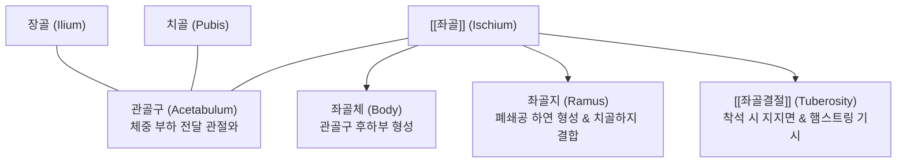
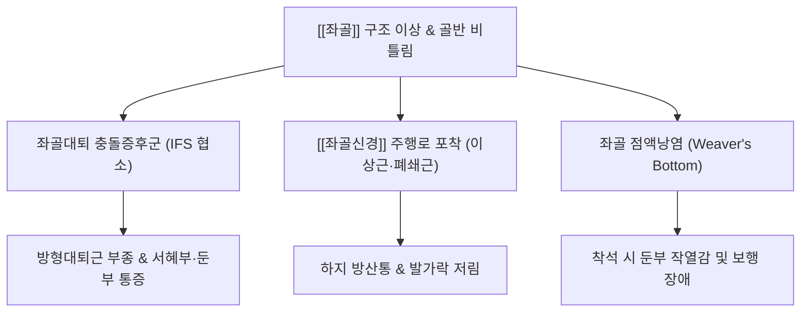

# 🦴 [[좌골]] (Ischium, 궁둥뼈)

> **핵심 요약 (Key Summary)**:
> [[골반]](Pelvis)을 형성하는 3개 뼈([[장골]], [[좌골]], [[치골]]) 중 후하부를 담당하는 단단한 L자형 골격 구조물입니다.
> 관골구(Acetabulum)의 후하방 2/5를 형성하는 좌골체(Body)와 전하방으로 뻗어 치골하지와 만나는 좌골지(Ramus)로 구성되며, 착석 시 지면과 맞닿아 상체 체중을 온전히 지탱하는 [[좌골결절]](Ischial tuberosity)을 포함합니다.
> 좌골극(Ischial spine)은 대좌골공과 소좌골공을 분할하는 기준점이자 [[음부신경]]의 해부학적 관문이며, 대퇴골 소전자와의 간격 협소로 인해 발생하는 좌골대퇴 충돌증후군(Ischiofemoral impingement)과 [[좌골신경통]] 감별의 핵심 기저 구조입니다.

---

## 1. 개요 및 해부학적 위치

[[좌골]](Ischium)은 골반환(Pelvic ring)의 후하벽을 지지하는 골성 기둥으로, 기립 및 보행 시에는 관골구를 통해 고관절로 체중을 전달하고 앉은 자세(Seated posture)에서는 지면 접촉면이 되어 상체의 축성 하중을 분산시킵니다.

좌골은 전방의 [[치골]](Pubis)과 결합하여 타원형의 큰 개구부인 폐쇄공(Obturator foramen)의 하부 및 후부 경계를 완성하며, 후방으로는 천골과 강력한 인대성 결합을 형성합니다.

---

## 2. 골성 지표 및 구조적 특징

좌골은 체부, 지부, 그리고 돌출된 골성 지표들로 구성됩니다.

| 골성 지표 | 해부학적 형태 및 위치 | 임상 및 기능적 의의 |
| :--- | :--- | :--- |
| **좌골체 (Body of Ischium)** | 관골구 후하방 2/5를 형성하는 두꺼운 골성 기둥 | 대퇴골두와의 관절 접촉면 제공 및 보행 시 충격 완충 |
| **좌골극 (Ischial spine)** | 좌골체 후연에서 후내측으로 뾰족하게 돌출된 융기 | 대좌골공과 소좌골공의 분할 지표, 천극인대 부착, [[음부신경]] 차단술 지표 |
| **대좌골절흔 (Greater sciatic notch)** | 좌골극 상방의 깊은 오목한 만곡부 | 천결절인대와 결합하여 대좌골공 형성 ([[이상근]], [[좌골신경]] 통과) |
| **소좌골절흔 (Lesser sciatic notch)** | 좌골극 하방과 좌골결절 사이의 얕은 오목부 | 소좌골공 형성 ([[내폐쇄근]] 건, 음부신경 재진입 통로) |
| **[[좌골결절]] (Ischial tuberosity)** | 좌골체 하후방의 넓고 거친 대형 융기 | 좌위 시 체중 부하 지지대, [[햄스트링]] 및 [[대내전근]] 기시 |
| **좌골지 (Ramus of Ischium)** | 좌골결절에서 전상방으로 뻗어 치골하지와 만나는 골편 | 폐쇄막 부착 및 하지 내전근 복합체의 골성 앵커 |

---

## 3. 부착 근육 및 인대 복합체

좌골은 골반강 내부 장기를 보호하는 골반저근과 하지를 후방으로 강력하게 추진하는 파워 근육들의 핵심 기시부입니다.

1. **둔부 및 대퇴 후면 근육군**:
   - [[햄스트링]](Hamstrings): [[대퇴이두근]] 장두, [[반건양근]], [[반막양근]]이 좌골결절 후상면에서 총건(Conjoint tendon) 형태로 기시합니다.
   - [[대내전근]](Adductor magnus): 좌골결절 외측 및 좌골지에서 기시하여 고관절 내전 및 신전을 보조합니다.
   - [[방형대퇴근]](Quadratus femoris): 좌골결절 외측연에서 기시하여 대퇴골 대전자간선에 부착하며 좌골대퇴 충돌의 주요 완충막 역할을 합니다.
   - 상쌍자근(Superior gemellus): 좌골극 외측면에서 기시합니다.
   - 하쌍자근(Inferior gemellus): 좌골결절 상연에서 기시합니다.
2. **골반저 근육군**:
   - 미골근(Coccygeus): 좌골극 내측면에서 기시하여 천골 및 미골에 정지하며 골반저를 완성합니다.
   - 좌골해면체근(Ischiocavernosus): 좌골지 내측면에서 기시하여 생식기 발기 조직을 지지합니다.
3. **인대 복합체**:
   - **천결절인대(Sacrotuberous ligament)**: 천골 외측연에서 좌골결절로 넓게 부착하는 매우 강인한 인대로 척추-골반 기계적 안정성의 핵심입니다.
   - **천극인대(Sacrospinous ligament)**: 천골 및 미골 하부에서 좌골극으로 주행하여 대좌골공과 소좌골공을 구분합니다.

---

## 4. 생체역학 및 운동학적 기능

좌골은 인체의 '착석 지렛대'이자 고관절 회전 모멘트의 기준축입니다.

1. **착석 시 3점 지지 체계**:
   - 앉은 자세에서 양측 [[좌골결절]]과 미골(Coccyx)이 삼각 받침대를 이루어 상체의 수직 하중을 분산시킵니다.
   - 골반이 과도하게 후방경사되면 좌골 대신 미골과 천골에 비정상적인 전단력이 집중되어 미골통 및 요추 후만이 유발됩니다.
2. **좌골대퇴 공간(Ischiofemoral Space, IFS)의 동적 변화**:
   - 좌골체 외측면과 대퇴골 소전자(Lesser trochanter) 사이의 좁은 틈새(정상 약 20±5mm)를 좌골대퇴 공간이라 합니다.
   - 고관절의 신전, 외전, 외회전 복합 운동 시 이 공간이 생리적으로 협소해지며, 골반 정렬 이상 시 방형대퇴근 및 좌골신경의 기계적 압박을 초래합니다.

---

## 5. 임상적 의의 및 관련 질환

1. **좌골대퇴 충돌증후군 (Ischiofemoral Impingement Syndrome, IFIS)**:
   - 좌골체와 대퇴골 소전자 사이 간격이 선천적 변이, 골극 형성, 또는 대퇴골 과도 후념으로 협소해져 그 사이를 지나는 방형대퇴근이 짓눌려 부종과 파열이 발생하고 만성 둔부 통증이 초래됩니다.
2. **좌골신경통 (Sciatica)**:
   - [[좌골신경]](Sciatic nerve)은 대좌골공을 통해 좌골극 외측을 돌아 대퇴 후면으로 하행합니다. 좌골 주위 근육([[이상근]], 쌍자근-내폐쇄근 복합체)의 경결이나 좌골 변위로 인해 신경이 압박되면 극심한 방산통이 발생합니다.
3. **좌골 점액낭염 (Ischial Bursitis)**:
   - 좌골결절과 둔근 사이에 위치한 활액낭의 만성 마찰로 인해 앉을 때 결절 부위에 송곳으로 찌르는 듯한 통증이 발생합니다.

---

## 6. 이학적 검사 및 감별 진단

1. **좌골대퇴 충돌 유발 검사 (Ischiofemoral Impingement Test)**:
   - 환자를 건측으로 눕힌 측와위에서 이환된 고관절을 수동적으로 신전(Extension)시키면서 외전 및 외회전을 유도합니다.
   - 좌골과 소전자 사이의 마찰이 유도되어 둔부 깊은 곳에서 익숙한 통증이 재현되면 양성입니다.
2. **좌골결절 압통 검사**:
   - 환자를 복와위로 두고 둔구(Gluteal fold) 하부에서 좌골결절을 직접 압박하여 점액낭염 및 햄스트링 기시부 건병증 유무를 판별합니다.
3. **감별 진단**:
   - **이상근 증후군(Piriformis Syndrome)**: FAIR 검사 양성 및 좌골결절보다 상방의 이상근 주행부 압통이 두드러집니다.
   - **음부신경 포착(Pudendal Neuralgia)**: 좌골극 부위 압박 시 회음부, 항문, 생식기 부위로 찌릿한 감각 이상 및 배뇨 장애가 동반됩니다.

---

## 7. 한의학적 임상 응용 및 치료

좌골 주변은 족태양방광경과 족소양담경이 교차하며 하지 신경통을 조절하는 한의 임상의 핵심 요혈들이 밀집해 있습니다.

1. **경혈학적 자침 치료**:
   - **환도(GB30)**: 대전자와 천골열공 연결선 외측 1/3 지점으로 좌골대골공을 통과하는 [[좌골신경]]의 주행 경로를 직접 자극하여 신경 포착을 해소합니다.
   - **질변(BL54)**: 천골열공 높이, 후상장골극 외측 3촌으로 좌골극 상방 및 이상근 심부를 목표로 심자(Deep needling)하여 골반강 순환을 촉진합니다.
   - **승부(BL36)**: 둔구(둔부 주름)의 정중앙으로 좌골결절 직하부의 햄스트링 건막과 좌골신경 주행을 동시에 치료합니다.
2. **소침도(Acupotomy) 분할 및 감압술**:
   - 좌골결절 외측연 및 천결절인대 부착부의 만성 석회화 병변에 침도를 직자하여 비후된 섬유대를 절개·박리함으로써 국소 내압을 낮추고 혈류를 개선합니다.
3. **추나요법 (Chuna Pelvic Correction)**:
   - **좌골 결절 전방/후방 변위 교정**: 측와위 자세에서 시술자의 주두(Olecranon) 또는 수근부로 좌골결절을 전하방 또는 전상방으로 지긋이 추진(Thrust)하여 장골-좌골 간의 비틀림(Torsion)을 정상화합니다.
4. **약침 치료**:
   - 방형대퇴근 부종 및 좌골 점액낭염 부위에 [[신바로약침]] 또는 [[황련해독탕]] 약침을 1.0ml 심부 주입하여 급만성 신경염증을 가라앉히고 조직 재생을 유도합니다.

---

## 8. 참고문헌

* Itthipanichpong T. (2025). Extra-articular hip impingement: subspine, iliopsoas, and ischiofemoral impingement. *EFORT Open Rev*. PMID: 41031635
* Atkins PR. (2017). In Vivo Measurements of the Ischiofemoral Space in Recreationally Active Participants During Dynamic Activities: A High-Speed Dual Fluoroscopy Study. *Am J Sports Med*. PMID: 28682639
