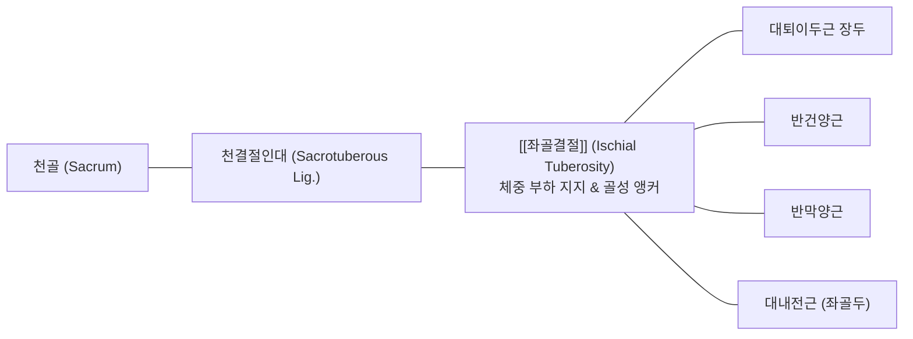
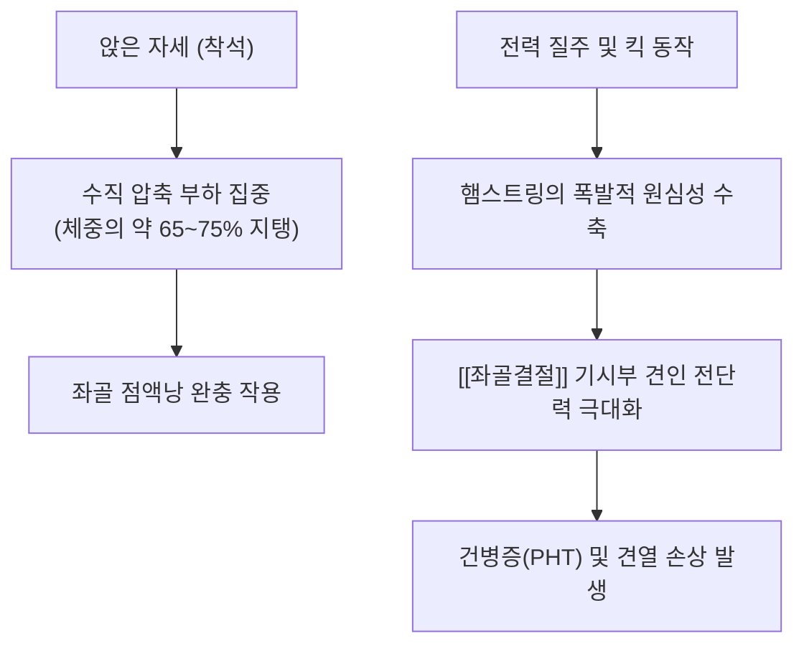

# 🦴 [[좌골결절]] (Ischial Tuberosity, 궁둥뼈결절)

> **핵심 요약 (Key Summary)**:
> [[좌골]](Ischium)의 하후방에 위치한 크고 거친 골성 융기부로, 의자에 앉았을 때 지면과 직접 맞닿아 상체 체중을 온전히 지탱하는 인체의 '착석 지지대'입니다.
> 대퇴 후면의 강력한 신전-굴곡 근육군인 [[햄스트링]]([[대퇴이두근]] 장두, [[반건양근]], [[반막양근]])과 [[대내전근]]의 공통 기시부이자 [[천결절인대]]가 견고하게 부착하는 골반 역학의 핵심 앵커입니다.
> 장시간 착석에 의한 좌골결절 점액낭염(Weaver's bottom)과 운동선수의 근위부 햄스트링 건병증(PHT) 및 견열 골절의 호발 부위이며, 족태양방광경의 승부혈(BL36)과 결합된 침도·약침 치료의 주 표적입니다.

---

## 1. 개요 및 해부학적 위치

[[좌골결절]](Ischial tuberosity)은 둔부 주름(Gluteal fold) 바로 심부에 위치하는 좌골의 가장 두껍고 단단한 돌출부입니다. 기립 시에는 [[대둔근]]의 두터운 근육 하연에 의해 덮여 보호받지만, 고관절을 90° 이상 굴곡시켜 앉으면 대둔근이 상방으로 미끄러져 올라가면서 결절 부위가 피하 조직 및 좌골 점액낭을 사이에 두고 좌면(Seat surface)에 직접 노출됩니다.

골반환의 하단에서 좌우 결절 사이의 거리는 골반출구(Pelvic outlet)의 횡경을 결정하며, 분만 역학과 보행 시 골반의 좌우 흔들림을 제어하는 기계적 지렛대 역할을 수행합니다.

---

## 2. 골성 지표 및 구조적 특징

좌골결절의 표면은 평활하지 않고 사선 방향의 능선에 의해 명확히 상하 두 구역으로 양분됩니다.

| 구역 구분 | 세부 위치 및 형태 | 부착 구조물 | 기능적 특징 |
| :--- | :--- | :--- | :--- |
| **상외측면 (Superolateral area)** | 결절 상부의 사선 능선 바깥쪽 오목한 면 | [[반막양근]](Semimembranosus) 건 기시 | 독립된 막성 건 형태로 부착하여 강력한 슬관절 굴곡력 발휘 |
| **하내측면 (Inferomedial area)** | 결절 하부의 넓고 거친 면 (종방향 능선으로 세분) | [[대퇴이두근]] 장두 + [[반건양근]] 연합건(Conjoint tendon) | 두 근육이 두꺼운 총건 형태로 기시하여 고관절 신전 주도 |
| **내측연 (Medial border)** | 결절 안쪽의 날카로운 골성 경계 | [[천결절인대]](Sacrotuberous ligament) | 햄스트링 건막과 천골-척추 기립근막을 연결하는 장력 전달 다리 |
| **외측연 (Lateral border)** | 결절 바깥쪽 경계 | [[방형대퇴근]](Quadratus femoris) 기시 | 대퇴골 소전자와의 완충 및 고관절 외회전 보조 |
| **하단 활액 접촉부** | 결절 최하단의 볼록한 활면 | 좌골 점액낭 (Ischial bursa) | 착석 시 뼈와 둔부 피부/피하조직 간의 마찰 완충 |

---

## 3. 부착 근육 및 인대 복합체

좌골결절은 하지 후방 사슬(Posterior kinetic chain)의 중심 시발점입니다.

1. **햄스트링 복합체 (Hamstring Complex)**:
   - **반막양근**: 결절 상외측면에서 넓은 판상 건으로 기시합니다.
   - **대퇴이두근 장두 & 반건양근**: 결절 하내측면에서 둥글고 두꺼운 공통 건(Conjoint tendon)을 이루어 강하게 결합합니다.
2. **고관절 내전근 및 회전근**:
   - **대내전근(Adductor magnus, Ischial part)**: 결절 하단의 외측면에서 기시하여 대퇴골 내전근결절(Adductor tubercle)로 주행하며 고관절의 강력한 신전 보조근으로 작용합니다.
   - **하쌍자근(Inferior gemellus)**: 결절 상연에서 기시하여 고관절 외회전을 돕습니다.
3. **인대성 결합 구조**:
   - **[[천결절인대]]**: 좌골결절 내측연에 매우 견고하게 부착하며, 일부 섬유는 대퇴이두근 건과 직접 연속성을 이룹니다. 이 해부학적 연결로 인해 보행 시 햄스트링의 장력이 천결절인대를 거쳐 천장관절의 강체화(Force closure)에 직접 기여합니다.

---

## 4. 생체역학 및 운동학적 기능

1. **착석 역학(Sitting Mechanics)**:
   - 양측 좌골결절은 체간의 척추 만곡을 유지한 상태에서 체중의 65% 이상을 직접 지탱합니다.
   - 둔부 쿠션이 부족하거나 비대칭적으로 앉을 경우 결절 하부 점액낭에 100kPa 이상의 과도한 압력이 집중되어 허혈과 염증이 유발됩니다.
2. **보행 및 주행 시의 장력 전달(Force Transmission)**:
   - 유각기 말기(Late swing phase)에서 하지가 전방으로 뻗어 나갈 때, 햄스트링은 급격한 원심성 수축(Eccentric contraction)을 통해 경골의 전방 전위를 제동합니다.
   - 이때 좌골결절 부착부에 체중의 수 배에 달하는 강력한 신장성 견인력(Tensile load)이 집중됩니다.

---

## 5. 임상적 의의 및 관련 질환

1. **근위부 햄스트링 건병증 (Proximal Hamstring Tendinopathy, PHT)**:
   - 달리기 선수, 요가 수련자, 장시간 착석자에게 호발하며, 좌골결절 부착부의 건-골 접합부(Enthesis)에 미세 파열과 점액성 변성이 발생하는 만성 퇴행성 질환입니다.
   - 둔부 깊은 곳의 묵직한 통증으로 인해 딱딱한 의자에 앉지 못하고, 고관절 굴곡 스트레칭 시 통증이 악화됩니다.
2. **좌골결절 점액낭염 (Ischial Bursitis, Weaver's Bottom)**:
   - 장시간 단단한 바닥에 앉아 작업하는 직업군(직포공, 운전기사 등)에서 결절과 연부조직 사이의 활액낭이 만성 마찰로 종창되고 삼출액이 고이는 병변입니다.
3. **좌골결절 견열 골절 (Avulsion Fracture of Ischial Tuberosity)**:
   - 골단판이 아직 닫히지 않은 13~18세 청소년 운동선수가 축구 킥이나 도약 동작 중 폭발적인 햄스트링 수축 시 좌골결절 골편이 뜯겨 나가는 급성 손상입니다.
4. **좌골신경 포착 연계**:
   - 좌골결절 외측 1~2cm 부위로 [[좌골신경]]이 밀접하여 주행하므로, 햄스트링 근위부 건병증이나 비후된 반흔 조직이 신경을 유착·견인하여 신경병증성 방산통을 병발시킬 수 있습니다.

---

## 6. 이학적 검사 및 감별 진단

1. **푸라넨-오라바 검사 (Puranen-Orava Test)**:
   - 환자가 기립한 상태에서 이환된 하지를 검사대 위에 올리고 슬관절을 완전히 신전시킨 채 체간을 전방으로 굴곡시킵니다.
   - 좌골결절 부착부에 날카로운 당김 통증이 재현되면 양성으로 판정합니다.
2. **굴곡 슬관절 신장 검사 (Bent-Knee Stretch Test)**:
   - 환자를 앙와위로 눕히고 고관절과 슬관절을 최대로 굴곡시킨 상태에서, 검사자가 슬관절을 수동적으로 빠르게 신전시킵니다.
   - 좌골결절 부착부의 햄스트링 기시부에 통증이 유발되면 PHT를 강력히 시사합니다.
3. **감별 진단**:
   - **요천추 신경근병증(L5-S1 Radiculopathy)**: 신경학적 결손(건반사 저하, 감각 둔마) 및 하지 직거상 검사(SLR) 양성을 보이지만, 국소 좌골결절 압통은 없습니다.
   - **천장관절 증후군**: Fortin's finger test 양성이며 통증 유발점이 좌골결절보다 상방의 후상장골극 부근에 위치합니다.

---

## 7. 한의학적 임상 응용 및 치료

좌골결절 부위는 족태양방광경(足太陽膀胱經)의 기혈 순환을 주관하며 하지 운동마비와 만성 둔통을 치료하는 핵심 혈위입니다.

1. **침구 치료 및 경혈 배오**:
   - **승부(BL36)**: 둔횡문(둔부 주름)의 정중앙에 위치하며, 심부 자침 시 좌골결절 하단과 대퇴이두근 장두 기시부 및 [[좌골신경]]에 직접 도달합니다. 호침 3~4촌으로 심자하여 득기감을 유도합니다.
   - **은문(BL37)**: 승부혈 하방 6촌으로 햄스트링 근복의 장력을 떨어뜨려 좌골결절 부착부의 견인 부하를 경감시킵니다.
   - **회양(BL35)**: 미골단 양옆 5푼 지점으로 천결절인대와 골반저근막의 긴장을 조절합니다.
2. **소침도(Acupotomy) 유착 박리술**:
   - 환자를 복와위로 두고 좌골결절 외하연의 햄스트링 골-건 접합부 압통점을 촉지한 후, 침도를 골면에 닿을 때까지 직자합니다.
   - 골막에 유착된 건초 섬유와 비후된 반흔 조직을 종횡으로 미세 절개하여 국소 미세혈관 신생을 자극하고 난치성 건병증 통증을 차단합니다.
3. **추나요법 (Chuna Pelvic & Hamstring Protocol)**:
   - **햄스트링 등척성 수축-이완 기법 (PIR MET)**: 앙와위에서 고관절 굴곡 각도를 가동제한벽(Barrier)까지 점진적으로 증진시키며 햄스트링의 원심성 신장성을 회복시킵니다.
   - **좌골 전단 변위 교정**: 골반 비틀림으로 인해 후하방으로 편위된 좌골결절을 전상방으로 교정 추진하여 천장관절 정렬을 정상화합니다.
4. **약침 치료**:
   - 좌골 점액낭염 및 건-골 부착부에 [[신바로약침]] 또는 [[봉약침]]을 0.5~1.0ml 주입하여 만성 건염증을 억제하고 콜라겐 섬유의 재생을 촉진합니다.

---

## 8. 참고문헌

* Baldassarri M. (2025). Porcine Collagen Injection Therapy Affects Proximal Hamstring Tendinopathy in Athletes by Reducing Time to Return to Sport. *Sports (Basel)*. PMID: 41150494
* Bowman KF Jr. (2013). Operative management of partial-thickness tears of the proximal hamstring muscles in athletes. *Am J Sports Med*. PMID: 23576684
* Feucht MJ. (2015). Gross anatomical and dimensional characteristics of the proximal hamstring origin. *Knee Surg Sports Traumatol Arthrosc*. PMID: 24929658
