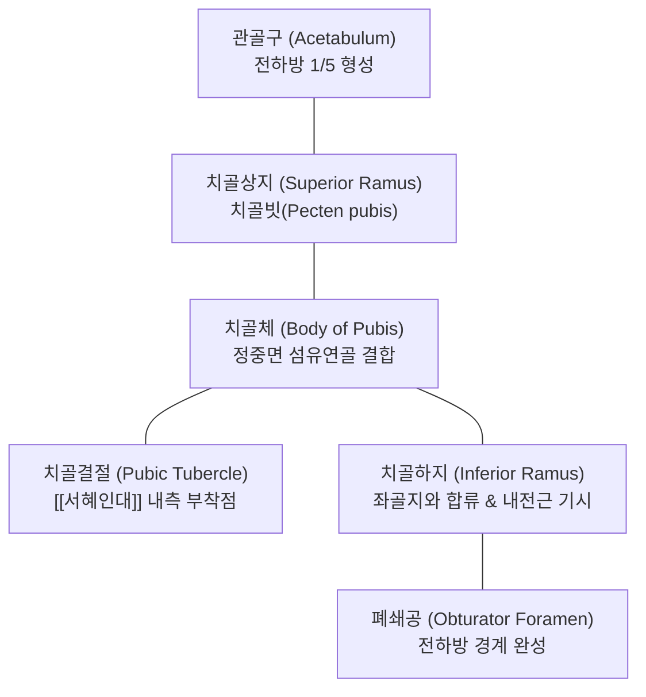
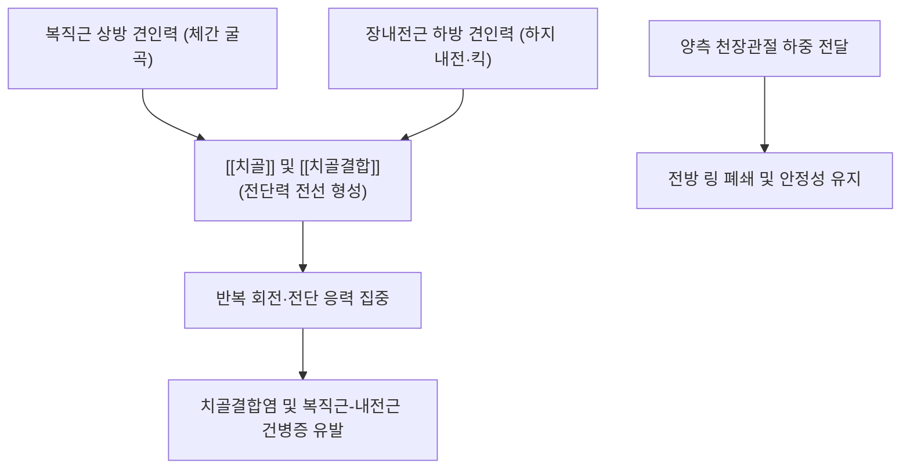

# 🦴 [[치골]] (Pubis, 두덩뼈)

> **핵심 요약 (Key Summary)**:
> [[골반]](Pelvis)을 구성하는 3개 골편([[장골]], [[좌골]], [[치골]]) 중 전하벽을 형성하는 골격 구조물로, 좌우 치골체가 정중선에서 섬유연골성 [[치골결합]](Pubic symphysis)을 이루어 골반환(Pelvic ring)의 전방 지지대(Strut) 역할을 담당합니다.
> 상부에는 상방 견인력을 발휘하는 [[복직근]]과 [[추체근]]이, 하부에는 하방 견인력을 발휘하는 하지 내전근군([[장내전근]], [[단내전근]], [[대내전근]], [[치골근]], [[박근]])이 강력하게 부착하여 양방향 짝힘(Force couple)의 중심 지렛대를 형성합니다.
> 달리기나 축구 킥 동작 시 발생하는 강력한 전단 응력으로 인한 치골결합염(Osteitis pubis), 스포츠 탈장(Athletic pubalgia), 산후 치골결합 이개(Pubic diastasis)의 핵심 병변 부위이며, 곡골혈(CV2)을 중심으로 한 침도 및 근에너지기법(MET) 추나 교정의 핵심 표적입니다.

---

## 1. 개요 및 해부학적 위치

[[치골]](Pubis)은 골반강의 전벽과 바닥을 형성하는 납작하고 각진 형태의 뼈입니다. 정중면에서 반대측 치골과 만나 매우 단단한 반관절(Amphiarthrosis) 형태의 치골결합을 형성합니다.

후상방으로는 장골과 결합하고, 후하방으로는 좌골과 결합하여 관골구의 전내측 1/5을 구성합니다. 좌우 치골하지는 아래쪽으로 벌어지면서 성별에 따라 각도가 다른 치골하각(Pubic arch: 남성 50~60°, 여성 80~85°)을 형성하여 산도(Birth canal)의 전방 출구를 구성합니다.

---

## 2. 골성 지표 및 구조적 특징

치골은 체부(Body), 상지(Superior ramus), 하지(Inferior ramus)의 세 주요 분절과 임상적으로 중요한 골성 융기들로 구성됩니다.

| 골성 지표 | 해부학적 형태 및 위치 | 부착 구조물 및 임상 의의 |
| :--- | :--- | :--- |
| **치골체 (Body of Pubis)** | 치골의 넓고 두꺼운 전내측 중앙부 | 반대측과 [[치골결합]] 형성, 내면은 방광을 지지 |
| **치골능 (Pubic crest)** | 치골체 상연의 둥근 능선 | [[복직근]] 및 [[추체근]] 부착, 복벽 긴장도 형성 |
| **치골결절 (Pubic tubercle)** | 치골능 외측 끝의 작은 둥근 돌기 | [[서혜인대]](Inguinal lig.) 내측단 부착, 서혜관 탈장 감별 지표 |
| **치골빗 (Pecten pubis)** | 치골상지 상연의 날카로운 능선 | 치골근 기시, 열공인대(Lacunar lig.) 부착 |
| **치골상지 (Superior ramus)** | 치골체에서 관골구를 향해 후외측 상방으로 뻗는 지둥 | 폐쇄구(Obturator groove) 형성 ([[폐쇄신경]]·혈관 통과) |
| **치골하지 (Inferior ramus)** | 치골체에서 하외측으로 뻗어 좌골지와 합류하는 얇은 골판 | 하지 내전근 복합체 및 골반저근막의 골성 앵커 |

---

## 3. 부착 근육 및 인대 복합체

치골은 복벽 코어 근육과 하지 내전근군이 서로 마주 보며 길항·협동 작용을 펼치는 근막 복합체(Aponeurotic plate)의 중심 기저부입니다.

1. **전복벽 근육군**:
   - [[복직근]](Rectus abdominis): 치골능과 치골결합 전면에 강력한 건막 형태로 정지하여 체간 굴곡 및 골반 후방경사를 조절합니다.
   - [[추체근]](Pyramidalis): 치골체 전면에서 기시하여 백선(Linea alba)을 팽팽하게 긴장시킵니다.
2. **하지 내전근 복합체 (Adductor Complex)**:
   - [[장내전근]](Adductor longus): 치골결결 바로 아래 치골체 전면에서 둥근 두꺼운 건으로 기시하여 대퇴골 조선에 정지합니다.
   - [[단내전근]](Adductor brevis): 치골하지 외측면에서 기시합니다.
   - [[대내전근]](Adductor magnus): 치골하지 하연과 좌골지에서 기시합니다.
   - [[치골근]](Pectineus): 치골빗(Pecten pubis)에서 기시하여 고관절 굴곡과 내전을 보조합니다.
   - [[박근]](Gracilis): 치골하지 내측연을 따라 얇은 띠 모양으로 기시하여 경골 [[거위발]]로 향합니다.
3. **골반저 근육군**:
   - 치골미골근(Pubococcygeus): 치골체 후면에서 기시하여 골반 장기(방광, 자궁, 직장)를 지지하고 배뇨·배변을 제어합니다.
4. **인대 복합체**:
   - [[서혜인대]]: 치골결절에 부착하여 서혜관(Inguinal canal)의 하벽을 형성합니다.
   - 상·하치골인대(Superior & Arcuate pubic ligaments): 치골결합 섬유연골판을 위아래에서 견고하게 결속시킵니다.

---

## 4. 생체역학 및 운동학적 기능

치골은 폐쇄형 골반 고리(Closed Pelvic Ring)의 전방 버팀목(Anterior Strut) 역할을 수행합니다.

1. **골반환 하중 분산과 전방 결속**:
   - 기립 보행 시 체중은 천골을 통해 양측 천장관절로 분산된 후 관골구로 전달됩니다. 이때 치골결합은 골반 전방이 양옆으로 벌어지려는 인장력(Tensile force)에 저항하여 골반환의 붕괴를 저지합니다.
2. **상하 짝힘(Force Couple) 갈등과 전단 응력**:
   - 치골체 전면에서는 상방으로 당기는 [[복직근]]과 하방으로 당기는 [[장내전근]]의 건막 섬유가 서로 얽혀 연속된 판을 이룹니다.
   - 축구 킥, 전력 질주, 급격한 방향 전환 시 상체 회전과 하지 내전력이 치골체에서 충돌하면서 막대한 수직 및 회전 전단력(Shear stress)이 발생합니다.

---

## 5. 임상적 의의 및 관련 질환

1. **치골결합염 (Osteitis Pubis)**:
   - 축구, 럭비, 마라톤 선수 등에게 호발하며, 치골결합 섬유연골과 인접 골수 내에 무균성 염증 및 미세 골절이 누적되는 과사용 증후군입니다.
   - 서혜부 전면, 하복부, 치골 중앙부에 극심한 둔통이 발생하며, 기침하거나 보행 시 통증이 악화됩니다.
2. **스포츠 탈장 (Athletic Pubalgia, Sports Hernia)**:
   - 진성 장 탈장이 아니며, 치골 부착부에서 복직근 건막과 장내전근 건이 미세 파열되거나 견열되어 만성 서혜부 통증을 초래하는 질환입니다.
3. **산후 치골결합 이개 (Diastasis of Pubic Symphysis)**:
   - 임신 중 릴랙신(Relaxin) 호르몬 분비로 골반 인대가 이완된 상태에서 분만 시 치골결합 간격이 정상(4~5mm)을 넘어 10mm 이상 벌어지는 병변입니다.
   - 출산 직후 산모가 극심한 치골 통증으로 인해 보행 불능(Waddling gait)에 빠집니다.
4. **치골 골절 (Pubic Ramus Fracture)**:
   - 골다공증성 노인 환자의 낙상으로 치골상지 및 하지가 골절되는 저에너지 손상이 빈발합니다.

---

## 6. 이학적 검사 및 감별 진단

1. **스퀴즈 검사 (Squeeze Test)**:
   - 환자를 앙와위로 눕히고 슬관절을 45° 또는 90° 굴곡시킨 상태에서, 양 무릎 사이에 검사자의 주먹이나 압력계를 끼우고 양다리를 강하게 모으도록(내전) 지시합니다.
   - 치골결합 부위에 날카로운 통증이 유발되면 치골결합염 또는 내전근 건병증 양성입니다.
2. **치골 직접 압박 검사 (Pubic Springing Test)**:
   - 환자의 치골결합 정중부를 검사자의 수근부로 직접 후방 압박하거나 좌우 치골을 엇갈리게 눌러 전단력을 가할 때 국소 압통이 재현되는지 확인합니다.
3. **감별 진단**:
   - **서혜부 탈장(Inguinal Hernia)**: 발살바 수기 시 서혜관 외륜을 통해 낭성 종괴가 돌출되지만, 치골결합염은 종괴 돌출이 없습니다.
   - **고관절 대퇴비구 충돌증후군(FAI)**: FADIR 검사 양성이며 통증 부위가 치골 중앙보다는 고관절 서혜인대 중간부 심부에 위치합니다.

---

## 7. 한의학적 임상 응용 및 치료

치골 부위는 임맥(任脈)과 족궐음간경(足厥陰肝經), 족양명위경(足陽明胃經)이 결합하는 비뇨생식 및 골반대 통증의 중심 관문입니다.

1. **침구 치료 및 경혈 배오**:
   - **곡골(CV2)**: 치골결합 상연 정중앙 함요처로 임맥의 요혈입니다. 복직근 부착부의 긴장을 풀고 치골결합의 무균성 염증을 가라앉힙니다.
   - **기충(ST30)**: 곡골혈 양옆 2촌, 치골결절 내측으로 서혜관 주위 기혈 순환을 촉진하고 내전근 복합체의 연축을 완화합니다.
   - **충문(SP12)**: 곡골혈 높이, 대퇴동맥 맥동처 외측으로 장요근과 대퇴삼각 주변 신경 포착을 해소합니다.
   - **음렴(LR11) 및 급맥(LR12)**: 치골하지 외측과 하지 내전근 기시부 압통점을 직접 자침하여 근막 긴장을 정상화합니다.
2. **소침도(Acupotomy) 건막 박리술**:
   - 만성 치골결합염 환자에서 치골체 전면의 비후된 복직근-장내전근 건막 부착부 섬유화 결절에 침도를 직자하여 유착을 박리하고 골막 견인 응력을 감압합니다.
3. **추나요법 (Chuna Pubic Shear MET)**:
   - **치골 결합 상하 전위 교정 (Pubic Shear Correction)**: 환자를 앙와위로 두고 양측 고관절을 외전/내전시킨 상태에서 시술자의 저항에 대항하여 환자가 등척성 수축을 가하도록 하는 근에너지기법(MET)을 적용합니다. 내전근의 동적 수축력을 이용하여 상하로 어긋난 치골결합을 정위치로 재정렬시킵니다.
4. **약침 치료**:
   - 치골결합 섬유연골판 주변 및 장내전근 기시부에 [[신바로약침]] 또는 [[봉약침]]을 0.3~0.5ml 주입하여 만성 골막염 부종을 흡수하고 손상된 건막 조직을 재생시킵니다.

---

## 8. 참고문헌

* Marya S. (2026). Mapping the Research Landscape of Osteitis Pubis and Athletic Pubalgia in Soccer. *Orthop Rev (Pavia)*. PMID: 42788175
* Via AG. (2019). Management of osteitis pubis in athletes: rehabilitation and return to training - a review of the most recent literature. *Open Access J Sports Med*. PMID: 30613167
