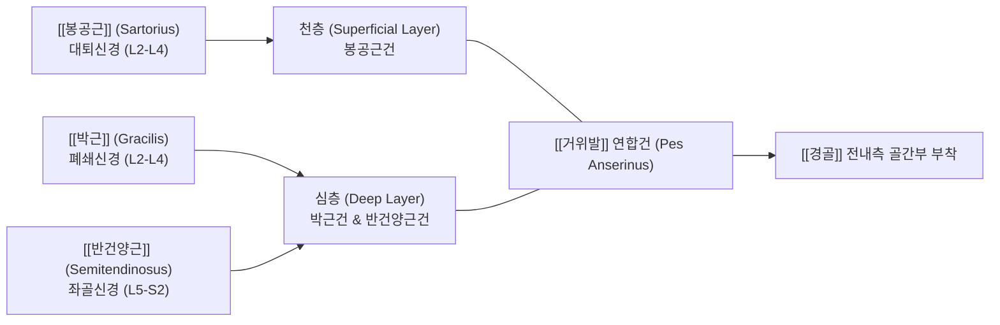
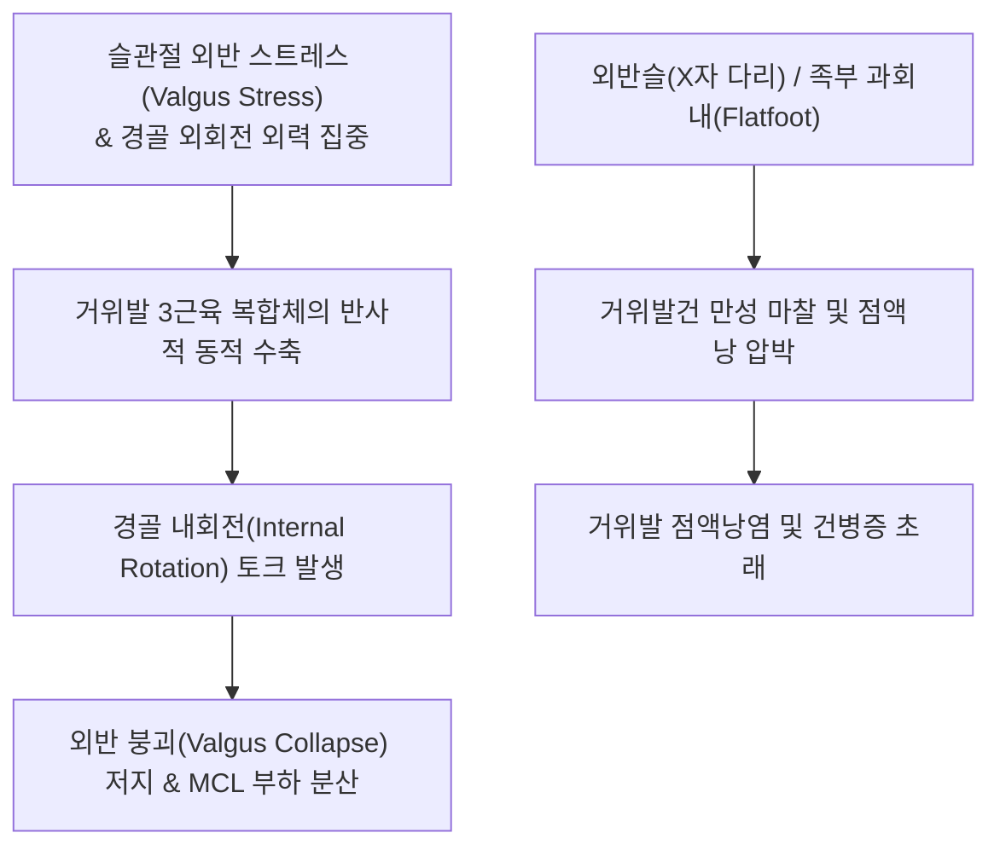

# 🦵 [[거위발]] (Pes Anserinus, 거위발건)

> **핵심 요약 (Key Summary)**:
> [[경골]](Tibia) 근위부 전내측면에 부착하는 3개 근육([[봉공근]], [[박근]], [[반건양근]])의 건이 거위의 물갈퀴 모양으로 합쳐진 연합건(Conjoint tendon) 복합체입니다.
> 세 근육이 각각 대퇴신경, 폐쇄신경, 좌골신경이라는 서로 다른 3대 주요 신경의 지배를 받는 독특한 해부학적 구조를 지니며, 정적 안정자인 내측측부인대(MCL)와 협력하여 슬관절의 외반(Valgus) 붕괴를 저지하는 핵심 동적 내측 안정기입니다.
> 연합건 심부의 거위발 점액낭(Pes anserine bursa)에 발생하는 점액낭염과 건병증은 퇴행성 슬관절염 환자의 내측 무릎 통증을 유발하는 대표적 원인이며, 음릉천(SP9)과 곡천(LR8)을 표적으로 하는 침도·약침 치료 및 슬관절 회전 추나의 핵심 표적입니다.

---

## 1. 개요 및 해부학적 위치

[[거위발]](Pes Anserinus)은 [[경골조면]](Tibial tuberosity) 내측 약 3~4cm 하방, 경골의 전내측 골간부 표면에 부착하는 건성 복합체입니다. 세 개의 길고 얇은 근육 건이 하나의 부채꼴 형태로 합류하여 경골 골막에 넓게 정지하는 모습이 거위의 발(Goose's foot)을 닮았다고 하여 명명되었습니다.

거위발 연합건의 바로 아래 심부에는 **거위발 점액낭(Pes anserine bursa)**이 위치하여, 팽팽한 연합건과 내측측부인대(MCL) 및 경골 골막 사이에서 발생하는 마찰을 완충하는 활액막 주머니 역할을 합니다.

---

## 2. 골성 지표 및 구조적 특징

거위발 복합체는 경골 내측의 골성 표면과 다층막(Layer) 구조로 결합되어 있습니다.

| 구조물/지표 | 해부학적 위치 및 주행 | 기능 및 임상 특징 |
| :--- | :--- | :--- |
| **경골 전내측면 부착부** | 관절선(Joint line) 하방 4~5cm, 경골조면 내측 | 피하에 위치하여 부종 및 압통의 직접 촉진 가능 |
| **천층: [[봉공근]]건** | 연합건의 가장 전방 및 천층을 덮는 넓은 막 | 무릎 내측을 감싸며 심층 건들을 보호하는 덮개 역할 |
| **심층 상부: [[박근]]건** | 봉공근건 바로 심후방을 주행하는 둥근 건 | 고관절 내전 및 슬관절 내회전 보조 |
| **심층 하부: [[반건양근]]건** | 세 건 중 가장 두껍고 긴 건으로 최후하단 위치 | 강력한 슬관절 굴곡력 및 경골 내회전 토크 생성 |
| **거위발 점액낭 (Bursa)** | 거위발건 심층과 MCL 표층 사이의 활액낭 | 마찰 완충, 염증 시 삼출액 저류 및 낭성 종창 발생 |
| **복재신경 슬내측지** | 거위발건 후연을 따라 표층으로 주행하는 피신경 | 시술 시 손상 위험 및 신경병증성 내측 무릎 통증 유발점 |

---

## 3. 부착 근육 및 인대 복합체

거위발은 골반의 서로 다른 세 부위에서 출발한 근육들이 슬관절 내측의 단일 지점으로 집결하는 인체에서 매우 드문 기하학적 융합 구조입니다.

| 구성 근육 | 기시부 (골반 앵커) | 지배 신경 | 주기능 (고관절 / 슬관절) |
| :--- | :--- | :--- | :--- |
| **[[봉공근]] (Sartorius)** | [[ASIS]] (전상장골극) | 대퇴신경 (Femoral n., L2-L4) | 고관절 굴곡·외전·외회전 / 슬관절 굴곡·내회전 |
| **[[박근]] (Gracilis)** | [[치골]] 결합 외측 하지 | 폐쇄신경 (Obturator n., L2-L4) | 고관절 내전 / 슬관절 굴곡·내회전 |
| **[[반건양근]] (Semitendinosus)** | [[좌골결절]] 하내측면 | 좌골신경 경골신경지 (L5-S2) | 고관절 신전 / 슬관절 굴곡·내회전 |

이러한 삼원적 구성은 대퇴 전면(대퇴신경), 내측면(폐쇄신경), 후면(좌골신경)의 근육군이 모두 슬관절의 내측 안정화에 관여하도록 설계된 신경학적 중복 보장(Neurological redundancy) 체계입니다.

---

## 4. 생체역학 및 운동학적 기능

거위발 복합체는 보행 및 점프 착지 시 슬관절에 가해지는 외반(Valgus) 스트레스에 대항하는 핵심 동적 제동기입니다.

1. **동적 외반 저지 (Dynamic Valgus Resistance)**:
   - 정적 인대인 내측측부인대(MCL)가 한계 장력에 도달하기 전에, 거위발 근육들이 수축하여 경골을 내측으로 끌어당김으로써 무릎이 안쪽으로 꺾이는 것을 방지합니다.
2. **스크루-홈 메커니즘(Screw-Home Mechanism)의 제어**:
   - 무릎이 완전 신전될 때 경골이 외회전되는 스크루-홈 기전을 굴곡 시 부드럽게 역회전(경골 내회전)시키는 시발체 역할을 수행합니다.

---

## 5. 임상적 의의 및 관련 질환

1. **거위발 점액낭염 및 건병증 (Pes Anserine Bursitis & Tendinopathy)**:
   - 무릎 골관절염(Knee OA), 당뇨, 비만 여성, 마라톤 주자에게 호발합니다.
   - 관절선 하방 3~5cm 부위에 뚜렷한 압통과 열감이 발생하며, 특히 계단을 내려갈 때나 야간에 양 무릎이 맞닿을 때 통증이 극심합니다.
2. **퇴행성 관절염과의 악순환**:
   - 내측 반월상연골 손상 및 내반 변형으로 관절 간격이 좁아지면 보행 시 거위발건에 보상성 장력이 걸려 2차성 점액낭염이 동반됩니다.
3. **복재신경 포착성 신경통 (Saphenous Nerve Entrapment)**:
   - 거위발건 후연을 감아 도는 복재신경의 슬개하자(Infrapatellar branch)가 비후된 점액낭에 의해 눌리면 경골 내측 전반으로 찌릿한 작열통이 방산됩니다.

---

## 6. 이학적 검사 및 감별 진단

1. **거위발 압통 검사 (Pes Anserine Palpation)**:
   - 환자를 앙와위로 두고 관절선에서 하방으로 3~5cm 떨어진 경골 전내측면을 촉진합니다.
   - 반월상연골의 관절선 압통과 명확히 구별되는 국소 압통점이 확인되면 양성입니다.
2. **저항성 슬관절 굴곡-내회전 검사**:
   - 슬관절을 90° 굴곡시킨 상태에서 검사자가 하퇴 외회전 및 신전 저항을 가할 때, 환자가 이에 대항하여 슬관절을 내회전·굴곡시키면서 통증이 유발되는지 평가합니다.
3. **감별 진단**:
   - **내측 반월상연골 후각 파열(MMTR)**: McMurray 검사 양성이며 압통선이 경골 내측 관절선 자체에 위치합니다.
   - **내측측부인대(MCL) 염좌**: 슬관절 30° 굴곡 상태에서의 외반 부하 검사(Valgus stress test) 시 이완감과 관절선 통증이 유발됩니다.

---

## 7. 한의학적 임상 응용 및 치료

거위발 부위는 족태음비경(足太陰脾經)과 족궐음간경(足厥陰肝經)이 교차하는 슬관절 내측의 혈위 복합체입니다.

1. **침구 치료 및 경혈 배오**:
   - **음릉천(SP9)**: 경골 내측과 하연과 경골 후연이 만나는 함요처로, 거위발건 부착부 직상방에서 비경의 습열(濕熱)을 제거하고 관절 부종을 배출합니다.
   - **곡천(LR8)**: 무릎을 굽혔을 때 반건양근-반막양근 건 전방 오금 주름 끝으로 간경의 합혈이며 힘줄의 경결을 이완합니다.
   - **슬관(LR7)**: 음릉천 후방 1촌으로 거위발 점액낭염의 통증점을 직접 관통하여 소염 진통 효과를 발휘합니다.
2. **소침도(Acupotomy) 점액낭 감압술**:
   - 거위발건과 경골 골막 사이의 유착 부위 및 종창된 점액낭벽에 침도를 직자하여 비후된 섬유대를 절개(Fenestration)함으로써 활액 낭포 내압을 낮추고 통증 수용기 자극을 차단합니다.
3. **추나요법 (Chuna Alignment Protocol)**:
   - **골반-고관절-슬관절 회전 정렬 추나**: 고관절 내회전 및 경골 외회전 변위를 교정하는 하지 회전 추나를 적용하여 거위발건에 가해지는 과도한 외반 장력을 근본적으로 차단합니다.
   - **박근·봉공근 근막 이완(MFR)**: 대퇴 내측 근육군의 단축을 심부 근막 이완술로 신장시킵니다.
4. **약침 치료**:
   - 거위발 점액낭 압통점에 [[신바로약침]] 또는 [[봉약침]]을 0.3~0.5ml 주입하여 만성 염증 물질을 신속히 제거하고 건막 조직의 섬유모세포 활성을 촉진합니다.

---

## 8. 참고문헌

* Tani B. (2026). Pes Anserine Bursitis: An Underrecognized Cause of Medial Knee Pain - A Review of Diagnosis, Associated Conditions, and Evidence-Based Management. *Orthop Res Rev*. PMID: 42894573

* Babaei-Ghazani A. (2024). Ultrasound-Guided Pes Anserine Bursitis Injection Choices: Prolotherapy or Oxygen-Ozone or Corticosteroid: A Randomized Multicenter Clinical Trial. *Am J Phys Med Rehabil*. PMID: 37752656

