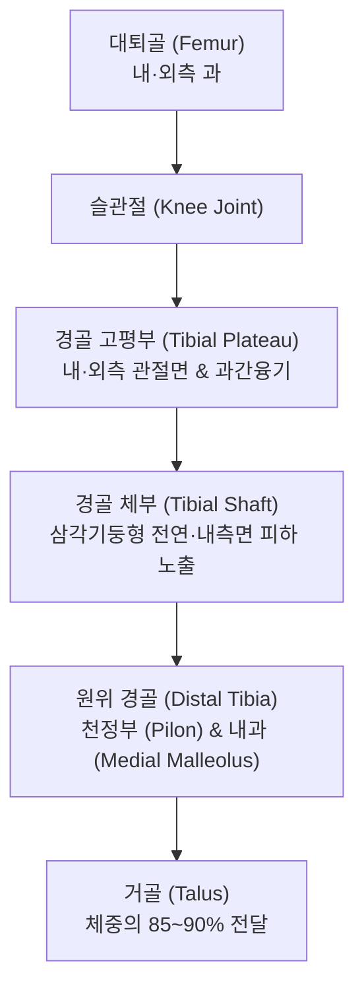
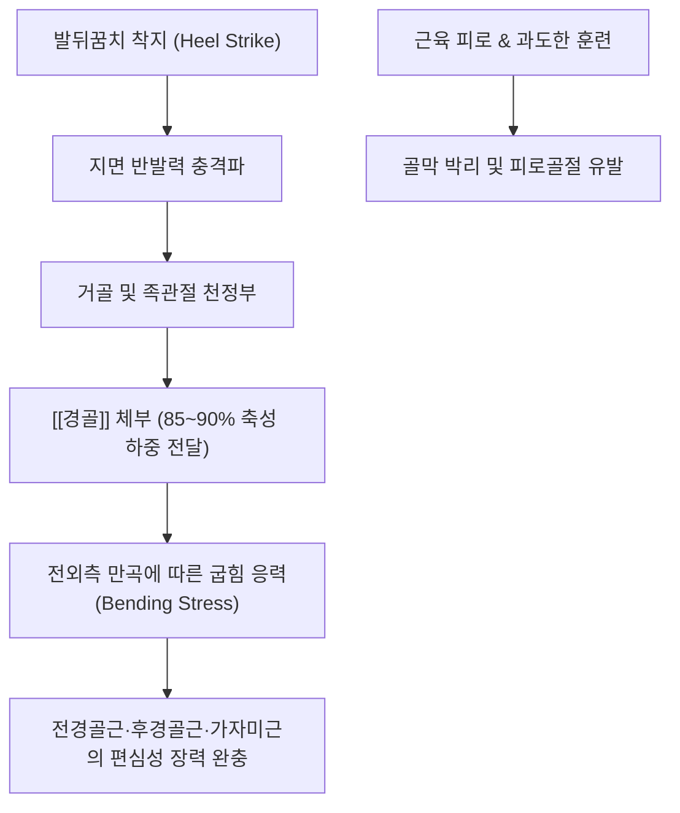

# 🦴 [[경골]] (Tibia, 정강뼈)

> **핵심 요약 (Key Summary)**:
> 하퇴(Lower leg)의 내측에 위치하는 대형 관상골로, 대퇴골로부터 전달되는 체중의 약 85~90%를 온전히 받아 거골(Talus)로 전달하는 인체 제2의 주요 체중 부하 골격입니다.
> 근위부의 내·외측과와 과간융기(Intercondylar eminence), 삼각기둥 형태의 골간부 및 원위부의 [[내과]](Medial malleolus)로 구성되며, 전연(Anterior border)은 피하에 직접 노출되어 촉진이 용이합니다.
> 달리기나 군사 훈련 시 과도한 지면 반발력과 회전 견인력으로 인한 내측 경골 스트레스 증후군(MTSS, 정강이 부목) 및 피로골절의 핵심 발생 부위이며, 족삼리(ST36)와 삼음교(SP6) 등 한의 임상 최고 요혈들의 골성 기저입니다.

---

## 1. 개요 및 해부학적 위치

[[경골]](Tibia)은 하퇴 골격계의 중심 기둥으로, 외측의 얇은 [[비골]](Fibula)과 함께 골간막(Interosseous membrane) 및 근위·원위 경비관절을 통해 결합되어 하퇴부를 구성합니다.

근위부는 넓게 팽대되어 대퇴골 하단과 슬관절(Knee joint)을 이루고, 원위부는 족관절 천정(Tibial pilon)과 내측복사뼈를 형성하여 족근골의 [[거골]](Talus)과 경거관절을 형성합니다.

---

## 2. 골성 지표 및 구조적 특징

경골은 근위부, 골간부, 원위부의 3대 구역에 뚜렷한 골성 지표들을 보유합니다.

| 부위 구분 | 골성 지표명 | 형태학적 특징 및 부착 구조 |
| :--- | :--- | :--- |
| **근위부 (Proximal)** | **내·외측과 (Condyles)** | 상면은 평탄한 관절면(Tibial plateau)을 이루어 대퇴골 및 반월상연골과 관절 |
| **근위부 (Proximal)** | **과간융기 (Intercondylar eminence)** | 양 과 사이의 융기로 전·후방십자인대([[ACL]], [[PCL]]) 및 반월상연골 각 부착 |
| **근위부 (Proximal)** | **[[경골조면]] (Tibial tuberosity)** | 근위 전면의 거친 돌기로 슬개인대([[대퇴사두건]]) 부착 |
| **근위부 (Proximal)** | **게르디 결절 (Gerdy's tubercle)** | 외측과 전외측면의 돌기로 [[장경인대]](ITB) 정지 |
| **체부 (Shaft)** | **전연 (Anterior border)** | 피하에서 만져지는 날카로운 '정강이 능선' (Shin) |
| **체부 (Shaft)** | **가자미근선 (Soleal line)** | 후상면의 사선 골릉으로 [[가자미근]] 기시 |
| **원위부 (Distal)** | **내과 (Medial malleolus)** | 안쪽복사뼈 형성, 삼각인대(Deltoid ligament) 기시 |
| **원위부 (Distal)** | **비골절흔 (Fibular notch)** | 원위 외측면의 오목한 고랑으로 하비골과 인대결합 형성 |

---

## 3. 부착 근육 및 인대 복합체

경골은 하지를 움직이고 발목을 제어하는 강력한 근육들의 기시 및 정지점입니다.

1. **정지하는 근육군 (슬관절 구동)**:
   - [[대퇴사두근]](대퇴직근, 외측광근, 내측광근, 중간광근): 슬개골을 거쳐 슬개인대로 경골조면에 강력하게 정지합니다.
   - [[거위발]] 3근육([[봉공근]], [[박근]], [[반건양근]]): 경골 근위 전내측면에 정지합니다.
   - [[반막양근]]: 경골 내측과 후면에 정지합니다.
   - [[장경인대]](TFL 건막): 게르디 결절에 부착하여 슬관절 외측 안정성을 부여합니다.
   - 슬와근(Popliteus): 경골 후면 가자미근선 상방에 정지하여 슬관절 잠김을 푸는 내회전 토크를 발생시킵니다.
2. **기시하는 근육군 (족관절 및 발가락 구동)**:
   - [[전경골근]](Tibialis anterior): 경골 외측면 상부 2/3에서 기시하여 발목 족배굴곡 및 내번을 주도합니다.
   - [[가자미근]](Soleus): 경골 후면 가자미근선에서 기시하여 아킬레스건을 형성합니다.
   - [[후경골근]](Tibialis posterior) 및 [[장지굴근]](Flexor digitorum longus): 경골 후면 골간막 인접부에서 기시하여 족궁(Arch)을 지지합니다.
3. **인대 복합체**:
   - 십자인대([[ACL]], [[PCL]]): 과간와에 견고히 부착하여 전후방 전위를 차단합니다.
   - 삼각인대(Deltoid lig.): 내과 첨부에서 부채꼴로 뻗어 거골, 주상골, 종골을 결속합니다.

---

## 4. 생체역학 및 운동학적 기능

경골은 체중 지지와 지면 반발력 전달의 기계적 대들보입니다.

1. **하중 전달 비율 (Load Partitioning)**:
   - 기립 시 하퇴 하중의 85~90%는 경골을 관통하며, 외측의 비골은 약 10~15%의 하중만을 보조적으로 분담합니다.
2. **스크루-홈 메커니즘 (Screw-Home Mechanism)**:
   - 무릎이 완전 신전(Extension)되는 마지막 15° 구간에서 대퇴골 내측과의 관절면이 더 길기 때문에 경골이 대퇴골에 대해 약 5~10° 수동 외회전(External rotation)되면서 관절이 견고하게 맞물리는 잠김(Locking)이 일어납니다.

---

## 5. 임상적 의의 및 관련 질환

1. **내측 경골 스트레스 증후군 (Medial Tibial Stress Syndrome, MTSS, 정강이 부목)**:
   - 달리기, 점프 등 반복적인 충격으로 인해 경골 내측 원위 1/3 모서리의 골막(Periosteum)과 가자미근/후경골근 근막 부착부에 발생하는 견인성 무균성 골막염입니다.
   - 운동 초기 또는 후에 경골 내측 능선을 따라 5cm 이상의 연속된 띠 모양 압통이 발생합니다.
2. **경골 피로골절 (Tibial Stress Fracture)**:
   - MTSS가 악화되거나 골 리모델링 한계를 초과했을 때 경골 전면(전방 피질) 또는 후내측 피질에 미세 골절선이 형성되는 질환입니다. 국소적으로 좁은 부위(1~2cm)에 칼로 베는 듯한 극심한 점상 압통(Point tenderness)이 특징입니다.
3. **하퇴 구획증후군 (Compartment Syndrome)**:
   - 경골과 비골, 골간막으로 둘러싸인 전방·후방 구획 내에 부종이나 출혈로 내압이 급상승하여 모세혈관 순환이 차단되고 근육 괴사가 일어나는 응급 질환입니다.

---

## 6. 이학적 검사 및 감별 진단

1. **경골 도약 검사 (Hop Test)**:
   - 환자에게 환측 단하지로 제자리에서 껑충껑충 뛰도록(Single-leg hop) 지시합니다.
   - 착지 시 경골부에 극심한 국소 통증으로 인해 도약이 불가능하다면 경골 피로골절을 강력히 의심합니다.
2. **소리굽쇠 진동 검사 (Tuning Fork Test)**:
   - 128Hz 진동 소리굽쇠를 경골 의심 병변부에 접촉시켰을 때 날카로운 뼈 통증이 유발되면 피로골절 양성 지표입니다.
3. **감별 진단**:
   - **MTSS vs 피로골절**: MTSS는 경골 내측 능선을 따라 5cm 이상 광범위한 미만성 압통을 보이는 반면, 피로골절은 1~2cm 이내의 국소 점상 압통과 방사선/MRI상 골수 부종 및 골절선이 확인됩니다.
   - **심부정맥 혈전증(DVT)**: 종아리 부종과 호만 징후(Homan's sign) 양성을 보이며 피하 골성 압통보다는 심부 비복근 파동성 압통이 두드러집니다.

---

## 7. 한의학적 임상 응용 및 치료

경골은 족양명위경(足陽明胃經), 족태음비경(足太陰脾經), 족소음신경(足少陰腎經)의 경혈들이 경골 전면과 후내측면을 따라 집중 배열된 임상 요혈의 보고입니다.

1. **침구 치료 및 대표 경혈**:
   - **족삼리(ST36)**: 독비혈 하방 3촌, 경골 전연 외측 1수지 지점으로 위경의 합혈이자 전신 보기(補氣) 및 하지 무력증의 최고 요혈입니다. 전경골근 근복을 자극합니다.
   - **삼음교(SP6)**: 내과 첨부 상방 3촌, 경골 내측연 후방 함요처로 비·간·신 3음경의 교회혈입니다. MTSS의 주 압통점에 해당하며 하퇴 순환을 촉진합니다.
   - **음릉천(SP9)**: 경골 내측과 하연으로 하퇴 부종 및 무릎 염증을 배출합니다.
   - **조구(ST38) 및 풍륭(ST40)**: 경골 외측 구획 근육군의 긴장을 풀고 거담통락(祛痰通絡)합니다.
2. **소침도(Acupotomy) 골막 감압술**:
   - 만성 MTSS로 인해 경골 골막과 근막이 비후 유착된 병변부에 침도를 직자하여 골막 부착 섬유를 종방향으로 미세 절개함으로써 골내압을 낮추고 통증 수용기 흥분을 억제합니다.
3. **추나요법 (Chuna Tibial Alignment)**:
   - **근위·원위 경비관절 가동술**: 비골두와 원위 비골을 전후방으로 글라이딩시켜 경골-비골 간의 역학적 유연성을 회복시킵니다.
   - **경골 내외회전 교정 추나**: 슬관절 신전 시 잠김 기전이 상실된 경골의 회전 변위를 바로잡아 관절면 하중을 고르게 분산시킵니다.
4. **약침 치료**:
   - 경골 골막염 및 건막 부착부 압통점에 [[신바로약침]] 또는 [[중성어혈약침]]을 0.5~1.0ml 주입하여 어혈(瘀血)을 제거하고 미세 골 손상의 리모델링을 촉진합니다.

---

## 8. 참고문헌

* Najim O. (2026). Tibial bone stress injury-a common cause of leg pain in sports. *Br Med Bull*. PMID: 42969581
* Saad MA. (2025). Medial Tibial Stress Syndrome: A Scoping Review of Epidemiology, Biomechanics, and Risk Factors. *Cureus*. PMID: 40171337
