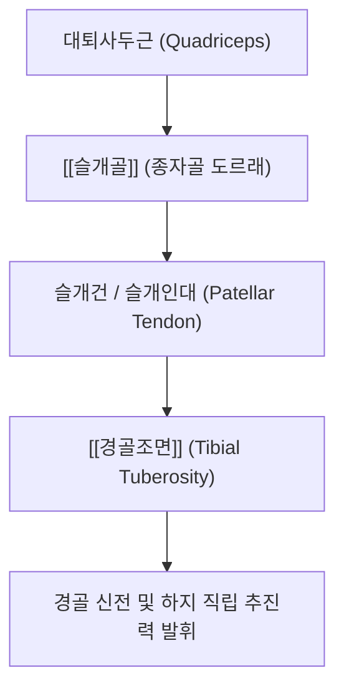
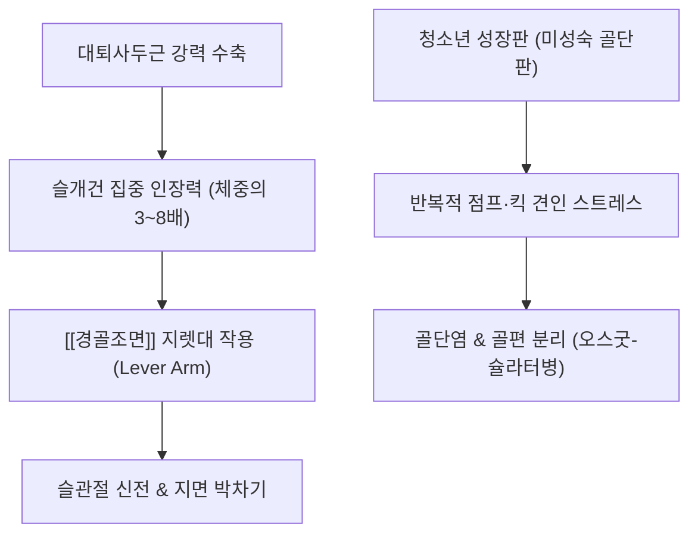

# 🦴 [[경골조면]] (Tibial Tuberosity, 정강뼈거친면)

> **핵심 요약 (Key Summary)**:
> [[경골]](Tibia) 근위부 전면에 위치한 크고 거친 타원형 골성 융기부로, [[대퇴사두근]]의 강력한 신전력이 슬개골을 거쳐 [[슬개건]](슬개인대, Patellar tendon)을 통해 최종 집결하는 인체 하지 신전 메커니즘의 핵심 정지부입니다.
> 상부의 평활한 활액 구역(심부 슬개하 점액낭 위치)과 하부의 거친 인대 부착 구역으로 구분되며, 슬개골 중심과 경골조면을 연결하는 선이 Q-각(Q-angle)의 하지 벡터를 결정합니다.
> 성장기 청소년 운동선수에게 호발하는 견열성 골연골염인 오스굿-슐라터병(Osgood-Schlatter Disease, OSD)과 성인의 슬개건병증의 주 호발 부위이며, 족삼리(ST36)와 하독비혈을 중심으로 한 대퇴사두근 근막 이완 및 침도·약침 치료의 핵심 표적입니다.

---

## 1. 개요 및 해부학적 위치

[[경골조면]](Tibial tuberosity)은 [[슬개골]](Patella) 하극에서 약 3~5cm 하방, [[경골]] 골간부 전면 상단에 위치하여 피부 바로 아래에서 뚜렷하게 돌출되어 쉽게 촉진할 수 있는 [[골반]]-하지 연계 랜드마크입니다.

발생학적으로 경골 근위 골단(Proximal tibial epiphysis)에서 하방으로 뻗어 나온 설상 골화 중심(Tongue-shaped apophysis)에서 기원하며, [[대퇴사두근]]의 막대한 수축 장력을 견딜 수 있도록 치밀골 능선으로 보강되어 있습니다.

---

## 2. 골성 지표 및 구조적 특징

경골조면은 [[슬개건]]의 부착과 완충 작용을 위해 상하 두 개의 상이한 면 구조를 지닙니다.

| 구조 구분 | 해부학적 형태 및 위치 | 기능적 특징 |
| :--- | :--- | :--- |
| **상부 활액 접촉면 (Proximal area)** | 조면의 상부 1/3로 비교적 평활한 활면 | 심부 슬개하 점액낭(Deep infrapatellar bursa)이 위치하여 건-골 마찰 완충 |
| **하부 거친 부착면 (Distal area)** | 조면의 하부 2/3로 결절 형태의 거친 골면 | 슬개인대의 강력한 콜라겐 샤피 섬유(Sharpey's fibers)가 골막 깊숙이 침투 |
| **외측 경계선** | 조면의 바깥쪽 모서리 | [[전경골근]] 근막의 기시부와 결합 |
| **내측 경계선** | 조면의 안쪽 모서리 | 경골 내측 피하 골막 및 [[거위발]] 복합체와 인접 |
| **경골조면 간격 (TT-TG distance)** | 경골조면 중앙과 [[대퇴골]] 활차구(Trochlear groove) 간 거리 | 정상 10~15mm; 20mm 초과 시 슬개골 외측 아탈구의 강력한 해부학적 위험 인자 |

---

## 3. 부착 근육 및 인대 복합체

경골조면은 대퇴 전면의 막강한 신전 모터를 단일 건으로 묶어 하지 전체를 펴게 만드는 파워 트랜스미션의 종착역입니다.

1. **정지 인대 및 건**:
   - **[[슬개건]] (Patellar tendon / ligament)**: [[대퇴직근]], [[중간광근]], [[외측광근]], [[내측광근]]의 건막이 [[슬개골]]을 감싸고 내려와 형성된 폭 약 3cm, 두께 약 5mm의 극도로 강인한 섬유속입니다. 경골조면 하부에 견고하게 고정됩니다.
2. **인접 근육군**:
   - [[전경골근]](Tibialis anterior): 조면의 외측 하연에서 일부 섬유가 기시하여 발목의 족배굴곡을 시작합니다.
3. **완충 점액낭 구조**:
   - **심부 슬개하 점액낭(Deep infrapatellar bursa)**: 슬개건 원위부와 경골조면 상부 골면 사이에 끼여 있어 무릎 굴곡 시 건이 뼈 모서리에 짓눌리지 않도록 보호합니다.
   - **천층 슬개하 점액낭(Subcutaneous infrapatellar bursa)**: 경골조면 피부와 슬개건 표층 사이에 위치하여 무릎을 꿇을 때 외부 충격을 흡수합니다.

---

## 4. 생체역학 및 운동학적 기능

경골조면은 슬관절 신전 지렛대(Extensor Lever Arm)의 회전 모멘트 암을 결정하는 핵심 지표입니다.

1. **신전 지렛대 작용 (Extensor Moment Arm)**:
   - 경골조면이 전방으로 돌출되어 있기 때문에 슬관절 회전 중심축으로부터 슬개건의 거리가 멀어져, [[대퇴사두근]]이 더 적은 힘으로도 경골을 전방으로 들어 올릴 수 있는 기계적 이득을 제공합니다.
2. **Q-각(Q-angle)의 원위 기준점**:
   - [[ASIS]]에서 [[슬개골]] 중심을 잇는 선과, 슬개골 중심에서 경골조면을 잇는 선이 이루는 각도(정상 남성 10~14°, 여성 15~18°)의 하부 꼭짓점이 됩니다.
   - 경골조면이 외측으로 편위될수록 Q-각이 증가하여 슬개골이 외측으로 탈구되려는 외측 견인 벡터가 증폭됩니다.

---

## 5. 임상적 의의 및 관련 질환

1. **오스굿-슐라터병 (Osgood-Schlatter Disease, OSD)**:
   - 10~15세 급성장기 청소년 운동선수(축구, 농구, 육상)에게 호발합니다.
   - 미성숙한 경골조면의 골단판에 대퇴사두근의 반복적인 강력한 견인력이 가해져 골단 연골의 미세 골절, 무균성 괴사, 골편 분리 및 2차성 골 비대가 초래됩니다.
   - 경골조면이 혹처럼 튀어나오며 무릎을 꿇거나 계단을 오를 때 극심한 동통이 나타납니다.
2. **슬개건 원위부 건병증 (Distal Patellar Tendinopathy)**:
   - 성인 운동선수에서 경골조면 부착부의 건-골 접합부에 발생하는 만성 퇴행성 건염으로 점프 및 착지 시 조면 직상부에 칼로 찌르는 듯한 통증이 발생합니다.
3. **경골조면 견열 골절 (Tibial Tuberosity Avulsion Fracture)**:
   - 도약 착지 중 대퇴사두근의 급격한 원심성 수축으로 인해 경골조면 전체가 뜯겨 나가는 응급 골절 손상입니다.
4. **심부 슬개하 점액낭염 (Deep Infrapatellar Bursitis)**:
   - 슬개건 심부 점액낭에 마찰로 인한 활액 저류가 발생하여 조면 상부 양측 함요처에 압통과 종창이 발생합니다.

---

## 6. 이학적 검사 및 감별 진단

1. **저항성 슬관절 신전 검사 (Resisted Knee Extension Test)**:
   - 환자가 앉은 상태에서 슬관절을 90°에서 완전 신전하도록 지시하고 검사자가 발목에서 강한 굴곡 저항을 가합니다.
   - 대퇴사두근 수축 시 경골조면에 날카로운 통증이 유발되면 조면 골단염 또는 슬개건병증 양성입니다.
2. **경골조면 직접 압통 및 타진 검사**:
   - 돌출된 경골조면을 엄지손가락으로 직접 압박하거나 가볍게 타진할 때 심한 국소 압통과 골성 융기가 만져지는지 확인합니다.
3. **감별 진단**:
   - **신딩-라르센-요한슨병(Sinding-Larsen-Johansson syndrome)**: 동일한 성장기 골단염이나 통증 부위가 경골조면이 아닌 슬개골 하극(Lower pole)에 국한됩니다.
   - **슬개대퇴 통증 증후군(PFPS)**: 슬개골을 대퇴 활차구로 압박할 때 연골 마찰음과 통증이 나타나며 경골조면의 골성 압통은 없습니다.

---

## 7. 한의학적 임상 응용 및 치료

경골조면 주변은 족양명위경(足陽明胃經)의 기혈이 슬관절로 진입하는 관문 구역입니다.

1. **침구 치료 및 경혈 배오**:
   - **독비(ST35, 외슬안) 및 내슬안(EX-LE4)**: 슬개건 양측 함요처로 슬개하 점액낭과 관절강 내 염증을 사화(瀉火)시킵니다.
   - **하독비(下犢鼻)**: 경골조면 양측 오목한 부위의 아시혈로, 슬개건 원위부 부착부의 긴장을 즉각 완화합니다.
   - **족삼리(ST36)**: 경골조면 외하방 1촌 지점으로 하지 전면부 기혈 순환과 건막의 혈류를 촉진합니다.
   - **양구(ST34) 및 복토(ST32)**: 대퇴직근 근복의 트리거 포인트를 해소하여 경골조면으로 가해지는 하향 견인 장력을 차단합니다.
2. **소침도(Acupotomy) 골막 감압술**:
   - 성인형 만성 오스굿-슐라터 후유증으로 비후된 골성 돌기 주위 건막 유착 부위에 침도를 종방향으로 가볍게 자입하여 반흔 조직을 박리하고 만성 장력을 해소합니다.
3. **추나요법 및 대퇴사두근 이완**:
   - **대퇴사두근 원심성 신장 및 근막 이완(MFR)**: 복와위에서 슬관절을 점진적으로 굴곡시키며 단축된 대퇴직근을 이완시켜 경골조면 부하를 줄입니다.
   - **슬개골 상하 가동화 추나**: 슬개골의 하방 활주 제한을 풀어주어 신전 기전의 균형을 복원합니다.
4. **약침 치료**:
   - 경골조면 부착부 염증 및 미세 골절 부위에 [[신바로약침]] 또는 [[봉약침]]을 0.3~0.5ml 주입하여 무균성 골연골염을 흡수시키고 연골 리모델링을 촉진합니다.

---

## 8. 참고문헌

* Colmenares-Bonilla D. (2026). Comprehensive management of the adolescent athlete with osgood-schlatter disease: a multidimensional approach. *Musculoskelet Surg*. PMID: 42402080
* Behnke RA. (2025). Arthroscopic-Assisted Open Excision of an Infrapatellar Tendon Osgood-Schlatter's Bony Ossicle. *Arthrosc Tech*. PMID: 41541364
