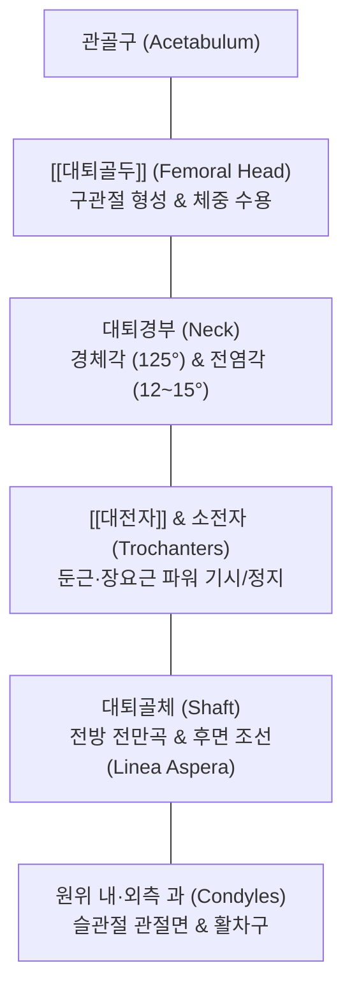
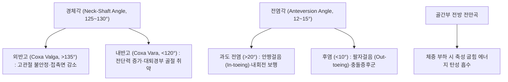

# 🦴 [[대퇴골]] (Femur, 넙다리뼈)

> **핵심 요약 (Key Summary)**:
> 인체에서 가장 길고 두꺼우며 가장 큰 하중을 지탱하는 관상골로, 체중의 수 배에 달하는 기계적 응력을 관골구(Acetabulum)에서 슬관절로 전달하는 하지 운동학의 중심 기둥입니다.
> 근위부의 [[대퇴골두]](Femoral head), 대퇴골경(Femoral neck), [[대전자]](Greater trochanter) 및 소전자, 전방 전만(Anterior bow)을 이루는 골간부(Shaft), 그리고 원위부의 내·외측 과(Condyles)로 구성됩니다.
> 경체각(125~130°)과 전염각(12~15°)의 해부학적 각도가 고관절의 가동성과 안정성을 좌우하며, 대퇴골두 무혈성 괴사(AVN), 노인성 대퇴경부 골절, 대퇴비구 충돌증후군(FAI)의 핵심 병변 구조물이자 환도(GB30)와 풍시(GB31)를 중심으로 한 한의 고관절 질환 치료의 핵심입니다.

---

## 1. 개요 및 해부학적 위치

[[대퇴골]](Femur)은 골반의 관골구와 무릎의 [[경골]] 및 [[슬개골]] 사이에 위치하여 단독으로 대퇴부(Thigh)의 골격을 형성합니다. 성인 신장의 약 1/4을 차지하는 가장 거대한 골격입니다.

기립 시 양측 대퇴골은 직하방으로 수직 주행하지 않고, 넓은 골반에서 무릎 관절을 향해 아래로 갈수록 내측으로 비스듬히 모여드는 생리적 외반각을 형성하여 인체의 무게중심 이동을 최소화합니다.

---

## 2. 골성 지표 및 구조적 특징

대퇴골은 3대 분절과 고유한 각도 기하학을 지닙니다.

| 부위 구분 | 골성 지표명 | 형태학적 특징 및 임상 의의 |
| :--- | :--- | :--- |
| **근위부 (Proximal)** | **[[대퇴골두]] (Head)** | 구형의 2/3 관절면으로 관골구와 고관절 형성; 중심에 대퇴골두와(Fovea) 존재 |
| **근위부 (Proximal)** | **대퇴경부 (Neck)** | 원통형의 잘록한 목으로 체중을 사선으로 분산; 노인 낙상 시 골절의 최호발 부위 |
| **근위부 (Proximal)** | **[[대전자]] (Greater trochanter)** | 외측 상방으로 사각형 돌출; [[중둔근]], [[소둔근]], [[이상근]] 정지 |
| **근위부 (Proximal)** | **소전자 (Lesser trochanter)** | 후내측 원추형 돌기; [[장요근]] 정지, 좌골대퇴 충돌의 경계 |
| **체부 (Shaft)** | **전방 전만곡 (Anterior bow)** | 앞쪽으로 볼록한 유연한 활 모양 만곡으로 축성 충격을 스프링처럼 완충 |
| **체부 (Shaft)** | **조선 (Linea aspera)** | 후면의 거친 두 줄기 능선; 내전근군 및 대퇴사두근의 강력한 건막 부착선 |
| **원위부 (Distal)** | **내·외측 과 (Condyles)** | 후방으로 돌출된 둥근 관절 융기로 경골 관절면과 슬관절 형성 |
| **원위부 (Distal)** | **슬개면 / 활차구 (Trochlea)** | 전면의 매끄러운 고랑으로 슬개골의 관절 연골과 맞물림 |

---

## 3. 부착 근육 및 인대 복합체

대퇴골은 인체에서 가장 강력한 둔근군, 코어 근육군, 대퇴사두근군이 사방에서 부착하는 거대한 근육 플랫폼입니다.

1. **근위부 정지 근육군**:
   - [[중둔근]] & [[소둔근]]: 대전자의 외측면 및 전면에 정지하여 고관절 외전 및 보행 시 골반 수평을 유지합니다.
   - [[이상근]](Piriformis): 대전자 상연에 정지합니다.
   - [[장요근]](Iliopsoas): 소전자에 정지하여 가장 강력한 고관절 굴곡력을 발휘합니다.
   - [[방형대퇴근]]: 대전자간능(Intertrochanteric crest)에 정지합니다.
2. **골간부 기시 및 정지 근육군**:
   - [[대퇴사두근]](중간광근, 내측광근, 외측광근): 대퇴골체 전면 및 조선의 내·외순에서 광범위하게 기시합니다.
   - 하지 내전근군([[장내전근]], [[단내전근]], [[대내전근]]): 조선을 따라 층을 이루며 정지합니다.
   - [[대둔근]]: 둔근조면(Gluteal tuberosity)에 정지합니다.
3. **원위부 기시 근육군**:
   - [[비복근]](Gastrocnemius): 내·외측 과의 상연 후면에서 기시합니다.
   - 슬와근(Popliteus): 외측과 외측면 오목부에서 기시합니다.
4. **주요 인대**:
   - 장대퇴인대(Iliofemoral ligament, Bigelow 인대): 대퇴경부 전면에 부착하여 고관절 과신전을 차단하는 인체 최강의 인대입니다.

---

## 4. 생체역학 및 운동학적 기능

대퇴골의 형태는 체중 부하와 보행 효율을 극대화하기 위해 진화된 정밀한 공학적 기하학 구조를 이룹니다.

1. **경체각 (Angle of Inclination)**:
   - 대퇴골두-경부 축과 골간부 장축이 이루는 각도로 성인 정상은 약 125~130°입니다.
   - 경체각이 감소한 내반고(Coxa vara)는 지렛대 모멘트 암을 늘려 중둔근 효율을 높이지만 대퇴경부에 가해지는 굽힘 전단력(Bending shear)을 급증시킵니다.
2. **전염각 (Anteversion Angle)**:
   - 원위 대퇴과 관절면 축에 대해 대퇴경부가 전방으로 틀어져 있는 각도로 정상은 약 12~15°입니다.
   - 전염각의 이상은 하지 전체의 회전 정렬(Torsional alignment)에 직접적인 영향을 미칩니다.

---

## 5. 임상적 의의 및 관련 질환

1. **대퇴골두 무혈성 괴사 (Avascular Necrosis of Femoral Head, AVN)**:
   - 대퇴경부를 감아 도는 내측대퇴회선동맥의 혈류 장애로 골두 골세포가 괴사하고 관절면이 붕괴되는 심각한 질환입니다. 알코올 과다 섭취, 스테로이드 장기 사용이 주요 유발 인자입니다.
2. **대퇴경부 및 전자간 골절 (Femoral Neck & Intertrochanteric Fracture)**:
   - 골다공증성 노인 낙상의 대표적 골절로, 경부 골절은 관절낭 내 골절로 불유합 및 골두 괴사 위험이 극도로 높습니다.
3. **대퇴비구 충돌증후군 (Femoroacetabular Impingement, FAI)**:
   - 대퇴골두-경부 접합부의 골성 돌출(Cam 병변)로 인해 고관절 굴곡 및 내회전 시 관골구 비구순과 충돌하여 연골 손상을 초래합니다.
4. **대퇴골 간부 골절 (Femoral Shaft Fracture)**:
   - 고에너지 외상(교통사고, 추락)으로 발생하며 대퇴동맥 손상 및 막대한 내출혈(500~1500ml)을 동반할 수 있는 응급 질환입니다.

---

## 6. 이학적 검사 및 감별 진단

1. **패트릭 검사 (Patrick / FABER Test)**:
   - 환자를 앙와위로 두고 환측 고관절을 굴곡(Flexion), 외전(Abduction), 외회전(External Rotation)시켜 족부를 반대측 무릎 위에 얹고 무릎을 하방으로 압박합니다.
   - 서혜부 전면에 통증이 나타나면 대퇴골두 관절염, FAI, 또는 골두 무혈성 괴사를 강력히 시사합니다.
2. **FADIR 검사 (Flexion-Adduction-Internal Rotation Test)**:
   - 고관절을 90° 굴곡, 내전, 내회전시킬 때 서혜부 충돌 통증이 유발되면 Cam형 대퇴비구 충돌 양성입니다.
3. **감별 진단**:
   - **요추 신경근병증(L2-L4)**: 대퇴 전면으로 방산통이 나타나나 고관절 수동 가동 범위는 정상이며 대퇴골 국소 병변이 없습니다.
   - **전자부 점액낭염**: 통증 부위가 서혜부가 아닌 대퇴골 대전자 외측면에 국한되며 직접 압통이 뚜렷합니다.

---

## 7. 한의학적 임상 응용 및 치료

대퇴골 영역은 족소양담경, 족양명위경, 족태음비경, 족궐음간경의 경혈들이 대퇴부를 감싸며 주행하는 한의 하지 치료의 핵심 축입니다.

1. **침구 치료 및 경혈 배오**:
   - **환도(GB30)**: 대전자 후상방 함요처로 대퇴골두 신경 지배를 조절하고 고관절 주변 혈류를 개선하는 절대 요혈입니다.
   - **풍시(GB31)**: 대퇴 외측 정중선, 직립 시 중지 끝이 닿는 장경인대 부위로 하지 풍담(風痰)과 마비성 통증을 치료합니다.
   - **복토(ST32) 및 음시(ST33)**: 대퇴골 전면 대퇴사두근 근막을 이완시켜 슬관절과 고관절 장력을 완화합니다.
   - **혈해(SP10)**: 대퇴골 내측상과 상방 2촌으로 혈액 순환을 촉진하고 관절염 어혈을 배출합니다.
2. **소침도(Acupotomy) 관절강 감압 및 인대 박리술**:
   - 대퇴경부 전면 관절낭 및 장대퇴인대의 만성 구축 부위와 대전자 점액낭 유착부에 침도를 자입하여 섬유화 결절을 박리함으로써 관절 내압을 감압합니다.
3. **추나요법 (Chuna Hip Manipulation)**:
   - **고관절 축성 견인 추나 (Long-axis Hip Traction)**: 환자의 발목을 파지하고 체중을 실어 순간적으로 외하방 견인을 가하여 좁아진 관골구-대퇴골두 간격을 넓혀줍니다.
   - **고관절 회전 관절가동술**: 내회전 및 외회전 제한벽에서 점진적인 수동 회전 운동을 적용하여 관절 가동 범위를 회복시킵니다.
4. **약침 및 한약 치료**:
   - 초기 대퇴골두 무혈성 괴사 및 고관절염에 [[신바로약침]]을 고관절 관절강 심부로 1.0~2.0ml 주입하고, 골세포 괴사를 막고 골형성을 촉진하는 [[독활기생탕]] 또는 [[오적산]] 가감방을 병행 투여합니다.

---

## 8. 참고문헌

* Aghasizade M. (2026). The impact of hip geometrical parameters on muscle and joint biomechanics during normal gait. *Hip Int*. PMID: 42387858

* Zhu JB. (2026). Association of Central Acetabular Osteophytes With Microinstability and Increased Combined Anteversion in Borderline Dysplasia Hips. *Am J Sports Med*. PMID: 42343539

