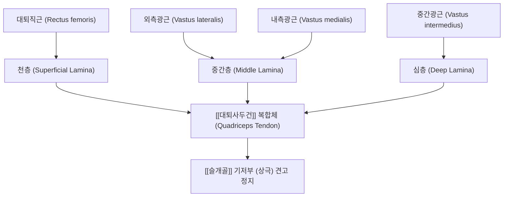
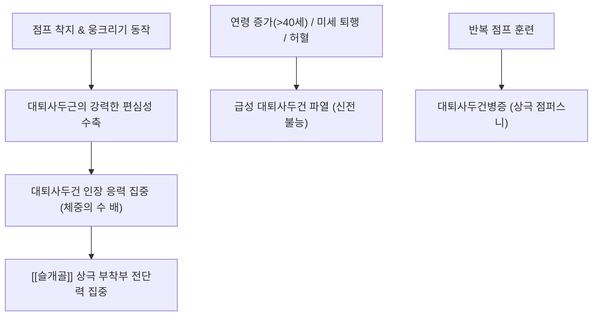

# 🦴 [[대퇴사두건]] (Quadriceps Tendon, 넙다리네갈래근힘줄)

> **핵심 요약 (Key Summary)**:
> 대퇴 전면의 4개 강력한 근육군([[대퇴직근]], [[외측광근]], [[내측광근]], [[중간광근]])이 슬관절 직상방에서 융합되어 [[슬개골]](Patella) 상극(Superior pole)에 부착하는 인체 최강의 건성 복합체입니다.
> 천층(대퇴직근), 중간층(내·외측광근), 심층(중간광근)의 정밀한 3층 판상 라미나(Laminae) 구조를 형성하며, 심부의 슬개상 점액낭(Suprapatellar bursa) 및 슬관절낭과 밀접하게 결합합니다.
> 점프 및 착지 동작의 반복적 과부하로 인한 대퇴사두건병증(Quadriceps tendinopathy, 상극형 점퍼스니)과 40세 이상 남성에서 호발하는 급성 대퇴사두건 완전 파열의 주 발생 부위이며, 학정혈(EX-LE2)과 양구혈(ST34)을 중심으로 한 침도 박리 및 약침 치료의 핵심 표적입니다.

---

## 1. 개요 및 해부학적 위치

[[대퇴사두건]](Quadriceps tendon)은 대퇴 원위부 전면에서 슬개골 상연까지 이어지는 길이 약 4~6cm, 두께 약 6~8mm, 폭 약 3~4cm의 매우 넓고 두꺼운 건 복합체입니다.

슬개골 상극에 단단히 정지한 후, 천층의 일부 건막 섬유는 슬개골 전면을 타고 내려가 [[슬개건]](슬개인대) 및 [[경골조면]]으로 직접 연결되어 슬관절 신전 기구(Extensor mechanism)의 연속성을 완성합니다.

---

## 2. 골성 지표 및 구조적 특징

대퇴사두건은 단순한 단일 건이 아니라 3개의 뚜렷한 판상 층(Trilaminar structure)으로 조직화되어 있습니다.

| 구조 층위 | 기원 근육군 | 주행 및 형태학적 특징 | 부착 부위 |
| :--- | :--- | :--- | :--- |
| **천층 (Superficial layer)** | [[대퇴직근]](Rectus femoris) | 가장 앞쪽의 얇고 단단한 건 섬유판 | 슬개골 상극 전면 및 일부 섬유는 슬개골 전면을 통과 |
| **중간층 (Middle layer)** | [[내측광근]] & [[외측광근]] | 좌우에서 사선으로 모여드는 가장 두꺼운 건 복합판 | 슬개골 상극 중앙 기저부 |
| **심층 (Deep layer)** | [[중간광근]](Vastus intermedius) | 가장 심부에서 직하방으로 주행하는 순수 건판 | 슬개골 상극 후연 및 관절낭 활액막 경계 |
| **슬개상 점액낭 (Suprapatellar bursa)** | 관절강과 직접 연통 | 대퇴사두건 심층과 대퇴골 하단 골막 사이에 위치 | 대퇴사두건 활주 시 마찰 방지 및 완충 |

이러한 삼중 적층 구조는 무릎의 굴곡 각도에 따라 각 광근이 독립적인 수축 방향과 장력을 조절할 수 있는 생체역학적 유연성을 보장합니다.

---

## 3. 부착 근육 및 인대 복합체

대퇴사두건은 슬관절을 펴고 체중 부하를 수용하는 하지 전면 근육군의 총합체입니다.

1. **구성 근육군과 힘의 벡터**:
   - **대퇴직근**: 2관절 근육(고관절 굴곡 + 슬관절 신전)으로 수직 상방의 신전 벡터를 담당합니다.
   - **외측광근**: 대퇴골 외측에서 기시하여 슬개골을 상외측으로 견인합니다.
   - **내측광근 (특히 VMO, 내측광근 사두섬유)**: 슬개골 상내측에 약 50~55° 사선으로 부착하여 슬개골이 외측으로 아탈구되는 것을 막는 핵심 동적 안정자입니다.
   - **중간광근**: 대퇴골 전면에서 직접 수직으로 당겨 완전 신전의 마지막 토크를 지탱합니다.
2. **지대 및 보조 인대 결합**:
   - 내·외측 슬개지대(Patellar retinacula): 대퇴사두건의 외측 및 내측 섬유가 슬개골 양옆으로 확장되어 관절낭을 보강하고 슬개골 트래킹(Tracking)을 제어합니다.

---

## 4. 생체역학 및 운동학적 기능

대퇴사두건은 보행, 달리기, 점프 시 발생하는 폭발적인 장력을 슬개골 종자골 도르래로 전달합니다.

1. **도르래 전달 효율 (Pulley Efficiency)**:
   - 슬개골이 관절 중심에서 지렛대 팔(Lever arm)을 들어 올려 줌으로써, 대퇴사두건이 슬관절을 펴는 데 필요한 힘의 효율을 약 30~50% 증가시킵니다.
2. **굴곡 각도별 하중 이동**:
   - 무릎 굴곡 30~60° 구간에서 대퇴사두건의 중간층과 천층에 최대 장력이 걸리며, 90° 이상 심굴곡 시에는 대퇴사두건이 대퇴골 활차구와 접촉(Wrenching effect)하여 압박 응력이 급증합니다.

---

## 5. 임상적 의의 및 관련 질환

1. **대퇴사두건병증 (Quadriceps Tendinopathy, 상극형 점퍼스니)**:
   - 배구, 농구, 역도 선수 등에게 호발하며, 슬개골 상극 부착부(Enthesis)에 반복적인 과부하로 인한 미세 파열과 혈관 증식 및 점액성 퇴행이 발생하는 질환입니다.
   - 무릎을 완전히 굽히거나 계단을 오를 때 슬개골 상연 바로 윗부분에 날카로운 압통이 발생합니다.
2. **급성 대퇴사두건 완전 파열 (Quadriceps Tendon Rupture)**:
   - 주로 40세 이상의 중장년 남성에게 호발하며, 계단을 헛디디거나 넘어지면서 무릎이 급격히 굴곡될 때 건이 슬개골 상극 골 부착부에서 완전히 뜯겨 나가는 응급 질환입니다.
   - 환자는 즉시 "뚝" 하는 파열음과 함께 주저앉으며, **슬관절 능동 완전 신전이 불가능(Loss of active extension)**해지고 슬개골 상부에 손가락이 쑥 들어가는 결손 함요(Sulcus sign)가 관찰됩니다.
3. **슬개상 점액낭염 (Suprapatellar Bursitis)**:
   - 대퇴사두건 심부의 점액낭에 관절염이나 외상으로 삼출액이 가득 차 슬개골 상방이 물주머니처럼 부풀어 오르는 병변입니다.

---

## 6. 이학적 검사 및 감별 진단

1. **하지 직거상 불능 검사 (Extensor Lag / Inability to SLR)**:
   - 환자를 앙와위로 눕히고 무릎을 편 채 다리를 공중으로 들어 올리도록 지시합니다.
   - 대퇴사두건이 완전 파열된 환자는 고관절은 약간 굴곡시킬 수 있으나 무릎이 아래로 꺾이며 다리를 전혀 들어 올리지 못합니다.
2. **슬개골 상극 직접 압통 검사**:
   - 슬개골 상연의 대퇴사두건 골 부착부를 엄지손가락으로 하방 압박하며 환자에게 대퇴사두근을 가볍게 수축시키도록 할 때 심한 통증이 재현되면 건병증 양성입니다.
3. **감별 진단**:
   - **슬개건 파열(Patellar Tendon Rupture)**: 40세 미만 젊은 층에서 호발하며, 방사선 검사상 슬개골이 상방으로 딸려 올라가는 고위 슬개골(Patella alta)을 보이는 반면, 대퇴사두건 파열은 저위 슬개골(Patella baja)을 보입니다.
   - **슬개하 건병증(전형적 점퍼스니)**: 압통점이 슬개골 상극이 아닌 슬개골 하극(Inferior pole)에 위치합니다.

---

## 7. 한의학적 임상 응용 및 치료

대퇴사두건 영역은 족양명위경(足陽明胃經)과 족태음비경(足太陰脾經)의 경혈들이 슬관절 상단에서 만나는 핵심 진단 및 치료점입니다.

1. **침구 치료 및 경혈 배오**:
   - **학정(EX-LE2)**: 슬개골 상연 정중앙 함요처로 대퇴사두건의 중심 부착부를 직접 관통하여 건-골 접합부의 허혈을 개선합니다. 사자(Oblique needling)로 슬개골 상연을 향해 45° 각도로 자입합니다.
   - **양구(ST34)**: 슬개골 외상각 상방 2촌으로 위경의 극혈(郄穴)이며 급성 무릎 통증과 대퇴사두건 외측광근 긴장을 즉각 진정시킵니다.
   - **혈해(SP10)**: 슬개골 내상각 상방 2촌으로 내측광근(VMO)의 약화를 보강하고 혈행을 촉진합니다.
2. **소침도(Acupotomy) 건막 박리 및 감압술**:
   - 만성 대퇴사두건병증으로 슬개골 상극에 골극이 형성되거나 건 부착부가 비후 섬유화된 경우, 침도를 슬개골 상연 골막에 밀착시켜 종방향으로 유착을 박리함으로써 건 내압을 낮추고 자가 치유 반응을 유도합니다.
3. **추나요법 (Chuna Extensor Mechanism Protocol)**:
   - **대퇴사두근 편심성 수축-이완 기법 (PIR MET)**: 단축된 대퇴직근과 중간광근을 단계적으로 신장시켜 대퇴사두건 부착부로 가해지는 기계적 장력을 차단합니다.
   - **슬개골 하방 활주 추나**: 슬개골의 정상적인 하방 미끄러짐을 유도하여 굴곡 시 건의 압박 마찰을 제거합니다.
4. **약침 치료**:
   - 대퇴사두건 상극 부착부 및 슬개상 점액낭에 [[신바로약침]] 또는 [[봉약침]]을 0.5~1.0ml 주입하여 만성 건염증을 억제하고 건 섬유의 콜라겐 리모델링을 촉진합니다.

---

## 8. 참고문헌

* Cretu A. (2026). Structural and Functional Principles in Quadriceps Reconstruction. *Muscles*. PMID: 42347482
* Rincón GA. (2026). Revision anterior cruciate ligament reconstruction using an autogenous quadriceps tendon graft is associated with substantial improvement in patient-reported outcomes. *J ISAKOS*. PMID: 41881264
