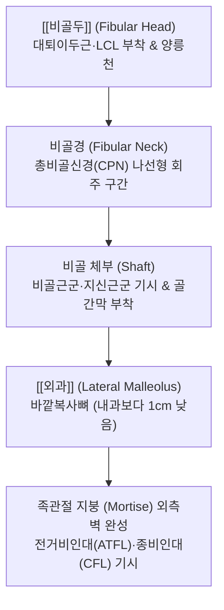
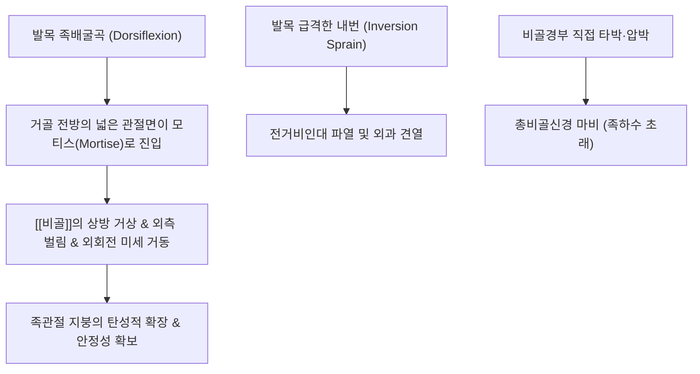

# 🦴 [[비골]] (Fibula, 종아리뼈)

> **핵심 요약 (Key Summary)**:
> 하퇴(Lower leg)의 외측에 평행하게 위치하는 가늘고 긴 보조 관상골로, 직접적인 체중 부하(약 10~15%만 분담)보다는 하퇴 및 족부 근육들의 부착면 제공과 족관절의 외측 안정벽 구축을 전담하는 골격입니다.
> [[비골두]](Fibular head), 비골경(Fibular neck), 골간부(Shaft), 그리고 경골 내과보다 약 1cm 더 길게 하방 돌출되어 발목의 과도한 외번을 뼈 자체로 저지하는 [[외과]](Lateral malleolus)로 구성됩니다.
> 비골경을 감아 도는 [[총비골신경]](Common peroneal nerve)의 표층 주행으로 인한 신경 포착 및 족하수(Foot drop), 족관절 내번 염좌 시의 전거비인대(ATFL) 파열과 비골 견열 골절, 메종뇌브 골절(Maisonneuve fracture)의 핵심 병변 구조물이며, 근회(筋會)인 양릉천(GB34)과 수회(髓會)인 현종(GB39)을 잇는 족소양담경의 중심 골성 기저입니다.

---

## 1. 개요 및 해부학적 위치

[[비골]](Fibula)은 하퇴 외측에서 [[경골]](Tibia)과 나란히 주행하며, 상단은 근위 경비관절을 통해 경골 외측과 후외측면과 만나고, 하단은 원위 경비인대결합(Syndesmosis)을 통해 경골 원위 비골절흔과 단단히 결합합니다.

비골 자체는 슬관절 형성에는 참여하지 않지만, 족관절(Ankle joint)에서는 거골의 외측면을 단단히 받쳐주는 외측 기둥(Lateral column) 역할을 수행합니다.

---

## 2. 골성 지표 및 구조적 특징

비골은 상단, 체부, 하단에 걸쳐 명확한 해부학적 지표를 형성합니다.

| 부위 구분 | 골성 지표명 | 형태학적 특징 | 부착 구조물 및 임상 의의 |
| :--- | :--- | :--- | :--- |
| **근위부 (Proximal)** | **[[비골두]] (Head)** | 둥글고 두꺼운 근위 말단 | [[대퇴이두근]] 건, 슬관절 외측측부인대(LCL) 부착 |
| **근위부 (Proximal)** | **비골두 첨부 (Apex/Styloid)** | 비골두 상후방의 뾰족한 돌기 | 궁상슬와인대(Arcuate popliteal lig.) 부착 |
| **근위부 (Proximal)** | **비골경 (Neck)** | 비골두 바로 아래의 잘록한 부위 | **총비골신경이 뼈를 직접 감아 돌며 주행** (압박 마비 취약지) |
| **체부 (Shaft)** | **골간연 (Interosseous border)** | 경골을 마주 보는 날카로운 내측 모서리 | 하퇴 골간막(Interosseous membrane) 단단히 부착 |
| **원위부 (Distal)** | **[[외과]] (Lateral malleolus)** | 피하에 돌출된 바깥쪽복사뼈 | 내과보다 약 1cm 하방 돌출 (외번 억제), 관절면 제공 |
| **원위부 (Distal)** | **외과와 (Malleolar fossa)** | 외과 내측 관절면 후방의 깊은 패임 | 후거비인대(PTFL) 및 횡인대 부착 |

---

## 3. 부착 근육 및 인대 복합체

비골은 발목과 발가락을 움직이는 8개 이상의 강력한 근육들이 빼곡하게 기시하고 정지하는 근육 지지대입니다.

1. **정지 근육 (슬관절 외측 안정화)**:
   - [[대퇴이두근]](Biceps femoris): 비골두 첨부에 강력하게 정지하여 슬관절 굴곡 및 하퇴 외회전을 조절합니다.
2. **기시 근육군 (외측 구획 - 발목 외번)**:
   - [[장비골근]](Peroneus longus): 비골두 및 비골 외측면 상부 2/3에서 기시하여 족저를 횡단하여 제1중수골 기저부에 정지합니다.
   - [[단비골근]](Peroneus brevis): 비골 외측면 하부 2/3에서 기시하여 제5중수골 조면에 정지합니다.
3. **기시 근육군 (전방 구획 - 발목 족배굴곡 및 발가락 신전)**:
   - [[장지신근]](Extensor digitorum longus): 비골 전내측면 상부 3/4에서 기시합니다.
   - 장모지신근(Extensor hallucis longus): 비골 전면 중앙부 1/2에서 기시합니다.
   - 제3비골근(Peroneus tertius): 비골 전면 하부 1/3에서 기시합니다.
4. **기시 근육군 (후방 구획 - 발목 족저굴곡)**:
   - [[후경골근]](Tibialis posterior): 비골 후면 내측부에서 기시합니다.
   - [[가자미근]](Soleus): 비골두 후면 및 상부 1/4에서 기시합니다.
5. **외측 족관절 인대 복합체**:
   - 전거비인대(ATFL), 종비인대(CFL), 후거비인대(PTFL)가 외과에서 기시하여 족관절의 전후방 및 내번 전위를 차단합니다.

---

## 4. 생체역학 및 운동학적 기능

비골은 유연한 미세 가동성(Micro-mobility)을 통해 족관절 천정의 용적을 조절하고 충격을 완충합니다.

1. **원위 비골의 동적 모티스 조절 (Ankle Mortise Adaptation)**:
   - 거골의 관절면은 앞쪽이 뒤쪽보다 약 4~5mm 더 넓습니다. 발목이 족배굴곡될 때 비골은 외측으로 약간 벌어지고 상방으로 미끄러져 올라가며(약 1~2mm), 약간 외회전하여 거골을 부드럽게 수용합니다.
2. **외과의 골성 외번 차단 (Bony Buttress)**:
   - 외과가 내과보다 1cm 더 길게 내려와 있어 거골이 외측으로 미끄러지는 외번 탈구를 해부학적으로 원천 차단합니다.

---

## 5. 임상적 의의 및 관련 질환

1. **비골경부 압박과 족하수 (Common Peroneal Nerve Palsy & Foot Drop)**:
   - 비골경을 감아 도는 총비골신경은 피하지방이 매우 얇아 다리를 꼬고 앉거나, 수술 중 측와위 압박, 또는 비골두 골절 시 쉽게 압박 마비됩니다.
   - [[전경골근]]과 비골근군이 마비되어 발목을 위로 젖히지 못해 걸을 때 발끝이 바닥에 끌리는 **계상 보행(Steppage gait)**과 족배부 감각 마비가 발생합니다.
2. **발목 외측 인대 염좌 및 외과 견열 골절**:
   - 발목이 안쪽으로 꺾이는 내번 손상 시 외과에 부착된 전거비인대(ATFL)가 파열되거나, 인대가 뼈를 물고 떨어지는 외과 첨부 견열 골절이 발생합니다.
3. **메종뇌브 골절 (Maisonneuve Fracture)**:
   - 족관절의 심한 외회전-회외 손상 시 원위 경비인대결합과 삼각인대가 파열되면서 충격파가 골간막을 찢고 상방으로 전파되어 **비골 근위부 1/3(비골경 및 비골두 인접부)에 골절**을 일으키는 복합 손상입니다.
4. **근위 경비관절 불안정성 및 신경절 낭종 (Ganglion Cyst)**:
   - 근위 경비관절의 활액막에서 발생한 낭종이 비골경부를 통과하는 총비골신경을 기계적으로 압박하여 신경 마비를 유발할 수 있습니다.

---

## 6. 이학적 검사 및 감별 진단

1. **티넬 징후 (Tinel's Sign at Fibular Neck)**:
   - 비골경 외측면을 검사자의 손가락 끝이나 진찰용 망치로 가볍게 타진합니다.
   - 족배부 및 외측 하퇴부로 찌릿한 전기 방산통이나 감각 이상이 재현되면 총비골신경 포착 양성입니다.
2. **전방 인발 검사 (Anterior Drawer Test)**:
   - 발목을 20° 족저굴곡시킨 상태에서 경골 하단을 고정하고 종골을 전방으로 잡아당겨 외과와 거골 사이의 전방 전위 및 이완감을 측정합니다 (전거비인대 파열 판정).
3. **감별 진단**:
   - **L5 요추 신경근병증(L5 Radiculopathy)**: 족하수가 동반될 수 있으나 족관절 내번근인 [[후경골근]]까지 마비되고 요통 및 하지 직거상 검사(SLR) 양성을 보이는 반면, 순수 비골신경 마비는 내번 근력(경골신경 지배)은 정상 보존됩니다.
   - **비골 골간부 스트레스 골절**: 러너에게 발생하며 외과 상방 5~7cm 비골 능선에 명확한 국소 골성 압통이 나타납니다.

---

## 7. 한의학적 임상 응용 및 치료

비골 외측면 전 구간은 족소양담경(足少陽膽經)이 주행하는 핵심 통로로 한의 근골격계 치료의 핵심 경혈들이 연속 배치되어 있습니다.

1. **침구 치료 및 핵심 경혈**:
   - **양릉천(GB34)**: 비골두 전하방 함요처로 담경의 합혈이자 팔회혈 중 **근회(筋會)**입니다. 전신 근육과 힘줄 질환, 비골신경 마비 및 족하수의 필수 취혈점입니다.
   - **광명(GB37)**: 외과 첨부 상방 5촌, 비골 전연으로 담경의 낙혈(絡穴)입니다. 하퇴 외측 감각 이상을 개선합니다.
   - **양보(GB38)**: 외과 첨부 상방 4촌, 비골 전연으로 담경의 경화혈(經火穴)입니다.
   - **현종(GB39, 절골 絶骨)**: 외과 첨부 상방 3촌, 비골 후연 함요처로 팔회혈 중 **수회(髓會)**입니다. 족관절 마비, 중풍 편마비, 비골 주위 신경통의 주혈입니다.
   - **구허(GB40)**: 외과 전하방 함요처로 발목 염좌의 최고 요혈입니다.
2. **소침도(Acupotomy) 비골경 터널 감압술**:
   - 비골경부를 통과하는 장비골근 기시부의 섬유성 아치(Peroneal tunnel)가 비후되어 총비골신경을 누르는 경우, 신경 주행을 피해 터널의 상연 섬유대를 침도로 미세 절개하여 신경 압박을 즉각 감압합니다.
3. **추나요법 (Chuna Fibular Mobilization)**:
   - **근위 비골두 전후방 활주 기법 (Fibular Head AP/PA Glide)**: 무릎을 굴곡시킨 상태에서 시술자의 모지구로 비골두를 전하방 및 후상방으로 글라이딩시켜 슬관절 및 족관절 가동성을 회복시킵니다.
   - **원위 외과 거골 맞춤 추나**: 발목 염좌 후 후방 전위된 외과를 전방으로 교정 추진합니다.
4. **약침 및 한약 치료**:
   - 비골신경 마비 부위 및 족관절 외측 인대 손상부에 신경 재생과 어혈 제거를 유도하는 [[신바로약침]] 또는 [[자하거약침]]을 0.5~1.0ml 주입하며, 신경 마비 회복을 촉진하는 [[보양환오탕]] 또는 [[당귀수산]]을 병행 투여합니다.

---

## 8. 참고문헌

* Amaral Oliveira L. (2025). Common Peroneal Nerve Palsy Due to a Proximal Tibiofibular Joint Ganglion Cyst in a Recreational Runner: A Case Report. *Cureus*. PMID: 41158911
* Baima J. (2008). Evaluation and treatment of peroneal neuropathy. *Curr Rev Musculoskelet Med*. PMID: 19468889
