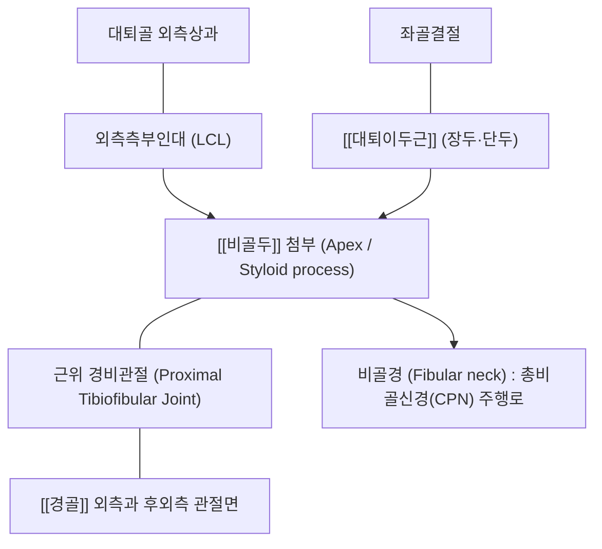
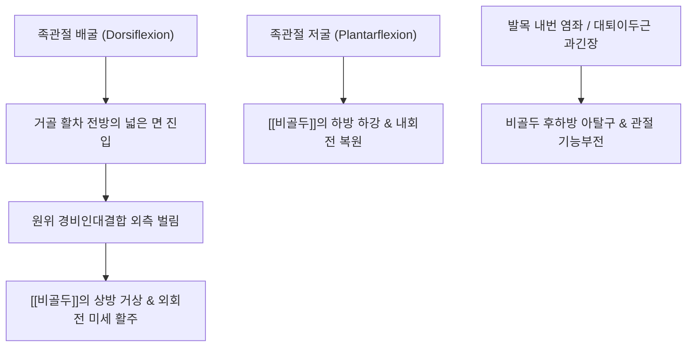

# 🦴 [[비골두]] (Head of Fibula, 종아리뼈머리)

> **핵심 요약 (Key Summary)**:
> 하퇴 외측 [[비골]](Fibula)의 근위부 팽대부로, [[경골]](Tibia) 외측과 후하면과 함께 활액성 평면관절인 근위 경비관절(Proximal tibiofibular joint, PTFJ)을 형성하는 주요 골성 랜드마크입니다.
> [[대퇴이두근]]건과 슬관절 외측측부인대(LCL)가 부착하여 슬관절의 외측 안정성을 지지하며, 바로 아래 비골경부(Fibular neck)를 감아 도는 [[총비골신경]](Common peroneal nerve)의 표재 주행으로 인해 압박성 신경병증([[족하수]]) 및 견인 손상이 호발합니다.
> 근위 경비관절의 기능이상(전외측 또는 후내측 아탈구)은 슬관절 외측 통증과 족관절 배굴 제한을 초래하며, 근회(筋會)인 양릉천(GB34)을 중심으로 한 소침도 신경 감압술 및 비골두 전후방 활주 추나의 핵심 표적입니다.

---

## 1. 개요 및 해부학적 위치

[[비골두]](Head of fibula)는 슬관절 외측 하방 약 2~3cm 지점에서 피부 바로 아래로 둥글게 촉진되는 비골의 근위 말단 팽대부입니다.

비골두 상면의 타원형 평활 관절면은 경골 외측과의 후하방 관절면과 맞물려 관절낭과 활액막으로 둘러싸인 근위 경비관절을 형성합니다. 정상인의 약 10%에서는 이 관절강이 슬관절강과 직접 연통되어 관절염의 파급 경로가 되기도 합니다.

---

## 2. 골성 지표 및 구조적 특징

비골두는 여러 인대와 강력한 근육이 집결하기 위해 복잡한 골성 돌기 구조를 지닙니다.

| 골성 지표명 | 형태학적 특징 | 부착 구조물 및 임상 의의 |
| :--- | :--- | :--- |
| **비골두 첨부 (Apex / Styloid)** | 비골두 상후방으로 뾰족하게 솟아오른 원추형 돌기 | 궁상슬와인대(Arcuate popliteal lig.) 및 [[대퇴이두근]] 건막 부착 |
| **근위 경비관절면 (Articular facet)** | 비골두 상내측의 둥근 평면 관절 연골면 | 경골 외측과 관절면과 맞물려 전후/상하 미세 활주 허용 |
| **비골경 (Fibular neck)** | 비골두 바로 아래의 잘록한 뼈 원통부 | [[총비골신경]]이 골막에 밀착하여 나선형 주행 (압박 마비 취약지) |
| **비골근 결절 및 능선** | 비골두 전외측면의 거친 능선 | [[장비골근]] 및 [[장지신근]] 기시부 형성 |
| **후면 부착능선** | 비골두 후하방의 거친 골면 | [[가자미근]] 외측두 기시부 |

---

## 3. 부착 근육 및 인대 복합체

비골두는 슬관절과 발목을 잇는 장력 사슬의 핵심 결절점입니다.

1. **정지 근육군**:
   - [[대퇴이두근]](Biceps femoris): 장두와 단두가 합쳐진 강력한 연합건이 비골두 첨부와 외측면에 정지하여 슬관절 굴곡과 하퇴 외회전을 조절합니다.
2. **기시 근육군**:
   - [[장비골근]](Peroneus longus): 비골두 외측면과 비골 상부에서 기시하여 발목 외번 및 족저굴곡을 유도합니다.
   - [[장지신근]](Extensor digitorum longus): 비골두 전내측면에서 기시합니다.
   - [[가자미근]](Soleus): 비골두 후면에서 기시하여 하퇴 삼두근 복합체를 완성합니다.
3. **인대 복합체**:
   - **외측측부인대(LCL)**: 대퇴골 외측상과에서 비골두 외측 중앙부로 연결되는 삭상(Cord-like) 인대로 무릎의 내반(Varus) 변형을 차단합니다.
   - **전·후근위경비인대(Anterior/Posterior PTF ligaments)**: 경골과 비골두를 전후방에서 견고히 묶어주는 인대 복합체입니다.

---

## 4. 생체역학 및 운동학적 기능

비골두는 족관절의 거골 움직임에 맞추어 상하·전후로 동적 미세 조절되는 '완충 서스펜션'입니다.

1. **거퇴관절-근위 경비관절 연동 운동**:
   - 발목을 족배굴곡시킬 때 거골의 넓은 전방부가 모티스(Mortise)로 진입하면서 원위 비골이 벌어지고, 연동 작용으로 비골두는 전외측 상방으로 미세하게 거상·외회전됩니다.
   - 반대로 족저굴곡 시에는 비골두가 후내측 하방으로 내려옵니다.
2. **슬관절 내반 부하 저항**:
   - 보행 시 무릎이 바깥쪽으로 벌어지려는 내반 스트레스에 대항하여 대퇴이두근과 LCL이 협력하여 비골두를 단단히 견인 고정합니다.

---

## 5. 임상적 의의 및 관련 질환

1. **총비골신경 포착 증후군 (Common Peroneal Neuropathy, 비골터널 증후군)**:
   - 비골두 후하방 경부를 감아 도는 [[총비골신경]]이 장비골근 기시부 섬유성 건궁(Fibrous arch)에 의해 눌리거나, 깁스 압박, 다리 꼬기, 수술 중 압박으로 손상됩니다.
   - [[전경골근]] 마비로 인한 [[족하수]](Foot drop, 계상 보행)와 족배부 감각 소실이 나타납니다.
2. **근위 경비관절 아탈구 및 기능부전 (PTFJ Instability)**:
   - 발목의 심한 내번 염좌나 축구 킥 중 대퇴이두근의 급격한 견인으로 비골두가 후하방으로 변위되어 고착됩니다. 슬관절 외측의 만성 통증과 쪼그려 앉기 제한이 발생합니다.
3. **근위 경비관절 결절종 (PTFJ Ganglion Cyst)**:
   - 관절낭에서 기원한 점액성 낭종이 비골두 주변으로 증식하여 총비골신경을 기계적으로 압박해 족하수를 유발할 수 있습니다.

---

## 6. 이학적 검사 및 감별 진단

1. **비골두 전후방 가동성 검사 (PTFJ AP Glide Test)**:
   - 환자의 무릎을 90° 굴곡시킨 상태에서 검사자가 한 손으로 경골을 고정하고 다른 손의 엄지와 검지로 비골두를 파지하여 전방 및 후방으로 흔들어 봅니다.
   - 건측에 비해 과도한 유동성(Hypermobility)이나 날카로운 통증이 유발되면 관절 불안정성 양성입니다.
2. **티넬 징후 (Tinel's Sign at Fibular Neck)**:
   - 비골경부를 가볍게 타진할 때 족배부와 엄지발가락으로 방산되는 저림증을 확인합니다.
3. **감별 진단**:
   - **외측 반월상연골 파열**: 관절선 자체의 압통과 McMurray 검사 양성을 보이며 비골두 가동성과는 무관합니다.
   - **L5 요추 신경근병증**: 족하수가 나타나더라도 족관절 내번근인 [[후경골근]]까지 마비되고 요통이 동반되나, 순수 비골두 부위 신경 포착은 족관절 내번 근력이 정상 유지됩니다.

---

## 7. 한의학적 임상 응용 및 치료

비골두 주변은 족소양담경(足少陽膽經)의 기혈이 슬관절 외측으로 모여드는 최고 요혈인 양릉천(GB34)의 중심 골성 기저입니다.

1. **침구 치료 및 핵심 경혈**:
   - **양릉천(GB34)**: 비골두 전하방 함요처로 담경의 합혈이자 팔회혈 중 **근회(筋會)**입니다. 전신 근육과 힘줄의 경결, 총비골신경 마비, 슬관절 외측통의 주혈입니다.
   - **슬양관(GB33)**: 비골두 상방, 대퇴골 외측상과 외측 함요처로 LCL과 대퇴이두근 부착부 긴장을 해소합니다.
2. **소침도(Acupotomy) 비골터널 감압술**:
   - 장비골근 기시부의 비후된 섬유성 아치로 인해 총비골신경이 압박된 경우, 신경 주행을 촉진하여 확인한 후 비골경 골막 상연의 횡주 섬유대를 침도로 미세 절개하여 신경 주위 압력을 즉각 차단합니다.
3. **추나요법 (Chuna PTFJ Mobilization)**:
   - **비골두 전방/후방 활주 교정술**: 무릎을 굴곡시킨 상태에서 시술자의 수근부로 후하방으로 편위된 비골두를 전상방으로 순간 추진(Thrust)하여 근위 경비관절의 관절 유동성을 복원하고 족관절 가동 범위를 정상화합니다.
4. **약침 치료**:
   - 총비골신경 포착 부위 및 근위 경비관절강에 [[신바로약침]] 또는 [[자하거약침]]을 0.5~1.0ml 주입하여 신경 부종을 가라앉히고 축삭 재생을 촉진합니다.

---

## 8. 참고문헌

* Patel R. (2026). Isolated Proximal Tibiofibular Joint Reconstruction With Semitendinosus Tendon Autograft in a Collegiate Athlete. *Video J Sports Med*. PMID: 42460293

* Amaral Oliveira L. (2025). Common Peroneal Nerve Palsy Due to a Proximal Tibiofibular Joint Ganglion Cyst in a Recreational Runner: A Case Report. *Cureus*. PMID: 41158911
