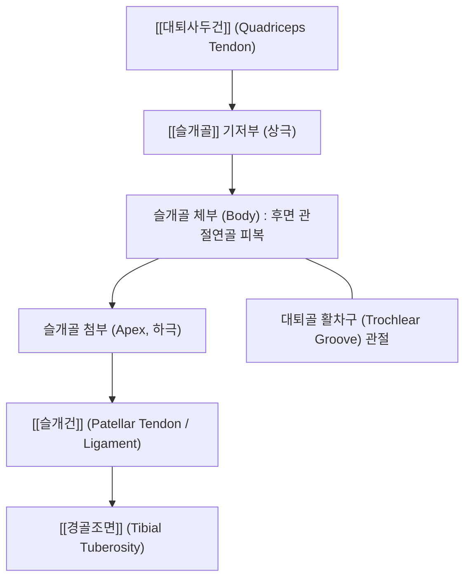
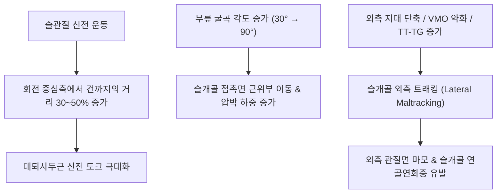

# 🦴 [[슬개골]] (Patella, 무릎뼈)

> **핵심 요약 (Key Summary)**:
> 인체에서 가장 큰 종자골(Sesamoid bone)로, [[대퇴사두건]] 내에 위치하여 대퇴골 활차구(Trochlea)와 함께 슬개대퇴관절(Patellofemoral joint, PFJ)을 구성합니다.
> 대퇴사두근의 신전 지렛대 모멘트 암을 들어 올려 신전 효율을 약 30~50% 증강시키는 도르래 역할을 수행하며, 후면은 두꺼운 유리연골(최대 5~6mm)로 피복되어 막대한 압박 응력을 흡수합니다.
> 슬개골 외측 트래킹 이상으로 인한 슬개대퇴 통증증후군(PFPS), 슬개골 연골연화증, 외측 탈구 및 아탈구의 핵심 발생 부위이며, 학정(EX-LE2), 양구(ST34), 내외슬안을 표적으로 하는 슬개골 가동화 추나와 침도·약침 치료의 주 표적입니다.

---

## 1. 개요 및 해부학적 위치

[[슬개골]](Patella)은 슬관절 전면에 위치하는 역삼각형 모양의 편평한 뼈로, 기저부(Base)는 상방을 향하고 첨부(Apex)는 하방을 향합니다.

슬개골은 대퇴사두근 건막과 슬개건 사이에 완전히 매몰되어 있는 종자골로, 관절 운동 시 대퇴골 활차구를 따라 상하 약 7~8cm, 좌우 및 회전 미세 운동을 수행합니다.

---

## 2. 골성 지표 및 구조적 특징

슬개골은 전면의 피하 활면과 후면의 복잡한 관절 연골면으로 구분됩니다.

| 골성 지표명 | 형태학적 특징 | 부착 구조물 및 임상 의의 |
| :--- | :--- | :--- |
| **슬개골 기저부 (Base / 상극)** | 상방을 향하는 넓고 두꺼운 수평 골연 | [[대퇴사두건]](Trilaminar plate) 정지 |
| **슬개골 첨부 (Apex / 하극)** | 하방을 향하는 뾰족한 아래쪽 모서리 | [[슬개건]](슬개인대) 기시, 신딩-라르센-요한슨병 호발 |
| **전면 (Anterior surface)** | 약간 볼록하고 세로 줄무늬가 있는 거친 골면 | 피하 슬개전 점액낭 위치, 무릎 꿇을 때 완충 작용 |
| **후면 외측 관절면 (Lateral facet)** | 수직 능선 바깥쪽의 넓고 오목한 면 | 대퇴골 외측과와 관절, 전체 관절면의 약 60% 차지 (하중 집중) |
| **후면 내측 관절면 (Medial facet)** | 수직 능선 안쪽의 좁고 편평한 면 | 대퇴골 내측과와 관절 |
| **오드 면 (Odd facet)** | 내측 관절면 최내측의 작은 부면 | 완전 굴곡(>135°) 시에만 대퇴골 내측과와 접촉 |

슬개골 후면 관절 연골은 인체에서 가장 두꺼운(5~6mm) 층을 이루어 웅크릴 때 체중의 6~8배에 달하는 압박 하중을 지탱합니다.

---

## 3. 부착 근육 및 인대 복합체

슬개골은 사방에서 당기는 근육과 지대 인대들에 의해 중심 정렬을 유지합니다.

1. **상하 신전 사슬**:
   - 상극: [[대퇴직근]], [[외측광근]], [[내측광근]], [[중간광근]]의 연합 건막이 정지합니다.
   - 하극: [[슬개건]]이 기시하여 [[경골조면]]에 부착합니다.
2. **좌우 지대 복합체 (Retinacular System)**:
   - **내측 슬개대퇴인대(MPFL)**: 슬개골 내측연과 대퇴골 내측상과를 연결하는 핵심 인대로 슬개골이 외측으로 탈구되는 것을 막는 주된 수동 안정자(약 50~60% 담당)입니다.
   - **내측광근 사두섬유(VMO)**: 슬개골 내측 상연에 사선(50~55°)으로 부착하여 수축 시 슬개골을 안쪽으로 잡아당기는 동적 제어기입니다.
   - **외측 지대(Lateral retinaculum)**: 장경인대 및 외측광근 건막과 결합되어 있으며, 단축 시 슬개골을 바깥쪽으로 기울어지게(Tilt) 만듭니다.

---

## 4. 생체역학 및 운동학적 기능

슬개골은 대퇴사두근의 기계적 지렛대 팔(Lever arm)을 증폭시키는 핵심 도르래입니다.

1. **지렛대 팔 증강 효과 (Moment Arm Amplification)**:
   - 슬개골이 없는 무릎(슬개골 절제술 후)은 동일한 신전력을 내기 위해 대퇴사두근이 약 30~50% 더 강하게 수축해야 합니다.
2. **굴곡 각도에 따른 관절 접촉면의 이동**:
   - 0~20° 신전 상태: 슬개골은 활차구 위에 떠 있어 접촉하지 않습니다.
   - 30~60° 굴곡: 슬개골 하부 관절면이 활차구 중앙과 접촉합니다.
   - 90° 이상 굴곡: 접촉면이 슬개골 상부로 이동하며 관절 접촉 압력이 체중의 수 배에 달합니다.

---

## 5. 임상적 의의 및 관련 질환

1. **슬개대퇴 통증증후군 (Patellofemoral Pain Syndrome, PFPS)**:
   - 젊은 여성, 러너, 군인에게 호발하며, 슬개골이 외측으로 미세하게 편위(Lateral tilt/subluxation)되어 활차구 외측면과 비정상적인 고압 마찰을 일으키는 질환입니다.
   - 극장 징후(Movie sign, 장시간 앉아 있을 때 무릎 뻐근함)와 계단 하강 시 악화되는 전방 무릎 통증이 전형적입니다.
2. **슬개골 연골연화증 (Chondromalacia Patellae)**:
   - 슬개골 후면 관절 연골이 연화(Softening), 균열(Fissuring), 마모되어 연골하골이 노출되는 퇴행성 병변입니다.
3. **급성 및 재발성 슬개골 탈구 (Patellar Dislocation)**:
   - 무릎이 외반(Valgus)되고 하퇴가 외회전되는 손상 기전 시 MPFL이 파열되며 슬개골이 대퇴골 활차구 외측으로 완전히 빠져나가는 손상입니다.
4. **슬개전 점액낭염 (Prepatellar Bursitis, Housemaid's Knee)**:
   - 무릎을 바닥에 꿇고 일하는 직업군에서 슬개골 전면 피하 점액낭에 마찰성 삼출액이 고여 둥근 물혹처럼 돌출되는 병변입니다.

---

## 6. 이학적 검사 및 감별 진단

1. **슬개골 압박 마찰 검사 (Patellar Grind Test / Clarke's Test)**:
   - 환자를 앙와위로 두고 검사자가 슬개골 상연을 가볍게 하방 압박한 상태에서 환자에게 대퇴사두근을 수축시키도록 합니다.
   - 슬개골 후면에서 사각거리는 마찰음(Crepitus)과 함께 날카로운 통증으로 수축을 지속하지 못하면 PFPS 또는 연골연화증 양성입니다.
2. **슬개골 불안정 검사 (Patellar Apprehension Test)**:
   - 슬관절 20~30° 굴곡 상태에서 검사자가 슬개골 내측연을 엄지로 외측으로 밀어낼 때, 환자가 탈구될 것 같은 불안감으로 무릎을 신전시키거나 대퇴사두근을 반사적으로 수축하면 양성입니다.
3. **감별 진단**:
   - **슬개건병증(점퍼스니)**: 통증점이 슬개골 후면이 아닌 슬개골 하극(첨부) 인대 기시부에 국한됩니다.
   - **내측 반월상연골 손상**: 관절선 압통과 McMurray 검사 양성을 보이며 슬개골 가동성과는 무관합니다.

---

## 7. 한의학적 임상 응용 및 치료

슬개골 주변은 족양명위경(足陽明胃經)과 족태음비경(足太陰脾經)의 경혈들이 슬개골을 사방에서 호위하는 슬관절 전면 치료의 핵심 축입니다.

1. **침구 치료 및 대표 경혈**:
   - **학정(EX-LE2)**: 슬개골 상연 정중앙으로 대퇴사두건 부착부를 사자하여 관절강 내 기혈 순환을 촉진합니다.
   - **내슬안(EX-LE4) 및 독비(ST35, 외슬안)**: 슬개골 하극 양측 함요처로 슬개하 지방체와 관절낭 내부의 무균성 염증을 사화(瀉火)시킵니다.
   - **양구(ST34) 및 혈해(SP10)**: 슬개골 외상각 및 내상각 상방 2촌에서 외측광근의 긴장을 풀고 VMO를 보강하여 슬개골 트래킹 균형을 회복시킵니다.
2. **소침도(Acupotomy) 외측 지대 이완술**:
   - 슬개골 외측 지대(Lateral retinaculum)가 극도로 단축되어 슬개골이 외측으로 기울어진 환자에서, 슬개골 외측연을 따라 침도를 직자하여 팽팽한 지대 섬유를 미세 절개(Lateral release)함으로써 슬개대퇴 관절면의 이상 압박을 즉각 해소합니다.
3. **추나요법 (Chuna Patellar Mobilization)**:
   - **슬개골 상하·좌우 가동술**: 시술자의 양수 모지구로 슬개골을 상하 및 내외측으로 지긋이 글라이딩시켜 관절낭 구축을 풀고, 특히 내측 활주(Medial glide)를 유도하여 외측 편위를 교정합니다.
4. **약침 치료**:
   - 슬개골 주변 활액막염 및 연골 연화 부위에 [[신바로약침]] 또는 [[봉약침]]을 0.5~1.0ml 주입하여 관절 활액의 항상성을 회복시키고 연골하골 부종을 흡수시킵니다.

---

## 8. 참고문헌

* Li J. (2025). Lateral patellar maltracking and patellar alta in the absence of increased TT-TG(dynamic) distance in isolated patellofemoral pain: a dynamic kinematic CT study. *BMC Med Imaging*. PMID: 41194019

* Yuan M. (2025). Abnormal patellar sagittal spatial kinematics in patients with patellofemoral pain: an in vivo dynamic CT study. *J Orthop Surg Res*. PMID: 39994699
