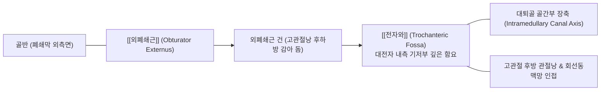
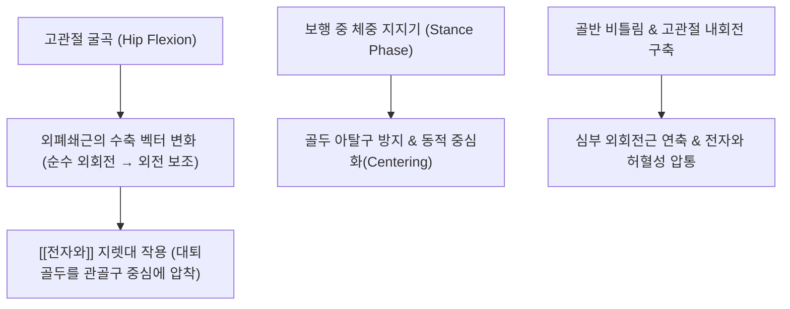

# 🦴 [[전자와]] (Trochanteric Fossa, 돌기오목)

> **핵심 요약 (Key Summary)**:
> [[대퇴골]](Femur) [[대전자]](Greater trochanter)의 내측 기저부와 대퇴경부(Femoral neck) 사이에 깊숙이 파인 오목한 골성 함요부로, 고관절의 심부 외회전근 복합체가 최종 집결하는 핵심 정지 랜드마크입니다.
> 고관절을 외회전시키고 대퇴골두를 관골구 내로 견고히 압착시키는 [[외폐쇄근]](Obturator externus)의 강력한 건이 정지하며, 인접하여 [[내폐쇄근]], 상·하쌍자근 건이 부착합니다.
> 정형외과적 골수강 골절 정복술(Femoral intramedullary nailing) 시 대퇴골 간부의 중심축과 완벽히 일치하는 이상적 진입점(Entry portal)으로 활용되며, 한의 임상에서는 환도(GB30)혈 심자 시 고관절 심부 관절낭 유착 및 외회전근 구축을 해소하는 침도·약침 치료의 표적입니다.

---

## 1. 개요 및 해부학적 위치

[[전자와]](Trochanteric fossa)는 대퇴골 근위부에서 대전자의 내측 벽과 대퇴경부의 후상면이 만나는 교차점에 위치하는 깊은 골성 구덩이(Pit) 구조물입니다.

체표면에서 직접 만져지지는 않으나, 대전자의 후상연 모서리를 따라 손가락을 내측 심부로 파고들어 갈 때 도달하는 해부학적 오목부로 대퇴골 간부의 중심 골수강(Medullary canal) 축선과 직선으로 연결됩니다.

---

## 2. 골성 지표 및 구조적 특징

전자와는 대퇴경부와 대전자 사이의 전환 구역에서 독특한 함몰 형태를 형성합니다.

| 골성 지표명 | 형태학적 특징 및 경계 | 부착 구조물 및 임상 의의 |
| :--- | :--- | :--- |
| **전자와 기저부 (Floor of Fossa)** | 대전자 내측벽 하단의 가장 깊은 오목면 | [[외폐쇄근]](Obturator externus)의 둥글고 강한 건 정지 |
| **전자와 전상연 경계** | 대퇴경부 후상면과 대전자 상연의 능선 경계 | [[이상근]](Piriformis) 정지부 직하방에 위치 |
| **전자간능 (Intertrochanteric crest)** | 전자와 후하방으로 이어지는 두꺼운 골릉 | [[방형대퇴근]](Quadratus femoris) 정지, 소전자 방향 연결 |
| **골수강 중심 진입점 (Entry portal)** | 전자와 내측 능선 바로 외측의 평활면 | 대퇴골 골수강 정(Intramedullary nail) 삽입의 해부학적 기준점 |
| **내측대퇴회선동맥 심지 인접부** | 전자와 외하방 모서리를 주행하는 혈관 | 대퇴골두 혈류를 공급하는 주요 동맥지로 시술 시 손상 주의 |

---

## 3. 부착 근육 및 인대 복합체

전자와는 고관절의 '회전근개(Rotator cuff of the hip)'라 불리는 심부 외회전근군의 집결지입니다.

1. **주 정지 근육**:
   - **[[외폐쇄근]](Obturator externus)**: 골반의 폐쇄공 외측면과 폐쇄막에서 기시하여 고관절 후하방 관절낭을 감싸 안고 올라와 전자와의 가장 깊은 바닥에 강력한 건으로 정지합니다.
2. **인접 근육 복합체**:
   - **[[내폐쇄근]](Obturator internus) 및 상·하쌍자근(Gemelli)**: 전자와 직상방의 대전자 내측연 오목부에 정지하여 함께 고관절을 외회전시키고 보행 시 대퇴골두를 관골구 안으로 당겨 안정화합니다.
3. **관절낭 및 인대 결합**:
   - 전자와 주변에는 고관절 후방 관절낭 섬유(Zona orbicularis)와 좌골대퇴인대(Ischiofemoral ligament)의 후방 부착 섬유가 조밀하게 결합되어 있어 고관절의 과도한 내회전을 억제합니다.

---

## 4. 생체역학 및 운동학적 기능

전자와는 대퇴골두의 동적 관절 수평화 및 비틀림 토크 제어의 지렛대 축입니다.

1. **고관절 동적 중심화 (Dynamic Centering)**:
   - 보행 시 대퇴골두가 전외측으로 미끄러져 빠져나가려는 전단력에 대항하여, 전자와에 붙은 외폐쇄근이 후하방에서 골두를 감아쥐며 관골구 중심와(Acetabular fossa)로 압박하는 동적 안정성을 제공합니다.
2. **골절 역학에서의 회전 변형 축**:
   - 대퇴경부 골절 및 전자간 골절 발생 시, 전자와에 부착된 강력한 외회전근들의 견인력 때문에 원위 골편이 심하게 외회전 전위(External rotation deformity)되는 생체역학적 원인을 제공합니다.

---

## 5. 임상적 의의 및 관련 질환

1. **심부 둔부 증후군 (Deep Gluteal Syndrome, DGS) 및 외회전근 구축**:
   - 전자와 주변 외폐쇄근 및 쌍자근-내폐쇄근 복합체의 만성 경결과 단축은 바로 후방을 통과하는 [[좌골신경]]을 압박하거나 견인하여 둔부 통증 및 하지 방산통을 유발합니다.
2. **좌골대퇴 충돌증후군 (Ischiofemoral Impingement)**:
   - 좌골결절과 대퇴골 소전자 및 전자와 주변 간격이 좁아지며 방형대퇴근과 외폐쇄근 건이 짓눌려 만성 서혜부 및 둔부 깊은 통증이 초래됩니다.
3. **골수강 내 정 삽입 시 의인성 손상 위험 (Intramedullary Nailing Complications)**:
   - 대퇴골 골절 수술 시 전자와를 진입점으로 선택할 때, 너무 내측으로 치우치면 대퇴골두로 가는 내측대퇴회선동맥 심지(Deep branch of MFCA)를 손상시켜 수술 후 [[대퇴골두]] 무혈성 괴사(AVN)를 유발할 수 있습니다.

---

## 6. 이학적 검사 및 감별 진단

1. **저항성 고관절 외회전 검사 (Resisted Hip External Rotation)**:
   - 환자를 좌위 또는 복와위에서 무릎을 90° 굴곡시킨 상태에서, 고관절 외회전을 시도하게 하고 검사자가 하퇴 내측에서 저항을 가합니다.
   - 대전자 심부 및 전자와 부위에 날카로운 통증이 유발되면 외회전근 복합체 손상 또는 건병증 양성입니다.
2. **고관절 수동 최대 내회전 검사 (Passive Internal Rotation Test)**:
   - 고관절을 신전 또는 굴곡 상태에서 최대로 내회전시켜 전자와에 부착된 외폐쇄근을 완전히 신장시킬 때 둔부 심부 당김 통증이 재현되는지 확인합니다.
3. **감별 진단**:
   - **전자부 점액낭염**: 압통점이 대전자 외측 표층에 국한되며 내회전 스트레칭 시 통증보다는 대전자 직접 압박 통증이 우세합니다.
   - **대퇴비구 충돌증후군(FAI)**: 통증 유발점이 둔부 후외측이 아닌 서혜부 전면(FADIR 양성)에 위치합니다.

---

## 7. 한의학적 임상 응용 및 치료

전자와 부위는 족소양담경(足少陽膽經)과 족태양방광경(足太陽膀胱經)의 심부 기혈이 교차하는 고관절 심부 치료의 전략적 요충지입니다.

1. **침구 치료 및 심자(Deep Needling)**:
   - **환도(GB30)**: 대전자와 천골열공을 잇는 선의 외측 1/3 지점에서, 장침(3~4촌)을 사용하여 대전자 후내측의 전자와 방향을 향해 비스듬히 심자합니다. 외폐쇄근과 이상근 심부의 경결을 해소하고 좌골신경 압박을 감압합니다.
   - **거료(GB29)**: ASIS와 대전자 최고점의 중점으로 고관절 전외측 근막을 함께 이완합니다.
2. **소침도(Acupotomy) 심부 외회전근 유착 박리술**:
   - 환자를 건측 측와위로 두고 대전자 후상연을 촉지한 후, 침도를 대전자 내측 벽 골면을 타고 전자와 기저부로 접근합니다.
   - 비후된 외폐쇄근 건막 및 관절낭 유착 섬유를 종방향으로 미세 절개하여 고관절 내회전 구축을 즉각 회복시키고 서혜부 방산통을 차단합니다.
3. **추나요법 (Chuna Deep External Rotator Release)**:
   - **고관절 회전 관절가동술 및 PIR MET**: 환자를 앙와위에서 고관절 90° 굴곡 상태로 두고 최대 내회전 제한벽까지 유도한 후, 환자에게 외회전 등척성 수축을 유도하여 전자와 주변 단축 근육의 이완을 유도합니다.
4. **약침 치료**:
   - 전자와 주변 외회전근 부착부에 [[신바로약침]] 또는 [[황련해독탕]] 약침을 1.0~2.0ml 심부 주입하여 심부 무균성 염증을 제거하고 좌골신경 주위 혈류를 개선합니다.

---

## 8. 참고문헌

* Erçakmak Güneş B. (2022). Estimating the optimal entry point of the antegrade femoral nailing: Previous and novel morphometric measurements. *Acta Orthop Traumatol Turc*. PMID: 35416157

* Kumar P. (2019). Greater trochanteric versus piriformis fossa entry nails for femur shaft fractures: Resolving the controversy. *Injury*. PMID: 31358301
