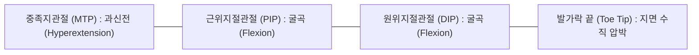
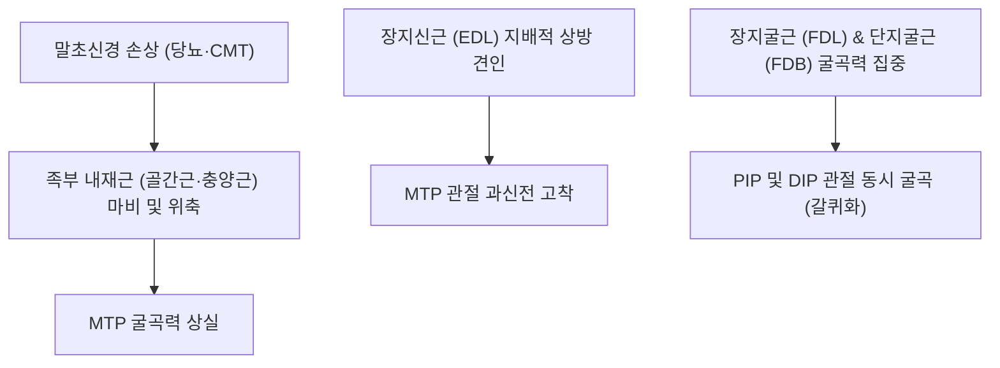

# 🦴 [[갈퀴족]] (Claw Toe, 갈퀴발가락)

> **핵심 요약 (Key Summary)**:
> 족부(Foot)의 중족지관절(MTP joint)은 과신전(Hyperextension)되고, 근위지절관절(PIP joint)과 원위지절관절(DIP joint)은 모두 과도하게 굴곡(Flexion)되어 발가락이 마치 맹수의 갈퀴 발톱처럼 웅크려지는 족지 변형 질환입니다.
> 족부 내재근(Intrinsics: [[골간근]], [[충양근]])의 마비 또는 기능 부전으로 인해 외재성 장지신근과 장지굴근의 장력 균형이 붕괴되어 발생합니다.
> 당뇨병성 말초신경병증(Diabetic neuropathy), 샤르코-마리-투스병(CMT), 요족(Pes cavus) 환자에게 호발하며, 발가락 등쪽(PIP 배부) 및 [[중족골]]두 족저면의 압박성 궤양과 통증성 티눈(Clavus)을 유발합니다. 한의학적으로 팔풍혈(EX-LE10), 태충(LR3), 용천(KI1)을 표적으로 하는 내재근 침도 자극 및 족부 관절가동 추나의 핵심 표적입니다.

---

## 1. 개요 및 해부학적 위치

[[갈퀴족]](Claw toe)은 제2~5[[족지]]에서 주로 발생하는 다발성 족가락 변형 질환으로, 족부의 내재근과 외재근 사이의 동적 힘의 균형(Dynamic balance)이 파괴되면서 초래됩니다.

초기에는 수동적으로 펴지는 가요성(Flexible) 변형으로 시작하지만, 시간이 지남에 따라 관절낭 구축과 측부인대 단축이 진행되어 손으로도 펴지지 않는 강직성(Rigid) 고정 변형으로 악화됩니다.

---

## 2. 골성 지표 및 구조적 특징

갈퀴족은 세 개 관절의 고유한 각도 변형으로 인해 전족부와 족지 골격의 접촉면이 기형적으로 재배치됩니다.

| 관절 및 골성 랜드마크 | 변형 방향 및 상태 | 역학적 결과 및 병변 부위 |
| :--- | :--- | :--- |
| **중족지관절 (MTP joint)** | 배측 아탈구 및 과신전 (>30~40°) | [[중족골]]두(Metatarsal head)가 족저부로 돌출되어 굳은살 및 족저 압통 초래 |
| **근위지절관절 (PIP joint)** | 족저 굴곡 변형 | PIP 관절 배측이 신발 갑피(Upper)에 지속 마찰되어 경성 티눈(Hard corn) 형성 |
| **원위지절관절 (DIP joint)** | 족저 굴곡 변형 | 발가락 끝(Toe tip)이 바닥을 수직으로 찍어눌러 조갑하 출혈 및 첨부 궤양 발생 |
| **[[중족골]]두 (Metatarsal head)** | 족저 지방 패드(Fat pad) 전방 편위 | [[중족골]]두 하부의 충격 흡수 패드가 앞으로 밀려나 뼈가 지면에 직접 충돌 |

---

## 3. 부착 근육 및 인대 복합체

갈퀴족의 병태생리는 족부 내재근과 외재근의 장력 불균형(Muscular imbalance)에서 출발합니다.

1. **족부 내재근 (Intrinsics)**:
   - [[골간근]](Interossei) 및 [[충양근]](Lumbricals): 본래 MTP 관절을 굴곡시키고 지절간관절(IP)을 신전시키는 '발의 조율사' 역할을 합니다. 이들 근육이 마비되면 MTP 신전 제어가 불가능해집니다.
2. **외재성 신전근 (Extrinsic Extensors)**:
   - [[장지신근]](Extensor digitorum longus, EDL): 내재근의 대항이 사라지면서 기저지골을 배측으로 과도하게 잡아당겨 MTP 관절을 뒤로 꺾어 놓습니다.
3. **외재성 굴곡근 (Extrinsic Flexors)**:
   - [[장지굴근]](Flexor digitorum longus, FDL) 및 [[단지굴근]](FDB): [[지골]]을 족저 방향으로 강하게 오그려 PIP와 DIP 관절을 동시에 심굴곡시킵니다.
4. **인대성 구조 변화**:
   - MTP 관절의 [[[[족저판]]]](Plantar plate)이 신장 및 파열되고, 배측 관절낭과 측부인대가 섬유성 단축을 일으킵니다.

---

## 4. 생체역학 및 운동학적 기능

갈퀴족은 보행 시 전족부의 충격 흡수와 추진력 분산을 근본적으로 파괴합니다.

1. **지견(Toe Grip) 및 추진력 상실**:
   - 정상 보행의 말기 입각기(Push-off phase)에서 발가락들이 지면을 넓게 밀어내며 체중을 전방으로 이동시켜야 하지만, 갈퀴족은 발가락이 구부러져 있어 추진 면적을 제공하지 못합니다.
2. **[[중족골]]두 족저부 과하중 (Metatarsalgia)**:
   - MTP 관절이 위로 들리면 [[중족골]]두가 지면을 향해 수직으로 곤두박질치게 되며, 정상적으로 [[중족골]]두 아래에 완충막 역할을 하던 전족부 지방 패드가 전방으로 밀려나 벗겨집니다.
   - 이로 인해 보행 시 [[중족골]]두에 정상의 2~3배에 달하는 전단력과 압박력이 집중되어 중족골통과 난치성 굳은살이 발생합니다.

---

## 5. 임상적 의의 및 관련 질환

1. **당뇨병성 족부 궤양 (Diabetic Foot Ulcer)**:
   - 당뇨병성 운동신경병증으로 내재근이 위축되면 갈퀴족이 동반되며, 감각이 저하된 상태에서 [[중족골]]두 족저면과 PIP 배부에 지속적인 압박성 허혈이 발생하여 무통성 심부 궤양 및 골수염으로 악화될 수 있습니다.
2. **샤르코-마리-투스병 (Charcot-Marie-Tooth, CMT)**:
   - 유전성 운동-감각 신경병증으로 하지 원위부 근육 위축과 함께 양측성 요족(Pes cavus)과 심한 갈퀴족 변형이 특징적으로 나타납니다.
3. **기타 족지 변형과의 감별**:
   - **망치족지(Hammer toe)**: MTP 중립/신전, **PIP 굴곡, DIP 신전/중립** (DIP는 굽지 않음).
   - **추지(Mallet toe)**: MTP 및 PIP 정상, **DIP 관절만 단독 굴곡**.
   - **갈퀴족(Claw toe)**: MTP 과신전, **PIP와 DIP 모두 굴곡**.

---

## 6. 이학적 검사 및 감별 진단

1. **켈리키안 밀어올림 검사 (Kelikian Push-Up Test)**:
   - 검사자가 [[중족골]]두 하부를 손가락으로 밀어 올려 체중 부하 상태를 재현할 때, 갈퀴족 변형이 수동적으로 펴지는지 확인합니다.
   - 손가락으로 밀었을 때 발가락이 펴지면 가요성(Flexible), 여전히 굽어 있으면 강직성(Rigid) 변형으로 판정합니다.
2. **모노필라멘트 감각 검사**:
   - 10g Semmes-Weinstein 모노필라멘트로 전족부 감각을 측정하여 당뇨병성 신경병증 동반 여부를 스크리닝합니다.

---

## 7. 한의학적 임상 응용 및 치료

갈퀴족은 족삼양경과 족삼음경의 종착점인 전족부 경혈들을 활용하여 족부 내재근을 활성화하고 근막 단축을 해소합니다.

1. **침구 치료 및 핵심 경혈**:
   - **팔풍(EX-LE10)**: 발가락 사이 갈퀴막(Web space) 적백육제에 위치한 8개 기혈로, 족부 내재근([[골간근]], [[충양근]])에 직접 자침하여 근육 연축을 풀고 혈류를 개선합니다.
   - **태충(LR3)**: 제1-2 중족골 간 함요처로 족부 전면부 근막 긴장을 완화합니다.
   - **용천(KI1)**: 족저 전방 1/3 함요처로 족저근막과 단지굴근의 과긴장을 사화(瀉火)시킵니다.
   - **함곡(ST43) 및 족임읍(GB41)**: 중족골 간격을 넓히고 MTP 관절 배측 구축을 해소합니다.
2. **소침도(Acupotomy) 지절 관절낭 및 건막 이완술**:
   - 강직성 갈퀴족 환자에서 MTP 관절 배측 관절낭 섬유와 장지신근 건막 유착 부위, 그리고 PIP [[족저판]] 단축부에 침도를 자입하여 미세 절개(Tenotomy/Capsulotomy)함으로써 굳어진 관절을 유연하게 신장시킵니다.
3. **추나요법 (Chuna Forefoot Mobilization)**:
   - **전족부 횡아치 및 족지 견인 가동술**: [[중족골]]두를 배측으로 지긋이 밀어 올리면서 동시에 굴곡된 지골을 전방으로 견인하여 MTP-PIP 관절의 정상 선열을 회복시킵니다.
   - **족부 내재근 재교육 운동 지도**: 수건 집어 올리기(Towel curl) 및 구슬 집기 운동을 병행하여 위축된 내재근의 동적 수축력을 회복시킵니다.
4. **약침 치료**:
   - 변형 관절 주위 통증성 티눈 하부 및 MTP 관절강에 [[신바로약침]] 또는 [[황련해독탕]] 약침을 0.3~0.5ml 주입하여 만성 활액막염 및 활액낭 부종을 치료합니다.

---

## 8. 참고문헌

* Reaney A. (2025). Management of Hammer Toe Deformities Using Percutaneous Surgical Techniques. *Clin Podiatr Med Surg*. PMID: 39550092

* Agius R. (2023). A Biomechanical Investigation of Children with Type 1 Diabetes Mellitus: Are Children's Feet a Precursor to Adulthood Foot Complications? *J Am Podiatr Med Assoc*. PMID: 38170612
