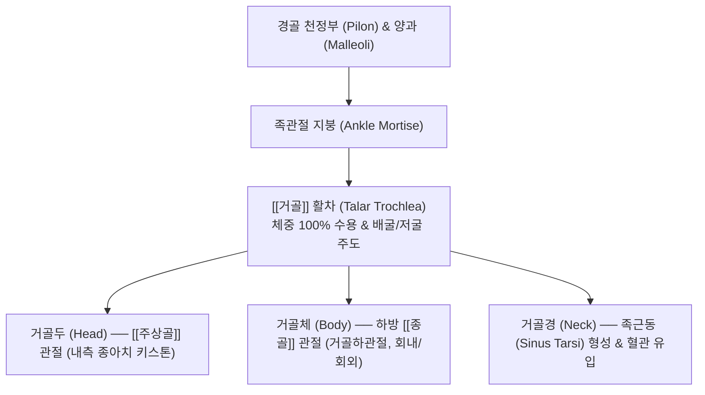
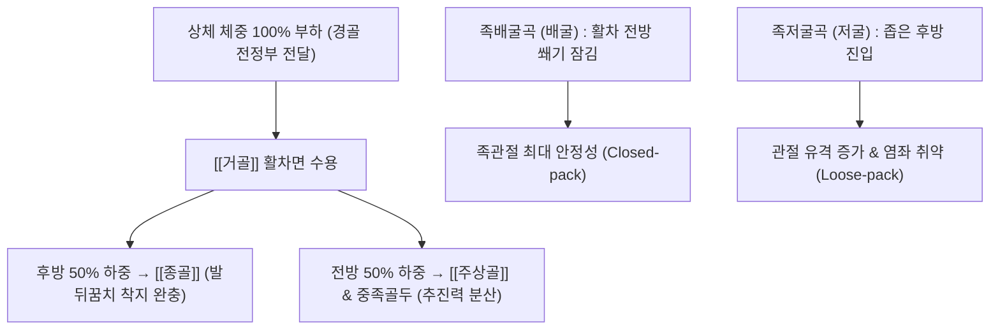

# 🦴 [[거골]] (Talus, 목말뼈)

> **핵심 요약 (Key Summary)**:
> 하퇴의 [[경골]](Tibia) 및 [[비골]](Fibula)과 족부의 [[종골]](Calcaneus) 및 [[주상골]](Navicular) 사이에 끼여 있는 족근골의 키스톤(Keystone)으로, 상체의 체중을 족부로 100% 분배하는 중계 관절골입니다.
> 표면의 60% 이상이 관절 연골로 덮여 있으며, **인체에서 어떠한 근육이나 건도 직접 부착하지 않는** 독특한 해부학적 특성을 지닙니다.
> 영양 혈관이 주로 거골경부(Neck)와 족근동(Sinus tarsi)을 통해 원위부에서 근위부로 역행성(Retrograde) 주행하기 때문에 거골 골절 탈구(Hawkins 분류) 시 거골체 무혈성 괴사(AVN) 발생률이 극도로 높으며, 거골 골연골 병변(OCLT), 거퇴관절 충돌증후군의 주 호발 부위이자 해계(ST41), 조해(KI6), 구허(GB40)를 중심으로 한 족관절 추나 교정의 핵심 표적입니다.

---

## 1. 개요 및 해부학적 위치

[[거골]](Talus)은 족부의 근위열 족근골 중 가장 상단에 위치하며, 하퇴와 족부를 기계적으로 연결하는 유일한 뼈입니다.

근위로는 경골 및 비골과 거퇴관절(Talocrural joint)을 이루어 발목의 족배굴곡 및 족저굴곡을 주관하고, 원위로는 종골과 거골하관절(Subtalar joint)을 이루어 발목의 내번과 외번(회내/회외)을 담당하며, 전방으로는 주상골과 거주상관절을 형성합니다.

---

## 2. 골성 지표 및 구조적 특징

거골은 거골두(Head), 거골경(Neck), 거골체(Body)의 3개 주요 구역으로 나뉩니다.

| 부위 구분 | 골성 지표명 | 형태학적 특징 | 임상 및 기능적 의의 |
| :--- | :--- | :--- | :--- |
| **체부 (Body)** | **거골 활차 (Trochlea)** | 상면이 볼록한 도르래 모양 관절면 | 전방 폭이 후방 폭보다 약 4~5mm 넓어 족배굴곡 시 모티스 내에서 완전 잠김 |
| **체부 (Body)** | **후돌기 (Posterior process)** | 거골 후방으로 돌출된 내측 및 외측 결절 | 외측 결절이 분리 골화되면 **삼각골(Os trigonum)** 형성 (후방 충돌 증후군 유발) |
| **체부 (Body)** | **장모지굴근 건구** | 내측 결절과 외측 결절 사이의 오목한 고랑 | [[장모지굴근]](FHL) 건이 주행하며 마찰 협착 호발 |
| **경부 (Neck)** | **거골하구 (Sulcus tali)** | 거골 아랫면의 깊은 횡방향 고랑 | 종골구와 합쳐져 **족근동(Sinus tarsi)** 형성; 골간거종인대 위치 |
| **두부 (Head)** | **주상골 관절면** | 전방으로 둥글게 돌출된 구형 관절면 | 발의 내측 종아치 정점을 지지하는 용수철인대(Spring lig.)와 접촉 |

---

## 3. 부착 근육 및 인대 복합체

거골의 가장 결정적인 해부학적 특징은 **근육이나 힘줄이 단 하나도 부착하지 않는다**는 점입니다. 따라서 거골의 모든 안정성과 가동성은 오직 주변 골격의 맞물림과 정밀한 인대 결합에만 의존합니다.

1. **외측 인대 복합체 부착부**:
   - 전거비인대(ATFL): 거골경 외측면에 부착하여 발목 내번 및 전방 탈구를 저지합니다.
   - 후거비인대(PTFL): 거골 후돌기 외측 결절에 부착하여 후방 전위를 차단합니다.
2. **내측 삼각인대 (Deltoid Ligament) 부착부**:
   - 심층 전·후거경인대(Anterior/Posterior tibiotalar lig.)가 거골체 내측면에 강력하게 고정되어 외번 탈구를 방지합니다.
3. **거골하관절 인대 복합체**:
   - 골간거종인대(Interosseous talocalcaneal lig.) 및 경자인대(Cervical lig.): 족근동 내부에서 거골과 종골을 밧줄처럼 결속시킵니다.
4. **혈액 공급의 취약성 (Blood Supply)**:
   - 후경골동맥의 족근관지, 전경골동맥의 족근동지, 비골동맥 관통지가 족근동과 거골경부를 통해 뼈 내부로 진입하여 후방으로 혈액을 공급합니다. 이로 인해 거골경 골절 시 거골체로 가는 혈류가 완전히 차단됩니다.

---

## 4. 생체역학 및 운동학적 기능

거골은 인체 체중의 100%를 수용하여 전족부와 후족부로 정확히 분배하는 기계적 분배기(Torque Converter)입니다.

1. **하중 분배 (Load Distribution)**:
   - 직립 시 거골에 도달한 하중의 약 50%는 거골하관절을 통해 종골(발뒤꿈치)로 내려가고, 나머지 50%는 거골두를 거쳐 주상골과 전족부로 전달됩니다.
2. **쐐기 효과(Wedge Effect)와 족관절 잠김**:
   - 거골 활차 상면은 전방이 후방보다 약 4~5mm 넓은 사다리꼴입니다. 발목을 족배굴곡시키면 넓은 전방부가 양과(Malleoli) 사이로 꽉 끼어들어가 관절이 단단히 잠겨 흔들림이 사라지는 최대 안정위(Closed-packed position)를 형성합니다. 반대로 족저굴곡 시에는 관절에 유격이 생겨 발목 염좌가 쉽게 발생합니다.

---

## 5. 임상적 의의 및 관련 질환

1. **거골 골연골 병변 (Osteochondral Lesion of Talus, OCLT)**:
   - 발목 염좌나 반복적 충격으로 거골 활차면의 연골과 연골하골이 손상·박리되는 질환입니다.
   - 전외측 병변은 발목 배굴-내번 손상 시 비골과 충돌하여 발생하고, 후내측 병변은 저굴-내번 손상 시 경골과 마찰되어 발생합니다.
2. **거골 골절 및 무혈성 괴사 (Talar Neck Fracture & AVN, Hawkins 분류)**:
   - 교통사고나 고소 추락 시 과도한 배굴력으로 거골경부가 경골 전연에 부딪히며 골절됩니다.
   - 호킨스 분류(Hawkins Class I~IV)에 따라 전위가 심할수록 거골체 무혈성 괴사 발생률이 급증(Class III는 80~100%)합니다.
3. **족근동 증후군 (Sinus Tarsi Syndrome)**:
   - 심한 발목 염좌 후 족근동 내부의 골간인대 파열, 활액막 비후, 신경섬유 손상으로 발목 외측 오목한 부위에 만성 둔통과 불안정성이 지속되는 질환입니다.
4. **발목 후방 충돌 증후군 (Posterior Ankle Impingement)**:
   - 거골 후돌기의 삼각골(Os trigonum)이나 돌출된 결절이 발레리나처럼 발목을 최대로 족저굴곡할 때 경골 후하연과 종골 사이에 끼여 후방 통증을 초래합니다.

---

## 6. 이학적 검사 및 감별 진단

1. **거골 경사 검사 (Talar Tilt Test)**:
   - 발목을 0° 중립위로 두고 종골과 거골을 강하게 내번시킬 때 거골이 모티스 밖으로 덜컹거리며 기우는 각도를 방사선 또는 촉진으로 확인합니다 (전거비인대 및 종비인대 완전 파열 판정).
2. **족근동 압통 검사 (Sinus Tarsi Palpation)**:
   - 외과 전하방의 족근동 오목한 부위를 엄지손가락으로 깊게 압박할 때 국소 압통과 함께 발목을 내번시킬 때 통증이 증폭되는지 확인합니다.
3. **감별 진단**:
   - **단순 전거비인대 염좌**: 부종과 압통이 외과 첨부 전방에 국한되는 반면, OCLT나 족근동 증후군은 관절 심부의 묵직한 체중 부하 통증과 관절 잠김(Locking) 증상이 동반됩니다.

---

## 7. 한의학적 임상 응용 및 치료

거골 주변은 족양명위경, 족태양방광경, 족소음신경, 족소양담경이 발목을 통과하며 거골을 삼차원적으로 둘러싸는 족관절 치료의 중심 허브입니다.

1. **침구 치료 및 핵심 경혈**:
   - **해계(ST41)**: 족관절 전면 횡문 중앙, 장모지신근건과 장지신근건 사이 함요처로 거골 활차 전면을 직접 자극하여 관절 부종을 배출합니다.
   - **구허(GB40)**: 외과 전하방 족근동 중심부로 담경의 원혈이며, 족근동 증후군 및 외측 인대 손상의 필수 취혈점입니다.
   - **조해(KI6)**: 내과 첨부 직하 1촌 함요처로 거골두 내측을 지지하고 음교맥을 소통시킵니다.
   - **중봉(LR4)**: 해계와 상구(SP5) 사이로 거골 전내측 연골 병변 통증을 완화합니다.
2. **소침도(Acupotomy) 족근동 및 후방 충돌 감압술**:
   - 만성 족근동 증후군으로 섬유화된 족근동 내 연부조직과 지방패드 유착 부위에 침도를 자입하여 반흔 조직을 박리하고, 후방 충돌 증후군 환자에서는 아킬레스건 전방의 삼각골 주위 활액막 비후대를 감압합니다.
3. **추나요법 (Chuna Talocrural & Subtalar Adjustment)**:
   - **거골 후방 변위 교정 견인술**: 발목 염좌 후 전방 또는 후방으로 아탈구된 거골을 정상 모티스 내로 정렬시키기 위해, 환자의 발등과 발꿈치를 견고히 파지하고 축성 견인과 함께 순간적인 배굴-밀어넣기 교정을 적용합니다.
   - **거골하관절 가동술**: 종골을 고정하고 거골을 내외측으로 활주시킵니다.
4. **약침 치료**:
   - 거골 연골 손상 부위 및 족근동 관절강 내에 [[신바로약침]] 또는 [[자하거약침]]을 0.5~1.0ml 주입하여 연골하골 부종을 흡수시키고 미세 손상 조직의 섬유모세포 분화를 촉진합니다.

---

## 8. 참고문헌

* Bedi H. (2023). Extra-articular Lateral Talar Dome Osteochondral Fracture: A Case Report and a Review of Literature. *Arch Bone Jt Surg*. PMID: 38058966

* Danilkowicz RM. (2021). Impact of Early Weightbearing After Ankle Arthroscopy and Bone Marrow Stimulation for Osteochondral Lesions of the Talus. *Orthop J Sports Med*. PMID: 34541014
