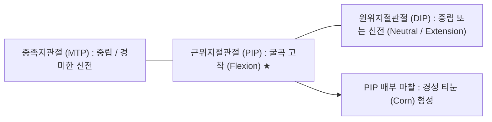
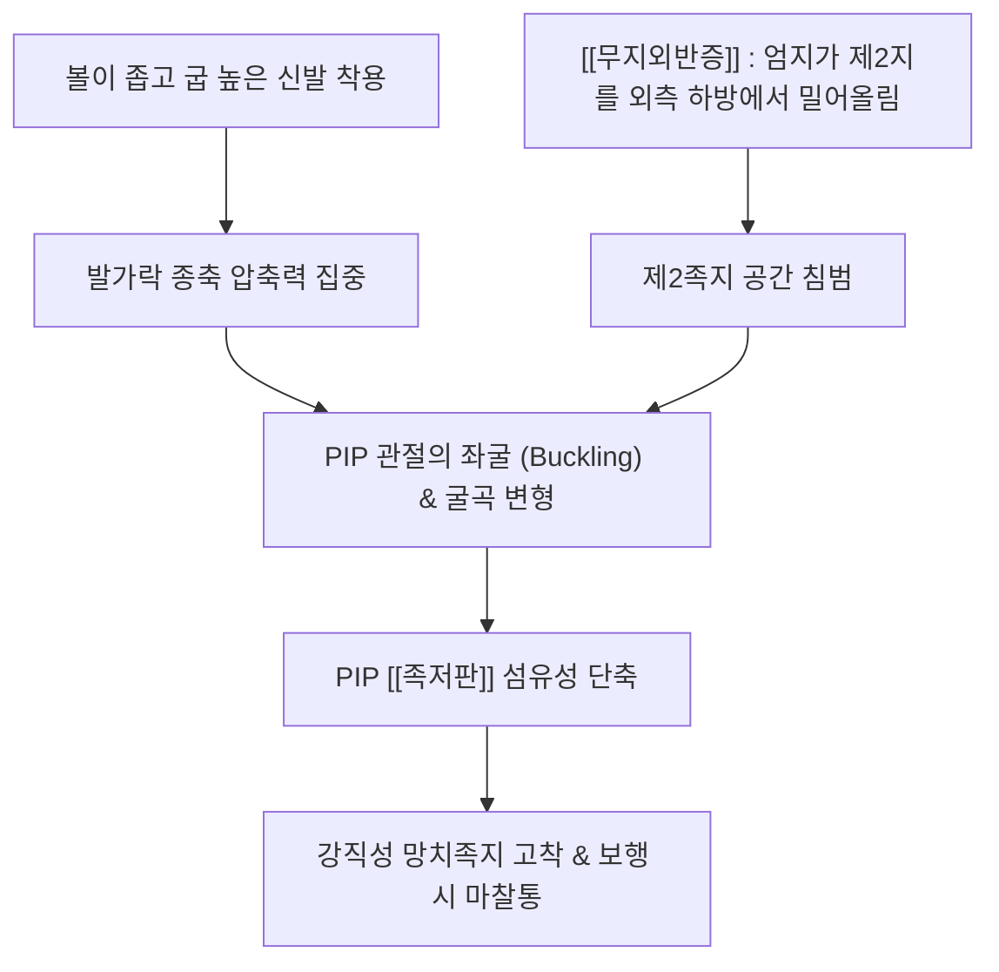

# 🦴 [[망치족지]] (Hammer Toe, 망치발가락)

> **핵심 요약 (Key Summary)**:
> 족부(Foot)의 근위지절관절(PIP joint)이 비정상적으로 굴곡(Flexion)되고, 원위지절관절(DIP joint)은 중립 또는 신전(Extension)되며, 중족지관절(MTP joint)은 중립 또는 경미한 신전 상태를 유지하는 가장 흔한 소[[족지]](Lesser toe) 변형 질환입니다.
> 주로 제2족지에서 호발하며, 맞지 않는 좁은 신발([[하이힐]]) 착용, [[무지외반증]](Hallux valgus)의 동반 밀림, 또는 [[단지신근]]과 [[단지굴근]]의 생체역학적 불균형에 의해 유발됩니다.
> 돌출된 PIP 관절 배부(Dorsal aspect)가 신발 내부와 지속적으로 마찰되어 극심한 통증성 경성 티눈(Hard corn, Clavus)을 형성하며, 한의학적으로 팔풍(EX-LE10), 함곡(ST43), 여태(ST45)를 중심으로 한 족지 지절간 관절가동 추나 및 소침도 인대 절개술의 주 표적입니다.

---

## 1. 개요 및 해부학적 위치

[[망치족지]](Hammer toe)는 발가락이 망치 머리처럼 아래로 꺾인 형태를 띠는 시상면(Sagittal plane)상의 변형 질환으로, 제2족지(Second toe)가 제1족지(엄지)보다 긴 그리스형 발(Greek foot) 구조에서 가장 흔히 발생합니다.

초기에는 손으로 발가락을 펴면 정상 정렬로 복원되는 **가요성(Flexible)** 상태이나, 방치할 경우 PIP [[[[족저판]]]](Plantar plate)과 측부인대가 영구 구축되어 손으로도 펴지지 않는 **강직성(Rigid)** 변형으로 고착됩니다.

---

## 2. 골성 지표 및 구조적 특징

망치족지는 족지 골격계의 3개 분절 중 [[근위지골]]과 중위지골 사이의 관절각 이상이 중심 병변입니다.

| 골성 분절 및 관절 | 변형 상태 및 위치 | 임상적 징후 및 병변 |
| :--- | :--- | :--- |
| **근위지절관절 (PIP joint)** | **족저 방향 굴곡 고착 (Flexion)** | 관절 배측부가 위로 뾰족하게 융기되어 신발 갑피와 만성 마찰 |
| **원위지절관절 (DIP joint)** | **중립(Neutral) 또는 과신전** | 갈퀴족(DIP 굴곡)과 달리 발가락 끝이 바닥에 박히지 않고 수평 유지 |
| **중족지관절 (MTP joint)** | 경미한 신전 또는 중립 | 무지외반증 동반 시 제2 [[중족골]]두 하방에 굳은살 형성 |
| **근위지골 (Proximal phalanx)** | MTP 관절에서 상방 경사 | 지골간 관절낭의 배측 섬유 비후 |
| **중위지골 (Middle phalanx)** | 바닥을 향해 수직 하향 경사 | PIP 관절 [[족저판]]의 만성 단축 |

---

## 3. 부착 근육 및 인대 복합체

망치족지는 외재성 굴곡근과 신전근, 그리고 족부 내재근 사이의 정교한 밸런스가 무너지면서 발생합니다.

1. **단지굴근 (Flexor digitorum brevis, FDB)**:
   - [[종골]]에서 기시하여 중위지골 기저부 양측에 정지합니다. 이 근육의 과긴장과 구축은 PIP 관절만을 선택적으로 강하게 족저 굴곡시키는 핵심 추진력입니다.
2. **장지신근 (Extensor digitorum longus, EDL) 및 단지신근 (EDB)**:
   - [[근위지골]]을 배측으로 당기지만, PIP 관절의 굴곡 구축으로 인해 중앙 신근건막(Central slip)이 신장되고 측도(Lateral bands)가 족저 방향으로 탈락(Subluxation)되면서 PIP 신전력을 완전히 상실합니다.
3. **[[[[족저판]]]](Plantar plate) 및 측부인대 복합체**:
   - PIP 관절 족저면의 섬유연골성 [[족저판]]이 단축 유착되고, 양측 측부인대가 구축되어 변형을 영구 고정화합니다.

---

## 4. 생체역학 및 운동학적 기능

망치족지는 좁은 신발 공간 내에서 외력에 의해 억류된 발가락이 유발하는 기계적 기능장애입니다.

1. **좌굴 역학 (Buckling Mechanics)**:
   - 긴 제2족지가 앞코가 좁은 신발 안에서 압축되면 가장 취약한 경첩관절인 PIP 관절이 위로 꺾이면서 좌굴 현상이 일어납니다.
2. **무지외반증과의 연동**:
   - 무지외반증으로 인해 엄지발가락이 바깥쪽으로 편위되면서 제2발가락 아래로 파고들거나 위로 올라타게(Cross-over toe) 되어 망치족지 변형을 물리적으로 강제합니다.

---

## 5. 임상적 의의 및 관련 질환

1. **PIP 배부 경성 티눈 (Hard Corn, Heloma Durum)**:
   - 위로 튀어나온 PIP 관절 배측 피부가 신발과 보행 시 [[보행]] 마찰로 짓눌려 각질이 비후되고 원추형 각질핵이 신경을 압박하여 보행 시 찌르는 듯한 극심한 통증을 유발합니다.
2. **제2 중족지관절 불안정성 및 [[족저판]] 파열**:
   - 망치족지가 장기화되면 MTP 관절의 [[족저판]]이 파열되면서 제2발가락이 전방으로 아탈구되는 [[전족부]] 불안정성이 병발합니다.
3. **3대 소족지 변형의 임상 감별표**:

| 질환명 | MTP 관절 | PIP 관절 | DIP 관절 | 주 호발 원인 |
| :--- | :--- | :--- | :--- | :--- |
| **[[망치족지]] (Hammer toe)** | 중립 / 신전 | **굴곡 (Flexion)** | **중립 / 신전** | 좁은 신발, 긴 제2족지, 무지외반증 |
| **[[갈퀴족]] (Claw toe)** | **과신전** | **굴곡 (Flexion)** | **굴곡 (Flexion)** | 당뇨·CMT 등 족부 내재근 마비 |
| **추지 (Mallet toe)** | 중립 | 중립 | **굴곡 (Flexion)** | 신발 코 충격, 장지굴근 단독 단축 |

---

## 6. 이학적 검사 및 감별 진단

1. **가요성 평가 (Flexibility Test)**:
   - 검사자의 손가락으로 굴곡된 PIP 관절을 펴보고, MTP 관절을 굴곡시켰을 때 PIP 관절이 완전히 펴지는지 확인합니다.
   - 완전 복원되면 가요성(보존적 치료 가능), 펴지지 않으면 강직성(침도 또는 수술적 이완 필요)으로 분류합니다.
2. **라클란 유사 검사 (Modified Lachman / Drawer Test of MTP)**:
   - [[중족골]]두를 고정하고 기저지골을 수직 방향으로 흔들어 MTP 관절 [[족저판]] 파열 및 전방 아탈구 여부를 평가합니다.

---

## 7. 한의학적 임상 응용 및 치료

망치족지는 족양명위경(足陽明胃經)과 족궐음간경(足厥陰肝經)의 족지 말단 경혈들을 활용하여 건막 단축을 해소하고 관절 유연성을 회복시킵니다.

1. **침구 치료 및 핵심 경혈**:
   - **팔풍(EX-LE10)**: 제2-3족지 사이 함요처에 자침하여 지골간 근막 긴장을 완화합니다.
   - **내정(ST44) 및 여태(ST45)**: 제2족지 외측 발톱뿌리 및 MTP 관절 전방 함요처로 위경의 기혈을 소통시키고 PIP 배부 티눈의 염증을 가라앉힙니다.
   - **함곡(ST43)**: 제2-3 중족골 접합부로 전족부 하중을 분산시킵니다.
2. **소침도(Acupotomy) PIP [[족저판]] 및 신근건막 이완술**:
   - 강직성 망치족지 환자에서 PIP 관절 족저면의 단축된 단지굴근 건막과 [[족저판]] 섬유, 그리고 MTP 배측 관절낭에 침도를 자입하여 미세 절개(Percutaneous tenotomy)함으로써 굽어진 발가락을 즉각 곧게 펴줍니다.
3. **추나요법 (Chuna Lesser Toe Mobilization)**:
   - **지골간 관절 견인-신전 기법**: 환자의 제2족지 기저지골을 고정하고 중위지골을 축성 견인하면서 점진적으로 PIP 신전을 유도하여 굳어진 관절낭을 이완시킵니다.
   - **신발 교육 및 족지 패드 교정**: 발가락 공간이 넓은 신발 착용 지도 및 실리콘 해머토 패드(Crest pad)를 적용하여 PIP 배부 마찰을 차단합니다.
4. **약침 치료**:
   - PIP 관절 배부 티눈 하부 및 활액낭 부위에 [[황련해독탕]] 또는 [[신바로약침]]을 0.2~0.3ml 주입하여 만성 마찰성 염증과 신경 자극을 소퇴시킵니다.

---

## 8. 참고문헌

* Cook JJ. (2018). Anatomic Reconstruction Versus Traditional Rebalancing in Lesser Metatarsophalangeal Joint Reconstruction. *J Foot Ankle Surg*. PMID: 29685561

* Unsdorfer GL. (2011). Proximal phalangeal osteotomy with proximal interphalangeal joint arthrodesis for multiplanar deformities of the second toe: historical perspectives and review of a case series. *J Foot Ankle Surg*. PMID: 21856180
