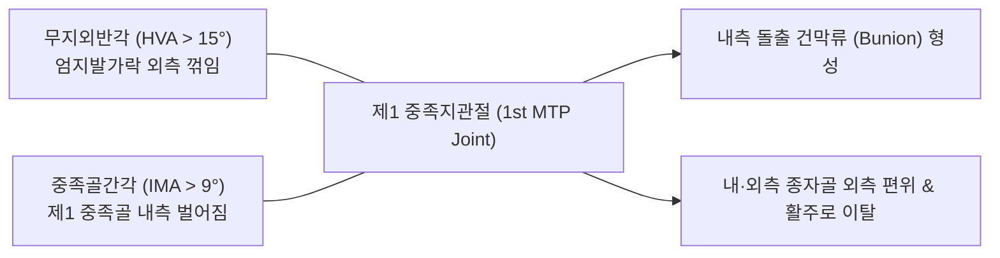
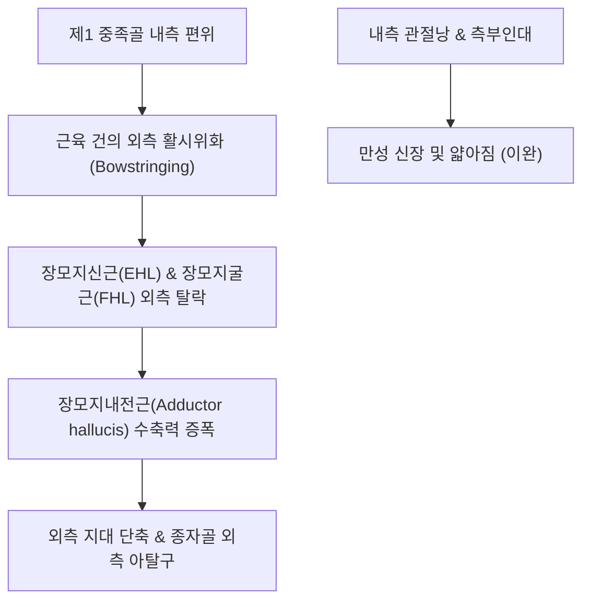

# 🦴 [[무지외반증]] (Hallux Valgus, 엄지발가락가쪽휨증)

> **핵심 요약 (Key Summary)**:
> 제1 중족지관절(First MTP joint)에서 엄지발가락(Hallux)이 제2족지 방향으로 외측 편위(Valgus deviation)되고, 제1 [[중족골]](First metatarsal)은 내측으로 편위(Varus deviation)되는 삼차원적 복합 족부 변형 질환입니다.
> 방사선학적으로 무지외반각(HVA) > 15° 및 중족골간각(IMA) > 9°를 기준으로 진단하며, 제1 중족골두 내측 결절의 비후와 점액낭 종창으로 형성된 돌출부인 **건막류(Bunion)**가 발생합니다.
> 제1 MTP 관절의 외측 지대 및 장모지내전근 단축, 내측 측부인대 이완, [[종자골]](Sesamoid)의 외측 아탈구가 동반되며, 한의학적으로 태백(SP3), 대도(SP2), 행간(LR2)을 표적으로 하는 소침도 외측 관절낭 이완술과 족부 아치 교정 추나의 핵심 표적입니다.

---

## 1. 개요 및 해부학적 위치

[[무지외반증]](Hallux valgus)은 인체 전족부(Forefoot)에서 가장 흔히 발생하는 변형 질환으로, 단순한 발가락 휨이 아니라 제1 중족골의 내번, 회내(Pronation), 그리고 엄지 지골의 외번이 복합된 입체적 관절 불일치 병변입니다.

유전적 소인(모계 유전, 인대 이완성, [[평발]])과 후천적 요인(앞코가 좁고 굽 높은 [[하이힐]] 착용)이 결합하여 발생하며, 여성에서 남성보다 약 5~10배 빈발합니다.

---

## 2. 골성 지표 및 구조적 특징

무지외반증의 방사선학적 및 형태학적 진단 지표는 다음과 같습니다.

| 골성 지표명 | 정상 범위 | 무지외반증 기준 | 임상적 의의 |
| :--- | :--- | :--- | :--- |
| **무지외반각 (Hallux Valgus Angle, HVA)** | < 15° | **≥ 15°** (중등도 20~40°, 중증 >40°) | 제1 [[중족골]] 장축과 [[근위지골]] 장축이 이루는 각도 |
| **중족골간각 (Intermetatarsal Angle, IMA)** | < 9° | **≥ 9~10°** (중증 >16°) | 제1 중족골과 제2 [[중족골]] 장축 사이의 벌어진 각도 |
| **건막류 (Bunion / Prominence)** | 없음 | 제1 중족골두 내측 골성 비후 | 신발 내측과 마찰되어 점액낭염, 발적, 극심한 통증 유발 |
| **[[종자골]] 위치 (Sesamoid Position)** | 능선(Crista) 좌우 대칭 | **외측으로 아탈구 (Grade I~III)** | 내측 종자골이 능선을 넘어 외측 홈으로 탈락 |
| **제1 중족골 과가동성 (Hypermobility)** | 안정된 지지 | TMT 관절의 비정상적 배측 가동성 | 체중 부하 시 제1열이 위로 들려 제2·3 중족골에 전이통 초래 |

---

## 3. 부착 근육 및 인대 복합체

무지외반증이 진행되면 제1 MTP 관절을 지나는 근육들의 당김 벡터가 변형을 오히려 가속시키는 '활시위 효과(Bowstring effect)'를 나타냅니다.

1. **외측 단축 근육군**:
   - **[[모지내전근]](Adductor hallucis)**: 사두와 횡두가 결합하여 [[근위지골]] 기저부 외측과 외측 종자골을 강력하게 외측으로 당깁니다.
   - **외측 측부인대 및 관절낭**: 심하게 수축·단축되어 관절을 외측으로 묶어둡니다.
2. **내측 이완 근육군**:
   - **[[모지외전근]](Abductor hallucis)**: 본래 엄지를 벌려주어야 하지만, 중족골두 하방으로 미끄러져 족저 방향으로 탈락되면서 외전 기능을 상실하고 엄지를 회내(Pronation)시키는 역효과를 냅니다.
   - **내측 측부인대 및 [[족저판]]**: 만성 견인으로 얇아지고 파열됩니다.
3. **활시위 효과 (Bowstringing)**:
   - [[장모지신근]](EHL)과 [[장모지굴근]](FHL)이 제1 MTP 관절 외측으로 벗어나면서 수축할 때마다 엄지발가락을 더 바깥쪽으로 꺾어버리는 악순환이 발생합니다.

---

## 4. 생체역학 및 운동학적 기능

무지외반증은 인체 보행 추진력의 핵심인 제1열(First ray)의 체중 부하 기능을 붕괴시킵니다.

1. **윈드라스 기전(Windlass Mechanism)의 붕괴**:
   - 보행 시 엄지발가락이 족배굴곡되면서 족저근막이 감겨 올라가 내측 종아치를 단단하게 세워야 하지만, MTP 관절의 아탈구로 인해 윈드라스 기전이 작동하지 못하고 전족부가 주저앉습니다.
2. **전이성 중족골통 (Transfer Metatarsalgia)**:
   - 엄지발가락과 제1 중족골두가 지탱해야 할 체중(정상 보행력의 약 50%)을 지탱하지 못하고 위로 들려버리므로, 하중이 제2·3 [[중족골]]두로 비정상적으로 전이됩니다.
   - 이로 인해 제2 중족골두 하방에 심한 굳은살, [[족저판]] 파열, [[망치족지]], [[지간신경종]](Morton's neuroma)이 2차적으로 연쇄 발생합니다.

---

## 5. 임상적 의의 및 관련 질환

1. **건막류 점액낭염 (Bunion Bursitis)**:
   - 제1 중족골두 내측 돌출부가 신발과 지속 마찰되어 활액낭에 염증과 부종이 발생하고 피부가 빨갛게 부어올라 신발을 신지 못할 정도의 통증을 초래합니다.
2. **제1 MTP 관절 골관절염 (Hallux Rigidus 연계)**:
   - 관절면의 부조화로 연골이 마모되고 골극이 형성되어 엄지발가락의 배굴 운동이 심각하게 제한되는 강직지(Hallux rigidus)로 진행할 수 있습니다.
3. **제2족지 밀림 및 교차 변형 (Crossover Toe)**:
   - 외측으로 편위된 엄지발가락이 제2족지를 밀어 올려 제2발가락이 엄지 위에 올라타는 심각한 [[전족부]] 기형을 유발합니다.

---

## 6. 이학적 검사 및 감별 진단

1. **제1 MTP 관절 정렬 및 가요성 검사**:
   - 환자를 체중 부하 상태(기립)와 비체중 부하 상태에서 관찰하여 외반각의 증가 정도를 확인하고, 손으로 엄지를 안쪽으로 밀었을 때 제1 MTP 관절이 정상 정렬로 환원되는지(가요성 vs 강직성) 평가합니다.
2. **종자골 압통 검사**:
   - 제1 중족골두 족저면의 내측 및 외측 종자골을 직접 압박하여 종자골염(Sesamoiditis) 동반 여부를 판별합니다.
3. **감별 진단**:
   - **통풍성 관절염(Gouty Arthritis)**: 급성 발작 시 제1 MTP 관절이 극심하게 붓고 붉어지며 열감이 심하나, 무지외반각의 영구적 골성 변형과는 구별되며 요산 수치 상승을 보입니다.

---

## 7. 한의학적 임상 응용 및 치료

무지외반증은 족태음비경(足太陰脾經)과 족궐음간경(足厥陰肝經)의 시발점인 엄지발가락 경혈들을 활용하여 관절 주변의 구축된 건막을 풀고 염증을 완화합니다.

1. **침구 치료 및 핵심 경혈**:
   - **태백(SP3)**: 제1 MTP 관절 근위 내측 함요처로 비경의 원혈입니다. 건막류 주변 골막 자극을 완화하고 비경의 기혈을 소통시킵니다.
   - **대도(SP2)**: 제1 MTP 관절 원위 내측으로 급만성 건막류 점액낭염의 열감을 내립니다.
   - **행간(LR2) 및 태충(LR3)**: 제1-2 중족골 간 함요처로 외측으로 당겨진 장모지내전근과 외측 지대의 연축을 이완시킵니다.
   - **은백(SP1) 및 대돈(LR1)**: 엄지발톱 뿌리 혈위로 족지 말단 감각 신경을 자극합니다.
2. **소침도(Acupotomy) 외측 관절낭 및 모지내전근 이완술**:
   - 침도를 제1 MTP 관절 외측 공간(제1-2 중족골 사이)으로 진입시켜 단축된 외측 측부인대와 모지내전근 건막을 미세 절개(Lateral release)하여 외측 활시위 장력을 차단함으로써 무지 정렬 복원을 유도합니다.
3. **추나요법 (Chuna Forefoot Alignment)**:
   - **제1 MTP 관절 견인-내번 가동술**: 시술자가 제1 중족골두를 외측으로 밀어주면서 동시에 엄지 지골을 축성 견인하며 내측으로 부드럽게 외전시켜 관절 유동성을 확보합니다.
   - **족부 횡아치 테이핑 및 보조기 요법**: 무지외반 교정 테이핑 및 실리콘 토 스프레더(Toe spreader)를 착용시켜 제1열 안정성을 보조합니다.
4. **약침 치료**:
   - 건막류 부종 및 활액막염 부위에 [[신바로약침]] 또는 [[황련해독탕]] 약침을 0.3~0.5ml 주입하여 만성 마찰성 염증과 골막염 통증을 신속히 가라앉힙니다.

---

## 8. 참고문헌

* Colò G. (2024). The efficacy of shoes modification and orthotics in hallux valgus deformity: a comprehensive review of literature. *Musculoskelet Surg*. PMID: 38922494

* Farzadi M. (2021). Ground reaction force complexity in hallux valgus. *Clin Biomech (Bristol)*. PMID: 33302118
