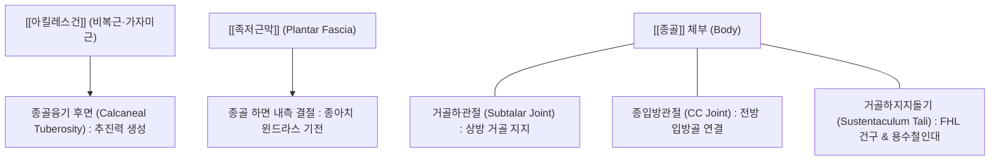
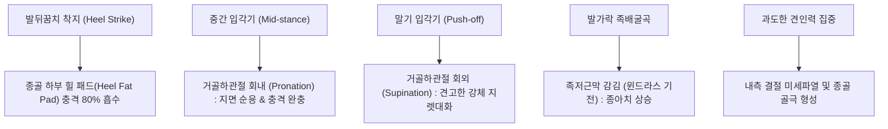

# 🦴 [[종골]] (Calcaneus, 발꿈치뼈)

> **핵심 요약 (Key Summary)**:
> 족부(Foot)의 후하방을 형성하는 족근골 중 가장 크고 단단한 단골(Short bone)로, 기립 및 보행 시 발뒤꿈치 착지(Heel strike) 충격을 최초로 흡수하는 인체의 '후방 주춧돌'입니다.
> 후방에는 인체 최강의 건인 [[아킬레스건]](Achilles tendon, 종골건)이 정지하여 강력한 보행 추진력을 생성하고, 하면 내측 결절에서는 [[족저근막]](Plantar fascia)이 기시하여 족부 종아치(Longitudinal arch)와 윈드라스 기전을 형성합니다.
> 내측면의 거골하지지돌기(Sustentaculum tali)는 [[거골]](Talus)을 받쳐주며 장모지굴근건의 도르래 역할을 수행합니다. 족저근막염, 종골 골극(Calcaneal spur), 종골 피로골절 및 보일러각(Böhler's angle) 편평화를 동반하는 관절내 골절의 주 발생 부위이며, 곤륜(BL60), 태계(KI3), 수천(KI5)을 중심으로 한 침도·약침 치료 및 거골하관절 교정 추나의 핵심 표적입니다.

---

## 1. 개요 및 해부학적 위치

[[종골]](Calcaneus)은 족부의 가장 뒤쪽 아래에 위치하여 발뒤꿈치 융기(Heel)를 형성하는 불규칙한 직육면체 모양의 거대한 뼈입니다.

상면으로는 거골과 3개의 관절면을 통해 거골하관절을 이루어 발목의 내번과 외번 운동을 허용하고, 전면으로는 [[입방골]](Cuboid)과 종입방관절을 형성하여 족부 외측 종아치의 기초를 구축합니다.

---

## 2. 골성 지표 및 구조적 특징

종골은 인체 체중 부하를 견디고 강력한 건과 인대를 지지하기 위해 독특한 돌기와 선반 구조를 지닙니다.

| 골성 지표명 | 형태학적 특징 및 위치 | 부착 구조물 및 임상 의의 |
| :--- | :--- | :--- |
| **종골융기 (Calcaneal tuberosity)** | 종골 후방으로 거대하게 돌출된 둥근 융기 | [[아킬레스건]] 및 족척근 정지; 보행 시 추진력 생성 지렛대 팔 |
| **내측 결절 (Medial process/tubercle)** | 종골 하면의 넓고 체중을 직접 받는 결절 | **[[족저근막]](Plantar fascia)** 및 단지굴근 기시 (족저근막염 호발지) |
| **외측 결절 (Lateral process/tubercle)** | 종골 하면 외측의 작은 돌출부 | 소지외전근 기시 |
| **거골하지지돌기 (Sustentaculum tali)** | 종골 내측면에서 수평 선반처럼 돌출된 골편 | 상면은 거골 중관절면 지탱, 하면은 [[장모지굴근]](FHL) 건구, 용수철인대 부착 |
| **비골도르래 (Peroneal trochlea)** | 종골 외측면의 작은 골성 융기 | 장·단비골근 건이 상하로 갈라져 주행하는 도르래 역할 |
| **보일러 각 (Böhler's angle)** | 종골 결절 최고점-후관절면-전돌기를 잇는 각도 | 정상 20~40°; 종골 골절 시 편평화(<20°)되어 관절 함몰 지표로 활용 |

---

## 3. 부착 근육 및 인대 복합체

종골은 하퇴 후면의 표층 굴곡근과 발바닥 심부 내재근들이 만나는 거대한 근막 허브입니다.

1. **정지 근육 (강력한 족저굴곡)**:
   - [[아킬레스건]](Achilles tendon): [[비복근]]과 [[가자미근]]의 연합건으로 종골융기 후면 중앙부에 부착하여 보행 및 도약 시 발뒤꿈치를 폭발적으로 들어 올립니다.
   - 족척근(Plantaris): 아킬레스건 내측을 따라 종골 후내측에 정지합니다.
2. **기시 근육군 및 족저건막**:
   - **[[족저근막]](Plantar fascia)**: 내측 결절에서 부채꼴로 기시하여 5개 발가락 기저부로 주행하는 두꺼운 섬유성 띠입니다.
   - 단지굴근(FDB) 및 모지외전근: 내측 결절에서 기시합니다.
   - 소지외전근: 외측 결절에서 기시합니다.
   - 족저방형근(Quadratus plantae): 종골 하면 내·외측에서 기시하여 장지굴근 건의 사선 견인력을 직선화합니다.
3. **인대 복합체**:
   - **용수철인대(Spring lig., 저측종주상인대)**: 거골하지지돌기에서 주상골로 주행하여 거골두를 바닥에서 떠받치는 인체 족궁의 핵심 인대입니다.
   - 종비인대(CFL): 종골 외측면에 부착하여 발목 외측 관절을 지지합니다.

---

## 4. 생체역학 및 운동학적 기능

종골은 발꿈치 충격 흡수와 발바닥 윈드라스(Windlass) 지렛대 기전의 중심축입니다.

1. **지면 충격 완충 (Shock Absorption)**:
   - 보행 시 체중의 약 1.5~2배, 달리기 시 3~5배의 충격이 종골융기에 가해집니다. 종골 하면의 두터운 격벽성 지방 패드(Heel pad)와 탄성 해면골 구조가 이 충격을 효과적으로 흡수합니다.
2. **거골하관절 삼평면 운동 (Subtalar Joint Triplanar Motion)**:
   - 거골하관절의 회내(Pronation: 외번+외전+배굴)는 족부를 유연하게 만들어 불규칙한 지면에 적응하게 하고, 회외(Supination: 내번+내전+저굴)는 족근골들을 단단히 결속시켜 추진력을 극대화하는 강체 레버(Rigid lever)로 전환시킵니다.

---

## 5. 임상적 의의 및 관련 질환

1. **족저근막염 (Plantar Fasciitis) 및 종골 골극 (Calcaneal Spur)**:
   - 종골 내측 결절 부착부의 반복적인 과신장과 미세 손상으로 인한 무균성 퇴행성 염증입니다. 아침에 일어나 첫발을 디딜 때 발뒤꿈치 내측에 찢어지는 듯한 통증이 발생하며, 견인 스트레스가 만성화되면 골막 반응으로 뾰족한 종골 골극이 자라납니다.
2. **아킬레스건염 및 후종골 점액낭염 (Retrocalcaneal Bursitis)**:
   - 아킬레스건 종골 부착부 직상방의 점액낭에 발생하는 염증으로 뒤꿈치 후방의 압통과 종창을 초래합니다.
3. **세버병 (Sever's Disease, 종골 골단염)**:
   - 8~12세 성장기 청소년 운동선수에서 종골 골화 중심과 아킬레스건 견인력 사이의 불일치로 발생하는 견열성 골연골염입니다.
4. **종골 골절 (Calcaneus Fracture)**:
   - 고소 추락이나 낙상으로 인한 고에너지 손상으로 거골이 쐐기처럼 종골을 부수어 분쇄 골절이 발생합니다. 보일러각(Böhler's angle)이 20° 미만으로 감소하며 거골하관절 손상으로 인한 외상성 관절염 위험이 높습니다.

---

## 6. 이학적 검사 및 감별 진단

1. **윈드라스 검사 (Windlass Test)**:
   - 환자가 체중을 부하한 상태에서 검사자가 엄지발가락을 수동적으로 강하게 족배굴곡시킵니다.
   - 종골 내측 결절 부착부에 날카로운 당김 통증이 재현되면 족저근막염 양성입니다.
2. **종골 스퀴즈 검사 (Calcaneal Squeeze Test)**:
   - 양 손바닥으로 종골의 내측과 외측을 동시에 강하게 압박합니다.
   - 발꿈치 양측을 쥐어짤 때 뼈 심부에서 심한 통증이 유발되면 **종골 피로골절(Stress fracture)**을 강력히 시사합니다.
3. **감별 진단**:
   - **족근관 증후군(Tarsal Tunnel Syndrome)**: 내과 하방 압박 시 발바닥 전체로 저림증이 방산되며(Tinel 징후), 단순 종골 내측 결절 압통과는 감각 이상 유무로 구별됩니다.

---

## 7. 한의학적 임상 응용 및 치료

종골 주변은 족태양방광경과 족소음신경이 교차하며 족근통(足跟痛)을 치료하는 최고 명혈들이 집중 배치된 구역입니다.

1. **침구 치료 및 대표 경혈**:
   - **곤륜(BL60)**: 외과 첨부와 아킬레스건 사이 함요처로 방광경의 경화혈(經火穴)이며 아킬레스건 후방 긴장과 종골 후면 통증을 가라앉힙니다.
   - **태계(KI3)**: 내과 첨부와 아킬레스건 사이 함요처로 신경의 원혈(原穴)이며 신음(腎陰)을 보하여 건골막 재생을 촉진합니다.
   - **수천(KI5)**: 태계혈 직하 1촌, 종골 결절 전상방 함요처로 족저근막염 발뒤꿈치 통증의 대표적인 특효혈입니다.
   - **조해(KI6)**: 내과 직하 1촌으로 거골하지지돌기 상방에서 족부 내측 종아치를 안정화합니다.
2. **소침도(Acupotomy) 족저근막 골막 박리술**:
   - 만성 난치성 족저근막염 및 종골 골극 환자에서, 침도를 종골 내측 결절 압통점에 골막에 닿을 때까지 수직 자입하여 비후된 족저근막 기시부 섬유와 골막 유착대를 종방향으로 미세 박리함으로써 건막 내압을 감압하고 혈류를 개선합니다.
3. **추나요법 (Chuna Subtalar Mobilization)**:
   - **거골하관절 내번/외번 가동술**: 거골을 한 손으로 견고히 고정하고 다른 손으로 종골을 파지하여 외번 및 내번 방향으로 부드럽게 글라이딩시켜 관절 가동 범위를 복원합니다.
   - **힐 패드 테이핑 요법**: 종골 하부 지방 패드를 중앙으로 모아주는 테이핑을 적용하여 보행 충격을 완화합니다.
4. **약침 및 봉약침 치료**:
   - 종골 내측 결절 압통점 및 후종골 점액낭에 [[봉약침]] 또는 [[신바로약침]]을 0.3~0.5ml 주입하여 만성 무균성 염증을 억제하고 콜라겐 리모델링을 촉진합니다.

---

## 8. 참고문헌

* Barnett JR. (2026). Does the presence of calcaneal spurs with associated oedema in plantar fasciitis affect the outcome of shockwave therapy? *Foot (Edinb)*. PMID: 42379017

* Zhu G. (2020). A Radiographic Study of Biomechanical Relationship between the Achilles Tendon and Plantar Fascia. *Biomed Res Int*. PMID: 32149113
