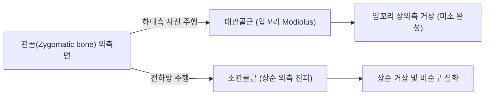

# 🫁 [[관골근]] (Zygomaticus Muscle Group)

> **핵심 요약 (Key Summary)**:
> [[관골근]](Zygomaticus)은 관골(Zygomatic bone) 외측면에서 기시하여 입꼬리(Modiolus) 및 상순에 정지하는 안면 표정근의 대표적 미소 근육군이다.
> 대관골근(Zygomaticus major)과 소관골근(Zygomaticus minor)으로 구성되며, [[안면신경]](CN VII)의 협부 및 관자가지의 지배를 받아 **입꼬리를 상외측으로 당겨 진정한 미소(Duchenne smile)를 형성**하고 비순구를 심화시킨다.
> 임상적으로는 [[안면신경마비]](구안와사), 구각 처짐, 비대칭 미소, 안면신경 재생 후 연합운동(Synkinesis)의 핵심 병변근이며, 한의 치료에서는 거료·사백·[[지창(地倉)|지창]] 부위 전침, 매선 및 도침 미세 박리가 주된 표적이다.

---
## 📌 목차
1. [해부학적 정밀 구조 및 지배 신경/혈관](#1-해부학적-정밀-구조-및-지배-신경혈관)
2. [생체역학·토크 분석 & 근막 사슬 (Biomechanical Synergy)](#2-생체역학토크-분석--근막-사슬-biomechanical-synergy)
3. [근막통증증후군(TP) & 연관통 패턴 (Travell & Simons)](#3-근막통증증후군tp--연관통-패턴-travell--simons)
4. [초음파 해부학(Sonoanatomy) 및 중재 시술 랜드마크](#4-초음파-해부학sonoanatomy-및-중재-시술-랜드마크)
5. [⭐ 원장님 심층 임상 고찰 및 원본 필기 (Clinical Pearls)](#5-원장님-심층-임상-고찰-및-원본-필기-clinical-pearls)
6. [관련 임상 질환 및 운동손상 증후군 총괄](#6-관련-임상-질환-및-운동손상-증후군-총괄)
7. [추나·도수치료(MET/PIR) & 침구·약침·재활 프로토콜](#7-추나도수치료metpir--침구약침재활-프로토콜)
8. [출처 및 학술 참고 문헌 (References)](#8-출처-및-학술-참고-문헌-references)

---
## 1. 해부학적 정밀 구조 및 지배 신경/혈관

| 항목 | 상세 내용 |
| :--- | :--- |
| **기시 (Origin)** | • **대관골근 (Zygomaticus major)**: 관골(Zygomatic bone) 외측면의 관골측두봉합 전방 • **소관골근 (Zygomaticus minor)**: 관골 상악봉합 부근 전면 (대관골근 기시부의 전내측) |
| **정지 (Insertion)** | • **대관골근**: 입꼬리 결절(구각 Modiolus) 및 [[구륜근]] 섬유와 교차 융합 • **소관골근**: 상순(윗입술) 외측 진피 및 비순구(Nasolabial fold) 피하 |
| **신경 지배** | [[안면신경]](Facial nerve, **CN VII**)의 협부 가지(Buccal branches) 및 관자가지(Zygomatic branches) |
| **혈관 공급** | 안면동맥(Facial artery) 및 횡안면동맥(Transverse facial artery)의 분지 |
| **해부학적 변이** | 대관골근의 이분지 변이(Bifid zygomaticus major): 인구의 약 30%에서 관찰되며 보조개(Dimple) 형성과 밀접한 관련(Pessa 1998) |

### 🔬 해부학 도해 및 단면도

관골근은 광대뼈에서 시작하여 비스듬히 하내측으로 주행하여 입꼬리에 도달하는 표층 안면 표정근이다. 천층근막계(SMAS) 내에 위치하며, 하부의 협근(Buccinator) 및 안면동맥·정맥과 근접하여 교차한다.

---
## 2. 생체역학·토크 분석 & 근막 사슬 (Biomechanical Synergy)

* **진정한 미소 형성 (Duchenne Smile Engine)**:
  * 대관골근이 수축하면 구각(Modiolus)을 상외측(위뒤쪽)으로 40~45도 각도로 강하게 당겨 올린다.
  * 안륜근(Orbicularis oculi)의 외측 섬유 수축과 동반되어 눈가 주름(Crow's feet)과 광대 융기가 함께 나타날 때 인간 고유의 감정적 진실 미소(Duchenne smile)가 완성된다.
* **상순 거상 보조 (소관골근)**:
  * 윗입술 외측을 수직으로 들어 올려 상악 절치 및 치경부를 노출시키고 비순구 상부를 뚜렷하게 만든다.
* **구각 결절(Modiolus)의 역학적 허브**:
  * 구각에서는 대관골근, [[구각거근]], [[구각견근]](소근), [[구각하제근]], [[구륜근]], 협근 등 6개 이상의 표정근이 한 점으로 결합하여 3차원적 구강 개폐 압력 평형을 유지한다.

---
## 3. 근막통증증후군(TP) & 연관통 패턴 (Travell & Simons)

* **발통점 위치**: 관골 하연 직하방의 대관골근 근복 중간부 또는 구각 결절 부착부에 형성된다.
* **연관통 양상**:
  * 광대뼈 하부 및 협부(뺨) 부위의 뻐근하고 당기는 듯한 둔통.
  * 활짝 웃거나 말을 많이 할 때 광대 부위의 경련성 쥐내림 또는 피로감.
  * 상악 치아 부위로 둔한 가성 통증이 방사될 수 있다.

---
## 4. 초음파 해부학(Sonoanatomy) 및 중재 시술 랜드마크

* **초음파 스캔 프로토콜**:
  * 관골체에서 구각을 잇는 사선 방향으로 선형 고주파 프로브(15~18MHz)를 거치.
  * 진피 직하방 고에코의 SMAS층 내에서 얇은 저에코 띠 형태로 주행하는 대/소관골근 섬유 관찰.
* **안전 마진 및 중재 시술 랜드마크**:
  * **안면동맥(Facial artery)**: 대관골근 심층 또는 전연을 따라 주행하므로 도플러를 켜서 혈류를 확인한 후 시술.
  * **안면신경 협부분지(Buccal branches)**: 대관골근 심층을 통과하여 표정근으로 진입하므로 무리한 심부 맹검 자침 회피.

---
## 5. ⭐ 원장님 심층 임상 고찰 및 원본 필기 (Clinical Pearls)

> 원장님의 임상 필기와 독창적인 임상 노하우를 100% 보존한 핵심 지침이다.

### 1) 구안와사(Bell's Palsy) 후유증과 비대칭 미소 (원장님 팁)
* 안면신경마비 환자에서 가장 먼저 회복을 관찰해야 하는 핵심 지표 근육이다.
* 마비 측 관골근이 약화되면 건측(정상 측)으로 입꼬리가 심하게 끌려가는 **구각 편위**가 발생한다.
* 치료 시 마비 측 거료·사백·지창 혈위 매선 및 심부 전침 자극을 통해 관골근의 수축 장력을 재활성화하는 것이 안면 대칭 회복의 제1단계이다.

### 2) 표정근 연합운동(Synkinesis)과 근긴장 이상 (원장님 팁 100% 보존)
* 안면신경 재생 과정에서 미만성 축삭 재배치로 인해, 눈을 깜빡일 때 입꼬리가 같이 실룩거리거나 웃을 때 눈이 감기는 **연합운동(Synkinesis)**이 발생한다.
* 이때 관골근의 섬유화 및 비정상적 과긴장 섬유를 도침으로 미세 박리(micro-dissection)하여 근막 유착을 분리하고 정상적인 독립적 표정 운동을 유도한다.

---
## 6. 관련 임상 질환 및 운동손상 증후군 총괄

| 임상 질환 / 증후군 | 병리적 연관 기전 | 주요 증상 및 이학적 검사 | 핵심 교정 타깃 |
| :--- | :--- | :--- | :--- |
| [[안면신경마비]] (Bell's palsy) | 안면신경(CN VII) 염증·허혈로 인한 관골근 마비 | 미소 시 환측 입꼬리 불능, 건측 구각 편위 | 거료·지창 전침, 매선 침구 치료 |
| 표정근 연합운동 (Synkinesis) | 신경 손상 후 비정상적 교차 신경재생 | 눈 깜빡임 시 입꼬리 동반 경련(실룩거림) | 관골근 기시부 도침 미세 박리 |
| 반측 안면경련 (Hemifacial spasm) | 뇌신경(CN VII) 혈관 압박에 의한 과흥분 | 불수의적 광대 및 입꼬리 수축 경련 | 풍지·태양·관골부 약침 및 침구 |
| 구각 하수 및 마리오네트 주름 | 관골근 위축 및 탄력 저하, 하제근 우세 | 입꼬리 처짐, 우울하고 피로한 인상 | 관골근 탄력 강화 매선 및 MET |

---
## 7. 추나·도수치료(MET/PIR) & 침구·약침·재활 프로토콜

* **한의학 경혈 매핑**:
  * 거료(ST3), 사백(ST2): 대/소관골근 기시부 직하방 취혈.
  * [[지창(地倉)|지창(ST4)]]: 구각 결절(Modiolus) 정지부 표적.
  * 협거: 협근 및 저작근 긴장 조절.
  * [[풍지(GB20)|풍지(GB20)]]: 안면신경 본간 순환 촉진.
* **침구 및 수기 프로토콜**:
  * 광대뼈 하연 관골근 기시부 도침술을 통한 근막 유착 박리.
  * 안면 근막 추나(Facial myofascial release): 광대뼈에서 입꼬리 방향으로 주행을 따라 엄지 또는 검지 패드로 가볍게 견인 이완.
* **양방 치료 및 의뢰 기준 (Red Flags)**:
  * **급성 안면마비 발병 72시간 이내**: 신경 손상 최소화를 위해 이비인후과/신경과 고용량 경구 스테로이드(Prednisolone) 병용 의뢰.
  * **이통 및 외이도 수포 동반 (Ramsay Hunt 증후군)**: 대상포진 바이러스 감염으로 즉각적인 항바이러스제(Acyclovir/Famciclovir) 투여 의뢰.
  * **안구 폐쇄 불능에 따른 각막 노출**: 각막염 및 궤양 예방을 위한 안과 협진(인공눈물, 테이핑, 안연고 처방).

---
## 8. 출처 및 학술 참고 문헌 (References)

1. Pessa, J. E., Zadoo, V. P., & Garza, P. A. (1998). Double or bifid zygomaticus major muscle: anatomy, incidence, and clinical correlation. *Clin Anat*, 11(5), 310-313. [PMID: 9725574](https://pubmed.ncbi.nlm.nih.gov/9725574/)

2. Sakuma, H., Matoba, E., & Fujii, T. (2026). Dynamic augmentation of lip levator function via depressor anguli oris transfer for post-facial paralysis synkinesis. *JPRAS Open*, 49, 10-18. [PMID: 42099755](https://pubmed.ncbi.nlm.nih.gov/42099755/)

3. Standring, S. (2020). *Gray's Anatomy: The Anatomical Basis of Clinical Practice* (42nd ed.). Elsevier, p. 531.

4. Duchenne, G. B. (1990). *The Mechanism of Human Facial Expression*. Cambridge University Press, pp. 85-92.
