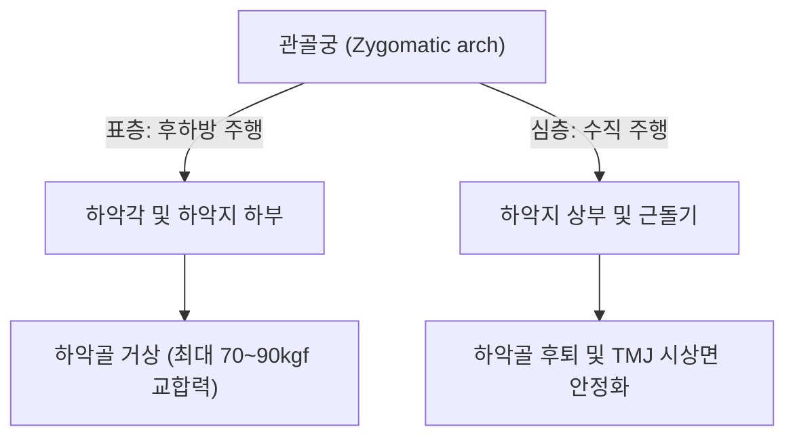
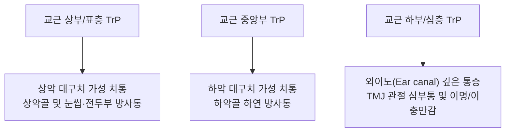

# 🫁 [[교근]] (Masseter)

> **핵심 요약 (Key Summary)**:
> [[교근]](Masseter)은 관골궁(Zygomatic arch) 하연 및 내측면에서 기시하여 하악각 및 하악지 외측면에 정지하는 인체 최강의 단위면적당 저작 근육이다.
> [[5. 삼차신경|삼차신경]](CN V3) 하악신경 교근가지의 지배를 받으며, **하악골 거상(강력한 폐구), 저작력 발휘 및 턱관절(TMJ)의 시상면 안정성**을 유지한다.
> 임상적으로는 [[턱관절 통증|턱관절 장애(TMD)]], [[이갈이]](Bruxism), 사각턱 비대(Masseteric hypertrophy), 긴장성 편두통, 치아 마모의 핵심 병변근이며, 한의 치료에서는 협거·하관·대영혈 침구, 심부 전침 및 도침 치료가 핵심 표적이다.

---
## 📌 목차
1. [해부학적 정밀 구조 및 지배 신경/혈관](#1-해부학적-정밀-구조-및-지배-신경혈관)
2. [생체역학·토크 분석 & 근막 사슬 (Biomechanical Synergy)](#2-생체역학토크-분석--근막-사슬-biomechanical-synergy)
3. [근막통증증후군(TP) & 연관통 패턴 (Travell & Simons)](#3-근막통증증후군tp--연관통-패턴-travell--simons)
4. [초음파 해부학(Sonoanatomy) 및 중재 시술 랜드마크](#4-초음파-해부학sonoanatomy-및-중재-시술-랜드마크)
5. [⭐ 원장님 심층 임상 고찰 및 원본 필기 (Clinical Pearls)](#5-원장님-심층-임상-고찰-및-원본-필기-clinical-pearls)
6. [관련 임상 질환 및 운동손상 증후군 총괄](#6-관련-임상-질환-및-운동손상-증후군-총괄)
7. [추나·도수치료(MET/PIR) & 침구·약침·재활 프로토콜](#7-추나도수치료metpir--침구약침재활-프로토콜)
8. [출처 및 학술 참고 문헌 (References)](#8-출처-및-학술-참고-문헌-references)

---
## 1. 해부학적 정밀 구조 및 지배 신경/혈관

| 항목 | 상세 내용 |
| :--- | :--- |
| **기시 (Origin)** | • **표층 (Superficial layer)**: 관골궁(Zygomatic arch) 하연 전방 2/3 (사선 방향 주행) • **심층 (Deep layer)**: 관골궁 하연 후방 1/3 및 관골궁 내측면 전체 (수직 방향 주행) |
| **정지 (Insertion)** | • **표층**: 하악각(Angle of mandible) 외측면 및 하악지 하반부 외측면 (후하방 사선) • **심층**: 하악지(Mandibular ramus) 상반부 외측면 및 근돌기(Coronoid process) 외측 기저부 |
| **신경 지배** | [[5. 삼차신경|삼차신경]](Trigeminal nerve, **CN V3**) 전지 분지인 교근신경(Masseteric nerve) — 하악절흔(Mandibular notch)을 넘어 교근 심면으로 진입 |
| **혈관 공급** | 악동맥(Maxillary artery)의 교근동맥(Masseteric artery) 및 안면동맥의 턱밑가지, 횡안면동맥 |
| **근막 슬링 구조** | [[내익상근]](Medial pterygoid)과 함께 하악각을 안팎에서 감싸 **익돌교근 슬링(Pterygomasseteric sling)**을 형성하여 강력한 교합력을 지지 |

### 🔬 해부학 도해 및 단면도

교근은 턱의 바깥쪽 각도를 두껍게 감싸며 위아래로 강력한 수직 교합력을 생성하는 메인 파워하우스이다. 이하선(Parotid gland) 전연과 이하선관(Stensen's duct)이 교근 표면을 수평으로 가로지르며, 안면신경의 협부분지와 횡안면동맥이 나란히 주행한다.

---
## 2. 생체역학·토크 분석 & 근막 사슬 (Biomechanical Synergy)

* **강력한 하악골 거상 (Mandibular Elevation / Jaw Closure)**:
  * 치아를 꽉 다물어 단단한 음식물을 분쇄하는 핵심 교합력 생성 (최대 70~90kgf, 성인 최대 저작력의 중심).
* **하악골 전방 및 후방 견인 (Protraction & Retraction)**:
  * 표층 섬유는 턱을 전상방으로 당기고, 심층 섬유는 턱을 후상방으로 당겨 턱관절 관절원판(디스크)과 과두의 정렬을 동적으로 안정화.
* **측방 연삭 운동 보조 (Lateral Grinding)**:
  * 반대측 [[내익상근]], 동측 [[측두근]]과 교차 수축하여 맷돌질 동작 완성.
* **근막 사슬 연계 (Anatomy Trains)**:
  * 교근은 두경부 저작근막을 거쳐 경추 심부 굴근군 및 흉쇄유돌근, 상부 승모근막과 기능적 긴장 연쇄를 이룬다.

---
## 3. 근막통증증후군(TP) & 연관통 패턴 (Travell & Simons)

* **발통점 위치 및 연관통 특징**:
  * **표층 상부 TrP**: 상악 대구치(윗 어금니)로 통증을 방사하여 치과적 이상이 없는데도 극심한 치통을 유발(가성 치통).
  * **표층 중앙 TrP**: 하악 대구치(아래 어금니)와 아래턱으로 뻐근한 연관통 방사.
  * **심층 상부/하부 TrP**: 외이도(귓구멍 안쪽) 깊은 곳과 TMJ 관절 부위로 통증을 방사하여 원인 모를 이명, 귀 먹먹함(이충만감) 유발.

---
## 4. 초음파 해부학(Sonoanatomy) 및 중재 시술 랜드마크

* **초음파 스캔 프로토콜**:
  * **프로브 위치**: 하악각과 관골궁 사이 교근 근복에 선형(12~18MHz) 프로브를 단축 및 종축으로 거치.
  * **소견**: 표층의 두꺼운 고에코 근막 및 내부 중간건막(Intramuscular tendon), 심층의 수직 섬유 다발 확인.
* **안전 마진 및 시술 랜드마크**:
  * **이하선(Parotid gland) 및 이하선관(Stensen's duct)**: 교근 후방 1/3을 덮는 이하선을 확인하고, 관골궁 하방 1.5cm에서 주행하는 이하선관을 회피.
  * **안면신경 협부가지 및 안면동맥**: 교근 전연 하악절흔 부위에서 도플러로 박동성 혈류를 확인하여 도침 및 전침 시술 시 손상 방지.

---
## 5. ⭐ 원장님 심층 임상 고찰 및 원본 필기 (Clinical Pearls)

> 원장님의 독창적인 임상 팁과 노하우를 100% 보존한 핵심 지침이다.

### 1) 턱관절 장애(TMD)와 이갈이(Bruxism) 연쇄 사슬 (원장님 팁)
* 야간 이갈이나 스트레스성 악물기(Clenching)로 교근이 과긴장되면 하악과두(Condyle)가 관절와(Glenoid fossa)를 강하게 압박하여 TMJ 관절원판(디스크) 전방 전위 및 관절음(Click sound)을 유발한다.
* 교근 긴장은 [[측두근]], [[내익상근]], 상부 승모근으로 이어지는 연쇄적 두경부 근막통증증후군(MPS)의 시발점이 된다.

### 2) 사각턱 비대와 하악골 후방 이동 (원장님 팁 100% 보존)
* 저작근 과사용으로 인한 근비대(Masseter hypertrophy)는 안면 비대칭과 사각턱을 형성한다.
* 협거혈-하관혈 심부 전침 및 도침 치료로 근긴장을 완화하고 비대해진 중간 건막 유착을 감압하여 안면 윤곽 교정 및 TMJ 관절 내압을 낮춘다.

---
## 6. 관련 임상 질환 및 운동손상 증후군 총괄

| 임상 질환 / 증후군 | 병리적 연관 기전 | 주요 증상 및 이학적 검사 | 핵심 교정 타깃 |
| :--- | :--- | :--- | :--- |
| [[턱관절 통증|턱관절 장애(TMD)]] | 교근 과긴장 및 하악과두 압박 | 개구 장애(개구량 저하), 관절잡음, 저작통 | 협거·하관 도침 및 TMJ 수기 추나 |
| [[이갈이]] (Bruxism) | 중추신경계 각성 및 저작근 긴장 항진 | 야간 치아 마모, 기상 시 턱 뻐근함, 두통 | 교근 이완, 스트레스 완화 한약 |
| 사각턱 비대 (Hypertrophy) | 장기적 저작 과사용 및 이갈이 | 하악각 부위 비대칭, 외측 융기 | 협거 심부 전침 및 도침 감압 |
| 긴장성 두통 / 가성 치통 | 교근 TrP에 의한 상/하악골 및 측두부 방사통 | 원인 불명의 어금니 통증, 편두통 유사 증상 | 교근 표층/심층 TrP 허혈성 압박 |

---
## 7. 추나·도수치료(MET/PIR) & 침구·약침·재활 프로토콜

* **한의학 경혈 매핑**:
  * 협거(ST6): 하악각 전상방 교근 융기부 정중앙 취혈.
  * 하관(ST7): 관골궁 하연 하악절흔 부위 심층 교근 표적.
  * 대영(ST5): 교근 전연 안면동맥 박동 부위 외측.
  * [[풍지(GB20)|풍지(GB20)]], [[합곡(LI4)|합곡(LI4)]]: 저작근 긴장성 두통 및 삼차신경 조절.
* **침구 및 수기 프로토콜**:
  * 협거(ST6), 하관(ST7) 심부 직자 및 저주파 전침 자극(2Hz, 근수축 유도).
  * 하악각 부착부 및 관골궁 하연 도침술(교근 근막 유착 박리 및 감압).
  * TMJ 관절 구강 내 수기 추나(Intraoral TMJ decompression): 엄지손가락으로 하악 대구치를 하방으로 견인하며 교근을 신장.
* **양방 치료 및 의뢰 기준 (Red Flags)**:
  * **급성 개구 장애(개구량 20mm 이하, Close lock)**: 관절원판 완전 전위 또는 유착 의심 시 구강악안면외과 턱관절 MRI 및 스플린트/관절강 세척술 의뢰.
  * **발열, 홍반 및 급성 하악 종창**: 교근 공간 감염(Masseteric space abscess) 또는 악하선/이하선 화농성 염염 의심 시 즉시 응급 항생제 치료 및 배농 의뢰.
  * **외상 후 교합 급변 및 부정교합**: 하악골 과두 골절 의심 시 즉시 안면 CT 의뢰.

---
## 8. 출처 및 학술 참고 문헌 (References)

1. Corcoran, N. M., & Varacallo, M. (2023). Anatomy, Head and Neck, Masseter Muscle. *StatPearls*. [PMID: 30969691](https://pubmed.ncbi.nlm.nih.gov/30969691/)

2. Spilz, A., Schwahn, C., & Krey, K. F. (2026). Multiparametric Ultrasonographic Phenotyping of the Masseter Muscle in Temporomandibular Disorders and Clinically Defined Probable Bruxism. *J Dent Res*, 105(3), 245-253. [PMID: 42427073](https://pubmed.ncbi.nlm.nih.gov/42427073/)

3. Standring, S. (2020). *Gray's Anatomy: The Anatomical Basis of Clinical Practice* (42nd ed.). Elsevier, pp. 548-549.

4. Travell, J. G., & Simons, D. G. (1999). *Myofascial Pain and Dysfunction: The Trigger Point Manual*, Vol. 1 (2nd ed.). Williams & Wilkins.

5. Okeson, J. P. (2019). *Management of Temporomandibular Disorders and Occlusion* (8th ed.). Elsevier, pp. 145-160.
